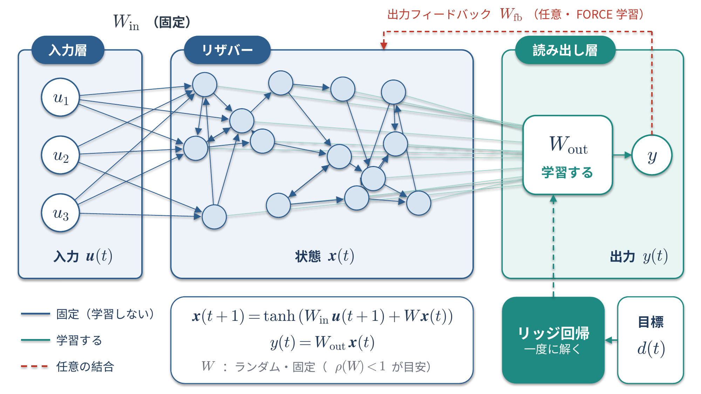
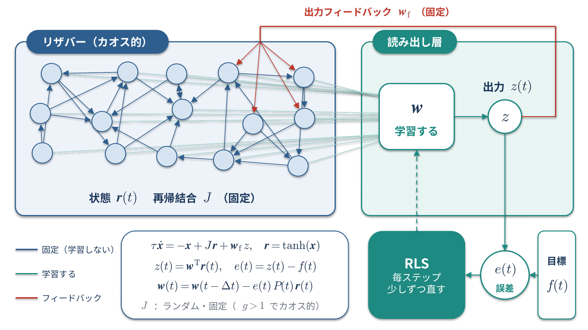

<!--
  コンパクト記事 no.1（草稿。公開前にこのコメントは削除）
  - 裏取り：Jaeger (2001) の ESN の技術レポート、Maass ら (2002) の LSM の論文、Sussillo & Abbott (2009)
  - 足したいもの：簡単な Python のコード（NumPy で ESN を組んで、sin 波を予測するくらい）
  - 図：image/01_リザバーのアーキテクチャ.pptx（生成スクリプトは image/図生成スクリプト.py）、image/02_FORCE学習のアーキテクチャ.pptx（no.6 の図1と同じ。生成スクリプトは image/図生成スクリプト_FORCE.py）
  - 関連：no.6 FORCE学習（リザバーの読み出しを学習するやり方の1つ）。「関連：FORCE学習」の節からリンク済み
-->

# リザバーコンピューティングとは

**中の再帰結合はランダムに作ったまま固定して、出力の重み（読み出し）だけを学習する**RNNの作り方です。つまりRNNの一種であるということ。

# 前提：リカレントニューラルネットワーク（RNN）

リザバーコンピューティングは RNN の一種なので、先に RNN をおさらいしておきます。

RNN は、**自分の出力（隠れ状態）を次の時刻の入力に戻す結合（再帰結合）を持つ**ニューラルネットワークです。
ひとつ前の状態を持ち越しながら計算するので、文章・音声・センサーデータのような時系列を扱えます。

```math
h(t) = \tanh\left(W_{in}\,u(t) + W\,h(t-1)\right), \qquad y(t) = W_{out}\,h(t)
```

| 記号 | 意味 |
| --- | --- |
| $`u(t)`$ | 時刻 $`t`$ の入力 |
| $`h(t)`$ | 隠れ状態（過去の入力の情報を持ち越したもの） |
| $`W_{in}, W, W_{out}`$ | 入力・再帰・出力の重み |

ふつうの RNN は、この3つの重みを**全部**学習します。

# RNNの学習はなぜ重いのか？

RNN の学習には、時間方向に展開したネットワークで誤差を過去へさかのぼって伝える、BPTT（Backpropagation Through Time）を使います。

- 系列が長いほど、さかのぼる計算とメモリが増える
- 同じ $`W`$ を何度も掛けるので、勾配が消える（勾配消失）か、爆発する（勾配爆発）ことがある
- 結果として、学習が不安定で時間もかかる

この「$`W`$ を学習するのが大変」という問題を、**そもそも $`W`$ を学習しない**ことで避けたのがリザバーコンピューティングです。

# 仕組み

リザバーコンピューティングは、次の3つの層でできています。


*図1：リザバーコンピューティングの構成。紺の結合（$`W_{in}`$、$`W`$）はランダムに作って固定し、緑の読み出し $`W_{out}`$ だけをリッジ回帰で学習する。赤の破線の出力フィードバックは任意*

| 層 | 中身 | 学習するか |
| --- | --- | --- |
| 入力層 | 入力 $`u(t)`$ をリザバーへ渡す重み $`W_{in}`$ | しない（ランダムで固定） |
| リザバー | ランダムにつないだ大量のニューロン。重み $`W`$ | しない（ランダムで固定） |
| 読み出し層 | リザバーの状態 $`x(t)`$ から出力 $`y(t)`$ を作る重み $`W_{out}`$ | **する** |

代表的なモデルの Echo State Network（ESN）では、リザバーの状態を次のように更新します。

```math
x(t+1) = \tanh\left(W_{in}\,u(t+1) + W\,x(t)\right)
```

```math
y(t) = W_{out}\,x(t)
```

形は上の RNN とまったく同じで、違うのは**どの重みを学習するか**だけです。

学習の流れは次のとおりです。

1. 学習用の入力 $`u(t)`$ を流して、各時刻のリザバーの状態 $`x(t)`$ を記録する
2. 記録した状態を並べた行列 $`X`$ と、目標の出力を並べた行列 $`D`$ を作る
3. リッジ回帰で $`W_{out}`$ を一度に求める

```math
W_{out} = D\,X^\top \left(X X^\top + \beta I\right)^{-1}
```

$`\beta`$ は過学習を抑えるための正則化の強さです。
誤差を時間方向にさかのぼって伝える必要がないので、BPTT に比べて学習がとても軽くなります。

リザバーの役割は、入力を**高次元の状態に写して、過去の入力の情報を混ぜ込んでおくこと**です。
状態が十分に豊かなら、そこから欲しい出力を取り出すのは線形の読み出しだけで足ります。

# うまく動かすための条件

- リザバーが「過去の入力の影響が、時間がたつと薄れていく」性質（エコーステート性）を持っている必要がある
- そのための目安として、$`W`$ のスペクトル半径（固有値の絶対値の最大）を1より少し小さくすることが多い
  - ただし、これは目安で、エコーステート性を必ず保証する条件ではない

# 関連：FORCE学習

リザバーの読み出しを学習するやり方は、リッジ回帰だけではありません。
代表的なのが、Sussillo と Abbott が 2009 年に提案した **FORCE学習**です。


*図2：FORCE学習の構成。出力 $`z`$ をフィードバック $`w_f`$ でリザバーに戻しながら、目標 $`f(t)`$ との誤差 $`e(t)`$ を使って、読み出し $`w`$ を RLS で毎ステップ直す*

| | ふつうの ESN | FORCE学習 |
| --- | --- | --- |
| 学習のタイミング | 状態を全部集めてから一度に解く | 1ステップごとにオンラインで直す（再帰最小二乗法：RLS） |
| 出力のフィードバック | なくてもよい（図1の赤の破線） | あり（図2の赤の実線） |
| リザバーの動き | 落ち着いた動き（スペクトル半径 < 1 が目安） | わざとカオス的に動かす |

出力をリザバーに戻すと、出力の誤差もリザバーに戻ってしまい、動きがずれていきます。
FORCE学習は、**学習の最初から誤差を小さく抑え続ける**ことで、このフィードバックを安定させます。
FORCE学習の詳しい仕組みは、「[FORCE学習を簡単にまとめる](https://qiita.com/nico0748/items/4cb4fa4c0220aea6ddc4)」にまとめました。

# どこで使われているか

- 時系列の予測（カオス時系列、気象、センサーデータなど）
- **物理リザバーコンピューティング**：リザバーの部分を、ソフトウェアではなく物理系（光回路、スピントロニクス素子、やわらかい素材など）で置き換える研究
  - 中身を学習しないので、「入力に対して複雑に反応する物理系」なら何でもリザバーの候補になる

# 主なモデル

| モデル | 提案 | 特徴 |
| --- | --- | --- |
| Echo State Network（ESN） | Jaeger（2001） | 連続値のニューロンを使う |
| Liquid State Machine（LSM） | Maass ら（2002） | スパイキングニューロンを使う |

# まとめ

- RNN は時系列を扱えるけど、再帰の重み $`W`$ の学習（BPTT）が重くて不安定
- リザバーコンピューティングは、$`W_{in}`$ と $`W`$ をランダムで固定して、読み出し $`W_{out}`$ だけを学習する
- $`W_{out}`$ はリッジ回帰で一度に求まる。オンラインで学習したいときは FORCE学習のような方法もある

「全部を学習しないで、最後だけ学習する」という割り切りがリザバーコンピューティングの肝なのよ。
もっと分かりやすい例えがあれば、有識者の方教えて欲しいです！

# 参考

- H. Jaeger, "The 'echo state' approach to analysing and training recurrent neural networks", GMD Report 148, 2001
- W. Maass, T. Natschläger, H. Markram, "Real-time computing without stable states", Neural Computation, 2002
- M. Lukoševičius, "A Practical Guide to Applying Echo State Networks", Neural Networks: Tricks of the Trade, 2nd ed., 2012
- Y. Bengio, P. Simard, P. Frasconi, "Learning long-term dependencies with gradient descent is difficult", IEEE Transactions on Neural Networks, 1994
- D. Sussillo, L. F. Abbott, "Generating coherent patterns of activity from chaotic neural networks", Neuron, 63(4), 2009
