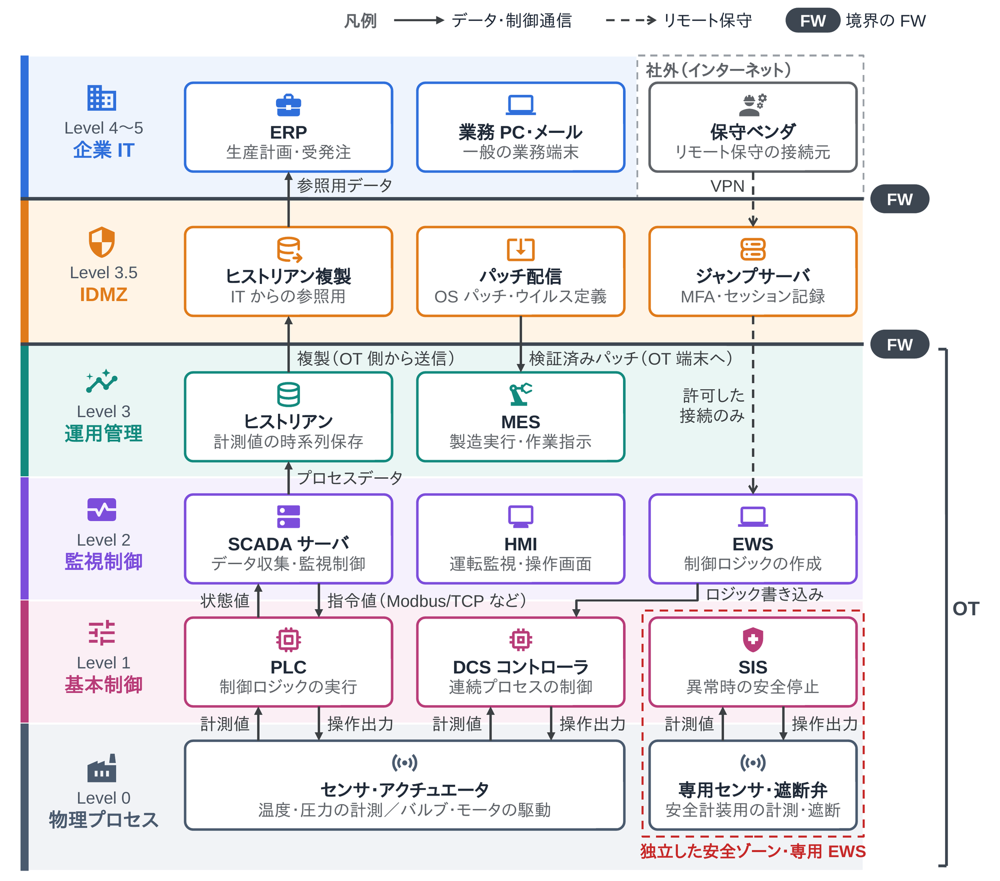
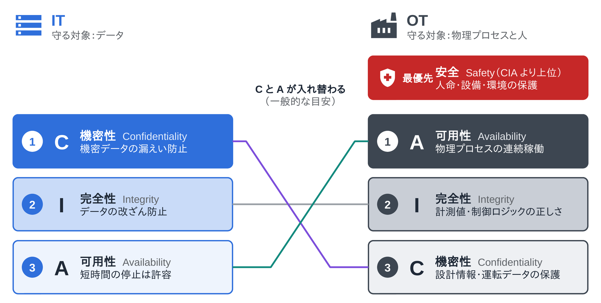
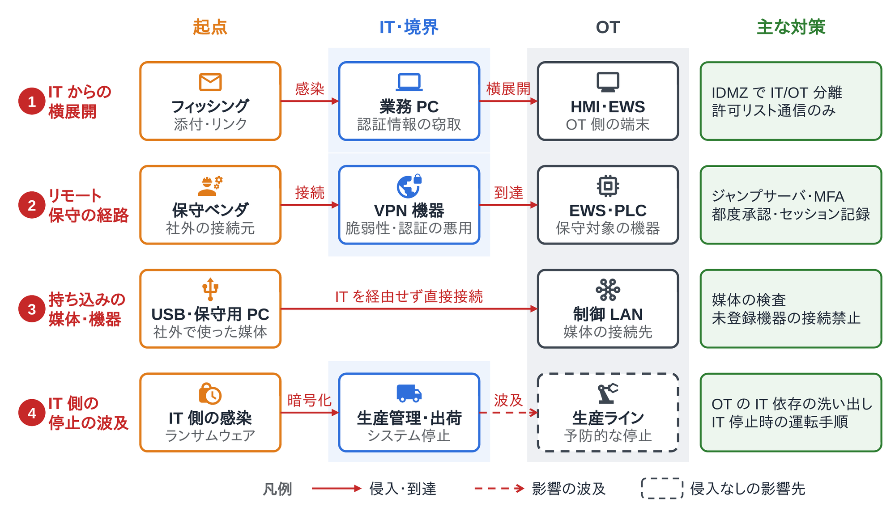

<!--
  コンパクト記事 no.25（草稿。公開前にこのコメントは削除）
  - 裏取り：NIST SP 800-82 Rev.3（2023-09）、ISA/IEC 62443、経済産業省「工場システムにおけるサイバー・フィジカル・セキュリティ対策ガイドライン」Ver1.0（2022-11）、各インシデントの公的報告（下の参考）
  - 図：image/01_パーデューモデルで見るITとOTのネットワーク構成、image/02_ITとOTのセキュリティの優先順位、image/03_OTに攻撃が届く主な経路と対策（pptx→png、生成スクリプトは image/zukai/）
  - 関連：no.29 OT-IDSのミラーリングポート（「見張る」側の話はそちらに回す）、no.5 C2サーバ
-->

# はじめに

OT セキュリティを調べていたら、IT と守るものの優先順位が逆だと知って驚きました。IT は機密性→完全性→可用性、OT は可用性→完全性→機密性。なぜそうなるのかも含めてまとめておきます。

# ひとことで言うと

**OT セキュリティは、工場・発電所・水道などで「モノを動かしている」制御システムを、サイバー攻撃から守るための考え方と対策**です。
IT と違って、守る対象の先に物理的な設備と人の安全があるので、「止めないこと」と「安全」が最優先になります。

# 前提：OT と ICS

OT（Operational Technology）は、物理的な設備やプロセスを監視・制御するハードウェアとソフトウェアのことです。NIST SP 800-82 Rev.3 では「物理環境とやりとりする（またはそれを行う機器を管理する）プログラム可能なシステムや機器」と定義されています。

OT の中心にあるのが ICS（Industrial Control System、産業制御システム）で、主な登場人物は次のとおりです。

| 名前 | 役割 |
|---|---|
| PLC（Programmable Logic Controller） | センサの値を読み、ラダーなどで書かれた制御ロジックでモータやバルブを動かす専用コンピュータ |
| DCS（Distributed Control System） | 化学プラントなど、連続プロセスを多数のコントローラで分散制御するシステム |
| SCADA（Supervisory Control And Data Acquisition） | 広い範囲（送電網、水道網など）に散らばった設備を集中監視・制御するシステム |
| HMI（Human Machine Interface） | 運転員が状態を見て操作する画面 |
| EWS（Engineering Workstation） | PLC や DCS コントローラのプログラムを作って書き込むための PC |
| ヒストリアン | プロセスの計測値を時系列で保存するデータベース |
| SIS（Safety Instrumented System） | 異常時に設備を安全側に止める安全計装システム |

# 構成：パーデューモデルで見る

OT のネットワークは、パーデューモデル（Purdue Enterprise Reference Architecture）の階層で説明されることが多いです。

| レベル | 中身 |
|---|---|
| Level 0 | センサ・アクチュエータ（物理プロセスそのもの） |
| Level 1 | PLC・DCS コントローラ・SIS（基本制御） |
| Level 2 | HMI・SCADA サーバ・EWS（監視制御） |
| Level 3 | ヒストリアン・MES（製造の運用管理） |
| Level 3.5 | IDMZ（IT と OT の間の緩衝地帯） |
| Level 4〜5 | ERP・メール・インターネット（企業の IT） |

ポイントは、**IT と OT の間に IDMZ を置いて、IT と OT が直接通信しないようにする**ことです。データは OT 側から IDMZ のヒストリアン複製へ送り、IT 側はそこを参照します。リモート保守も IDMZ のジャンプサーバで一度止めてから、許可した機器にだけつなぎます。
また、SIS は通常の制御系とは別の独立したゾーンに置き、専用の EWS で保守します。TRITON のように、安全計装まで乗っ取られると「最後の止める仕組み」がなくなるからです。

なお、Level 3.5（IDMZ）は 1990 年代に作られた元のパーデューモデルにはなく、あとから実務で足された層です。最近はクラウドや IIoT で階層をまたぐ通信が増えていて、ISA/IEC 62443 では階層よりも「ゾーン（同じセキュリティ要件の機器のまとまり）とコンジット（ゾーン間の通信路）」で考えます。

# なぜ IT と優先順位が逆なのか？

情報セキュリティの3要素、機密性（Confidentiality）・完全性（Integrity）・可用性（Availability）の優先順位が、IT と OT ではほぼ逆になります。

- **IT** が守りたいのは、顧客情報や機密情報といった「データ」。漏れたら取り返せないので、機密性が先に来る
- **OT** が守りたいのは、動き続けている「物理プロセス」。止まれば生産停止や停電・断水になり、炉やプラントは急に止めること自体が危険なこともある。だから可用性が先に来る
- OT でも完全性は2番目に重い。計測値や制御ロジックを書き換えられると、設備が壊れたり事故につながったりするから
- さらに OT では、CIA より上に**安全（人命・設備・環境）**が置かれる。SIS が「止めてでも安全を守る」仕組みとして別にあるのはこのため

なお、IT の「C→I→A」も OT の「A→I→C」も、よく使われる目安の並びです。IT でも EC サイトのように可用性が最重要なシステムはありますし、絶対的な順位ではありません。

# IT のセキュリティと何が違うのか？

| | IT | OT |
|---|---|---|
| 止まったときの被害 | 情報漏えい、業務の停止 | 生産停止、設備の破損、人身事故、停電・断水 |
| 機器の寿命 | 3〜5 年程度 | 10〜20 年以上 |
| パッチ | 定期的に当てる | ベンダの検証が必要で、当てるのは計画停止のときくらい |
| 通信プロトコル | HTTP(S) など、認証・暗号化が前提 | Modbus/TCP（502/tcp）、DNP3（20000/tcp）、S7comm（102/tcp）など。古いものは認証も暗号化もない |
| スキャン | 脆弱性スキャンを定期的に回す | 能動的なスキャンで古い機器が止まることがあるので、受動的な監視が基本 |

たとえば Modbus/TCP には認証の仕組みがないので、ネットワークに入れた人は誰でも PLC に書き込み要求を送れます。OPC UA のように署名・暗号化を持つ新しいプロトコルもありますが、現場には古い機器が長く残ります。

# 実際に起きたインシデント

| 年 | 名前 | 何が起きたか |
|---|---|---|
| 2010（発見） | Stuxnet | イランのウラン濃縮施設を狙ったマルウェア。Siemens の PLC のロジックを書き換えて遠心分離機の回転数を狂わせ、HMI には正常な値を見せ続けた |
| 2015 | ウクライナの大規模停電 | 配電会社 3 社が攻撃され、約 22.5 万の顧客が数時間停電。攻撃者は HMI を遠隔操作して遮断器を開いた |
| 2016 | Industroyer（CrashOverride） | キーウの変電所を停止。IEC 60870-5-104 などの電力用プロトコルを直接しゃべるマルウェア |
| 2017 | TRITON（TRISIS） | サウジアラビアの石油化学プラントで、Schneider Electric の安全計装システム（Triconex）を狙った。人の安全を守る最後の仕組みが標的になった |
| 2021 | Colonial Pipeline | ランサムウェアに感染したのは IT 側だったが、会社は OT（パイプライン）を予防的に停止し、5 月 7 日から 12 日までパイプラインを止めた。米国東海岸で燃料不足が起きた |
| 2022 | 小島プレス工業 | 部品メーカーがランサムウェアに感染し、トヨタが国内 14 工場 28 ラインを 1 日停止 |

Colonial Pipeline とトヨタの例のように、**OT に直接触れなくても、IT やサプライチェーンが止まれば生産は止まります**。

# 攻撃が OT に届く主な経路と対策

- **IT からの横展開**：フィッシングなどで業務 PC に入られ、そこから OT ネットワークへ。→ IDMZ で IT と OT を分け、通信は許可リストで絞る
- **リモート保守の経路**：保守ベンダ用の VPN 機器の脆弱性や、使い回された認証情報を使われる。→ ジャンプサーバ経由に限定し、多要素認証（MFA）と接続の都度承認、セッションの記録
- **持ち込みの媒体・機器**：USB メモリや、外で使った保守用 PC を制御ネットワークにつなぐ。→ 媒体の検査ステーション、未登録の機器の接続を禁止
- **IT 側の停止の波及**：生産管理や出荷のシステムが止まり、OT は無事でも生産を止める。→ OT が IT のどのシステム（MES、認証、出荷管理など）に依存しているかを洗い出し、IT が止まっても運転を続ける手順を決めておく。OT 自体がやられたときの復旧に備えて、PLC プログラムや設定のバックアップも取っておく

どの対策も、まず「何がどこにつながっているか」の資産台帳とネットワーク構成図がないと始められません。そのうえで、OT ネットワークの通信をミラーリングポートで受動的に見張るのが OT-IDS です（no.29 でまとめる予定）。

# 勘違いしやすいところ

- **「インターネットにつながっていないから安全」ではない**。エアギャップでも、USB や保守 PC、IT との見えないつながりから入られる。Stuxnet も、インターネットから切り離された施設に持ち込まれたと考えられている
- **IT の対策をそのまま持ち込むと事故になる**。能動スキャンや自動の再起動つきパッチ適用は、制御を止めるおそれがある
- **機密性より可用性、だけでもない**。完全性が崩れる（計測値や制御ロジックを書き換えられる）と、止まるより危ないことがある。Stuxnet は「正常な値を見せながら壊す」攻撃だった

# まとめ

優先順位が逆と聞いたときは驚きましたが、守っているものが「データ」か「動いている設備と人」かの違いだと考えると納得でした。
OT セキュリティは、IT の対策を持ち込む分野というより、「止めない」「人を傷つけない」を最優先に組み立て直す分野だと感じました。
古い機器と認証のないプロトコルが 10 年単位で残るので、機器そのものを堅くするより、ネットワークを分けて境界で見張るのが現実的な基本になっています。
ほかにも現場ならではの勘所があれば、有識者の方教えて欲しいです！

# 参考

- NIST, "SP 800-82 Rev. 3: Guide to Operational Technology (OT) Security", 2023
- ISA/IEC 62443 シリーズ（産業オートメーションおよび制御システムのセキュリティ）
- 経済産業省「工場システムにおけるサイバー・フィジカル・セキュリティ対策ガイドライン Ver1.0」, 2022
- IPA「制御システムのセキュリティリスク分析ガイド」
- CISA, "Cyber-Attack Against Ukrainian Critical Infrastructure" (IR-ALERT-H-16-056-01), 2016
- CISA, "CRASHOVERRIDE Malware" (TA17-163A), 2017
- CISA (NCCIC), "MAR-17-352-01 HatMan—Safety System Targeted Malware"（TRITON）, 2017
- CISA, "DarkSide Ransomware: Best Practices for Preventing Business Disruption from Ransomware Attacks" (AA21-131A), 2021
- トヨタ自動車 2022年2月28日の発表（3月1日の国内全工場・全ラインの稼働停止）<!-- TODO：正式なリリース名とURLを確認 -->
