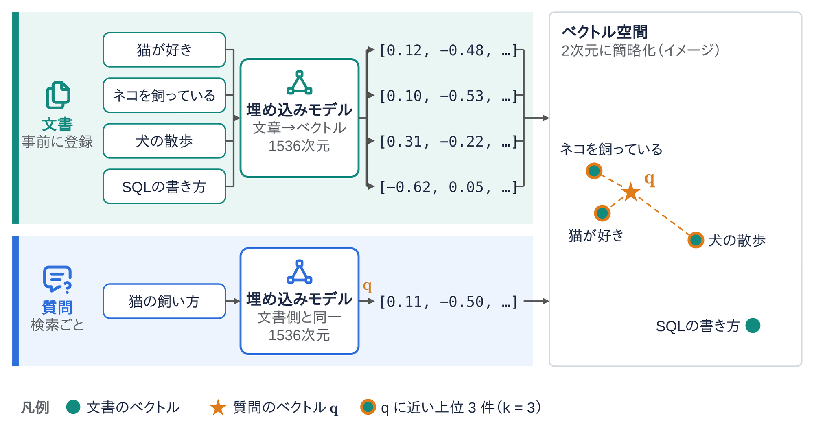
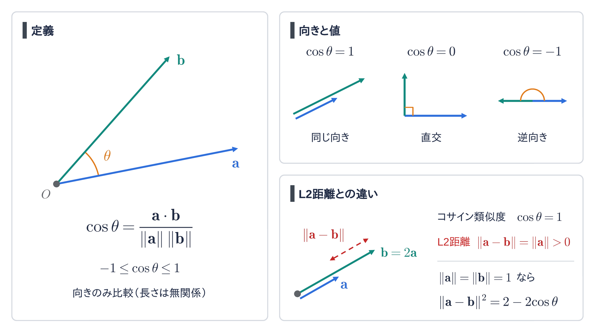
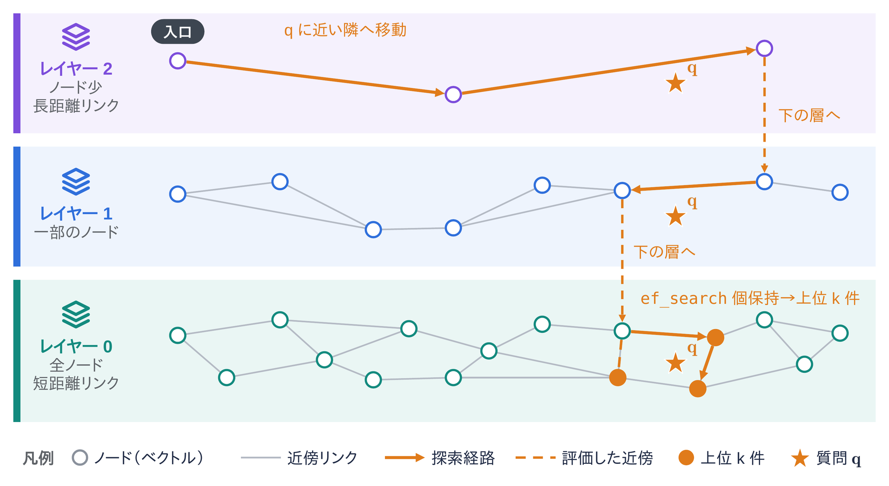
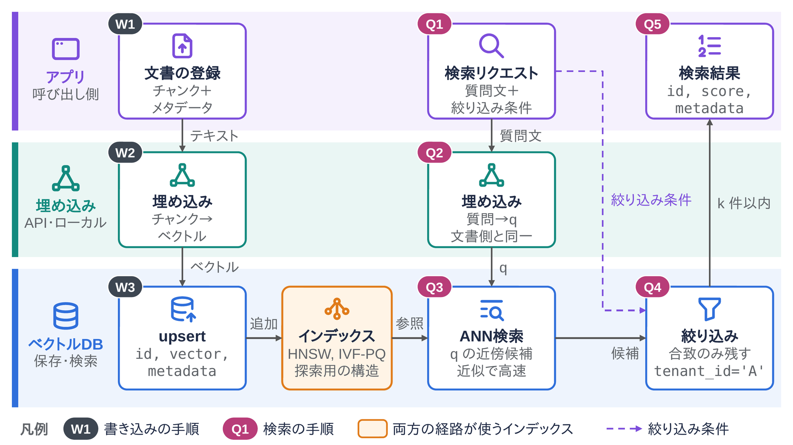

<!--
  コンパクト記事 no.26（草稿。公開前にこのコメントは削除）
  - 裏取り：Malkov & Yashunin (HNSW)、Jégou ら (PQ)、Faiss の論文、pgvector の README、Morris ら (Vec2Text)
  - 図：image/01〜04（pptx→png、生成は image/script/）
  - 関連：no.13 RAG、no.27 RAG、no.24 RAG-Pull（RAG の流れはそっちに任せて、ここではベクトルDBそのものに絞る）
-->

# はじめに

RAG の記事を書くたびに「ベクトルDBに入れておく」で済ませていたので、その中で何が起きているのかをまとめておきます。

# ひとことで言うと

**ベクトルデータベースは、文章や画像を数値の並び（ベクトル）にしたものを保存し、あるベクトルに「近い」ものを速く探すためのデータベース**です。
キーワードの一致ではなく、意味の近さで検索できます。

# ベクトル（埋め込み）とは

- 埋め込みモデルに文章を入れると、決まった長さの数値の並びが返ってくる（例：1536次元の float の配列）
- 意味が近い文章ほど、ベクトル空間の中で近い位置に置かれるように学習されている
- 「猫が好き」と「ネコを飼っている」は近く、「SQLの書き方」は遠くなる

検索するときは、質問文も**同じ埋め込みモデル**でベクトルにして、その近くにあるベクトルを上位 k 件取り出します（k 近傍探索）。

# 「近さ」の測り方

| 指標 | 式 | 中身 |
|---|---|---|
| コサイン類似度 | $\cos\theta = \dfrac{\mathbf{a}\cdot\mathbf{b}}{\lVert\mathbf{a}\rVert\lVert\mathbf{b}\rVert}$ | 向きの近さ。大きいほど近い |
| 内積 | $\mathbf{a}\cdot\mathbf{b}$ | 向きと長さの両方。大きいほど近い |
| ユークリッド距離（L2） | $\lVert\mathbf{a}-\mathbf{b}\rVert$ | 点と点の距離。小さいほど近い |

長さを 1 にそろえた（正規化した）ベクトルどうしなら、$\lVert\mathbf{a}-\mathbf{b}\rVert^2 = 2 - 2\cos\theta$ なので、3つとも検索結果の順位は同じになります。
どれを使うかは、埋め込みモデルの説明に合わせるのが基本です。

# なぜ普通に全件比べないのか？

全件と距離を計算すれば、正確な上位 k 件は取れます。ただ、

- 100万件 × 1536次元だと、1回の検索で約15億回の掛け算と足し算
- ベクトルだけで 100万 × 1536 × 4バイト ≒ 6.1GB（float32 のとき）

になり、件数が増えると重すぎます。
そこでベクトルDBは、**近似最近傍探索（ANN：Approximate Nearest Neighbor）** 用のインデックスを作って、「だいたい正しい上位 k 件」を速く返します。

# 主なインデックス

| 方式 | やり方 | 特徴 |
|---|---|---|
| HNSW | ベクトルどうしを近い順につないだグラフを、粗い層から細かい層へ重ねる | 速くて精度も高い。メモリを多く使う |
| IVF | k-means でクラスタに分け、質問に近いクラスタの中だけを探す | 作るのが軽い。探すクラスタ数（`nprobe`）で精度と速さを調整 |
| PQ | ベクトルを複数の部分ベクトルに分け、それぞれを一番近い代表ベクトル（k-means の重心）の番号に置きかえて圧縮 | メモリを大きく減らせる。精度は下がる。IVF と組み合わせることが多い |

## HNSW の探し方

1. 一番上の層（ノードが少なく、遠くまで飛べる）の入口から始める
2. その層で、隣のうち質問に一番近いノードへ移っていく
3. それ以上近づけなくなったら、1つ下の層へ降りて同じことをする
4. 一番下の層（全ノードがある）では、候補を `ef_search` 個まで持ちながら探し、上位 k 件を返す

`M`（1ノードがつなぐ数）、`ef_construction`（作るときの候補数）、`ef_search`（探すときの候補数）を大きくすると、精度は上がるけど遅く・重くなります。

# ベクトルDBの中身

- 1件は **ID・ベクトル・メタデータ**（元の文章、作成者、テナントIDなど）の組で保存する
- 検索は「ANN で近いものを探す」＋「メタデータで絞り込む（`tenant_id = 'A'` など）」の組み合わせ
- 絞り込みを ANN の後にやると、ANN が返した候補（pgvector の HNSW なら `ef_search` 件、既定 40）のうち条件に合うものしか残らず、k 件より少なく返ることがある（pgvector は 0.8.0 以降の iterative index scan で緩和できる）。先に絞る・探索しながら絞る・多めに取ってから絞る、のどれをやるかは製品ごとに違う

## 主な製品

| 種類 | 例 |
|---|---|
| 専用のベクトルDB | Pinecone、Milvus、Qdrant、Weaviate、Chroma |
| 既存のDB・検索エンジンのベクトル機能 | pgvector（PostgreSQL の拡張）、Elasticsearch / OpenSearch |
| ライブラリ（DBではない） | Faiss、hnswlib |

Faiss などのライブラリが受け持つのは、インデックスの構築と検索（ファイルへの保存、追加・削除くらい）までです。メタデータの管理や絞り込み、同時更新、障害からの復旧、レプリケーション、権限管理は自分で用意する必要があります。

# 勘違いしやすいところ

- **ANN は近似**。本当の上位 k 件をいくつか取りこぼすことがある（どれだけ拾えたかを再現率 recall で測る）
- **埋め込みモデルを変えたら、全件作り直し**。モデルが違うとベクトル空間が別物なので、古いベクトルと新しいベクトルは比べられない
- **「近い」は「正しい」ではない**。意味が似ているだけで、質問の答えになっているとは限らない
- **ベクトルにしても元の文章は隠れない**。埋め込みから元の文章をかなり復元できるという研究がある（Vec2Text）。ベクトルも元データと同じ機密度で扱う

# まとめ

ベクトルDBは「意味の近さで探す」ために、埋め込みベクトルと近似最近傍探索のインデックスをまとめて面倒見てくれるデータベースです。
精度・速さ・メモリのどれを優先するかでインデックスとパラメータを選ぶのが肝になります。
ほかにも選び方のコツがあれば、有識者の方教えて欲しいです！

# 参考

- Y. A. Malkov and D. A. Yashunin, "Efficient and robust approximate nearest neighbor search using Hierarchical Navigable Small World graphs", IEEE TPAMI, 2020
- H. Jégou, M. Douze, and C. Schmid, "Product Quantization for Nearest Neighbor Search", IEEE TPAMI, 2011
- M. Douze et al., "The Faiss library", arXiv:2401.08281, 2024
- J. X. Morris et al., "Text Embeddings Reveal (Almost) As Much As Text", EMNLP, 2023
- pgvector（GitHub）README
