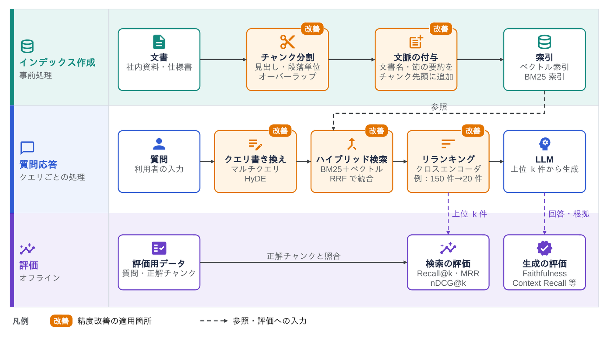
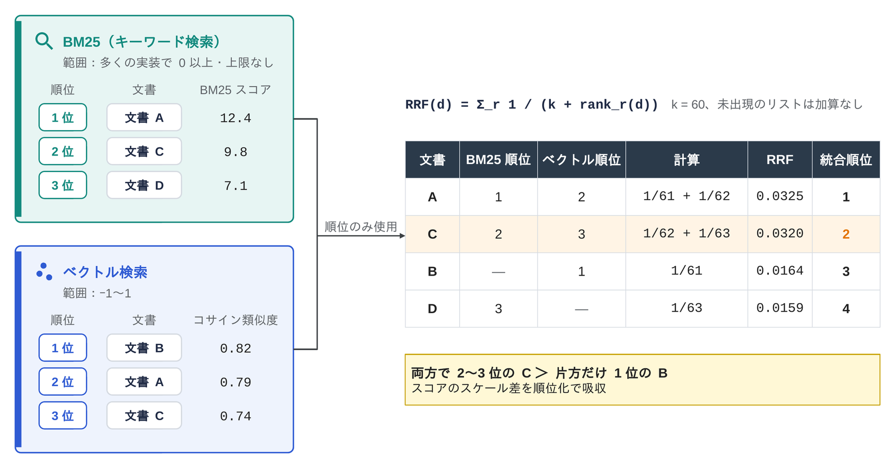
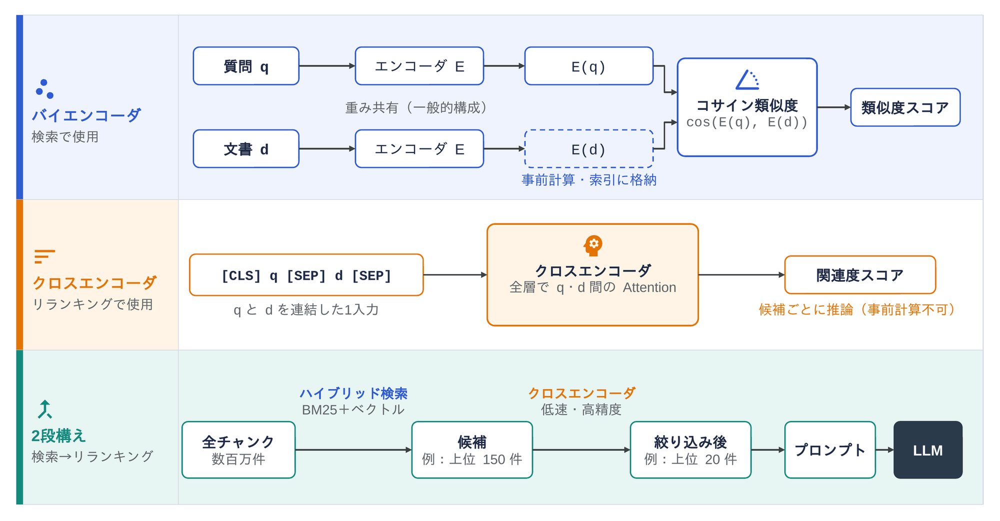

<!--
  コンパクト記事 no.27（草稿。公開前にこのコメントは削除）
  - 裏取り：Cormack ら (2009) RRF の論文、Gao ら (2023) HyDE の論文、Liu ら (2024) Lost in the Middle、Anthropic「Introducing Contextual Retrieval」(2024-09-19)、Es ら RAGAS
  - 図：image/01〜03（pptx→png）
  - 関連：no.13 RAG（仕組みとセキュリティ）、no.26 ベクトルDB（索引の中身はそっちで扱う）、no.24 RAG-Pull
-->

# はじめに

RAG を組んでみたものの、「ドキュメントには書いてあるのに、それっぽくない答えが返ってくる」ことがよくあります。
原因を追うと、だいたい LLM ではなく**検索で正しいチャンクを取れていない**ところに行き着きます。
RAG（Lewis ら, 2020）の仕組みそのものは [no.13 RAG](../no.13-rag/rag.md) でまとめたので、今回は検索の精度を上げる工夫だけを集めました。

# ひとことで言うと

**RAG の答えの質は、プロンプトに入れたチャンクの質で決まります。なので「切り方」「探し方」「並べ方」「測り方」の4か所を順に詰めていくのが基本**です。

*図1　検索精度を上げる工夫の置き場所*

| 置き場所 | 工夫 | ねらい |
|---|---|---|
| インデックス作成 | チャンクの切り方、文脈の付け足し | 1つのチャンクで意味が通るようにする |
| 質問を受けたとき | クエリの書き換え | 質問と文書の言い回しのずれを埋める |
| 検索 | ハイブリッド検索＋RRF | ベクトル検索の取りこぼしをキーワード検索で拾う |
| 検索のあと | リランキング | 上位の候補を、より正確なモデルで並べ直す |
| 全体 | 評価 | 改善したかどうかを数字で確かめる |

# チャンクはどう切ればいいのか？

チャンクは大きすぎても小さすぎてもうまくいきません。

- **大きすぎる**：1つのチャンクに話題が混ざり、ベクトルがぼやけて検索に引っかかりにくくなる。プロンプトも長くなる
- **小さすぎる**：「それは」「この設定は」の指す先がチャンクの外に出てしまい、単体では意味が通らない

よく使われる工夫はこのあたりです。

- **構造で切る**：文字数で機械的に切らず、見出し・段落・コードブロックの区切りに合わせる
- **前後を重ねる（オーバーラップ）**：区切りの前後を少し重ねて、文の途中で切れたときの取りこぼしを減らす
- **文脈を付け足す**：チャンクの先頭に「どの文書の、どの節か」を足してから埋め込む

見出しや文書名を付けるだけでも効きますが、さらに LLM に文脈を書かせて付け足すやり方を、Anthropic が 2024 年に Contextual Retrieval という名前で紹介しています。
各チャンクについて LLM で 50〜100 トークンほどの説明を作って先頭に付け、その状態で埋め込みと BM25 の索引を作ります。
同社の評価では、上位 20 件で正解チャンクを取りこぼす割合が 5.7% → 3.7%（埋め込みだけに適用）、→ 2.9%（BM25 にも適用）、→ 1.9%（さらにリランキング）まで下がったと報告されています。

# ベクトル検索だけでは足りないのか？

ベクトル検索は「意味が近い」文書を探すのは得意ですが、**型番・エラーコード・関数名・固有名詞のような、文字列が一致してほしいもの**は苦手です。
`ERR_0x80070005` と `ERR_0x80070057` は、埋め込みの空間ではかなり近くに置かれてしまうことがあります。

そこで、キーワード検索（BM25 など）と並べて実行し、結果を1つにまとめるのが**ハイブリッド検索**です。

## RRF で結果をまとめる

困るのは、BM25 のスコアとコサイン類似度は**目盛りがまったく違う**ので、そのまま足せないことです。
そこでよく使われるのが **RRF（Reciprocal Rank Fusion）** で、スコアを捨てて**順位だけ**を使います。

$$
\mathrm{RRF}(d) = \sum_{r \in R} \frac{1}{k + \mathrm{rank}_r(d)}
$$

- $R$：まとめる検索結果の集合（ここでは BM25 とベクトル検索の2つ）
- $\mathrm{rank}_r(d)$：検索結果 $r$ の中での文書 $d$ の順位（1 から数える）。その結果に出てこなければ足さない
- $k$：定数。元の論文（Cormack ら, 2009）では $k = 60$

*図2　RRF で2つの検索結果をまとめる計算例（k = 60）*

図2 の例では、ベクトル検索で1位の B より、両方の検索で 2〜3 位に入った C のほうが上に来ます。
**片方で飛び抜けているより、両方でそこそこ上にいる文書を優先する**のが RRF の性格です。

# リランキングは何をしているのか？

検索で取ってきた上位の候補（たとえば 50〜150 件）を、より正確だけど重いモデルで採点し直して、上位数件〜20件くらいに絞る処理です。
ここで使うモデルと、検索で使う埋め込みモデルは、入力の渡し方が違います。

*図3　検索に使うバイエンコーダと、リランキングに使うクロスエンコーダ*

| | バイエンコーダ（検索） | クロスエンコーダ（リランキング） |
|---|---|---|
| 入力 | 質問と文書を**別々に**ベクトル化 | 質問と文書を**1つの入力にまとめて**渡す |
| 出力 | ベクトル（類似度は後でコサインで計算） | 関連度のスコア1つ |
| 文書側の事前計算 | できる（インデックスに入れておける） | できない（質問が来るたびに計算） |
| 精度 | そこそこ | 高い（質問と文書の単語同士を突き合わせられる） |
| 向いている件数 | 数百万件から探す | 数十〜百数十件を並べ直す |

なので「**速いバイエンコーダで広く拾い、重いクロスエンコーダで絞る**」という2段構えにします。

# 質問のほうを書き換えるのはありなのか？

ありです。ユーザーの質問は短く、文書とは言い回しも違うので、検索の前に LLM で書き換えることがあります。

- **言い換えを複数作る（マルチクエリ）**：同じ質問を数通りに言い換えてそれぞれ検索し、結果を RRF などでまとめる
- **仮の答えを作ってから探す（HyDE）**：LLM に「答えっぽい文章」を先に書かせ、その文章の埋め込みで検索する（Gao ら, 2023）。質問文より答えの文章のほうが、文書の書き方に近いため

どちらも LLM の呼び出しが1回増えるので、その分だけ遅くなり、お金もかかります。

# 上位何件を入れればいいのか？

多く入れれば取りこぼしは減りますが、関係ないチャンクも混ざります。
また、長いコンテキストでは**真ん中に置いた情報ほど使われにくい**という報告もあります（Liu ら, "Lost in the Middle"）。
「とりあえず多めに入れる」ではなく、リランキングで絞ってから入れる、関連度の高いものを先頭に置く、といった工夫とセットで考えます。

# 改善したかどうかはどう測るのか？

ここが一番大事で、一番さぼられがちなところです。
**検索の評価と、生成（答え）の評価は分けて測ります**。答えが悪かったときに、検索と LLM のどちらが原因かを切り分けるためです。

## 検索の評価

「この質問なら、このチャンクが正解」という組を数十〜数百件用意して、検索結果と突き合わせます。

| 指標 | 中身 |
|---|---|
| Recall@k | 正解チャンクのうち、上位 k 件に入った割合 |
| MRR | 最初の正解が何位に出たかの逆数（1位なら 1、3位なら 1/3、出なければ 0）の平均 |
| nDCG@k | 順位が下がるほど割り引いて合計し、理想的な並び順のときの値で割って 0〜1 にした指標 |

RAG では、プロンプトに入れる件数を k にした **Recall@k** をまず見るのがわかりやすいです。入らなかったチャンクは、LLM がどう頑張っても使えないので。

## 生成の評価

RAGAS などのツールでは、LLM を採点役にして次のような観点を測れます。

- **Faithfulness（忠実性）**：答えの内容が、取り出したチャンクに書かれていることだけでできているか
- **Answer Relevancy**：答えが質問に答えているか
- **Context Precision / Context Recall**：取り出したチャンクに、必要な情報がどれだけ・どの順位で入っているか（Context Recall は正解の答えを用意する必要あり）

指標名はバージョンで変わることがあり、最近のバージョンでは Answer Relevancy が Response Relevancy と呼ばれています。

採点役の LLM も間違えるので、評価用データの一部は人が見て確かめておくのが安全です。

# まとめ

検索の精度を上げる工夫は、どれか1つで劇的に変わるというより、評価用データを作って Recall@k を見ながら1つずつ足していくものです。
個人的には、ハイブリッド検索とリランキングは既存の検索の後ろに足すだけで試せるので先に入れて、チャンクの切り方は評価の数字を見ながら詰めていくのがよさそうだと思いました。
逆に評価がないまま工夫を重ねると、何が効いたのかわからなくなるので、測る仕組みは最初に作っておきたいところです。
もっと良いやり方があれば、有識者の方教えて欲しいです！

# 参考

- G. V. Cormack, C. L. A. Clarke, S. Buettcher, "Reciprocal Rank Fusion outperforms Condorcet and individual Rank Learning Methods", SIGIR, 2009
- L. Gao, X. Ma, J. Lin, J. Callan, "Precise Zero-Shot Dense Retrieval without Relevance Labels", ACL, 2023（HyDE）
- N. F. Liu et al., "Lost in the Middle: How Language Models Use Long Contexts", TACL, 2024
- S. Es et al., "RAGAS: Automated Evaluation of Retrieval Augmented Generation", EACL (System Demonstrations), 2024
- Anthropic, "Introducing Contextual Retrieval", 2024-09-19, https://www.anthropic.com/engineering/contextual-retrieval
- P. Lewis et al., "Retrieval-Augmented Generation for Knowledge-Intensive NLP Tasks", NeurIPS, 2020
