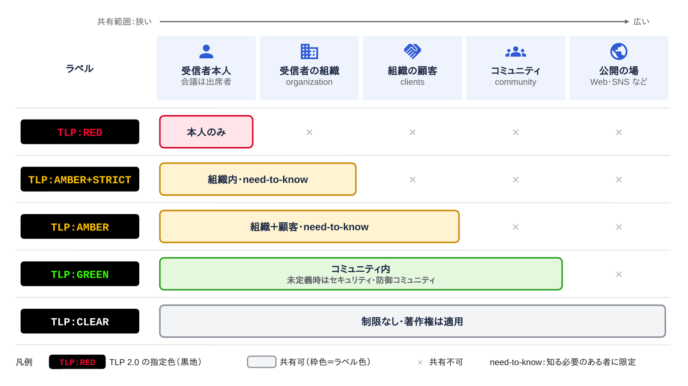
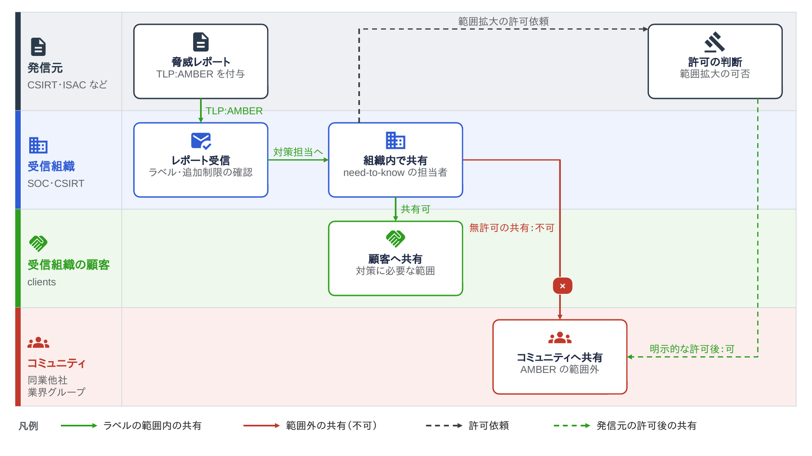
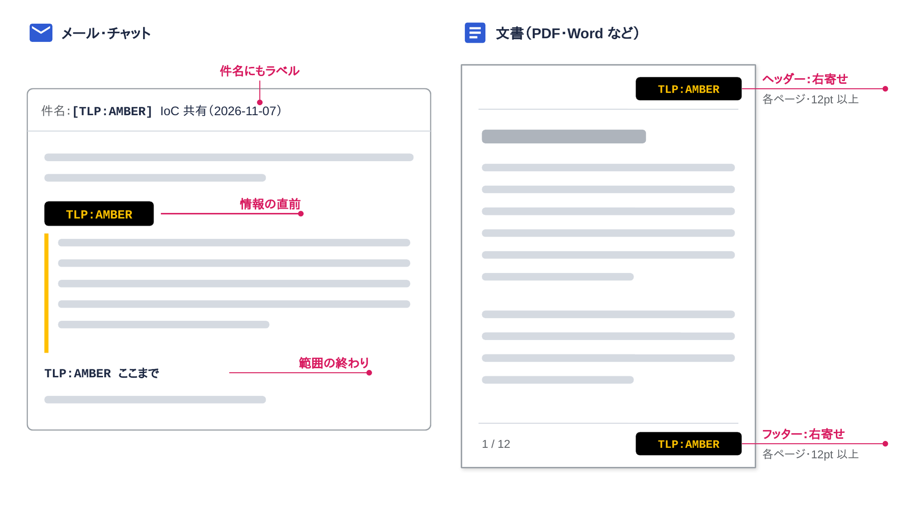

<!--
  コンパクト記事 no.28（草稿。公開前にこのコメントは削除）
  - 裏取り：FIRST「Traffic Light Protocol (TLP) — FIRST Standards Definitions and Usage Guidance — Version 2.0」（https://www.first.org/tlp/、2022年8月から有効）
    - 作業環境から first.org に直接つながらなかったので、FIRST の原文を転載している cirt.gov.bd と、CERT-EU の解説記事で確認した。公開前に first.org の原文で最終確認する
    - 色の値（RGB）は sematicon の転載ページで確認（cirt.gov.bd の転載では画像で掲載）。公開前に first.org で確認する
  - 図：image/01〜03（pptx→png）
  - 関連：other no.8 直近のサイバー攻撃分析（脅威レポートの読み方）
-->

# はじめに

脅威レポートや ISAC のメールの冒頭に、`TLP:AMBER` のような謎のタグが付いていることがあります。
これが付いた情報を、社内の誰に、どこまで転送していいのかをまとめておきます。

# ひとことで言うと

**TLP（Traffic Light Protocol）は、情報の発信元が「この情報をどこまで共有してよいか」を、信号機の色のラベルで受信者に伝えるための約束ごと**です。
セキュリティインシデント対応チームの国際団体 FIRST が標準として定めていて、今の版は 2022年8月から有効な **TLP 2.0** です。

# 5つのラベル

TLP 2.0 のラベルは、`TLP:RED`・`TLP:AMBER`・`TLP:GREEN`・`TLP:CLEAR` の4色と、`TLP:AMBER` の派生の `TLP:AMBER+STRICT` の5つです。
上にいくほど共有できる範囲が狭くなります。

| ラベル | 共有してよい範囲 | 使う場面の例 |
|---|---|---|
| `TLP:RED` | 受け取った本人だけ。会議なら出席者だけ | 関係者以外に広がると、関係する組織のプライバシー・評判・業務に大きなリスクが出る情報 |
| `TLP:AMBER+STRICT` | 受信者の組織の中だけ（need-to-know） | 顧客にも出したくない、組織内で対策するための情報 |
| `TLP:AMBER` | 受信者の組織と、その顧客まで（need-to-know） | 受信者や顧客が身を守るために使ってほしい情報 |
| `TLP:GREEN` | 受信者のコミュニティの中まで。公開の場には出さない | 同じ業界・地域の仲間に広く知らせたい情報 |
| `TLP:CLEAR` | 制限なし（著作権のルールには従う） | 悪用されるリスクがほとんどない、公開してよい情報 |

*図1：TLP 2.0 のラベルごとの共有範囲。右に行くほど広い範囲で、色の帯が共有してよいところ*

## 用語の範囲

ラベルの定義に出てくる「組織」「顧客」「コミュニティ」は、TLP 2.0 の中で意味が決められています。

| 用語 | TLP 2.0 での意味 |
|---|---|
| 組織（organization） | 正式なメンバーシップで結ばれ、共通のポリシーに従うグループ。会社など。広くても1つの情報共有団体の全メンバー程度まで |
| 顧客（clients） | その組織からサイバーセキュリティのサービスを受けている人や組織。国レベルのチームなら、ステークホルダーや管轄先も含む |
| コミュニティ（community） | 目的や慣行が同じで、ゆるい信頼関係でつながったグループ。国・業界・地域のセキュリティ担当者全体のように広いこともある |

`TLP:GREEN` の「コミュニティ」が特に決められていないときは、**サイバーセキュリティ・防御のコミュニティ**とみなします。

# 共有のルール

*図2：`TLP:AMBER` のレポートを受け取ったときの流れ。ラベルより広く共有したいときは、発信元の明示的な許可が要る*

- **ラベルを付けるのは発信元**。受信者は、付いたラベルの範囲を守って共有する
- 発信元は、ラベルに**追加の制限**（「〇〇社には共有しない」など）を付けてもよく、受信者はそれにも従う
- ラベルより**広く**共有したいときは、**発信元から明示的な許可**をもらう
- `TLP:AMBER` と `TLP:AMBER+STRICT` の「need-to-know」は、組織の中でも**その情報が対策に必要な人だけ**という意味。全社メーリングリストに流してよいわけではない

# ラベルの付け方

*図3：メールと文書でのラベルの付け方*

| 媒体 | 付ける場所 |
|---|---|
| メール・チャット | 情報の**直前**にラベルと追加の制限を書く。メールなら件名にも入れるのが望ましい。必要に応じて、ラベルの効く範囲の終わりも示す |
| 文書 | **すべてのページのヘッダーとフッター**に、ラベルと追加の制限を書く。右寄せ・12pt 以上が望ましい |
| 自動でのやり取り | システムの設計者に任されている（標準の定義には従う） |

表記は `TLP:` のあとに色を大文字で続け、間にスペースを入れません（`TLP:AMBER`、`TLP:AMBER+STRICT`）。
色は黒の背景に、RED が RGB(255, 0, 51)、AMBER が RGB(255, 192, 0)、GREEN が RGB(51, 255, 0)、CLEAR が白です。

MISP のような脅威情報共有プラットフォームでは、イベントや属性に `tlp:amber` のようなタグとして付けて、共有の範囲を機械的に扱えるようにしています。

# TLP 1.0 からの変更点

| 変更点 | 中身 |
|---|---|
| `TLP:WHITE` → `TLP:CLEAR` | 名前だけ変わった。意味（制限なし）は同じ |
| `TLP:AMBER+STRICT` の追加 | 共有を組織の中だけに絞り、顧客を外したいとき用 |
| 「顧客（clients）」の定義を追加 | 1.0 でも顧客への共有は認められていたが、2.0 で顧客の意味を定義し、`TLP:AMBER` は既定で顧客を含むと明記した |
| `TLP:GREEN` の既定のコミュニティ | 決められていなければサイバーセキュリティ・防御のコミュニティとみなす |

# 勘違いしやすいところ

- **色は危険度ではない**。`TLP:RED` は「深刻な脆弱性」ではなく「受け取った本人だけ」という共有範囲の話。重大度は CVSS など別の指標で見る
- **TLP は機密区分（秘・極秘など）ではない**。正式な分類の仕組みでもなく、ライセンスや、取り扱い・暗号化のルールを定めるものでもない
- **TLP は情報公開法などの開示義務には影響しない**（FIRST が明記している）
- `TLP:GREEN` は「誰にでも話してよい」ではない。**公開の場（ブログ・SNS など）には出せない**
- `TLP:CLEAR` は共有範囲の制限がないだけで、**著作権のルールはそのまま**かかる

# まとめ

TLP は、信号機の色に「どこまで共有してよいか」だけを乗せた、かなりシンプルな約束ごとです。
TLP 自体は法令や契約ではないので（ISAC の会員規約や NDA で遵守が義務付けられることはあります）、守られるかどうかは基本的に受信者との信頼関係にかかっています。
脅威レポートを社内に転送する前に、件名のタグを一度見るだけで防げる事故は多そうです。
運用でのつまずきどころがあれば、有識者の方教えて欲しいです！

# 参考

- FIRST「Traffic Light Protocol (TLP) — FIRST Standards Definitions and Usage Guidance — Version 2.0」 https://www.first.org/tlp/
- CERT-EU「New Traffic Light Protocol: New definitions and updated restrictions」 https://www.cert.europa.eu/blog/tlp-version-2-primer
- CISA「Traffic Light Protocol (TLP) Definitions and Usage」 https://www.cisa.gov/tlp
