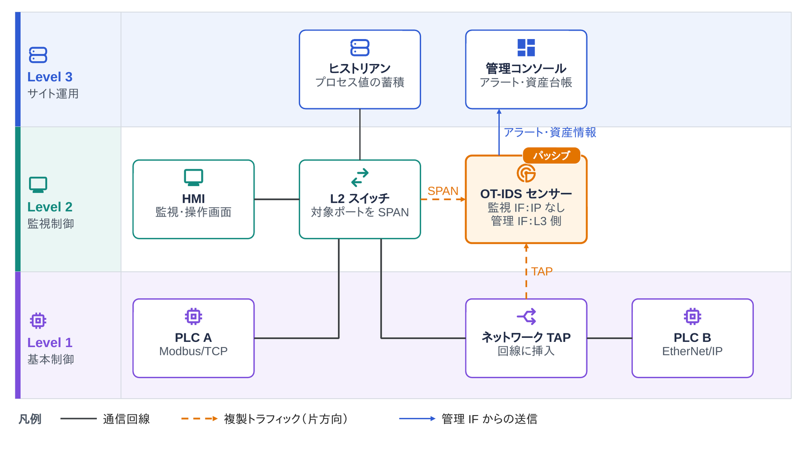
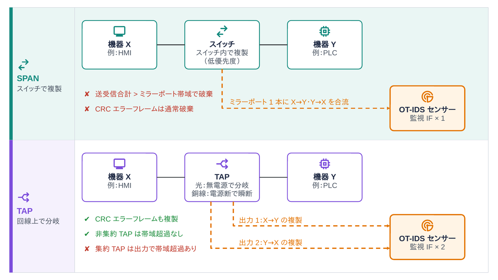
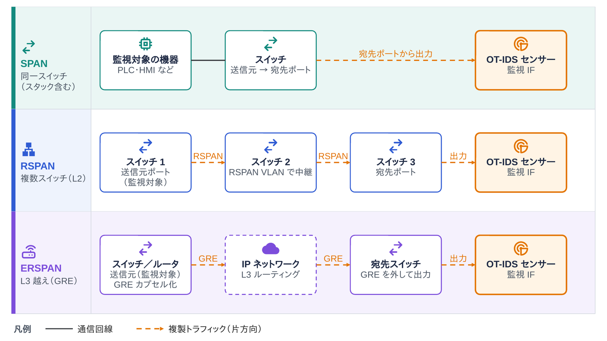

<!--
  コンパクト記事 no.29（草稿。公開前にこのコメントは削除）
  - 裏取り済み（2026-11-07）
    - Microsoft Learn「Choose a traffic mirroring method for OT sensors」：SPAN／RSPAN／ERSPAN／集約TAP、スイッチはミラーリングを低優先度で処理、TAPは破損フレームも通す、非集約TAPは送受信で2ポート、全ポートのミラーリング推奨、ERSPANはCisco独自
    - Microsoft Learn「Traffic mirroring overview」：SPAN／RSPAN／ERSPANの届く範囲、センサーが見るべきトラフィック（L2・OTプロトコル・サブネット内）
    - NIST SP 800-82 Rev.3：OT ではアクティブスキャンが機器に影響しうる
  - 宛先ポートの帯域超過で破棄される点は、SPAN の構造（送受信を1本に合流）から言えること。機種ごとの挙動は各ベンダーの資料で確認する
  - no.25（OTセキュリティ）とかぶらないよう、総論はそちらに任せて「ミラーリングでのパッシブ監視」に絞った。公開順によっては no.25 へのリンクを足す
-->

# はじめに

OT（工場やプラントの制御システム）向けの IDS は、たいてい「スイッチのミラーリングポートにつなぐだけ」で動きます。
つなぐだけで本当に全部見えているのか？が気になったので、SPAN と TAP の違いを中心にまとめておきます。

# ひとことで言うと

**OT-IDS は、スイッチの SPAN やネットワーク TAP で複製した通信を受信専用のポートで受け取り、制御ネットワークに一切パケットを送らずに監視します（パッシブ監視）。**

# なぜミラーリングで見るのか

IT のネットワークなら、端末にエージェントを入れたり、スキャナで機器を調べたりできます。
OT では、これがやりにくい事情があります。

- PLC などの制御機器にはエージェントを入れられない（OS が専用、ベンダーの保証が外れる）
- 古い機器の中には、想定外のパケットやスキャンで止まったり、動作が変わったりするものがある
- 止めてよい時間がほとんどない。インラインの機器を挟むと、その機器の故障が工程の停止につながる

そこで、通信の**コピー**だけを受け取って解析します。
IDS 側は Modbus/TCP や EtherNet/IP などの産業用プロトコルを解釈して、「どの機器がどの機器に、どの命令を出しているか」を学習し、そこから外れた通信をアラートにします。

# センサーの置き場所

*図1：OT ネットワークでの OT-IDS センサーの置き場所。SPAN と TAP で複製したトラフィックを監視 IF で受け、アラートは管理 IF から送る（L2・L3 間のファイアウォールは省略）*

- センサーには役割の違うポートが2種類ある
  - **監視 IF**：複製されたトラフィックを受け取るだけ。IP アドレスを持たせない
  - **管理 IF**：アラートや資産情報を管理コンソールへ送る。上位（Level 3 側）のネットワークにつなぐ
- 置く場所は、PLC・HMI 間の通信が通る **Level 1〜2 のスイッチ**が基本。上位との境界だけを見ても、PLC どうしの通信（東西方向の通信）は見えない
- Microsoft Defender for IoT のドキュメントでは、つながっていないポートも含めてスイッチの**全ポート**をミラーリングするよう勧めている。あとから空きポートにつながれた不正な機器も見えるようにするため
  - ただし、TAP を挟んだ回線のポートまで SPAN すると同じ通信を二重に受けるので、そのポートは SPAN の対象から外す（図1）

# 複製のしかた：SPAN と TAP

*図2：SPAN と TAP の複製のしかたの違い*

| | SPAN（ポートミラーリング） | ネットワーク TAP |
|---|---|---|
| 複製する場所 | スイッチの中 | ケーブルの途中に挟んだ専用機器 |
| 追加の機器 | いらない（設定だけ） | いる。挟むときに一度回線を切る |
| 電源 | 不要（スイッチの機能） | 光の受動 TAP は不要。銅線の TAP は電源が切れるとバイパスに切り替わり、その間リンクが瞬断することがある |
| 取りこぼし | 送受信の合計が宛先ポートの帯域を超えると落ちる | 落ちない（集約 TAP は出力側で超えうる） |
| エラーフレーム | スイッチで破棄され、複製されない | 含めてそのまま複製 |
| タイミング | スイッチが低い優先度で処理するので、ずれることがある | ずれない（集約 TAP はずれうる） |
| センサー側のポート | 1つ | 送信・受信で2つ（集約 TAP なら1つ） |

SPAN は手軽ですが、「スイッチが余力で複製しているもの」です。
フォレンジックのように取りこぼしが許されない用途では TAP が勧められています。

# スイッチをまたいで集める：RSPAN と ERSPAN

*図3：SPAN・RSPAN・ERSPAN の届く範囲*

| 方式 | 届く範囲 | 運び方 |
|---|---|---|
| SPAN | 同じスイッチ（スタック）の中 | 内部で宛先ポートへ |
| RSPAN | L2 でつながった複数のスイッチ | 専用の RSPAN VLAN に載せ、トランクで運ぶ |
| ERSPAN | L3 をまたいだ先（別のサイトなど） | GRE でカプセル化して IP で運ぶ |

RSPAN と ERSPAN は、複製したトラフィックが**本番と同じネットワークを流れる**ので、その分の帯域を使います。
ERSPAN は Cisco 独自の機能で、ほかのベンダーには似た機能が別の名前であります。
図3では宛先のスイッチで GRE を外していますが、GRE のまま直接受け取れるセンサー製品もあります。

# 勘違いしやすいところ

- **「アラートが出ない＝通信がない」ではない**。SPAN の取りこぼしや、ミラーリングしていないポートの通信は、そもそもセンサーに届いていない
- **パッシブでも、センサー自体は守る対象**。管理 IF は上位のネットワークにつながるので、監視 IF と管理 IF を同じネットワークにつながない
- **上位との境界だけを見ても足りない**。HMI やエンジニアリング端末から PLC への書き込み命令は、Level 1〜2 のスイッチを通るだけで、上位との境界を通らないことが多い

# まとめ

OT-IDS の検知精度は、解析エンジンより前に「どのポートを、どの方式で複製しているか」で上限が決まります。
SPAN は設定だけで始められる反面、取りこぼしても何も教えてくれないのが正直な弱点です。
まず SPAN で全体を見て、重要な回線だけ TAP にする、という組み合わせが現実的な落としどころだと思います。
実際の現場でのセンサー配置の工夫があれば、有識者の方教えて欲しいです！

# 参考

- Microsoft Learn「Choose a traffic mirroring method for OT sensors」 https://learn.microsoft.com/en-us/azure/defender-for-iot/organizations/best-practices/traffic-mirroring-methods
- Microsoft Learn「Configure traffic mirroring」 https://learn.microsoft.com/en-us/azure/defender-for-iot/organizations/traffic-mirroring/traffic-mirroring-overview
- NIST SP 800-82 Rev.3「Guide to Operational Technology (OT) Security」 https://csrc.nist.gov/pubs/sp/800/82/r3/final
