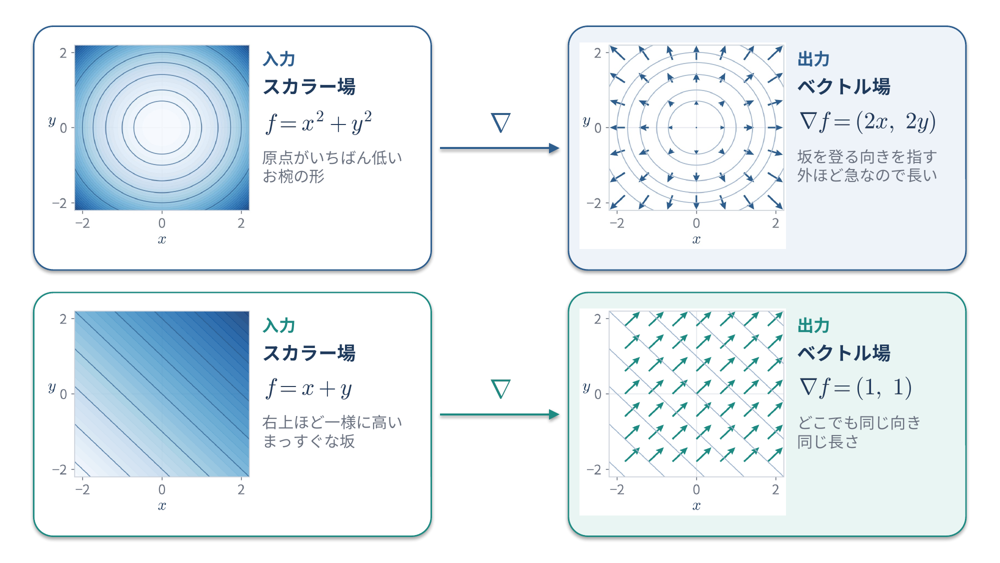
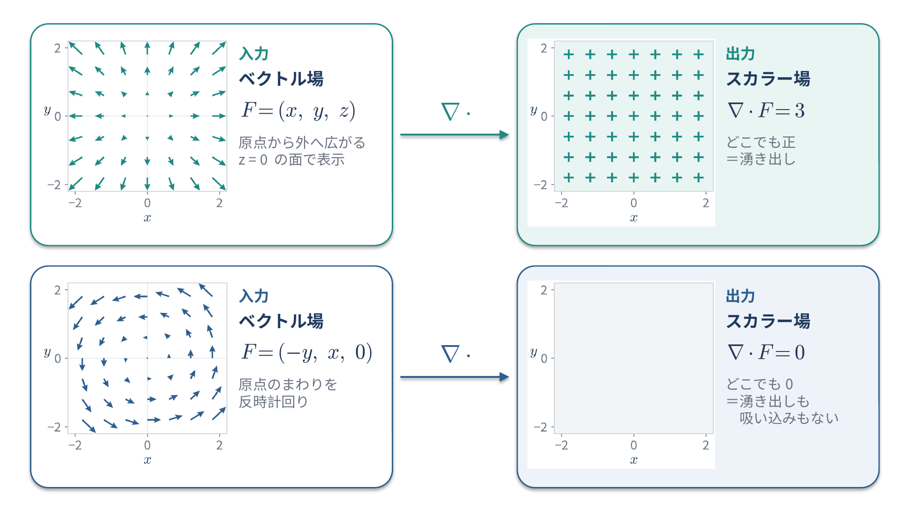
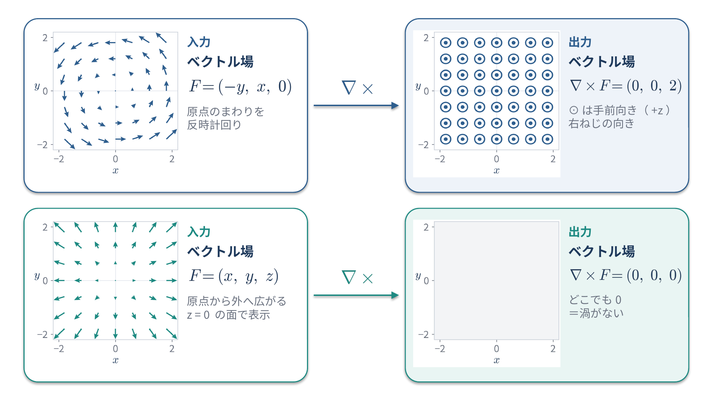

<!--
  コンパクト記事 no.3（草稿。公開前にこのコメントは削除）
  - 図：image/ナブラ図.pptx（3スライド→01〜03のPNG。生成スクリプトは image/図生成スクリプト.py）
  - 関連：no.2 転置と内積・外積（発散は内積、回転はベクトル積の形）。公開済みの no.2 に「ひとことで言うと」からリンク済み
  - 数式はすべて SymPy で検算済み（2026-10-27）
-->

# はじめに

$\nabla$ が出てくると身構えてしまうので、勾配・発散・回転の3つを、偏微分の計算から途中式を省かずにまとめてみました。

# ひとことで言うと

ナブラ演算子 $\nabla$ は「各方向の偏微分を並べたベクトル」のような記号で、何にどう掛けるかで3つの意味になります。

$$
\nabla = \left( \frac{\partial}{\partial x}, \frac{\partial}{\partial y}, \frac{\partial}{\partial z} \right)
$$

| 名前 | 書き方 | 入力 | 出力 | 意味 |
|---|---|---|---|---|
| 勾配（grad） | $\nabla f$ | スカラー場 | ベクトル場 | いちばん急に増える向きと、その増え方 |
| 発散（div） | $\nabla \cdot F$ | ベクトル場 | スカラー場 | その点から湧き出している量 |
| 回転（rot / curl） | $\nabla \times F$ | ベクトル場 | ベクトル場 | その点のまわりの渦の強さと軸の向き |

div は内積、rot はベクトル積の形をしているので、計算方法は前回の記事「[転置と内積・外積を簡単にまとめる](https://qiita.com/nico0748/items/97c5400f2fc565c27a1d)」もあわせてどうぞ。

ただし $\nabla$ は数が入ったふつうのベクトルではなく、「右側にあるものを微分する」という操作を並べたものです。そのため $\nabla f$ を $f \nabla$ と書き換えることはできません。

# 準備：偏微分の計算方法

grad・div・rot はどれも偏微分を並べたり足したりしているだけなので、まず偏微分の計算方法をおさえます。

## ふつうの微分のおさらい

この記事で使う微分のルールは次の3つだけです。

| ルール | 式 | 例 |
|---|---|---|
| べき乗 | $\dfrac{d}{dx} x^n = n x^{n-1}$ | $\dfrac{d}{dx} x^3 = 3x^2$、$\dfrac{d}{dx} x = 1$ |
| 定数 | $\dfrac{d}{dx} c = 0$ | $\dfrac{d}{dx} 5 = 0$ |
| 定数倍・和 | $\dfrac{d}{dx} \{ a\,g(x) + b\,h(x) \} = a\,g'(x) + b\,h'(x)$ | $\dfrac{d}{dx} (4x^2 + 3x) = 8x + 3$ |

## 偏微分は「ほかの変数を定数とみなして微分する」

$f(x, y, z)$ のように変数が複数ある関数で、1つの変数だけに注目して微分するのが偏微分です。

- $\dfrac{\partial f}{\partial x}$：$y$ と $z$ を定数とみなして、$x$ で微分する
- $\dfrac{\partial f}{\partial y}$：$x$ と $z$ を定数とみなして、$y$ で微分する
- $\dfrac{\partial f}{\partial z}$：$x$ と $y$ を定数とみなして、$z$ で微分する

$\partial$ は「ラウンドディー」や「デル」と読みます。$d$ ではなく $\partial$ と書くのは「ほかにも変数があるけど、今はこの変数だけで微分しています」という目印です。

## 例：$f = x^2 y + y z^3$ を偏微分する

この記事を通して、次の関数を例に使います。

$$
f(x, y, z) = x^2 y + y z^3
$$

### $x$ で偏微分する

$y$ と $z$ を定数とみなします。1項ずつ見ていきます。

- 1項目 $x^2 y$：$y$ は定数なので、$x^2$ に係数 $y$ が掛かっているだけです。$\dfrac{\partial}{\partial x}(x^2 y) = y \cdot \dfrac{\partial}{\partial x} x^2 = y \cdot 2x = 2xy$
- 2項目 $y z^3$：$x$ が入っていないので、まるごと定数です。$\dfrac{\partial}{\partial x}(y z^3) = 0$

$$
\frac{\partial f}{\partial x} = 2xy + 0 = 2xy
$$

### $y$ で偏微分する

$x$ と $z$ を定数とみなします。

- 1項目 $x^2 y$：$x^2$ が係数です。$\dfrac{\partial}{\partial y}(x^2 y) = x^2 \cdot \dfrac{\partial}{\partial y} y = x^2 \cdot 1 = x^2$
- 2項目 $y z^3$：$z^3$ が係数です。$\dfrac{\partial}{\partial y}(y z^3) = z^3 \cdot \dfrac{\partial}{\partial y} y = z^3 \cdot 1 = z^3$

$$
\frac{\partial f}{\partial y} = x^2 + z^3
$$

### $z$ で偏微分する

$x$ と $y$ を定数とみなします。

- 1項目 $x^2 y$：$z$ が入っていないので定数です。$\dfrac{\partial}{\partial z}(x^2 y) = 0$
- 2項目 $y z^3$：$y$ が係数です。$\dfrac{\partial}{\partial z}(y z^3) = y \cdot \dfrac{\partial}{\partial z} z^3 = y \cdot 3z^2 = 3yz^2$

$$
\frac{\partial f}{\partial z} = 0 + 3yz^2 = 3yz^2
$$

## 2回偏微分する

偏微分した結果をもう一度偏微分することもできます。たとえば $\dfrac{\partial f}{\partial x} = 2xy$ をさらに $x$ で偏微分すると次のようになります。

$$
\frac{\partial^2 f}{\partial x^2} = \frac{\partial}{\partial x}\left( \frac{\partial f}{\partial x} \right) = \frac{\partial}{\partial x}(2xy) = 2y \cdot \frac{\partial}{\partial x} x = 2y \cdot 1 = 2y
$$

違う変数で続けて偏微分することもできます。$\dfrac{\partial f}{\partial x} = 2xy$ を $y$ で偏微分すると次のとおりです。

$$
\frac{\partial}{\partial y}\left( \frac{\partial f}{\partial x} \right) = \frac{\partial}{\partial y}(2xy) = 2x \cdot \frac{\partial}{\partial y} y = 2x
$$

逆の順番で、$\dfrac{\partial f}{\partial y} = x^2 + z^3$ を $x$ で偏微分してみます。

$$
\frac{\partial}{\partial x}\left( \frac{\partial f}{\partial y} \right) = \frac{\partial}{\partial x}(x^2 + z^3) = 2x + 0 = 2x
$$

どちらも $2x$ で一致しました。$f$ が2回続けて微分できて、その結果が連続な関数（多項式など、ふつうに出てくる関数はたいていこれに当てはまります）なら、偏微分する順番を入れ替えても結果は同じになります（シュワルツの定理）。この性質は最後の「覚えておくと便利な性質」で使います。

# 勾配（grad）

スカラー場 $f(x, y, z)$ に $\nabla$ を掛けます。$\nabla$ の各成分を $f$ に作用させるだけです。

$$
\nabla f = \left( \frac{\partial}{\partial x}, \frac{\partial}{\partial y}, \frac{\partial}{\partial z} \right) f = \left( \frac{\partial f}{\partial x}, \frac{\partial f}{\partial y}, \frac{\partial f}{\partial z} \right)
$$

## 例1：お椀の形 $f = x^2 + y^2$（2次元）

イメージをつかむために、まず2次元の例を見ます。$f(x, y) = x^2 + y^2$ は原点がいちばん低いお椀の形です。

$$
\frac{\partial f}{\partial x} = \frac{\partial}{\partial x}(x^2) + \frac{\partial}{\partial x}(y^2) = 2x + 0 = 2x
$$

$$
\frac{\partial f}{\partial y} = \frac{\partial}{\partial y}(x^2) + \frac{\partial}{\partial y}(y^2) = 0 + 2y = 2y
$$

$$
\nabla f = (2x, 2y)
$$

点 $(1, 2)$ では $\nabla f = (2 \cdot 1, 2 \cdot 2) = (2, 4)$ です。原点から離れる向き、つまりお椀の坂を登る向きを指しています。

- 例：山の標高を $f$ とすると、$\nabla f$ はいちばん急な登り坂の向きを指す
- 機械学習の勾配降下法は、損失関数の勾配と逆向き（$-\nabla L$）にパラメータを動かす

*図1：勾配による変化。上はお椀の形 $f = x^2 + y^2$、下はまっすぐな坂 $f = x + y$ で、左のスカラー場に $\nabla$ を掛けると右のベクトル場になる*

上の段がこの例です。下の段はまっすぐな坂 $f = x + y$ で、$\dfrac{\partial f}{\partial x} = 1$、$\dfrac{\partial f}{\partial y} = 1$ なので $\nabla f = (1, 1)$ になり、どこでも同じ向き・同じ長さの矢印になります。

## 例2：$f = x^2 y + y z^3$（3次元）

準備で計算した3つの偏微分を並べるだけです。

$$
\nabla f = \left( \frac{\partial f}{\partial x}, \frac{\partial f}{\partial y}, \frac{\partial f}{\partial z} \right) = \left( 2xy,\; x^2 + z^3,\; 3yz^2 \right)
$$

点 $(1, 2, 1)$ での値は次のとおりです。

$$
\nabla f(1, 2, 1) = \left( 2 \cdot 1 \cdot 2,\; 1^2 + 1^3,\; 3 \cdot 2 \cdot 1^2 \right) = (4, 2, 6)
$$

# 発散（div）

ベクトル場 $F = (F_x, F_y, F_z)$ と $\nabla$ の**内積**をとります。内積は「同じ位置の成分どうしを掛けて足す」計算でした。

$$
a \cdot b = a_x b_x + a_y b_y + a_z b_z
$$

$a$ に $\nabla$、$b$ に $F$ を入れます。「掛ける」の部分は「右側を偏微分する」に置き換わります。

$$
\nabla \cdot F = \left( \frac{\partial}{\partial x}, \frac{\partial}{\partial y}, \frac{\partial}{\partial z} \right) \cdot (F_x, F_y, F_z) = \frac{\partial F_x}{\partial x} + \frac{\partial F_y}{\partial y} + \frac{\partial F_z}{\partial z}
$$

- 正なら湧き出し、負なら吸い込み
- 例：水の流れで、蛇口のあたりは発散が正、排水口のあたりは発散が負

## 例1：外向きに広がる流れ $F = (x, y, z)$

どの点でも原点から外向きに流れていく場です。

$$
\frac{\partial F_x}{\partial x} = \frac{\partial}{\partial x} x = 1, \quad
\frac{\partial F_y}{\partial y} = \frac{\partial}{\partial y} y = 1, \quad
\frac{\partial F_z}{\partial z} = \frac{\partial}{\partial z} z = 1
$$

$$
\nabla \cdot F = 1 + 1 + 1 = 3
$$

どこでも正なので、どの点からも湧き出していることになります。

## 例2：くるくる回る流れ $F = (-y, x, 0)$

$xy$ 平面上で原点のまわりを反時計回りに回る流れです。たとえば点 $(1, 0, 0)$ では $F = (0, 1, 0)$ で、上向きに流れています。

$$
\frac{\partial F_x}{\partial x} = \frac{\partial}{\partial x}(-y) = 0, \quad
\frac{\partial F_y}{\partial y} = \frac{\partial}{\partial y} x = 0, \quad
\frac{\partial F_z}{\partial z} = \frac{\partial}{\partial z} 0 = 0
$$

$$
\nabla \cdot F = 0 + 0 + 0 = 0
$$

回っているだけで、湧き出しも吸い込みもありません。

例1と例2を図にすると次のようになります。例1はベクトル場を $z = 0$ の面で切って表示しています。

*図2：発散による変化。上は外向きに広がる流れ $F = (x, y, z)$ で $\nabla \cdot F = 3$、下はくるくる回る流れ $F = (-y, x, 0)$ で $\nabla \cdot F = 0$*

## 例3：$F = (x^2 y,\; yz,\; xz^2)$

成分ごとに、対応する変数で偏微分します。

$$
\frac{\partial F_x}{\partial x} = \frac{\partial}{\partial x}(x^2 y) = y \cdot 2x = 2xy
$$

$$
\frac{\partial F_y}{\partial y} = \frac{\partial}{\partial y}(yz) = z \cdot 1 = z
$$

$$
\frac{\partial F_z}{\partial z} = \frac{\partial}{\partial z}(xz^2) = x \cdot 2z = 2xz
$$

$$
\nabla \cdot F = 2xy + z + 2xz
$$

# 回転（rot / curl）

ベクトル場 $F$ と $\nabla$ の**ベクトル積**をとります。ベクトル積の公式は次のとおりでした。

$$
a \times b = \left( a_y b_z - a_z b_y,\; a_z b_x - a_x b_z,\; a_x b_y - a_y b_x \right)
$$

$a$ に $\nabla = \left( \dfrac{\partial}{\partial x}, \dfrac{\partial}{\partial y}, \dfrac{\partial}{\partial z} \right)$、$b$ に $F = (F_x, F_y, F_z)$ を入れます。$a_y$ は $\dfrac{\partial}{\partial y}$、$a_z$ は $\dfrac{\partial}{\partial z}$ なので、たとえば $x$ 成分の $a_y b_z$ は $\dfrac{\partial F_z}{\partial y}$ になります。

$$
\nabla \times F = \left(
\frac{\partial F_z}{\partial y} - \frac{\partial F_y}{\partial z},\;
\frac{\partial F_x}{\partial z} - \frac{\partial F_z}{\partial x},\;
\frac{\partial F_y}{\partial x} - \frac{\partial F_x}{\partial y}
\right)
$$

$\nabla$ の成分は「右側を微分する」操作なので、必ず $\nabla$ 側を左に置きます。$a_y b_z$ を $b_z a_y$ と入れ替えて $F_z \dfrac{\partial}{\partial y}$ にすると、意味が変わってしまいます。

- 例：渦を巻く流れでは、回転のベクトルが渦の軸の向きを指す
- 向きは右ねじの法則で決まる

## 例1：くるくる回る流れ $F = (-y, x, 0)$

発散の例2と同じ、反時計回りの流れです。$F_x = -y$、$F_y = x$、$F_z = 0$ を1成分ずつ入れます。

$x$ 成分：

$$
\frac{\partial F_z}{\partial y} - \frac{\partial F_y}{\partial z} = \frac{\partial}{\partial y} 0 - \frac{\partial}{\partial z} x = 0 - 0 = 0
$$

$y$ 成分：

$$
\frac{\partial F_x}{\partial z} - \frac{\partial F_z}{\partial x} = \frac{\partial}{\partial z}(-y) - \frac{\partial}{\partial x} 0 = 0 - 0 = 0
$$

$z$ 成分：

$$
\frac{\partial F_y}{\partial x} - \frac{\partial F_x}{\partial y} = \frac{\partial}{\partial x} x - \frac{\partial}{\partial y}(-y) = 1 - (-1) = 2
$$

$$
\nabla \times F = (0, 0, 2)
$$

$xy$ 平面で反時計回りに回っているので、右ねじの法則で軸は $+z$ 向きになります。計算結果も $z$ 成分だけが正になっていて一致します。

## 例2：外向きに広がる流れ $F = (x, y, z)$

$$
x \text{成分}: \frac{\partial}{\partial y} z - \frac{\partial}{\partial z} y = 0 - 0 = 0
$$

$$
y \text{成分}: \frac{\partial}{\partial z} x - \frac{\partial}{\partial x} z = 0 - 0 = 0
$$

$$
z \text{成分}: \frac{\partial}{\partial x} y - \frac{\partial}{\partial y} x = 0 - 0 = 0
$$

$$
\nabla \times F = (0, 0, 0)
$$

まっすぐ広がっているだけで、渦はありません。

例1と例2を図にすると次のようになります。⊙ は紙面の手前向き（$+z$ 向き）の矢印を表します。

*図3：回転による変化。上はくるくる回る流れ $F = (-y, x, 0)$ で $\nabla \times F = (0, 0, 2)$、下は外向きに広がる流れ $F = (x, y, z)$ で $\nabla \times F = (0, 0, 0)$*

## 例3：$F = (x^2 y,\; yz,\; xz^2)$

$F_x = x^2 y$、$F_y = yz$、$F_z = xz^2$ です。

$x$ 成分：

$$
\frac{\partial F_z}{\partial y} - \frac{\partial F_y}{\partial z} = \frac{\partial}{\partial y}(xz^2) - \frac{\partial}{\partial z}(yz) = 0 - y = -y
$$

$y$ 成分：

$$
\frac{\partial F_x}{\partial z} - \frac{\partial F_z}{\partial x} = \frac{\partial}{\partial z}(x^2 y) - \frac{\partial}{\partial x}(xz^2) = 0 - z^2 = -z^2
$$

$z$ 成分：

$$
\frac{\partial F_y}{\partial x} - \frac{\partial F_x}{\partial y} = \frac{\partial}{\partial x}(yz) - \frac{\partial}{\partial y}(x^2 y) = 0 - x^2 = -x^2
$$

$$
\nabla \times F = \left( -y,\; -z^2,\; -x^2 \right)
$$

# 覚えておくと便利な性質

- $\nabla \times (\nabla f) = 0$：勾配の回転は0
- $\nabla \cdot (\nabla \times F) = 0$：回転の発散は0
- $\nabla \cdot (\nabla f) = \nabla^2 f$：勾配の発散はラプラシアン

ここでは、例で計算した結果を使って3つとも確かめてから、一般の場合も示します。$f$ や $F$ の成分は2回続けて微分できて、その結果が連続な関数とします。

## 勾配の回転は0

例の $f = x^2 y + y z^3$ では $\nabla f = (2xy,\; x^2 + z^3,\; 3yz^2)$ でした。これを $G = (G_x, G_y, G_z)$ とおいて回転を計算します。

$$
x \text{成分}: \frac{\partial G_z}{\partial y} - \frac{\partial G_y}{\partial z} = \frac{\partial}{\partial y}(3yz^2) - \frac{\partial}{\partial z}(x^2 + z^3) = 3z^2 - 3z^2 = 0
$$

$$
y \text{成分}: \frac{\partial G_x}{\partial z} - \frac{\partial G_z}{\partial x} = \frac{\partial}{\partial z}(2xy) - \frac{\partial}{\partial x}(3yz^2) = 0 - 0 = 0
$$

$$
z \text{成分}: \frac{\partial G_y}{\partial x} - \frac{\partial G_x}{\partial y} = \frac{\partial}{\partial x}(x^2 + z^3) - \frac{\partial}{\partial y}(2xy) = 2x - 2x = 0
$$

一般の $f$ でも、回転の公式に $F = \nabla f$ を入れると次のようになります。

$$
\nabla \times (\nabla f) = \left(
\frac{\partial}{\partial y}\frac{\partial f}{\partial z} - \frac{\partial}{\partial z}\frac{\partial f}{\partial y},\;
\frac{\partial}{\partial z}\frac{\partial f}{\partial x} - \frac{\partial}{\partial x}\frac{\partial f}{\partial z},\;
\frac{\partial}{\partial x}\frac{\partial f}{\partial y} - \frac{\partial}{\partial y}\frac{\partial f}{\partial x}
\right)
$$

どの成分も「同じ2つの変数で、順番だけ違う偏微分」の引き算です。準備で見たとおり順番を入れ替えても結果は同じなので、すべて0になります。

## 回転の発散は0

例の $F = (x^2 y,\; yz,\; xz^2)$ では $\nabla \times F = (-y,\; -z^2,\; -x^2)$ でした。この発散を計算します。

$$
\frac{\partial}{\partial x}(-y) + \frac{\partial}{\partial y}(-z^2) + \frac{\partial}{\partial z}(-x^2) = 0 + 0 + 0 = 0
$$

一般の $F$ でも、回転の各成分を発散の公式に入れて展開します。

$$
\begin{aligned}
\nabla \cdot (\nabla \times F)
&= \frac{\partial}{\partial x}\left( \frac{\partial F_z}{\partial y} - \frac{\partial F_y}{\partial z} \right)
 + \frac{\partial}{\partial y}\left( \frac{\partial F_x}{\partial z} - \frac{\partial F_z}{\partial x} \right)
 + \frac{\partial}{\partial z}\left( \frac{\partial F_y}{\partial x} - \frac{\partial F_x}{\partial y} \right) \\
&= \frac{\partial}{\partial x}\frac{\partial F_z}{\partial y} - \frac{\partial}{\partial x}\frac{\partial F_y}{\partial z}
 + \frac{\partial}{\partial y}\frac{\partial F_x}{\partial z} - \frac{\partial}{\partial y}\frac{\partial F_z}{\partial x}
 + \frac{\partial}{\partial z}\frac{\partial F_y}{\partial x} - \frac{\partial}{\partial z}\frac{\partial F_x}{\partial y}
\end{aligned}
$$

同じ成分どうしで並べ替えます。

$$
= \left( \frac{\partial}{\partial x}\frac{\partial F_z}{\partial y} - \frac{\partial}{\partial y}\frac{\partial F_z}{\partial x} \right)
+ \left( \frac{\partial}{\partial z}\frac{\partial F_y}{\partial x} - \frac{\partial}{\partial x}\frac{\partial F_y}{\partial z} \right)
+ \left( \frac{\partial}{\partial y}\frac{\partial F_x}{\partial z} - \frac{\partial}{\partial z}\frac{\partial F_x}{\partial y} \right)
$$

各かっこの中は、順番だけ違う偏微分の引き算なので0です。よって全体も0になります。

## 勾配の発散はラプラシアン

発散の公式に $F = \nabla f = \left( \dfrac{\partial f}{\partial x}, \dfrac{\partial f}{\partial y}, \dfrac{\partial f}{\partial z} \right)$ を入れます。

$$
\nabla \cdot (\nabla f) = \frac{\partial}{\partial x}\frac{\partial f}{\partial x} + \frac{\partial}{\partial y}\frac{\partial f}{\partial y} + \frac{\partial}{\partial z}\frac{\partial f}{\partial z} = \frac{\partial^2 f}{\partial x^2} + \frac{\partial^2 f}{\partial y^2} + \frac{\partial^2 f}{\partial z^2}
$$

この「同じ変数で2回偏微分したものの和」をラプラシアンと呼び、$\nabla^2 f$（または $\Delta f$）と書きます。

例の $f = x^2 y + y z^3$ で計算します。$\nabla f = (2xy,\; x^2 + z^3,\; 3yz^2)$ なので、

$$
\frac{\partial^2 f}{\partial x^2} = \frac{\partial}{\partial x}(2xy) = 2y, \quad
\frac{\partial^2 f}{\partial y^2} = \frac{\partial}{\partial y}(x^2 + z^3) = 0, \quad
\frac{\partial^2 f}{\partial z^2} = \frac{\partial}{\partial z}(3yz^2) = 3y \cdot 2z = 6yz
$$

$$
\nabla^2 f = 2y + 0 + 6yz = 2y + 6yz
$$

# まとめ

$\nabla$ を「偏微分のベクトル」と思えば、grad はスカラー倍、div は内積、rot はベクトル積と覚えられます。
偏微分も「ほかの変数を定数とみなして微分する」だけなので、1項ずつ落ち着いて計算すれば大丈夫です。
もっと直感的な説明があれば、有識者の方教えて欲しいです！

# 参考

- [ナブラ（Wikipedia）](https://ja.wikipedia.org/wiki/%E3%83%8A%E3%83%96%E3%83%A9)
- [勾配 (ベクトル解析)（Wikipedia）](https://ja.wikipedia.org/wiki/%E5%8B%BE%E9%85%8D_%28%E3%83%99%E3%82%AF%E3%83%88%E3%83%AB%E8%A7%A3%E6%9E%90%29)
- [発散 (ベクトル解析)（Wikipedia）](https://ja.wikipedia.org/wiki/%E7%99%BA%E6%95%A3_%28%E3%83%99%E3%82%AF%E3%83%88%E3%83%AB%E8%A7%A3%E6%9E%90%29)
- [回転 (ベクトル解析)（Wikipedia）](https://ja.wikipedia.org/wiki/%E5%9B%9E%E8%BB%A2_%28%E3%83%99%E3%82%AF%E3%83%88%E3%83%AB%E8%A7%A3%E6%9E%90%29)
- [ラプラス作用素（Wikipedia）](https://ja.wikipedia.org/wiki/%E3%83%A9%E3%83%97%E3%83%A9%E3%82%B9%E4%BD%9C%E7%94%A8%E7%B4%A0)
- [18.02SC Multivariable Calculus（MIT OpenCourseWare）](https://ocw.mit.edu/courses/18-02sc-multivariable-calculus-fall-2010/)
