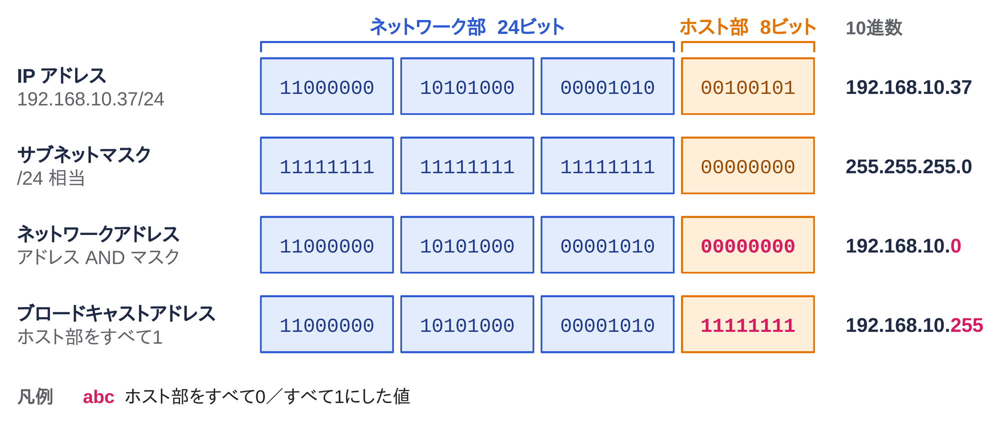
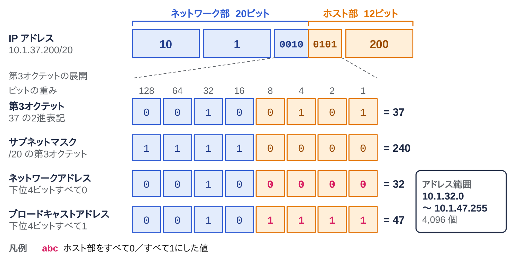
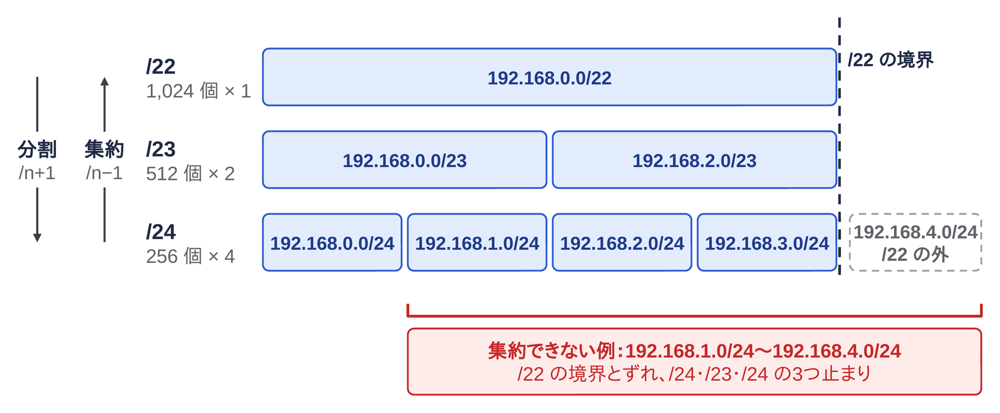
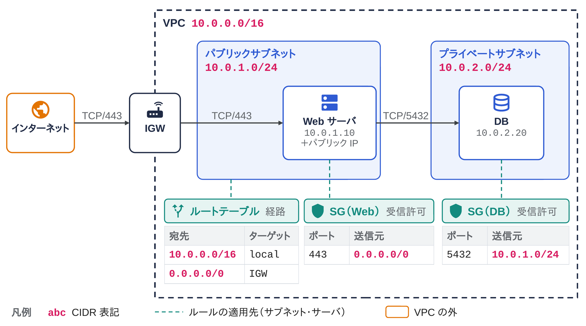

<!--
  コンパクト記事 no.30（草稿。公開前にこのコメントは削除）
  - 2026-11-07 Nico の依頼で新規作成。範囲：IPv4 アドレスの中身、ネットワーク部とホスト部、CIDR 表記の読み方と計算、分割と集約、特別な範囲、クラウドで CIDR が出てくる場所、IPv6 は短く
  - 裏取り：RFC 791（IPv4）、RFC 950（サブネット）、RFC 4632（CIDR）、RFC 1918（プライベート）、RFC 3021（/31）、RFC 6598（共有アドレス）、RFC 3927（リンクローカル）、RFC 5737・RFC 3849（文書用）、RFC 6890（特別用途アドレスのレジストリ）、RFC 4291（IPv6 アドレス体系）、AWS VPC ユーザーガイド「サブネットの CIDR ブロック」（予約アドレス5個）
  - 計算例と「確かめるコマンド」の出力は Python 3.13 の ipaddress で実際に実行した結果（2026-11-07）
  - 図：image/01〜04_*.pptx/png（生成スクリプト image/script/）
-->

# はじめに

ファイアウォールのルールやクラウドのセキュリティグループで `10.0.0.0/16` のような書き方を毎回なんとなく読んでいたので、ちゃんと計算できるように整理してみました。

# ひとことで言うと

**IP アドレスは、ネットワーク上の機器を指す番号**です。IPv4 では 32 ビットの数で、`192.168.10.37` のように書きます。
**CIDR 表記は、`アドレス/プレフィックス長` の形で「先頭の何ビットがネットワークを表すか」を書く方法**です。`192.168.10.0/24` なら、先頭24ビットが共通のアドレスの範囲（256個）を表します。

# IPv4 アドレスの中身

IPv4 アドレスは 32 ビットの数です（RFC 791）。
人間が読みやすいように、8ビット（1オクテット）ずつ4つに区切り、それぞれを10進数にして `.` でつなぎます。

| 書き方 | 第1オクテット | 第2オクテット | 第3オクテット | 第4オクテット |
|---|---|---|---|---|
| 10進数 | 192 | 168 | 10 | 37 |
| 2進数 | `11000000` | `10101000` | `00001010` | `00100101` |

1オクテットは 0〜255 の値をとるので、IPv4 アドレスは全部で 2^32 = 約43億個あります。

# ネットワーク部とホスト部とは？

IP アドレスは、前半の**ネットワーク部**（どのネットワークか）と、後半の**ホスト部**（そのネットワークの中のどの機器か）に分かれます。
どこで分けるかを表すのが**プレフィックス長**で、CIDR 表記の `/` の後ろの数字がそれです。


*図1：`192.168.10.37/24` のネットワーク部とホスト部。サブネットマスクとの AND でネットワークアドレスが、ホスト部をすべて1にするとブロードキャストアドレスが求まる*

- **サブネットマスク**：ネットワーク部を1、ホスト部を0にした32ビットの数（RFC 950）。`/24` は `255.255.255.0` と同じ意味で、`/n` の書き方は RFC 4632 で定められている
- **ネットワークアドレス**：アドレスとサブネットマスクの AND をとった値。ホスト部がすべて0のアドレスで、ネットワークそのものを表す（`192.168.10.0`）
- **ブロードキャストアドレス**：ホスト部をすべて1にしたアドレス。そのネットワークの全員宛て（`192.168.10.255`）
- 一般的な LAN では、同じネットワークアドレスを持つ機器どうしはルータを通さずに直接通信し、違えばデフォルトゲートウェイ（ルータ）に送る

# CIDR 表記はどう読むのか？

`/n` は「先頭 n ビットがネットワーク部」という意味なので、ホスト部は `32 − n` ビットです。
そこから、範囲に含まれるアドレスの数がすぐに出ます。

- アドレスの数：2^(32 − n) 個
- 機器に割り当てられる数：2^(32 − n) − 2 個（ネットワークアドレスとブロードキャストアドレスの2つを除く）

| CIDR | サブネットマスク | アドレス数 | 割り当てられる数 | よく見る場所 |
|---|---|---|---|---|
| /8 | 255.0.0.0 | 16,777,216 | 16,777,214 | `10.0.0.0/8`（プライベート） |
| /16 | 255.255.0.0 | 65,536 | 65,534 | VPC 全体（`10.0.0.0/16`） |
| /20 | 255.255.240.0 | 4,096 | 4,094 | 大きめのサブネット |
| /24 | 255.255.255.0 | 256 | 254 | 家庭の LAN、サブネットの定番 |
| /26 | 255.255.255.192 | 64 | 62 | 小さいサブネット |
| /28 | 255.255.255.240 | 16 | 14 | AWS のサブネットの最小（AWS では予約を除き 11） |
| /30 | 255.255.255.252 | 4 | 2 | ルータ間をつなぐ回線 |
| /31 | 255.255.255.254 | 2 | 2（例外） | ルータ間をつなぐ回線（RFC 3021） |
| /32 | 255.255.255.255 | 1 | 1（例外） | 1台だけを指す（FW のルールなど） |

- `/31` は機器が2台だけの回線（ポイントツーポイント）用に、ネットワークアドレスとブロードキャストアドレスを持たず、2つとも機器に割り当てる（RFC 3021）
- `/32` は1つのアドレスだけを表す。ファイアウォールのルールで「このホストだけ許可」と書くときに使う
- `0.0.0.0/0` はネットワーク部が0ビット、つまり**すべての IPv4 アドレス**を表す。ルーティングテーブルではデフォルトルート、セキュリティグループでは「どこからでも」の意味になる

# 実際に計算してみる

オクテットの切れ目で分かれない `10.1.37.200/20` の範囲を求めてみます。

1. `/20` なので、ネットワーク部は第1・第2オクテット（16ビット）と、第3オクテットの上位4ビット
2. 第3オクテット `37` を2進数にすると `0010 0101`。上位4ビット `0010` を残して下位4ビットを0にすると `0010 0000` = **32**
3. 第3オクテットの下位4ビットと第4オクテットがホスト部なので、すべて1にすると第3オクテットは `0010 1111` = **47**、第4オクテットは **255**


*図2：`10.1.37.200/20` の計算。境界は第3オクテットの途中にあり、上位4ビットだけを残すと 32、下位4ビットを1で埋めると 47 になる*

| 項目 | 値 |
|---|---|
| ネットワークアドレス | `10.1.32.0` |
| ブロードキャストアドレス | `10.1.47.255` |
| 割り当てられる範囲 | `10.1.32.1` 〜 `10.1.47.254` |
| アドレス数 | 4,096（割り当てられるのは 4,094） |

第3オクテットだけに注目すると、`/20` の範囲は「16 の倍数から始まって 16 個ずつ」になります（32〜47、48〜63…）。
一般に、境界があるオクテットの中のホスト部のビット数を k とすると、そのオクテットは 2^k の倍数ごとに区切られる、と覚えておくと暗算できます（`/20` なら k = 4 で 16 ごと）。

# 分割と集約

CIDR では、プレフィックス長を1増やすと範囲がちょうど半分に分かれ、1減らすと隣の範囲と合わさって倍になります。


*図3：`192.168.0.0/22` の分割と集約。プレフィックス長を1増やすごとに範囲が半分に分かれ（分割）、逆にたどると1つにまとまる（集約）。下の赤枠は、`/22` の境界とずれているため1つにまとまらない例*

- **分割（サブネット化）**：`192.168.0.0/24` を `/26` で分けると、`.0/26`・`.64/26`・`.128/26`・`.192/26` の4つになる
- **集約（ルート集約、スーパーネット化）**：`192.168.0.0/24` 〜 `192.168.3.0/24` の4つは、`192.168.0.0/22` の1行にまとめられる。ルーティングテーブルの行数が減る
- 集約できるのは、**連続していて、かつ境界がそろっている**ときだけ。`192.168.1.0/24` 〜 `192.168.4.0/24` の4つは、連続していても `/22` 1つにはまとまらない（`192.168.1.0/24`・`192.168.2.0/23`・`192.168.4.0/24` の3つになる）

## なぜ「CIDR」と呼ぶのか？

CIDR は Classless Inter-Domain Routing の略です。
昔の IPv4 は、先頭のビットでクラス A（`/8` 相当）・クラス B（`/16`）・クラス C（`/24`）が決まり、組織には3つのどれかの大きさでしか割り当てられませんでした。
クラス C の 256 個では足りず、クラス B の 65,536 個では余る、という組織が多く、アドレスもルーティングテーブルも無駄に消費されていました。
そこで 1993 年に、プレフィックス長を自由に決められる CIDR が導入されました（RFC 1518・RFC 1519、現在は RFC 4632）。
今「クラス C」と言ったら、たいてい「`/24` の大きさ」くらいの意味で使われています。

# 特別な範囲のアドレス

用途が決まっていて、インターネット上の機器には割り当てられない範囲があります。主なものは次のとおりです（全体の一覧は IANA の Special-Purpose Address Registry、RFC 6890）。

| 範囲 | 用途 | RFC |
|---|---|---|
| `10.0.0.0/8` | プライベートアドレス | RFC 1918 |
| `172.16.0.0/12` | プライベートアドレス（172.16〜172.31） | RFC 1918 |
| `192.168.0.0/16` | プライベートアドレス | RFC 1918 |
| `100.64.0.0/10` | 共有アドレス（キャリアグレード NAT 用） | RFC 6598 |
| `127.0.0.0/8` | ループバック（自分自身） | RFC 1122 |
| `169.254.0.0/16` | リンクローカル（DHCP で取れなかったときなど） | RFC 3927 |
| `192.0.2.0/24`、`198.51.100.0/24`、`203.0.113.0/24` | 文書・例示用 | RFC 5737 |

- **プライベートアドレス**は、組織の中で自由に使ってよい範囲。インターネットに出るときは NAT でグローバルアドレスに変換する
- `100.64.0.0/10` はプロバイダが NAT の内側で使う範囲で、プライベートアドレスではない
- この記事の例のように、ブログや資料に IP アドレスを書くときは、実在する機器を指さないよう文書用の範囲を使う

# クラウドでは CIDR はどこに出てくるのか？

AWS の VPC を例にすると、CIDR 表記は「アドレスの割り当て」「経路」「通信の許可」の3か所に出てきます。図4の IGW はインターネットゲートウェイ（VPC とインターネットの出入口）、SG はセキュリティグループ（インスタンスのネットワークインタフェースごとに付けるファイアウォール）です。


*図4：AWS の VPC で CIDR が出てくる場所。VPC とサブネットはアドレスの割り当て、ルートテーブルは宛先ごとの転送先、セキュリティグループのインバウンドルールは許可する送信元を CIDR で書く（プライベートサブネットのルートテーブルは省略）*

- **VPC・サブネット**：VPC に `10.0.0.0/16` を割り当て、その中をサブネット（`10.0.1.0/24` など）に分割する。同じ VPC の中でサブネットの範囲は重ねられない
- **ルートテーブル**：サブネットごとに関連付け、宛先を CIDR で書く。`10.0.0.0/16 → local`（VPC の中）と `0.0.0.0/0 → インターネットゲートウェイ` のように書き、より長いプレフィックスに一致した行が優先される（ロンゲストマッチ）。プライベートサブネットのルートテーブルには `0.0.0.0/0 → igw` の行を置かない
- **パブリック IP**：インターネットゲートウェイ経由で外と通信できるのは、パブリック IPv4 アドレス（または Elastic IP）を持つ機器だけ。図4の Web サーバには `10.0.1.10` に加えてパブリック IP（例 `203.0.113.10`）が付いている
- **セキュリティグループ**：インバウンドルールで、許可する送信元を CIDR で書く。DB の 5432 番ポートは Web サーバのサブネット `10.0.1.0/24` からだけ許可する、のように絞る。実際の運用では、送信元に CIDR の代わりに Web サーバのセキュリティグループを指定することも多い
- AWS のサブネットでは、先頭4つと最後の1つ、合わせて5個のアドレスが予約されていて使えない。`10.0.1.0/24` で割り当てられるのは `10.0.1.4` 〜 `10.0.1.254` の 251 個（Azure も同じく5個を予約）

# IPv6 でも考え方は同じ

IPv6 アドレスは 128 ビットで、16ビットずつ16進数で書いて `:` で区切ります（RFC 4291）。
CIDR 表記の読み方は IPv4 と同じで、`2001:db8:1234::/48` なら先頭48ビットがネットワーク部です（`2001:db8::/32` は文書用の範囲、RFC 3849）。

- 1つのサブネットはふつう `/64`。後半の64ビットが機器を表すインタフェース ID になる
- 組織や家庭には `/48` や `/56` がまとめて割り当てられ、その中を `/64` に分けて使う
- IPv6 にはブロードキャストアドレスがない（代わりにマルチキャストを使う）

# ハマりやすいところ

- **`0.0.0.0/0` を許可すると、インターネット全体に開く**。SSH（22番）や DB のポートを `0.0.0.0/0` で開けたままにしない
- **`172.16.0.0/12` は 172.16〜172.31 まで**。`172.32.0.1` はプライベートアドレスではなく、グローバルアドレス
- **ホスト部に1が残った CIDR は、ツールによって扱いが違う**。`10.0.0.5/24` を Python の `ipaddress.ip_network()` に渡すと `ValueError` になるが、`strict=False` を付けると黙って `10.0.0.0/24` に直す。ほかのツールでも扱いが分かれるので、範囲のつもりなら、ネットワークアドレスで書く
- **連続した範囲でも、境界がそろっていないと1つに集約できない**（`192.168.1.0/24`〜`192.168.4.0/24` の例）
- **クラウドのサブネットは、計算した数より使えるアドレスが少ない**（AWS・Azure は1サブネットあたり5個が予約）
- **VPC やオンプレの CIDR が重なると、あとからつなぐのが難しい**。重なった VPC どうしはピアリングできず、VPN でも NAT を挟む必要が出る。最初に組織全体で使う範囲を決めておく

# 確かめるコマンド

Python の標準ライブラリ `ipaddress` で、この記事の計算をそのまま確かめられます。

```python
import ipaddress as ip

# 10.1.37.200/20 の範囲（図2）
n = ip.ip_interface("10.1.37.200/20")
print(n.network, n.netmask)              # 10.1.32.0/20 255.255.240.0
print(n.network.broadcast_address)       # 10.1.47.255
print(n.network.num_addresses)           # 4096

# /24 を /26 に分割する（図3）
print(list(ip.ip_network("192.168.0.0/24").subnets(new_prefix=26)))
# [IPv4Network('192.168.0.0/26'), IPv4Network('192.168.0.64/26'),
#  IPv4Network('192.168.0.128/26'), IPv4Network('192.168.0.192/26')]

# /24 を4つ集約する（図3）
print(list(ip.collapse_addresses(
    [ip.ip_network(f"192.168.{i}.0/24") for i in range(4)])))
# [IPv4Network('192.168.0.0/22')]

# ホスト部に1が残っているとエラー
ip.ip_network("10.0.0.5/24")
# ValueError: 10.0.0.5/24 has host bits set
```

自分の端末のアドレスとプレフィックス長は、次のコマンドで見られます。

```sh
# Linux：inet 192.168.10.37/24 のように CIDR 表記で出る
ip addr

# macOS：netmask 0xffffff00（= 255.255.255.0 = /24）のように16進数で出る
ifconfig en0
```

# まとめ

CIDR 表記の `/n` は「先頭 n ビットがネットワーク部」という1つのルールだけで、アドレスの数・範囲・分割・集約がすべて計算できます。
オクテットの途中で区切られるときも、そのオクテットを2進数にして上位ビットを残せば範囲が出ます。
セキュリティグループやルートテーブルを読むときは、`0.0.0.0/0` と `/32` の意味、それに予約アドレスの数を押さえておくと迷いにくいです。
もっと楽な暗算の方法があれば、有識者の方教えて欲しいです！

# 参考

- RFC 791（IPv4）、RFC 950（サブネット）、RFC 4632（CIDR）、RFC 1518 / RFC 1519（CIDR の導入）
- RFC 1918（プライベートアドレス）、RFC 6598（共有アドレス）、RFC 3927（リンクローカル）、RFC 5737（IPv4 の文書用アドレス）、RFC 3021（/31）
- RFC 6890 と IANA IPv4 / IPv6 Special-Purpose Address Registry
- RFC 4291（IPv6 アドレス体系）、RFC 3849（IPv6 の文書用アドレス）
- AWS VPC ユーザーガイド「サブネットの CIDR ブロック」
- Python ドキュメント「ipaddress — IPv4/IPv6 操作ライブラリ」
