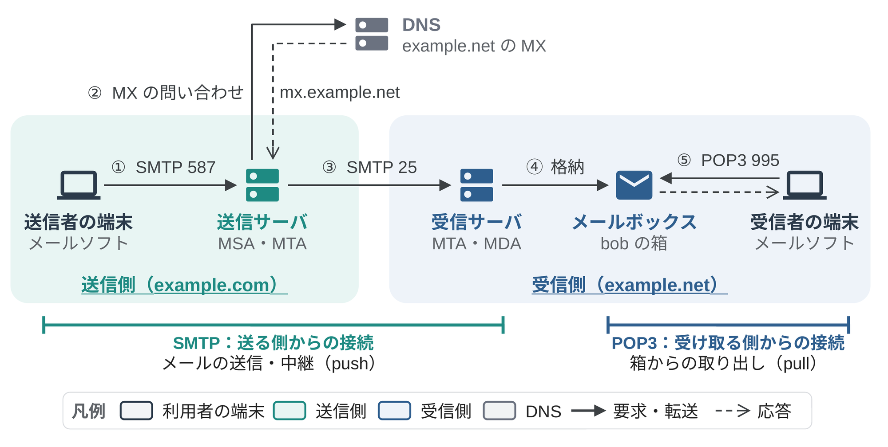
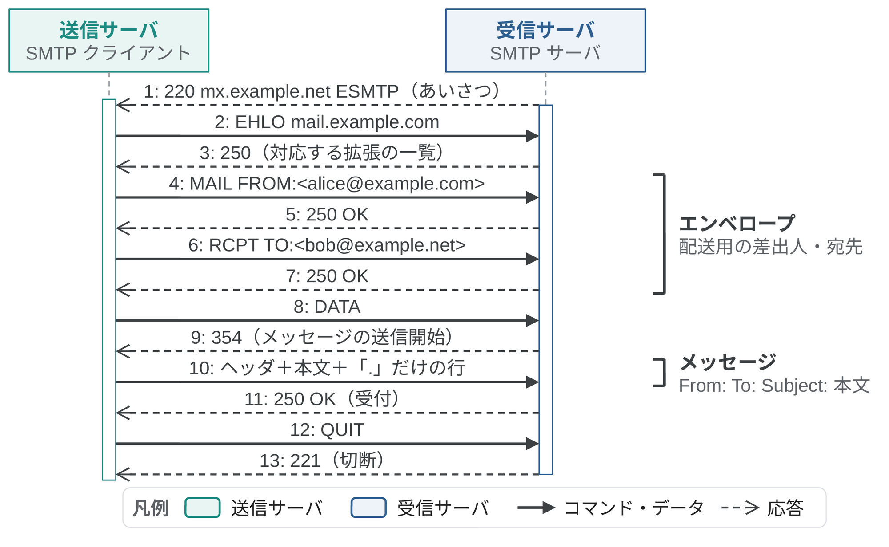
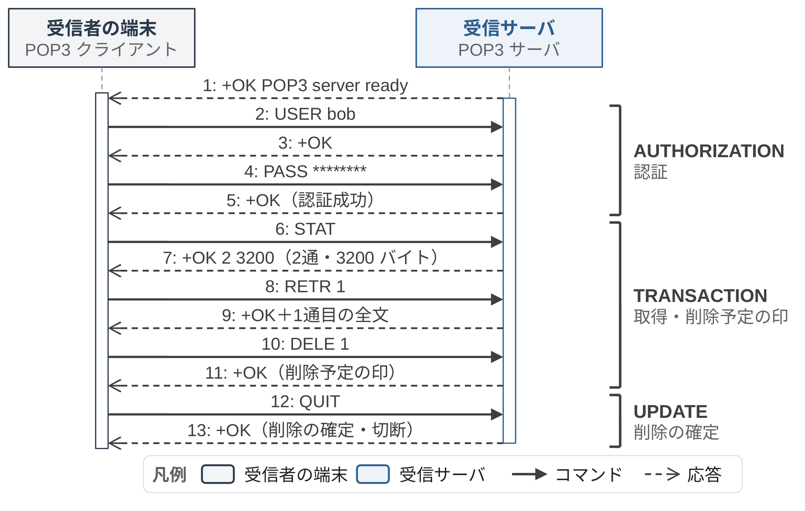
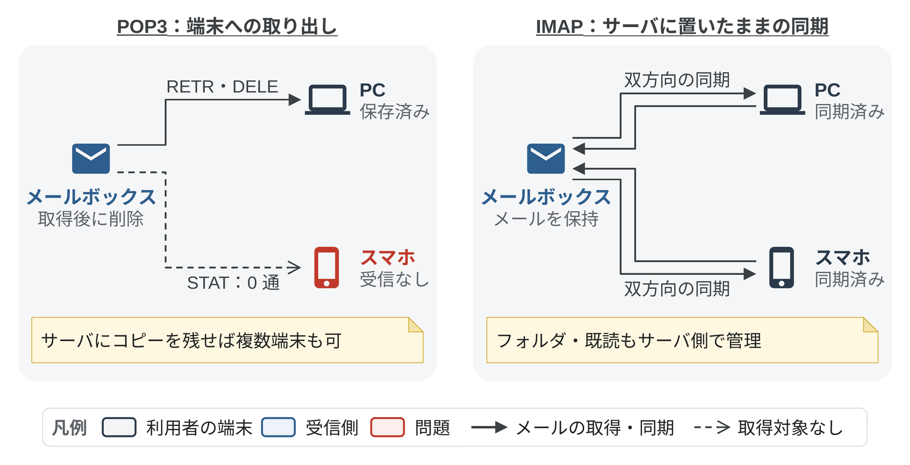

<!--
  コンパクト記事 no.33（草稿。公開前にこのコメントは削除）
  - 扱う範囲：SMTP（送信・中継）と POP3（受信箱からの取り出し）。IMAP は比較のために1節だけ
  - 裏取り：SMTP は RFC 5321（応答コード 4.2、ドットスタッフィング 4.5.2、エンベロープ 2.3.1／3.3）、サブミッションは RFC 6409、ポートと TLS の推奨は RFC 8314、POP3 は RFC 1939（状態 3〜6章）、STLS は RFC 2595、IMAP は RFC 9051、役割の名前（MUA など）は RFC 5598
  - Gmail の POP 取得機能の終了：新規は2026年第1四半期で停止、既存は2027年1月まで（Gmail ヘルプ answer/16604719 の FAQ、2026-11-09 確認）。最初の告知は The Register 2026-01-05 など
  - DMARC は RFC 9989（2026-05、RFC 7489 と RFC 9091 を置き換え）を参照。no.8 はまだ RFC 7489 を挙げている
  - 図：image/01〜04_*.pptx/png（zukai-diagrams 準拠、色の組は no.8 と同じ。生成スクリプト image/zukai/figs.js、`node figs.js <出力先>` → `bash render.sh <出力先>`）
  - TODO：「確かめるコマンド」に、Nico が自分で管理するサーバ（またはテスト用サーバ）で叩いた実際の出力を貼る
-->

# はじめに

Gmail が他社のメールを POP で取りに行く機能（「他のアカウントのメールを確認」）を終了する（新規の設定は2026年第1四半期で停止、既存の設定も2027年1月まで）、というニュースを見て、そもそも POP と SMTP ってちゃんと説明できるか？と気になったのでまとめてみました。

# ひとことで言うと

- **SMTP**（Simple Mail Transfer Protocol）は、**メールを送り出し、サーバからサーバへ中継する**ためのプロトコル
- **POP3**（Post Office Protocol version 3）は、**受信サーバの箱（メールボックス）にたまったメールを、手元の端末に取り出す**ためのプロトコル

SMTP は「送る側から接続して渡す（push）」、POP3 は「受け取る側から接続して取りに行く（pull）」と、向きが逆になっています。

# メールはどう届くのか？

`alice@example.com` が `bob@example.net` にメールを送るときの流れです。


*図1：メールが届くまでの流れ。①・③が SMTP、②が DNS、⑤が POP3 の区間*

1. alice のメールソフトが、自分のドメインの送信サーバに SMTP（587番ポート）でメールを渡す
2. 送信サーバが、宛先ドメイン `example.net` の MX レコードを DNS に問い合わせて、受信サーバの名前（`mx.example.net`）を知る
3. 送信サーバが、受信サーバに SMTP（25番ポート）でメールを中継する
4. 受信サーバが、bob のメールボックスにメールを格納する
5. bob のメールソフトが、受信サーバに POP3（995番ポート）で接続して、メールボックスからメールを取り出す（メール本体は応答として返ってくる）

MX レコードの引き方は [compact no.8「DNSとレコード」](../no.8-dns-records/dns-records.md) の MX の節にまとめています。

登場人物には、RFC 5598 で次の名前が付いています。

| 名前 | 正式名 | 役割 | 図1 |
|---|---|---|---|
| MUA | Mail User Agent | メールソフト。書く・読む | 送信者・受信者の端末 |
| MSA | Mail Submission Agent | 利用者からメールを受け付ける窓口 | 送信サーバ |
| MTA | Mail Transfer Agent | サーバ間でメールを中継する | 送信サーバ・受信サーバ |
| MDA | Mail Delivery Agent | メールボックスに格納する | 受信サーバ |

実際の製品では、MSA と MTA（たとえば Postfix）や、MDA と POP3 サーバ（たとえば Dovecot）が1台に同居していることがよくあります。

# SMTP はどんなやり取りをしているのか？

SMTP は、テキストのコマンドと3桁の応答コードを交互にやり取りするプロトコルです（RFC 5321）。
図2は、図1の③（送信サーバ → 受信サーバ）のやり取りです。


*図2：SMTP のやり取り。4〜7でエンベロープ（配送用の差出人・宛先）を、10でメッセージ本体を送る*

| コマンド | 意味 |
|---|---|
| `EHLO` | 自分の名前を名乗り、サーバが対応する拡張（`STARTTLS`、`AUTH`、`SIZE` など）の一覧をもらう |
| `MAIL FROM` | 差出人（エラー通知の返送先）を伝える |
| `RCPT TO` | 宛先を伝える。宛先が複数なら、その数だけ繰り返す |
| `DATA` | メッセージの送信を始める。ヘッダと本文を送り、`.` だけの行で終える |
| `STARTTLS` / `AUTH` | TLS に切り替える／利用者を認証する（587番などで使う） |
| `QUIT` | 終了する |

応答コードの1桁目で、結果のおおまかな意味が決まっています。

| 1桁目 | 意味 | 例 |
|---|---|---|
| 2 | 成功 | `250 OK`、`220`（接続直後のあいさつ） |
| 3 | 続きを送ってよい | `354`（メッセージを送ってよい） |
| 4 | 一時的な失敗。あとで再送する | `421`、`450` |
| 5 | 恒久的な失敗。再送しない | `550`（宛先がない、ポリシーで拒否など） |

本文の途中に `.` だけの行があると、そこで本文が終わったと誤解されます。
そのため、送る側は `.` で始まる行の先頭にもう1つ `.` を足し、受け取る側はそれを1つ取り除きます（ドットスタッフィング、RFC 5321 4.5.2）。

## エンベロープとヘッダは別物

SMTP で送る差出人・宛先は2組あります。

- **エンベロープ**：`MAIL FROM` と `RCPT TO`。サーバが配送に使う、封筒の表書き
- **ヘッダ**：`DATA` の中の `From:` `To:` `Cc:`。メールソフトが画面に表示する、便せんの中の宛名

サーバが配送先を決めるのは `RCPT TO` だけで、ヘッダの `To:` は配送に使われません。
Bcc が他の宛先に見えないのもこの仕組みで、メールソフトは Bcc の相手を `RCPT TO` にだけ書き、ヘッダには載せません。

逆に言うと、SMTP の仕様そのものは、ヘッダの `From:` にどんなアドレスを書いても止めません。
これがなりすましメールの入り口で、SPF（送信元 IP が、エンベロープの `MAIL FROM`（と `HELO`）のドメインに許可されているかを確かめる）、DKIM（署名したドメインの公開鍵で署名を検証し、改ざんを確かめる）、DMARC（SPF か DKIM で認証できたドメインが、ヘッダの `From:` のドメインと一致するかを確かめる）で補います。
3つの DNS 上の書き方は、no.8 の TXT の節にまとめています。

## 25・587・465 番ポートの違い

| ポート | 用途 | 暗号化 | 認証 |
|---|---|---|---|
| 25 | サーバ間の中継（MTA → MTA） | STARTTLS（任意） | なし |
| 587 | 利用者からの送信（サブミッション、RFC 6409） | STARTTLS | SMTP AUTH |
| 465 | 利用者からの送信（RFC 8314） | 接続直後から TLS | SMTP AUTH |

- **STARTTLS** は、平文で接続したあと `STARTTLS` コマンドで TLS に切り替える方式。**接続直後から TLS**（暗黙的 TLS）は、最初から TLS で話す方式
- 465番は一時期「SMTPS は廃止された」と扱われていましたが、RFC 8314（2018年）でサブミッション用（submissions）としても登録され、STARTTLS より暗黙的 TLS を推奨すると書かれました
- 多くのプロバイダは、家庭や携帯回線から外向きの25番ポートへの接続をふさいでいます（OP25B：Outbound Port 25 Blocking）。迷惑メールの送信元にされた PC から直接ばらまかれるのを防ぐためで、利用者は認証つきの587番や465番で自分の送信サーバに渡します

# POP3 はどんなやり取りをしているのか？

POP3 も、テキストのコマンドを送って、`+OK` か `-ERR` で答えが返ってくるプロトコルです（RFC 1939）。
図3は、図1の⑤（受信者の端末 → 受信サーバ）のやり取りです。


*図3：POP3 のやり取り。セッションは AUTHORIZATION → TRANSACTION → UPDATE の3つの状態を順に進む*

| コマンド | 意味 |
|---|---|
| `USER` / `PASS` | ユーザー名とパスワードで認証する |
| `STAT` | メールの件数と合計バイト数を聞く |
| `LIST` | メールごとの番号とサイズの一覧をもらう |
| `UIDL` | メールごとの一意な ID の一覧をもらう |
| `RETR n` | n 番のメールを全文もらう |
| `DELE n` | n 番のメールに削除の印を付ける |
| `RSET` | 削除の印をすべて取り消す |
| `QUIT` | 終了する。ここで削除が確定する |

## DELE しただけでは消えないのか？

`DELE` はメールに削除予定の印を付けるだけで、その場では消えません。
クライアントが `QUIT` を送るとセッションが UPDATE 状態に入り、そこで初めて印の付いたメールが削除されます（RFC 1939 6章）。

そのため、`QUIT` を送る前に回線が切れると、UPDATE 状態に入らず、何も削除されません。
次に接続したとき同じメールがまた落ちてくるのはこのためで、メールソフトは `UIDL` の ID を覚えておき、取得済みのメールをもう一度ダウンロードしないようにしています。

# POP3 と IMAP は何が違うのか？

受信にはもう1つ、IMAP（Internet Message Access Protocol、現行は IMAP4rev2：RFC 9051）があります。
POP3 は「端末に取り出す」、IMAP は「サーバに置いたまま見に行く」プロトコルです。


*図4：POP3 と IMAP の違い。POP3 で取り出して削除すると、ほかの端末からはそのメールが見えなくなる。IMAP はサーバの箱を各端末が同期して見る*

| 観点 | POP3 | IMAP |
|---|---|---|
| メールの置き場所 | 端末（取得後にサーバから消すのが基本） | サーバ |
| 複数端末 | 苦手（「サーバにコピーを残す」設定で回避） | 得意（既読やフォルダも同期） |
| フォルダ | なし（受信箱1つ） | サーバ側で作れる |
| サーバの容量 | 取り出して消せば空く | 消さない限りたまる |
| ポート | 110（STARTTLS は `STLS` コマンド）／995（暗黙的 TLS） | 143（STARTTLS）／993（暗黙的 TLS） |

PC とスマホの両方でメールを読むのが当たり前になった今は、受信には IMAP（または Web メール）を使うのが主流です。
POP3 は、サーバの容量が小さい環境や、メールを手元に保管して管理したい場面で使われています。

# セキュリティで気をつけるところ

- **平文の認証**：STLS を使わない110番の POP3 や、TLS なしの SMTP AUTH では、パスワードがそのまま流れる。995番・465番の暗黙的 TLS か、STARTTLS を使う
- **STARTTLS の弱さ**：最初は平文なので、途中の攻撃者が `STARTTLS` の対応表示を消すと、平文のまま通信が続くことがある（ダウングレード）。STARTTLS の実装には、TLS に切り替える前に送り込まれたコマンドを切り替え後に実行してしまう不具合も多く見つかっている（USENIX Security 2021「Why TLS is better without STARTTLS」）。この種のコマンド注入は2011年にも見つかっており、RFC 8314 が利用者とサーバの間の通信に暗黙的 TLS を推奨する理由の1つになっている
- **サーバ間の 25番**：MTA 同士の STARTTLS は「使えたら使う」が基本で、証明書も確かめないことが多い。受信側は MTA-STS（RFC 8461）で「TLS 必須・証明書を確かめよ」と送信側に伝えられる
- **オープンリレー**：認証なしで、誰からのメールでも外部へ中継してしまう SMTP サーバ。迷惑メールの踏み台にされるので、中継は自ドメイン宛てと認証済みの利用者だけに限る
- **なりすまし**：前述のとおり、SMTP 自体は `From:` を確かめない。SPF・DKIM・DMARC をそろえて設定する

# ハマりやすいところ

- **POP3 で受信したら、スマホからメールが消えた**：PC のメールソフトが取得後に `DELE` していた。複数端末で読むなら IMAP にするか、「サーバにコピーを残す」設定にする
- **587番で送れない**：587番は STARTTLS ＋ SMTP AUTH が前提。メールソフトの設定で「暗号化：SSL/TLS」を選ぶと、接続直後から TLS で話しかけてしまい失敗する。465番なら SSL/TLS、587番なら STARTTLS と組み合わせる
- **ヘッダの `To:` に無い人にも届いている**：その人は Bcc で、`RCPT TO` にだけ書かれていた
- **`openssl s_client` で `RCPT TO` を打つと接続がおかしくなる**：対話モードの `s_client` は、`R` で始まる行を TLS の再ネゴシエーション、`Q` で始まる行を終了の命令として扱う。`RETR` も `R` で始まるので同じことが起きる…。`QUIT` も `Q` で始まるので、サーバに届かないまま切断され、POP3 では `DELE` が確定しない。`-quiet`（または `-ign_eof`、`-nocommands`）を付けると、この解釈が無効になる

# 確かめるコマンド

自分で管理しているサーバかテスト用のサーバで、手で SMTP・POP3 を話してみると、図2・図3のやり取りがそのまま見えます。
`-crlf` は改行を CRLF にするオプションで、SMTP と POP3 は行の終わりに CRLF を求めます。

```sh
# SMTP（587番、STARTTLS）。openssl が EHLO と STARTTLS まで済ませるので、TLS になったあと EHLO から打ち直す
openssl s_client -starttls smtp -connect smtp.example.com:587 -crlf -quiet

# SMTP（465番、接続直後から TLS）
openssl s_client -connect smtp.example.com:465 -crlf -quiet

# POP3（995番、接続直後から TLS）。USER / PASS / STAT / LIST / RETR 1 / QUIT と打つ
openssl s_client -connect pop.example.com:995 -crlf -quiet

# 受信サーバの名前（図1の②）を確かめる。example.net は自分のドメインに置き換える
dig +short MX example.net
```

送信サーバは、認証しないと外部宛てのメールを受け付けないのが普通です（`AUTH` コマンドが必要）。
ほかの人のサーバで試すのはやめておきましょう。

# まとめ

SMTP は「送る側から接続して渡す」、POP3 は「受け取る側から接続して取り出す」プロトコルで、メールはこの2つを組み合わせて届きます。
SMTP で押さえておきたいのは、配送に使うエンベロープと画面に出るヘッダが別物だということで、なりすましや Bcc の仕組みもここから来ています。
POP3 は `DELE` が `QUIT` まで確定しないことと、取り出したメールがほかの端末から見えなくなることを覚えておくと、トラブルの原因に気づきやすいです。

# 参考

- RFC 5321（SMTP）、RFC 6409（メールのサブミッション）、RFC 3207（SMTP の STARTTLS）、RFC 4954（SMTP AUTH）
- RFC 1939（POP3）、RFC 2595（IMAP・POP3 の TLS と `STLS`）、RFC 9051（IMAP4rev2）
- RFC 8314（メールのサブミッションとアクセスに TLS を使う。暗黙的 TLS を推奨）、RFC 8461（MTA-STS）
- RFC 5598（インターネットメールのアーキテクチャ。MUA・MSA・MTA・MDA）
- RFC 7208（SPF）、RFC 6376（DKIM）、RFC 9989（DMARC。RFC 7489 を置き換え）
- Poddebniak et al.「Why TLS is better without STARTTLS: A Security Analysis of STARTTLS in the Email Context」USENIX Security 2021
- OpenSSL ドキュメント「openssl-s_client」（CONNECTED COMMANDS）
- Gmail ヘルプ（support.google.com/mail/answer/16604719）、The Register「Gmail preparing to drop POP3 mail fetching」（2026-01-05）
