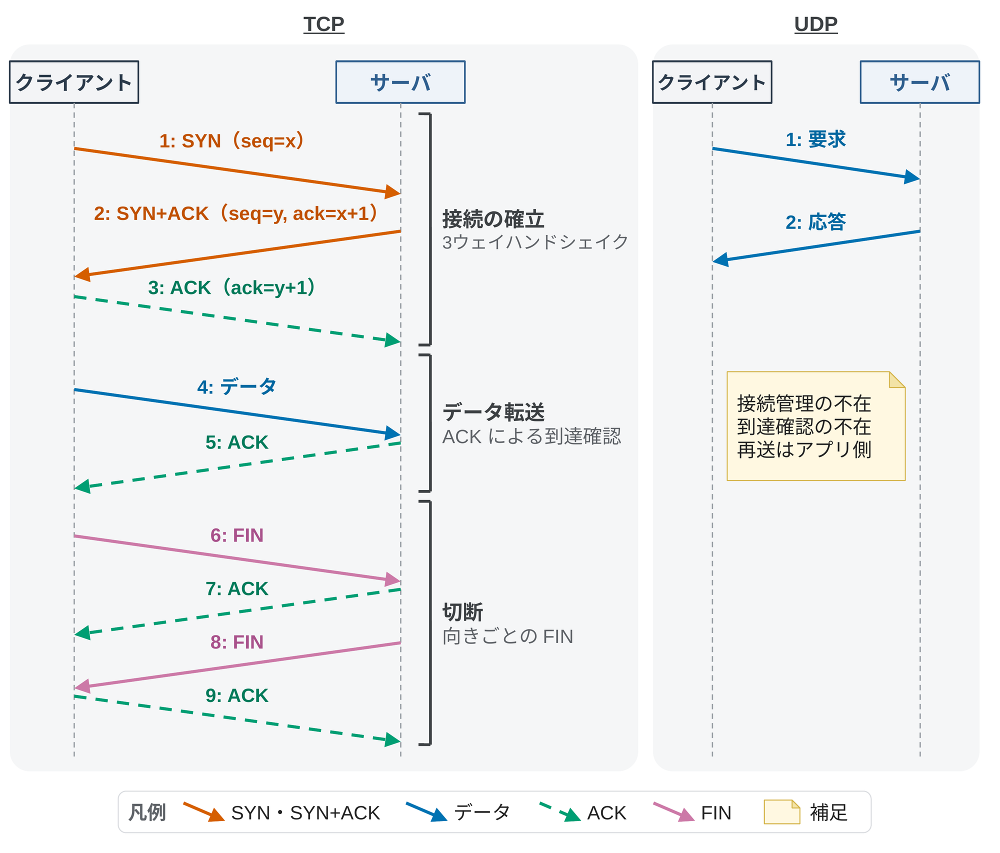
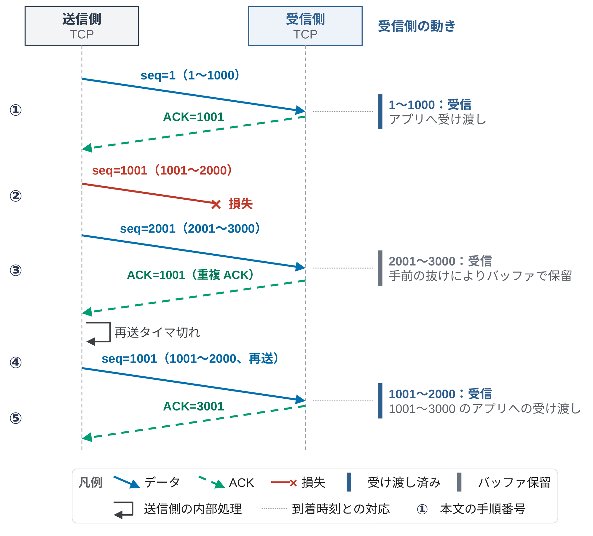
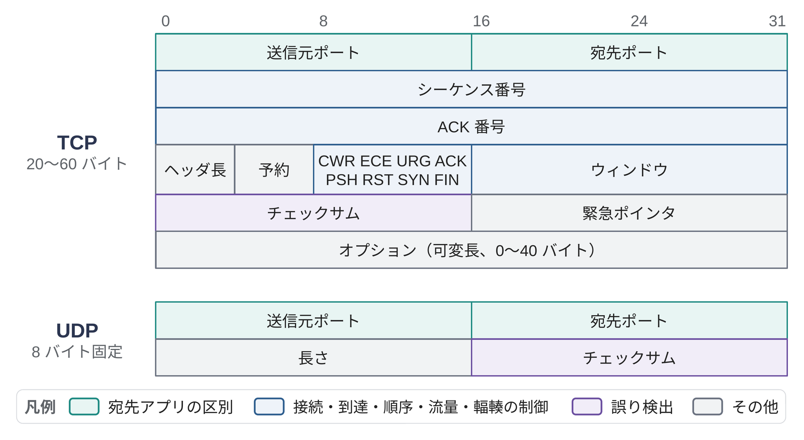
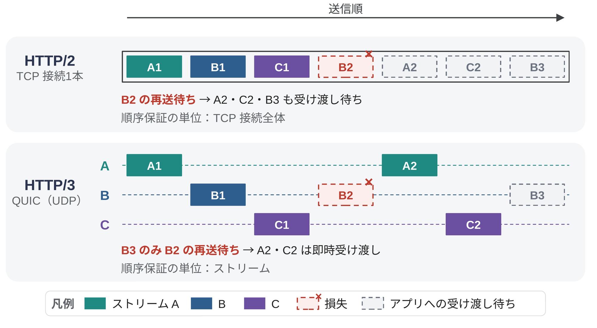

<!--
  コンパクト記事 no.34（草稿。公開前にこのコメントは削除）
  - きっかけ：人に TCP と UDP の違いを聞かれて、きちんと答えきれなかった
  - 裏取り：TCP は RFC 9293（2022、RFC 793 を置き換え。ヘッダ 3.1、状態 3.3.2、ISN 3.4.1）、UDP は RFC 768、UDP の使い方の指針は RFC 8085、
    輻輳制御は RFC 5681・RFC 9438（CUBIC）、ウィンドウスケールは RFC 7323、SYN フラッドと SYN クッキーは RFC 4987、
    QUIC は RFC 9000、HTTP/3 は RFC 9114、DNS の TCP 対応必須は RFC 7766・RFC 9210、EDNS(0) は RFC 6891、IPv6 の UDP チェックサムは RFC 8200 8.1
  - 増幅率の数字は CISA「UDP-Based Amplification Attacks」（TA14-017A）の表から
  - 図：image/01〜04_*.pptx/png（zukai-diagrams 準拠、生成スクリプト image/zukai/figs.js、`node figs.js <出力先>` → `bash render.sh <出力先>`）
  - TODO：「確かめるコマンド」に、Nico の Mac で取った実際の出力を貼る
-->

# はじめに

人に「TCP と UDP って何が違うの？」と聞かれて、「TCP は確実で、UDP は速い」くらいまでしか答えられなかったので、仕組みと実例をまとめ直してみました。

# ひとことで言うと

- **TCP**（Transmission Control Protocol）は、**接続を張ってから、データを順番どおり・抜けなく届ける**ためのプロトコル。届かなかった分は自分で再送する
- **UDP**（User Datagram Protocol）は、**データグラム（ひとかたまりのデータ）を、接続も再送もせずにそのまま送る**ためのプロトコル。届いたかどうかは気にしない

どちらも IP の上で動き、ポート番号で「どのアプリ宛てか」を区別するところは同じです。
違うのは、IP が保証してくれない「届いたか・順番どおりか」を、トランスポート層が面倒を見るかどうかです。

| 観点 | TCP | UDP |
|---|---|---|
| 接続 | 3ウェイハンドシェイクで張る | なし（いきなり送る） |
| 到達の確認・再送 | ACK と再送でする | しない |
| 順序 | シーケンス番号で並べ直す | 届いた順のまま |
| データの区切り | なし（バイトの流れ） | あり（1回の送信＝1データグラム） |
| 流量・輻輳の制御 | する（ウィンドウ、輻輳制御） | しない |
| ヘッダ | 20〜60バイト | 8バイト |
| 主な用途 | Web（HTTP/1.1・HTTP/2）、SSH、メール | DNS、DHCP、NTP、音声・映像通話、QUIC（HTTP/3） |

# 通信の始め方はどう違うのか？


*図1：TCP と UDP の通信の違い。TCP はデータを送る前に1往復のハンドシェイクが要る*

TCP は、データを送る前に3つのセグメントをやり取りして接続を張ります（3ウェイハンドシェイク）。

1. クライアントが `SYN` を送る。自分の初期シーケンス番号（ISN）を伝える
2. サーバが `SYN+ACK` を返す。サーバの ISN と、「クライアントの SYN を受け取った」という ACK を伝える（図1の `ack=x+1` は ACK 番号のこと）
3. クライアントが `ACK` を返す。ここで接続が確立する

ISN は、時計で進む値に、外から計算できない擬似乱数を足して決めます（RFC 9293 3.4.1）。
前の同じ組み合わせの接続から遅れて届いたセグメントと混ざらないようにするためと、推測されると第三者がその接続のセグメントを偽造して割り込めてしまうためです。

終わるときは、それぞれの向きで `FIN` を送り、相手が `ACK` を返します（片方ずつ閉じるので、FIN と ACK が2組）。
なお、最初の `SYN` 以外のセグメントには ACK フラグも立っています（図1ではデータや FIN を ACK なしの名前で書いていますが、`tcpdump` では FIN は `[F.]`＝FIN+ACK と表示されます）。
先に閉じた側は、遅れて届くセグメントに備えて `TIME_WAIT` 状態でしばらく待ってから、接続の情報を捨てます。

UDP には、この接続の準備も後片付けもありません。
最初のデータグラムにいきなり中身を載せて送り、相手のアプリが返事をするかどうかはアプリしだいです。

# TCP はどうやって順番どおり・抜けなく届けているのか？

TCP は、送るデータの1バイトごとに番号（シーケンス番号）を振っています。
受け取った側は、「次に欲しいのは何番のバイトか」を ACK 番号で返します。


*図2：TCP の再送と並べ直し。2つ目のセグメントが失われると、受信側は3つ目をバッファにためたまま「1001 番から欲しい」ともう一度返す（簡略化のため1セグメント＝1000バイト、seq は ISN からの相対値。見やすさのため1本ずつ描いているが、実際は ACK を待たずに続けて送る）*

1. 送信側が 1〜1000 番のバイト（`seq=1`）を送り、受信側が `ACK=1001`（次は 1001 番から）を返す
2. 1001〜2000 番（`seq=1001`）が途中で失われる
3. 2001〜3000 番（`seq=2001`）は届くが、手前が抜けているので、受信側はこれをバッファにためてアプリには渡さず、`ACK=1001` をもう一度返す（重複 ACK）
4. 送信側は、再送タイマが切れる（または同じ ACK が重ねて届く）と、`seq=1001` を再送する
5. 抜けが埋まったので、受信側は 1001〜3000 番をまとめてアプリに渡し、`ACK=3001` を返す

ACK は「ここまでは全部そろった」という累積の番号なので、3つ目のセグメントへの ACK を個別に返す必要はありません。
実際の TCP は、再送タイマを待たずに、重複 ACK を3つ受け取った時点（最初の ACK と合わせて同じ ACK が4つ）で再送する（高速再送、RFC 5681）ことが多く、どの範囲が届いたかを細かく伝える SACK（RFC 2018）もよく使われます。

## 送る量はどうやって決めているのか？

TCP は、相手と経路の両方があふれないように、一度に送る量を調整しています。

- **フロー制御**：受信側がヘッダのウィンドウで「あと何バイト受け取れるか」を伝え、送信側はそれを超えて送らない。受信側のアプリが読むのが遅いと、ウィンドウが 0 になって送信が止まる
- **輻輳制御**：送信側が、ACK の返り方やパケットの損失から経路の混み具合を推測し、送る量を増減する。Linux の既定は CUBIC（RFC 9438）で、Google が作った BBR も使われている

UDP は、このどちらもしません。
アプリが送れと言った分だけ、そのまま送り出します。
そのため RFC 8085 は、UDP で大量に送るアプリには、輻輳制御を自分で組み込むよう求めています。

# UDP はどこまで何もしないのか？

UDP がしてくれることは、ほぼ次の2つだけです。

- **ポート番号による宛先アプリの区別**
- **チェックサムによる壊れたデータグラムの検出**（壊れていたら黙って捨てる。IPv4 では省略できるが、IPv6 では原則必須）

それ以外の「届いたか」「順番どおりか」「同じものが2回届いていないか」「送りすぎていないか」は、すべてアプリの仕事です。

その代わり、TCP にはない性質が1つあります。
**1回の送信が、そのまま1つのデータグラムとして相手に届く**（区切りが保たれる）ことです。
TCP はバイトの流れなので、送信側が 100 バイトずつ2回送っても、受信側では 200 バイトまとめて読めたり、150 バイトと 50 バイトに分かれて読めたりします。
そのため、TCP の上のプロトコルは、`Content-Length` ヘッダや長さの前置き、区切りの改行などで、メッセージの切れ目を自分で決めています。

# ヘッダには何が入っているのか？


*図3：TCP と UDP のヘッダ。1行が32ビット。UDP は TCP の最初の1行に、長さとチェックサムを足しただけの大きさ*

| フィールド | TCP | UDP |
|---|---|---|
| 送信元・宛先ポート | あり（各16ビット） | あり（各16ビット） |
| シーケンス番号・ACK 番号 | あり（各32ビット） | なし |
| フラグ | `SYN` `ACK` `FIN` `RST` `PSH` `URG` `ECE` `CWR` | なし |
| ウィンドウ | あり（16ビット。ウィンドウスケールのオプションで拡大） | なし |
| 長さ | なし（ヘッダ長（データオフセット）だけ持つ） | あり（ヘッダ＋データのバイト数） |
| チェックサム | あり（必須） | あり（IPv4 では省略可） |
| オプション | あり（MSS、ウィンドウスケール、SACK、タイムスタンプなど） | ヘッダにはなし（RFC 9868 で、データの後ろに付ける UDP オプションが標準化された） |

TCP のヘッダが大きいのは、再送・並べ直し・流量の調整に使う情報を毎回載せているからです。

# 実際にはどこで使われているのか？

| プロトコル | TCP / UDP | ポート | なぜその選択か |
|---|---|---|---|
| HTTP/1.1・HTTP/2 | TCP | 80・443 | ページやファイルが1バイトでも欠けると困る |
| HTTP/3 | UDP（QUIC） | 443 | 後述 |
| SSH | TCP | 22 | 打ったコマンドが抜けたり入れ替わったりすると困る |
| SMTP・POP3・IMAP | TCP | 25・587・465、110・995、143・993（995・993 は TLS 版） | メール本文の欠けは許されない |
| データベース（MySQL・PostgreSQL） | TCP | 3306・5432 | クエリと結果の欠けは許されない |
| DNS | UDP（大きい応答やゾーン転送は TCP） | 53 | 小さい問い合わせ1往復で済むので、接続の準備が無駄 |
| DHCP | UDP | 67・68 | まだ IP アドレスがなく、ブロードキャストで呼びかける必要がある |
| NTP | UDP | 123 | 往復の遅れから時刻のずれを計算するので、再送で遅れが乱れると精度が落ちる。失われたら次の問い合わせで足りる |
| 音声・映像通話（RTP） | UDP | 動的 | 0.5秒前の音声を再送されても困る。欠けたら飛ばして進む |
| オンラインゲームの位置同期 | UDP が多い | タイトルごと | 古い位置情報より最新の位置情報が欲しい |
| VPN（WireGuard） | UDP | 設定で決める（公式の例では 51820） | 中で運ぶ TCP の再送と、外側の再送が二重にならないようにする |

UDP を選ぶ理由は、だいたい次の3つに分かれます。

- **1往復で済む**：DNS や NTP のように、問い合わせと応答が1つずつで終わるなら、ハンドシェイクの1往復がまるごと無駄になる
- **遅れて届くくらいなら要らない**：通話やゲームでは、再送を待つあいだ後ろのデータまで止まる（後述のヘッドオブラインブロッキング）より、欠けたまま進むほうがよい
- **信頼性の仕組みを自分で作りたい**：QUIC のように、TCP とは違う再送・輻輳制御を UDP の上に自前で組む

## DNS は UDP だけではないのか？

DNS は基本は UDP ですが、TCP も使います。

- 応答が UDP で送れる大きさを超えると、サーバは途中で切った応答に TC（truncated）ビットを立てて返し、クライアントは TCP で問い合わせ直す
- ゾーン転送（AXFR・IXFR）は TCP を使う
- RFC 7766 で DNS の実装は TCP 対応が必須とされ、RFC 9210（BCP 235）で運用者も TCP で応答できるようにすることが求められている

UDP で送れる大きさは、もともと512バイトでしたが、EDNS(0)（RFC 6891）で広げられるようになりました。
2020年の DNS Flag Day では、IP の断片化を避けるため、EDNS で伝えるバッファサイズの既定値を1232バイト（IPv6 の最小 MTU 1280 からヘッダ分の48を引いた値）にし、それを超える応答は UDP で送らずに TC ビットで TCP に切り替えることが推奨されました。

# HTTP/3 はなぜ UDP なのか？

HTTP/3 は、UDP の上で動く QUIC（RFC 9000）を使っています。
理由の中心は、TCP の **ヘッドオブラインブロッキング**（先頭のパケットが詰まると、後ろも全部止まる）です。


*図4：HTTP/2 と HTTP/3 のヘッドオブラインブロッキング。ストリーム B のパケットが1つ失われたとき、HTTP/2（TCP）では A と C も待たされ、HTTP/3（QUIC）では B だけが待つ*

- HTTP/2 は、1本の TCP 接続の中に複数のストリーム（画像・CSS・JS など）を混ぜて流す。TCP はストリームの区別を知らないので、どれか1つのパケットが失われると、再送が届くまで後ろのデータを全部止める
- QUIC は、ストリームごとに順序を管理する。失われたパケットのストリームだけが再送を待ち、ほかのストリームはそのまま進む

ほかにも、次のような理由があります。

- **接続の準備が速い**：QUIC は TLS 1.3 のハンドシェイクを自分のハンドシェイクに組み込んでいるので、TCP＋TLS 1.3 なら2往復かかるところを1往復で始められる。以前つないだことのあるサーバが対応していれば、0往復（0-RTT）で最初のリクエストを送れる（ただし再送攻撃を受けうるので、繰り返されても困らないリクエストに限る）
- **ネットワークが変わっても接続が切れない**：TCP の接続は「送信元・宛先の IP とポート」の組で決まるので、Wi-Fi からモバイル回線に切り替わると切れる。QUIC は接続 ID で接続を見分けるので、クライアントの IP が変わっても、新しい経路を確かめたうえで同じ接続を続けられる（サーバが許可している場合）
- **改良しやすい**：TCP は OS のカーネルに入っているので、新しい仕組みを全員に行き渡らせるのに何年もかかる。QUIC はアプリ（ブラウザやライブラリ）側に実装されるので、更新が速い

「TCP でも UDP でもない、新しいトランスポートプロトコルを作れば？」と思いますが、途中のファイアウォールや NAT が TCP と UDP 以外を通さないことが多く、インターネット越しに広く使うのは現実的ではありません（実際、SCTP は WebRTC では UDP の上に載せて使われています）。
そのため QUIC は、どこでも通る UDP を土台にして、その上に再送・順序・輻輳制御を自前で作り、暗号化は TLS 1.3 の仕組みを取り込む形を選んでいます。

# セキュリティで気をつけるところ

- **SYN フラッド**：攻撃者が `SYN` だけを大量に送り、サーバに「接続待ち」の情報を大量に抱えさせて、正規の接続を受け付けられなくする。サーバは SYN クッキー（接続待ちの情報を持たず、`SYN+ACK` のシーケンス番号に情報を埋め込んで、最後の `ACK` で確かめる）で対策する（RFC 4987）
- **UDP の送信元の偽装と増幅攻撃（リフレクション攻撃）**：UDP にはハンドシェイクがないので、送信元 IP を偽った問い合わせでも、サーバはその偽の IP に応答を返してしまう。攻撃者は被害者の IP を送信元にして、小さい問い合わせで大きい応答が返るサービスに送りつける。CISA のまとめでは、増幅率は DNS で28〜54倍、NTP（monlist）で約557倍、memcached で1万〜5万1千倍。オープンリゾルバを置かない、NTP は monlist（mode 7）を無効にする、memcached の UDP をインターネットに公開しないことと、送信元を偽ったパケットを出さないフィルタ（BCP 38／BCP 84）が対策になる
- **ファイアウォールでの扱い**：TCP は `SYN` から `FIN`・`RST` までで接続の始まりと終わりが分かるが、UDP には始まりも終わりもない。ステートフルなファイアウォールや NAT は、UDP では「最後に通ってから何秒か」のタイマで通り道を消すので、長く黙っている UDP の通信は途中で通れなくなることがある

# ありがちな勘違い

- **「TCP なら必ず届く」**：TCP が保証するのは「届いた分は順番どおり・抜けなく・重複なく渡す」ことと、届かなければ再送することまで。回線が切れたままなら、再送をあきらめて接続をエラーで終える。また、ACK は「相手の TCP が受け取った」という意味で、相手のアプリが処理したかどうかまでは分からない。アプリとして処理が終わったかを知りたいなら、アプリの応答で確かめる
- **「TCP はパケット単位で送受信する」**：TCP はバイトの流れで、送った回数と受け取る回数は一致しない。1回の `recv()` で1メッセージが読めると思い込むと、手元では動くのに、負荷や回線の状況しだいでたまに壊れるバグになる…
- **「UDP は信頼性がないから大事な用途には使えない」**：UDP 自体は何も保証しないが、アプリや上のプロトコルで信頼性を足せる。HTTP/3 は QUIC で、TCP と同等以上の信頼性を UDP の上に作っている
- **「UDP のほうが常に速い」**：速いのは「接続の準備がない」「再送で止まらない」から。大きいファイルを確実に送るなら、結局は再送と輻輳制御が要り、それを雑に作ると TCP より遅くなったり、経路を詰まらせたりする

# 確かめるコマンド

自分の端末で、今どんな TCP・UDP の通信があるかを見てみると、表の実例がそのまま見えます。

```sh
# いま張られている TCP 接続と、待ち受けている UDP ポート（Mac）
netstat -an -p tcp | head
netstat -an -p udp | head

# 同じこと（Linux）。-t が TCP、-u が UDP、-n で数字のまま、-a で待ち受けも含める
ss -tan
ss -uan

# DNS を UDP（既定）と TCP で問い合わせる。どちらでも同じ答えが返る
dig example.com
dig +tcp example.com

# HTTPS の接続のハンドシェイク（SYN）と終了（FIN）だけを見る
sudo tcpdump -n -i any 'tcp port 443 and (tcp[tcpflags] & (tcp-syn|tcp-fin) != 0)'
```

Mac の `tcpdump` では、`-i any` の代わりに `-i en0` のように使っているインターフェースを指定します。

# まとめ

TCP は「接続を張って、番号と ACK と再送で、順番どおり・抜けなく届ける」、UDP は「何もせず、そのまま送る」プロトコルです。
どちらを使うかは、「欠けたら困るか」「遅れて届いたデータに意味があるか」「1往復で済むか」で決まっていて、DNS や通話、HTTP/3 が UDP を選んでいるのにもそれぞれ理由があります。
TCP がバイトの流れであることと、UDP の送信元は偽れることの2つを押さえておくと、アプリのバグや攻撃の話がぐっと読みやすくなります。

# 参考

- RFC 9293（TCP。RFC 793 を置き換え）、RFC 768（UDP）、RFC 8085（UDP の使い方の指針）、RFC 9868（UDP のオプション）
- RFC 5681（TCP の輻輳制御）、RFC 9438（CUBIC）、RFC 2018（SACK）、RFC 7323（ウィンドウスケール・タイムスタンプ）
- RFC 4987（SYN フラッドと対策）、RFC 2827（BCP 38）・RFC 3704（BCP 84）（送信元の偽装を防ぐフィルタ）
- RFC 9000（QUIC）、RFC 9001（QUIC と TLS）、RFC 9114（HTTP/3）
- RFC 7766・RFC 9210（DNS の TCP 対応）、RFC 6891（EDNS(0)）、DNS Flag Day 2020（dnsflagday.net）
- RFC 8200（IPv6。8.1 で UDP のチェックサムを原則必須に）
- CISA「UDP-Based Amplification Attacks」（Alert TA14-017A）
