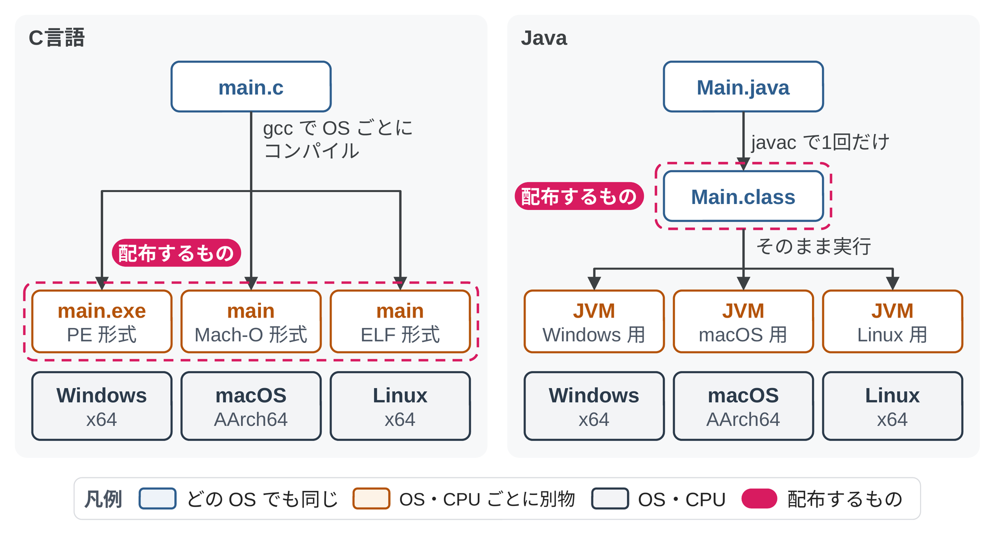
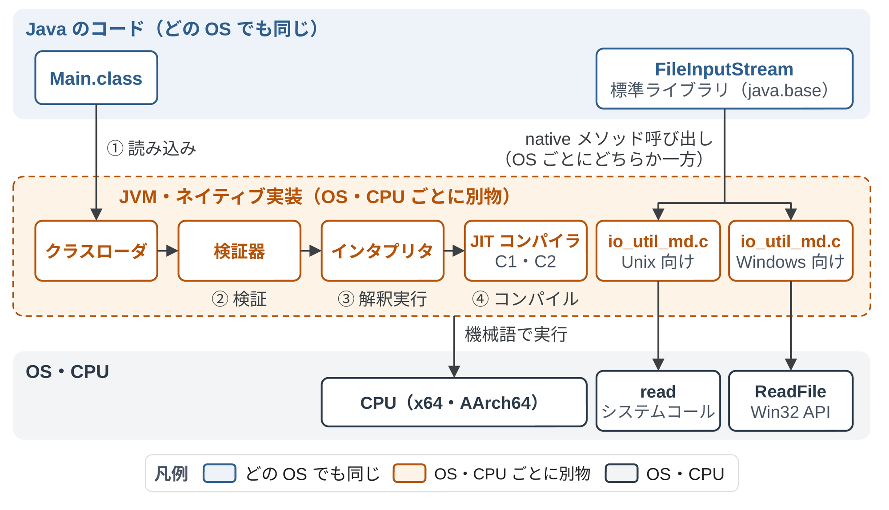

<!--
  コンパクト記事 no.35（草稿。公開前にこのコメントは削除）
  - 扱う範囲：Java が OS に依存せず動く仕組み（バイトコード・JVM・標準ライブラリ）。javac と gcc のコンパイルの違いそのものは no.36 に任せる
  - 検証環境：OpenJDK 21.0.12.1（Ubuntu 24.04、x86_64）で javac / javap / java を実行した結果を貼っている
  - 裏取り：クラスファイルの形式とマジックナンバー・バージョン番号は JVM 仕様（JVMS）4章、プリミティブ型の幅は Java 言語仕様（JLS）4.2、
    FileInputStream の native メソッドと OS ごとの実装は OpenJDK（jdk21u）の src/java.base/share/classes/java/io/FileInputStream.java、
    src/java.base/unix/native/libjava/io_util_md.c（read）、src/java.base/windows/native/libjava/io_util_md.c（ReadFile）、
    既定の文字コードが UTF-8 になったのは JEP 400（JDK 18）
  - 図：image/01〜02_*.pptx/png（zukai-diagrams 準拠。生成スクリプト image/zukai/figs.js、`node figs.js <出力先>` → `bash render.sh <出力先>`）
  - TODO：同じ Main.class を Nico の Mac（macOS/AArch64）でも `java Main` して、そのまま動く様子を貼る
-->

# はじめに

「Java って OS に依存しないって言うけど、なんで？」と聞かれて、「JVM があるから…？」以上のことが言えなかったので、ちゃんとまとめてみました。

# ひとことで言うと

Java のプログラムは、特定の OS や CPU の機械語ではなく、**JVM（Java Virtual Machine）という仮想マシン向けの命令列（バイトコード）** にコンパイルされます。
そして、**OS と CPU の組み合わせごとに、その環境で動く JVM が用意されている** ので、同じバイトコードがどの環境でも動きます。

つまり、OS への依存がなくなったのではなく、**OS に依存する部分を JVM と標準ライブラリが引き受けている** というのが正確なところです。
Sun Microsystems が掲げた「Write Once, Run Anywhere（一度書けば、どこでも動く）」は、この仕組みのことを指しています。
ここでいう「OS に依存しない」は、**コンパイル済みの `.class` を、作り直さずに別の OS・CPU でそのまま動かせる** という意味です。ファイル名の大文字・小文字の区別やファイルの権限、GUI の見た目といった OS ごとの差まで消えるわけではありません。

# C言語と何が違うのか？

C 言語でコンパイルすると、その OS と CPU 向けの機械語の実行ファイルができます。
Windows 向けにビルドした `.exe` は macOS では動かないので、動かしたい環境ごとにビルドし直して、実行ファイルを配ることになります。

Java では、`javac` が出力する `.class` ファイル（バイトコード）は1つだけで、環境ごとに違うのは、それを実行する JVM の側です。


*図1：C 言語とJavaで、OS ごとに用意するもの。C は実行ファイルを OS ごとに作り、Java は同じ `.class` を OS ごとの JVM で動かす*

JVM 自体は C++ などで書かれたネイティブのプログラムなので、OS と CPU の組み合わせごとに別のバイナリです。
実際、JDK の配布ページを見ると、Windows x64、macOS AArch64、Linux x64…と環境ごとに別のファイルが並んでいます。
OS ごとにビルドする手間を、Java の開発者ではなく JVM の開発者が引き受けている、と言えます。

コンパイルの手順そのものの違い（C のリンクや Java のクラスの読み込みなど）は、[compact no.36「C言語とJavaのコンパイル方法の違いを簡単にまとめる」](../no.36-c-java-compile/c-java-compile.md) にまとめています。

# バイトコードの中身はどうなっているのか？

次のプログラムをコンパイルして、中身を見てみます。

```java:Main.java
public class Main {
    public static void main(String[] args) {
        int a = 1;
        int b = 2;
        System.out.println(a + b);
    }
}
```

```shell-session
$ javac Main.java
$ od -A x -t x1 Main.class | head -1
000000 ca fe ba be 00 00 00 41 00 1b 0a 00 02 00 03 07
```

先頭の4バイト `ca fe ba be` は、クラスファイルであることを示すマジックナンバーです（JVM 仕様 4.1）。
続く `00 00` がマイナーバージョン、`00 41`（10進で65）がメジャーバージョンで、65 は Java 21 のクラスファイル形式を表します。

`javap -c` で、バイトコードを命令の形で読めます。

```shell-session
$ javap -c Main
（コンストラクタの部分は省略）
  public static void main(java.lang.String[]);
    Code:
       0: iconst_1
       1: istore_1
       2: iconst_2
       3: istore_2
       4: getstatic     #7                  // Field java/lang/System.out:Ljava/io/PrintStream;
       7: iload_1
       8: iload_2
       9: iadd
      10: invokevirtual #13                 // Method java/io/PrintStream.println:(I)V
      13: return
```

| 命令 | 意味 |
|---|---|
| `iconst_1` | 整数の 1 をスタックに積む |
| `istore_1` | スタックの値を取り出し、ローカル変数1（`a`）に入れる |
| `iload_1` | ローカル変数1の値をスタックに積む |
| `iadd` | スタックの上2つを取り出して足し、結果を積む |
| `invokevirtual` | メソッドを呼び出す（ここでは `println`） |

JVM は、CPU のレジスタではなく **スタック** を使って計算する、スタックマシンとして定義されています。
x86-64 の汎用レジスタが16本、ARM64 の汎用レジスタが31本、といった CPU ごとの違いがバイトコードに出てこないのはこのためです。
`#7` や `#13` は、クラスファイル内の定数プールの番号で、メソッドの実際のアドレスではなく `java/io/PrintStream.println` という **名前** で呼び先を指しています。アドレスは JVM が実行時に解決します。

# JVM はバイトコードをどう実行しているのか？

JVM は、CPU が直接読めないバイトコードを、その環境の機械語の動きに置き換えて実行します。
OpenJDK の標準の JVM（HotSpot）の場合、流れはおおまかに次のとおりです。


*図2：JVM が OS の違いを吸収するしくみ。上の層は OS に依存せず、OS ごとの違いは JVM 本体とネイティブ実装の層に閉じ込められている*

1. **クラスローダ** が `.class` を読み込む
2. **検証器**（バイトコード検証器）が、型の合わない操作やスタックのあふれがないかを確かめる
3. **インタプリタ** が、バイトコードを1命令ずつ解釈して実行する
4. 何度も呼ばれるメソッドは、**JIT コンパイラ**（Just-In-Time、実行時コンパイラ）がその CPU の機械語にコンパイルし、以降は機械語のまま実行する

HotSpot には、軽い最適化で素早くコンパイルする C1 と、時間をかけて強く最適化する C2 の2種類の JIT コンパイラがあり、呼ばれる回数に応じてインタプリタ → C1 → C2 と段階的に切り替えます（階層型コンパイル。Java 8 以降は既定で有効）。
「Java は仮想マシンだから遅い」と言われることがありますが、よく動くコードは最終的に機械語で動くので、起動直後を除けば、インタプリタだけで動く場合とは速さがまったく違います。

## ファイルの読み書きは、どこで OS の違いを吸収しているのか？

バイトコードだけでは、ファイルやネットワークは扱えません。それらは最終的に OS のシステムコールを呼ぶ必要があるからです。
ここを受け持っているのが、Java の標準ライブラリです。

たとえば `FileInputStream` の `read()` を追っていくと、`native` 修飾子の付いたメソッド（引数なしの `read()` なら `read0`、配列に読む `read(byte[], int, int)` なら `readBytes`）に行き着きます。
`native` メソッドの中身は Java ではなく C で書かれています。入口の C のコード（`FileInputStream.c`、`io_util.c`）は OS 共通で、実際に OS を呼ぶ最下層の `handleRead` 関数だけが、OS ごとに別のファイルになっています。

| OS | `handleRead` があるファイル（OpenJDK） | 最終的に呼ぶもの |
|---|---|---|
| Linux・macOS など | `src/java.base/unix/native/libjava/io_util_md.c` | `read` システムコール |
| Windows | `src/java.base/windows/native/libjava/io_util_md.c` | `ReadFile`（Win32 API） |

Java のプログラムからは同じ `FileInputStream` に見えますが、その下では OS ごとに別の C のコードが動いています。
これらのネイティブ実装は JDK に同梱されているので、Java の開発者が意識する必要はありません。

## 言語仕様でも、環境の差が出ないようにしている

C 言語の `int` は、処理系によって幅が変わりえます（規格上は16ビット以上）。
Java では、`int` は常に32ビット、`long` は常に64ビットと言語仕様（JLS 4.2）で決まっていて、整数の計算はどの環境でも同じ結果になります。
浮動小数点の四則演算も、Java 17 以降（JEP 306）は常に厳密な IEEE 754 の規則で計算されるようになり、環境による差は出ません（それ以前は `strictfp` を付けないと、わずかに差が出る余地がありました）。ただし `Math.sin` などの一部の関数は、実装ごとにわずかな誤差の違いが仕様で許されていて、どの環境でも同じ結果が必要なら `StrictMath` を使います。
クラスファイルの中の多バイトの値も、CPU のバイト順にかかわらずビッグエンディアンで書くと決まっています（JVM 仕様 4章）。

# どこでも動く、が崩れるのはどんなときか？

JVM と標準ライブラリが OS の違いを吸収してくれるのは、標準ライブラリの範囲で書いたときだけです。次のような場合は、OS に依存します。

| ケース | 何が起きるか | 対策 |
|---|---|---|
| JNI などで OS 用のネイティブライブラリ（`.dll` / `.so` / `.dylib`）を呼ぶ | そのライブラリがない OS では動かない | OS ごとのライブラリを用意する |
| `Runtime.exec` や `ProcessBuilder` で OS のコマンドを呼ぶ | `cmd.exe` や `ls` がない環境で失敗する | できるだけ標準ライブラリの API で書く |
| パスの区切りや改行コードを決め打ちする（`"C:\\data"`、`"\n"`） | ほかの OS でファイルが見つからない、改行が混ざる | `Path.of(...)`、`System.lineSeparator()` を使う |
| 文字コードを指定せずにファイルを読み書きする | JDK 17 以前は、OS の既定の文字コード（日本語版 Windows なら MS932 など）で読み書きされる | 文字コードを明示する（JDK 18 以降、ファイルの中身の既定は UTF-8：JEP 400。ただしコンソール出力やファイル名の文字コードは今も OS に従う） |
| 新しい JDK でコンパイルした `.class` を古い JVM で動かす | `UnsupportedClassVersionError` で起動しない | `javac --release 17` のように対象のバージョンを指定する |

最後のケースは、OS ではなく **Java のバージョン** への依存です。
古い JVM は新しいクラスファイルを読めません。逆に、新しい JVM は古いクラスファイルを形式としては読めますが、JDK 11 で削除された `javax.xml.bind`（JAXB）のように、なくなった API を使っていると動きません。

また、そもそも JVM が入っていない環境では動きません。
最近は、`jlink` で必要なモジュールだけを含む Java ランタイムをアプリに同梱したり、GraalVM の Native Image で機械語の実行ファイルにしたりする配り方もありますが、どちらも成果物は OS ごとに別物になります。

# まとめ

- Java は、OS や CPU の機械語ではなく、JVM 向けのバイトコード（`.class`）にコンパイルされる
- OS と CPU の組み合わせごとに JVM が用意されていて、同じバイトコードをインタプリタと JIT コンパイラで実行する
- ファイルやネットワークなど OS の機能は、標準ライブラリの `native` メソッドの下で、OS ごとの C の実装が受け持つ
- 「OS に依存しない」のは Java のプログラムの話で、OS への依存は JVM と標準ライブラリが引き受けている

聞かれたときに「JVM があるから」で止まっていたのは、JVM の下にも OS ごとの実装がちゃんとある、というところまで見えていなかったからでした。

# 参考

- [The Java Virtual Machine Specification, Java SE 21 Edition（4章 The class File Format）](https://docs.oracle.com/javase/specs/jvms/se21/html/jvms-4.html)
- [The Java Language Specification, Java SE 21 Edition（4.2 Primitive Types and Values）](https://docs.oracle.com/javase/specs/jls/se21/html/jls-4.html#jls-4.2)
- [JEP 400: UTF-8 by Default](https://openjdk.org/jeps/400)
- [JEP 306: Restore Always-Strict Floating-Point Semantics](https://openjdk.org/jeps/306)
- [openjdk/jdk21u（FileInputStream.java、io_util_md.c）](https://github.com/openjdk/jdk21u)
