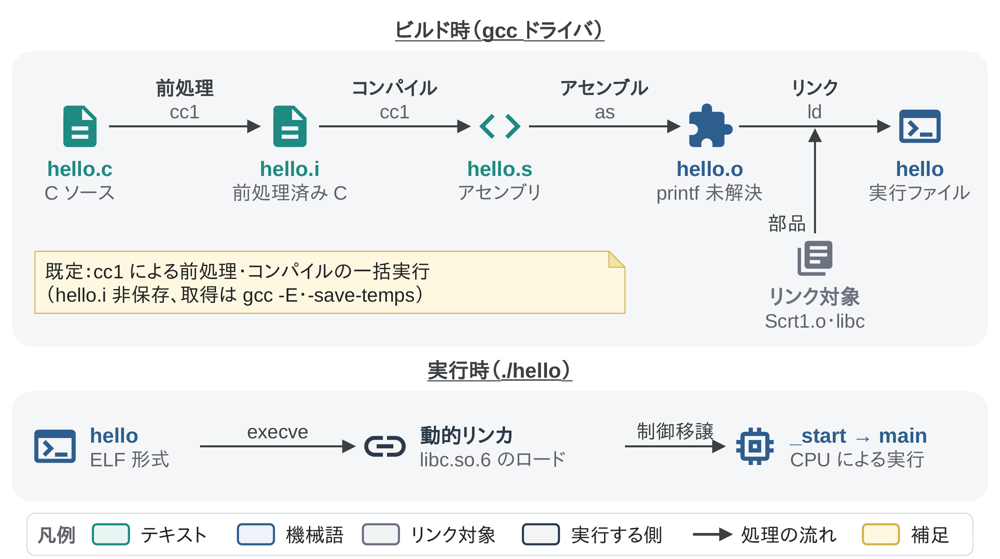
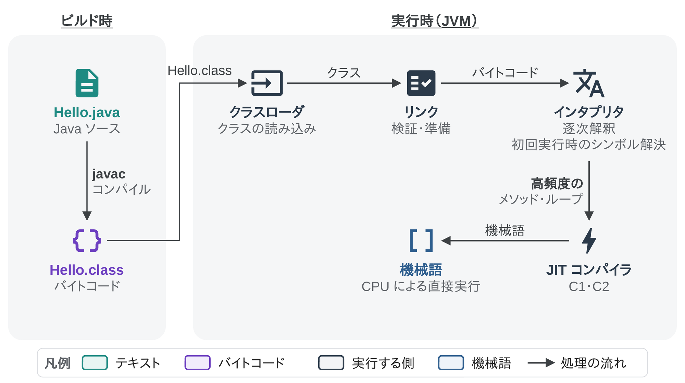
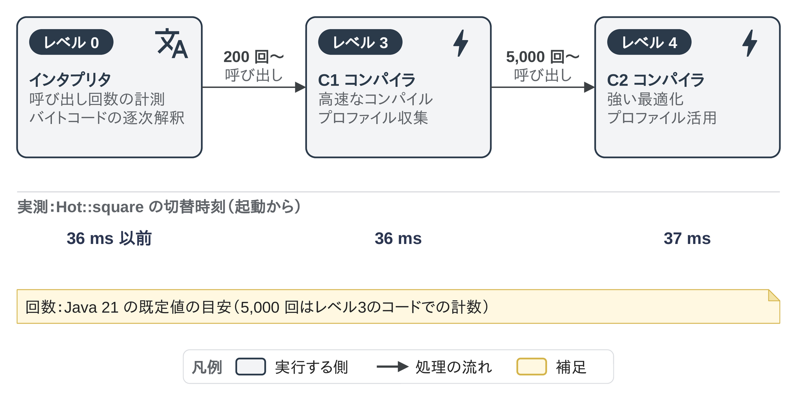

<!--
  コンパクト記事 no.36（草稿。公開前にこのコメントは削除）
  - 扱う範囲：C（GCC）のビルドの4段階と、Java（javac＋HotSpot）のバイトコード化と JIT。なぜ Java が OS に依存しないのかは no.35 に任せ、ここでは1文で触れるだけ
  - 実行結果はすべて下の検証環境で実際に取ったもの（2026-11-11）
  - 裏取り：GCC の段階とオプションは GCC マニュアル「Overall Options」、class ファイルの形式は JVM 仕様 4章、ロードとリンクは JVM 仕様 5章、段階的コンパイルは Oracle の「Java HotSpot Virtual Machine Performance Enhancements」、Tier の番号（0〜4）は HotSpot の実装上の区分
  - TODO：no.35 へのリンク（../no.35-java-os-independence/）は、公開時に no.35 の Qiita URL に置き換える
  - 図：image/01〜03_*.pptx/png（zukai-diagrams 準拠。生成 image/zukai/figs.js、`node figs.js <出力先>` → `bash render.sh <出力先>`）
-->

# はじめに

「C言語とJavaって、コンパイルのしかたは何が違うの？」と人に聞かれて、「Cは機械語になって、Javaはバイトコードになる」までしか答えられませんでした。
その先の「じゃあJavaはいつ機械語になるの？」「Cのリンクって何をしてるの？」に答えられなかったので、実際に手元で動かしながらまとめてみました。

# ひとことで言うと

- **C** は、ビルドのときにソースコードを **特定の CPU・OS 向けの機械語（実行ファイル）まで変換しきる**（事前コンパイル、AOT：Ahead-Of-Time）
- **Java** は、`javac` が **JVM 向けの中間コード（バイトコード、`.class`）までしか変換しない**。機械語にするのは実行時の JVM で、**よく実行される部分だけを JIT コンパイラ（Just-In-Time）が機械語にする**

つまり、「いつ」「どこまで」機械語にするかが違います。

## 検証環境

| 項目 | バージョン |
|---|---|
| OS | Ubuntu 24.04.5 LTS（x86-64） |
| C コンパイラ | GCC 13.3.0 |
| Java | OpenJDK 21.0.12.1（HotSpot VM） |

# C のソースはどうやって実行ファイルになるのか？

`gcc hello.c` と打つと1回で実行ファイルができますが、中では4つの段階を順にこなしています。


*図1：C のビルドの4段階。gcc はドライバで、段階に応じて cc1・as・collect2（ld）を呼び出す。下段は `./hello` を起動したときの流れ*

| 段階 | やること | 道具（GCC） | 途中で止めるオプション | 出力 |
|---|---|---|---|---|
| 前処理 | `#include` の展開、`#define` の置き換え | `cc1`（`gcc -E` のときは `cc1 -E`） | `gcc -E` | `hello.i`（前処理済みの C） |
| コンパイル | C をアセンブリ言語に変換 | `cc1` | `gcc -S` | `hello.s`（アセンブリ） |
| アセンブル | アセンブリを機械語に変換 | `as` | `gcc -c` | `hello.o`（オブジェクトファイル） |
| リンク | 複数の `.o` とライブラリをつなぐ | `collect2` → `ld` | （なし） | `hello`（実行ファイル） |

`gcc -v` を付けると、`cc1`・`as`・`collect2` が順に呼ばれているのが見えます。
通常の `gcc hello.c` では、`cc1` が前処理とコンパイルを1回でまとめて行うので、`hello.i` はファイルとして残りません。下のように `gcc -E` や `-save-temps` を使うと、段階ごとの中間ファイルを取り出せます。

使ったソースはこれです。

```c:hello.c
#include <stdio.h>
#define GREETING "Hello"

int main(void) {
    printf("%s, World!\n", GREETING);
    return 0;
}
```

## 1. 前処理：`#include` と `#define` を片付ける

```console
$ gcc -E hello.c -o hello.i
$ wc -l hello.i
820 hello.i
$ tail -4 hello.i
int main(void) {
    printf("%s, World!\n", "Hello");
    return 0;
}
```

7行のソースが820行になりました。`stdio.h` の中身（`printf` の宣言など）がまるごと貼り付けられ、`GREETING` は `"Hello"` に置き換わっています。
前処理はトークン単位の置き換えと取り込み（と `#if` の評価）なので、C の文法（構文）はまだ解析していません。

## 2. コンパイル：アセンブリ言語にする

```console
$ gcc -S hello.i -o hello.s
```

```asm:hello.s（抜粋。endbr64 と .cfi で始まる行は省略）
main:
	pushq	%rbp
	movq	%rsp, %rbp
	leaq	.LC0(%rip), %rax
	movq	%rax, %rsi
	leaq	.LC1(%rip), %rax
	movq	%rax, %rdi
	movl	$0, %eax
	call	printf@PLT
	movl	$0, %eax
	popq	%rbp
	ret
```

ここで初めて C の文法を解析し、x86-64 の命令に置き換えます。
この時点で **CPU の種類が決まる** のがポイントで、ARM 向けなら全く別の命令列になります。

## 3. アセンブル：機械語のオブジェクトファイルにする

```console
$ gcc -c hello.s -o hello.o
$ file hello.o
hello.o: ELF 64-bit LSB relocatable, x86-64, version 1 (SYSV), not stripped
$ nm hello.o
0000000000000000 T main
                 U printf
```

中身はもう機械語ですが、`nm` で見ると `printf` が `U`（undefined：未定義）になっています。
`hello.o` は「`printf` を呼ぶ」とは書いてあるものの、`printf` の本体は持っていません。

## 4. リンク：足りない部品をつなぐ

```console
$ gcc hello.o -o hello
$ file hello
hello: ELF 64-bit LSB pie executable, x86-64, version 1 (SYSV), dynamically linked, interpreter /lib64/ld-linux-x86-64.so.2, ...
$ ./hello
Hello, World!
```

リンカ（`ld`）は、`hello.o` に加えて、`main` を呼び出すためのスタートアップコード（`Scrt1.o`、`crti.o` など）と C の標準ライブラリ（`-lc`）をつないで、1つの実行ファイルにします。

`printf` の本体をどこに置くかで、リンクは2種類に分かれます。

- **動的リンク**（既定）：実行ファイルには「`libc.so.6` の `printf` を使う」という印だけを残す。起動のときに、動的リンカ（`ld-linux-x86-64.so.2`）が `libc.so.6` を読み込んでつなぐ。`hello` は 15,960 バイト
- **静的リンク**（`gcc -static`）：`printf` などの本体を実行ファイルにコピーする。`hello_static` は 785,328 バイトで、約49倍になった

どちらにしても、できた `hello` は **x86-64 の Linux 向けの ELF** です。Windows（WSL などの Linux 互換環境を除く）や Apple シリコンの Mac では、そのままでは動きません。動かしたい環境ごとにビルドし直す必要があります。

# Java のソースはどうやって実行されるのか？

Java は、ビルドと実行の2つに分かれています。


*図2：Java のビルドと実行の流れ。javac はバイトコードまで、機械語にするのは実行時の JVM*

## javac はバイトコードまでしか作らない

```java:Hello.java
public class Hello {
    public static void main(String[] args) {
        System.out.println("Hello, World!");
    }
}
```

```console
$ javac Hello.java
$ file Hello.class
Hello.class: compiled Java class data, version 65.0
$ od -A x -t x1 -N 8 Hello.class
000000 ca fe ba be 00 00 00 41
```

`Hello.class` の先頭4バイトは `CA FE BA BE`（class ファイルの目印）、続く4バイト `00 00 00 41` はバージョン番号（マイナー0、メジャー0x41＝65＝Java 21）です（JVM 仕様 4章）。
C の実行ファイルの先頭は `7F 45 4C 46`（`\x7F` + `ELF`）なので、まったく別の形式です。

中身は `javap -c` で読めます（`main` の部分だけ抜粋）。

```console
$ javap -c Hello.class
  public static void main(java.lang.String[]);
    Code:
       0: getstatic     #7    // Field java/lang/System.out:Ljava/io/PrintStream;
       3: ldc           #13   // String Hello, World!
       5: invokevirtual #15   // Method java/io/PrintStream.println:(Ljava/lang/String;)V
       8: return
```

`getstatic`・`ldc`・`invokevirtual` は x86-64 の命令ではなく、**JVM の命令（バイトコード）** です。
もう1つ大事なのが、`println` の呼び出し先が `java/io/PrintStream.println` という **名前（シンボル参照）** で書かれているだけ、という点です。C のリンクのように、ビルド時に本体をつなぐことはしていません。

C と比べると、`javac` には次の段階がありません。

- **前処理**：`#include` や `#define` はない。ほかのクラスの情報は、コンパイル時にクラスパス（やモジュールパス）上の `.class`・ソースや、JDK 標準ライブラリのモジュールから読む（`import` は名前を短く書くための宣言で、中身を貼り付けるわけではない）
- **アセンブル・リンク**：`javac` の出力は1クラスにつき1つの `.class` で、1つの実行ファイルにまとめる段階はない（配布するときは `.jar` に固めるが、これは zip で、リンクではない）

## 実行時に JVM がロード・リンクして、JIT で機械語にする

`java Hello` を実行すると、JVM が次のことをします（JVM 仕様 5章）。

1. **ロード**：クラスローダが `Hello.class` を読み込む。`Hello` が参照するほかのクラスは、必要になった時点で読み込まれる（`System` や `PrintStream` のような基本クラスは、JVM の起動処理の中ですでに読み込まれている）
2. **リンク**：バイトコードの検証と準備（static 変数の領域確保）を行う。`java/io/PrintStream.println` のような名前を実際のメソッドへの参照に置き換える「解決」は、HotSpot ではその命令を初めて実行するときに行う（遅延解決）
3. **初期化と実行**：static 初期化子を実行したあと、最初はインタプリタがバイトコードを1命令ずつ解釈して実行する。何度も実行されるメソッドやループは、JIT コンパイラが **その環境の CPU 向けの機械語** にして、以降はそれを実行する

C ではビルド時（または起動時）に済ませていたリンクを、Java は実行中に、必要になったクラス・命令から順に行っているわけです。
実際、`java -Xlog:class+load Hello` で見ると、`java.io.PrintStream` は起動から0.027秒の時点で（JDK の共有アーカイブから）、`Hello` は0.037秒の時点で読み込まれていました。
バイトコードがどの OS でも同じまま動く理由は、[compact no.35「JavaはなぜOSに依存せずに動作させることができるのか」](../no.35-java-os-independence/) にまとめています。

# JIT はいつ機械語にしているのか？

HotSpot VM は、インタプリタと2つの JIT コンパイラを段階的に使い分けます（段階的コンパイル、Tiered Compilation。Java SE 7 で導入され、現在は既定で有効）。


*図3：HotSpot の段階的コンパイル。よく実行されるメソッドほど、時間をかけて最適化した機械語になる*

| レベル | 実行のしかた | 特徴 |
|---|---|---|
| 0 | インタプリタ | すぐ実行できるが遅い。呼び出し回数などを数える |
| 3 | C1 コンパイラ（クライアントコンパイラ）＋プロファイル | すばやく機械語にし、どの分岐をよく通るかなどを記録する |
| 4 | C2 コンパイラ（サーバコンパイラ） | プロファイルをもとに、時間をかけて強く最適化する |

（レベル1・2も C1 だが、よく通る道筋では 0 → 3 → 4 と進む）

次のコードで、実際にいつ JIT が動くかを見てみます。

```java:Hot.java
public class Hot {
    static int square(int x) { return x * x; }
    public static void main(String[] args) {
        long sum = 0;
        for (int i = 0; i < 1_000_000; i++) sum += square(i);
        System.out.println(sum);
    }
}
```

`-XX:+PrintCompilation` を付けると、JIT がコンパイルしたメソッドが表示されます。

```console
$ java -XX:+PrintCompilation Hot | grep Hot::
36    5       3       Hot::square (4 bytes)
37    6       4       Hot::square (4 bytes)
37    5       3       Hot::square (4 bytes)   made not entrant
38    7 %     3       Hot::main @ 4 (32 bytes)
39    8       3       Hot::main (32 bytes)
39    9 %     4       Hot::main @ 4 (32 bytes)
...
```

左から、起動からの時間（ミリ秒）、コンパイルの通し番号、属性（`%` など。後述）、レベル、メソッド名です。

- `square` は、起動から36ミリ秒でレベル3（C1）、37ミリ秒でレベル4（C2）になった
- `made not entrant` は、新しい呼び出しでは古いレベル3のコードに入らない（レベル4に置き換わった）、という印
- `%` は **OSR**（On-Stack Replacement）。`main` は1回しか呼ばれないが、中のループが何度も回るので、**ループの途中で** インタプリタから機械語に切り替えている

レベルを上げる目安は、Java 21 の既定値で、レベル3へは呼び出し約200回、レベル4へはレベル3のコードでの呼び出し約5,000回です（`Tier3InvocationThreshold`・`Tier4InvocationThreshold`）。実際には、ループの回数との組み合わせや、コンパイル待ちの量に応じた調整も入ります。

## JIT を止めるとどれくらい遅いのか？

`-Xint` を付けると、JIT を使わずインタプリタだけで実行します。`square` を2億回呼ぶプログラムで、ループ部分の時間（`System.nanoTime` で計測、JVM の起動時間は含まない）を比べると、こうなりました（3回ずつ実行）。

| 実行のしかた | 時間 |
|---|---|
| 既定（JIT あり） | 123〜126 ミリ秒 |
| `-Xint`（インタプリタのみ） | 5,768〜6,275 ミリ秒 |

約46〜51倍。「Java はインタプリタだから遅い」は、少なくとも何度も回る処理には当てはまらないのがよく分かる数字です。

# 結局、何が違うのか？

| 観点 | C（GCC） | Java（javac＋HotSpot） |
|---|---|---|
| ビルドの成果物 | 機械語の実行ファイル（Linux なら ELF） | バイトコード（`.class`） |
| 機械語にするタイミング | ビルド時に、全部（AOT） | 実行時に、よく実行される部分だけ（JIT） |
| ビルドの段階 | 前処理 → コンパイル → アセンブル → リンク | `javac` が構文解析・型検査をしてバイトコードを出す（アセンブル・リンクはない） |
| ライブラリとのリンク | ビルド時（静的）か起動時（動的） | 実行中に、クラスや命令が必要になった時点で |
| 成果物が動く場所 | ビルド時に指定した CPU・OS（ふつうはビルドした環境と同じ） | 対応するバージョンの JVM がある環境（今回の class ファイルなら Java 21 以降） |
| 起動直後の速さ | 最初から機械語なので速い | 最初はインタプリタなので遅め |

# ありがちな勘違い

- **「Java は機械語にならない」**：なります。ならないのは `javac` の出力で、実行時に JVM の JIT が機械語にしています
- **「`gcc` という1つのプログラムが全部やっている」**：`gcc` はドライバで、`cc1`（前処理・コンパイル）、`as`（アセンブル）、`collect2`/`ld`（リンク）を順に呼んでいます
- **「Java は必ず JIT」「C は必ず事前コンパイル」**：どちらも処理系しだいです。Java にも、GraalVM Native Image のようにビルド時にネイティブの実行ファイルまで作る方法があります。言語の違いというより、代表的な処理系（GCC と HotSpot）の違いとして読んでください

# まとめ

- C は、ビルド時に前処理・コンパイル・アセンブル・リンクの4段階で、特定の CPU・OS 向けの実行ファイルまで作る
- Java は、`javac` でバイトコードまで作り、実行時に JVM がロード・リンクして、よく実行される部分だけを JIT で機械語にする
- どちらも、よく実行される部分は最後は機械語として CPU が直接実行する。違うのは、機械語にするのが「ビルド時に全部」か「実行時に必要な分だけ」か

聞かれたときに答えられなかった「Java はいつ機械語になるのか」は、「実行中、何度も使われると分かった時点」が答えでした。
間違いや、もっと分かりやすい説明があれば、有識者の方教えて欲しいです！

# 参考

- [GCC Manual: Options Controlling the Kind of Output](https://gcc.gnu.org/onlinedocs/gcc/Overall-Options.html)
- [The Java Virtual Machine Specification, Java SE 21 Edition: Chapter 4. The class File Format](https://docs.oracle.com/javase/specs/jvms/se21/html/jvms-4.html)
- [The Java Virtual Machine Specification, Java SE 21 Edition: Chapter 5. Loading, Linking, and Initializing](https://docs.oracle.com/javase/specs/jvms/se21/html/jvms-5.html)
- [Java HotSpot Virtual Machine Performance Enhancements（Tiered Compilation）](https://docs.oracle.com/en/java/javase/21/vm/java-hotspot-virtual-machine-performance-enhancements.html)
- [The javac Command（JDK 21）](https://docs.oracle.com/en/java/javase/21/docs/specs/man/javac.html)
- [GraalVM Native Image](https://www.graalvm.org/latest/reference-manual/native-image/)
