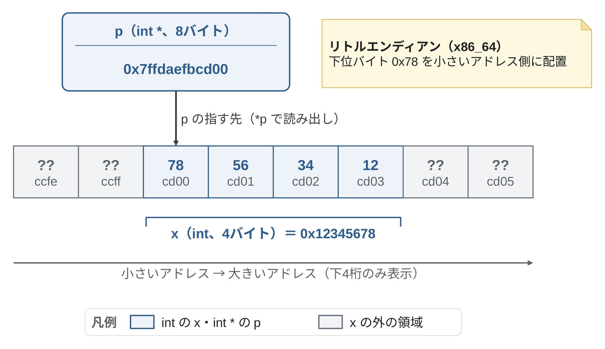
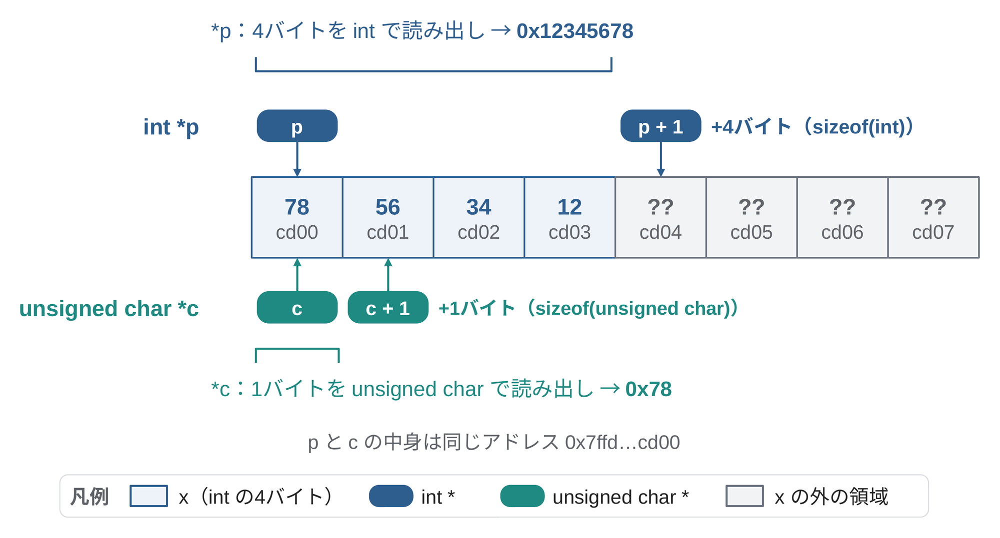
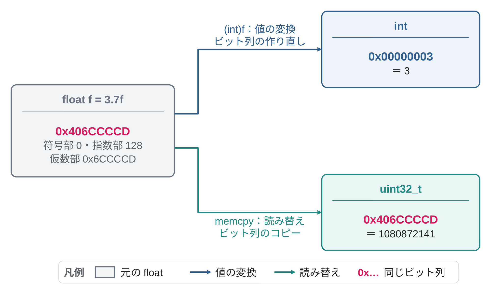
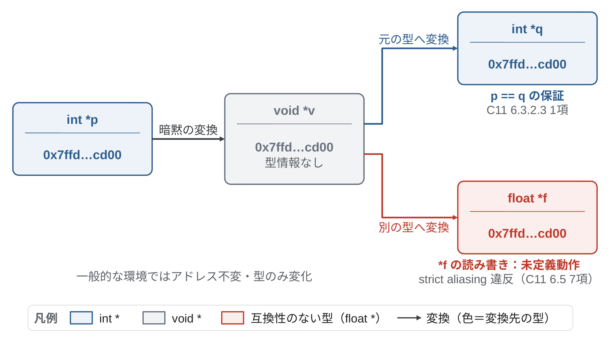

<!--
  コンパクト記事 no.37（草稿。公開前にこのコメントは削除）
  - 扱う範囲：C 言語のポインタ（アドレス・ポインタの型・ポインタ演算）と型変換（値の変換／ポインタの型変換／暗黙の型変換）、危ない型変換の例
  - 裏取り：C11（N1570）6.2.6.1（オブジェクトはバイトの並び）、6.3.1.3（整数どうしの変換）、6.3.1.4（浮動小数点→整数は 0 方向に切り捨て、範囲外は未定義）、6.3.1.8（通常の算術変換）、6.3.2.3（ポインタの変換・アラインメント・void *。1項：void * との往復で元に戻る）、6.5 7項（strict aliasing）、6.5.6（ポインタの加減算）。C23 でもこのあたりの規則は同じ
  - 実行結果はすべて下記の検証環境（クラウドの Ubuntu）で実際に動かして取った値。Nico の Mac（Apple Silicon、arm64）も LP64・リトルエンディアンなので、アドレス以外は同じ結果になるはず
  - 図：image/01〜04_*.pptx/png（zukai-diagrams 準拠、生成スクリプト image/zukai/）
-->

# はじめに

人に「ポインタってつまり何？」「キャストすると中身はどうなるの？」と聞かれて、なんとなくでしか答えられなかったので、メモリの中で何が起きているかを C 言語で確かめながらまとめてみました。

# ひとことで言うと

- **ポインタ**は、**メモリ上の場所（アドレス）を値として持つ変数**。ポインタの**型**は、その場所から「何バイトを、どう解釈して読むか」を決める
- **型変換**には2種類ある
  - **値の変換**：`(int)3.7` のように、値の意味を保とうとして**ビット列を作り直す**
  - **ポインタの型変換**：`(unsigned char *)&x` のように、アドレスはそのままで**読むときの型（同じバイト列の読み方）を変える**。ただし、変換したポインタで実際に読んでよいかは別のルール（strict aliasing・アラインメント）で決まる

# 検証環境

- Ubuntu 24.04（x86_64）
- gcc 13.3.0、clang 18.1.3
- `int` は4バイト、`long` とポインタは8バイト（LP64）、リトルエンディアン

コードは `gcc -Wall -Wextra` でコンパイルしています（最適化の違いを見る節だけ `-O0` と `-O2` を比べます）。

# ポインタには何が入っているのか？

メモリは1バイトごとに番号（アドレス）が振られた、長い箱の列です。
変数はこの列のどこかに置かれ、`int` なら連続した4バイトを使います。

```c
#include <stdio.h>

int main(void) {
    int x = 0x12345678;
    int *p = &x;          /* p には x の先頭アドレスが入る */

    printf("&x = %p\n", (void *)&x);
    printf("p  = %p\n", (void *)p);
    printf("*p = 0x%x\n", *p);
    printf("sizeof(x) = %zu, sizeof(p) = %zu\n", sizeof x, sizeof p);
    return 0;
}
```

```text
&x = 0x7ffdaefbcd00
p  = 0x7ffdaefbcd00
*p = 0x12345678
sizeof(x) = 4, sizeof(p) = 8
```

- `&x` は「x の先頭アドレス」を取り出す演算子で、`p` にはそのアドレスが入っている（x86_64 では中身はアドレスを表す数値。ただし C の規格上、ポインタは整数とは別物で、別々のオブジェクトをまたいだ引き算や大小比較は未定義動作）
- `*p` は「p が指す場所から読む」演算子で、x の値 `0x12345678` が返ってくる
- `p` 自身も8バイトの変数で、メモリのどこかに置かれている（64ビット環境ではアドレスが8バイトなので）

x の4バイトを1バイトずつ見ると、`0x12345678` が逆順の `78 56 34 12` で並んでいます。
これは x86_64 が、値の下位バイトを小さいアドレスに置く**リトルエンディアン**だからです。


*図1：メモリとポインタ。p には x の先頭アドレスが入っていて、x の4バイトは下位バイトから順に並ぶ*

# ポインタの型は何のためにあるのか？

中身はアドレスなのに、`int *` や `char *` のように型が付いているのはなぜか？
ポインタの型は、次の2つを決めています。

1. `*p` で**何バイトを読み、どう解釈するか**
2. `p + 1` で**何バイト進むか**（指す型の `sizeof` 分だけ進む）

同じ x のアドレスを、`int *` と `unsigned char *` の2つのポインタで見てみます。

```c
int x = 0x12345678;
int *p = &x;
unsigned char *c = (unsigned char *)&x;   /* 同じアドレスを 1 バイト単位で見る */

printf("*p = 0x%x\n", *p);
for (int i = 0; i < 4; i++)
    printf("c[%d] (%p) = 0x%02x\n", i, (void *)(c + i), c[i]);
printf("p + 1 = %p\n", (void *)(p + 1));
printf("c + 1 = %p\n", (void *)(c + 1));
```

```text
*p = 0x12345678
c[0] (0x7ffdaefbcd00) = 0x78
c[1] (0x7ffdaefbcd01) = 0x56
c[2] (0x7ffdaefbcd02) = 0x34
c[3] (0x7ffdaefbcd03) = 0x12
p + 1 = 0x7ffdaefbcd04
c + 1 = 0x7ffdaefbcd01
```

`p` と `c` に入っているアドレスは同じですが、`*p` は4バイトをまとめて `int` として読み、`*c` は1バイトだけを読みます。
`p + 1` は4バイト先、`c + 1` は1バイト先を指します。
配列の `a[i]` も、中身は `*(a + i)` というポインタ演算です。


*図2：同じアドレスでも、ポインタの型で読むバイト数と +1 の進み幅が変わる*

`void *` は「型の決まっていないアドレス」で、`malloc` の戻り値などに使われます。
読むバイト数が決まらないので、`*` で読んだり `+ 1` したりはできず（GCC は拡張で `+ 1` を1バイトとして扱う）、使う前に具体的な型のポインタへ変換します。

# 型変換すると中身はどうなるのか？

ここで最初の「ひとことで言うと」に戻ります。
型変換は「値の変換」と「ポインタの型変換」で、メモリの中身に起きることがまったく違います。


*図3：値の変換はビット列を作り直し、ポインタの型変換（や memcpy）は同じビット列を別の型として読む*

```c
float f = 3.7f;
uint32_t bits;
memcpy(&bits, &f, sizeof bits);   /* f のバイト列をそのまま 4 バイトの整数にコピー */

printf("(int)f = %d\n", (int)f);
printf("bits   = 0x%08x\n", bits);
```

```text
(int)f = 3
bits   = 0x406ccccd
```

- `(int)f` は**値の変換**。小数部を 0 の方向に切り捨てた整数 3 を求めて、`0x00000003` という新しいビット列を作る
- `memcpy` でコピーした `bits` は、float の 3.7 のビット列（IEEE 754 の符号1ビット・指数8ビット・仮数23ビット）を**そのまま**整数として読んだもの。10進数にすると 1080872141 で、整数として見ると 3.7 とはかけ離れた値になる（図3の「指数部 128」は格納されている値で、実際の指数は 128 − 127 = 1。3.7 = 1.85 × 2^1）

ポインタの型変換も、後者と同じく「同じバイト列の読み方を変える」側です。
ただし、`*(uint32_t *)&f` のようにポインタを変換して直接読むのは、後述の strict aliasing のルールに反するので、ビット列を取り出すときは `memcpy` を使います。

## void * を介したポインタの型変換

ポインタの型変換でいちばんよく使うのは、実は `void *` を経由するものです。
C では、どんなオブジェクトへのポインタも `void *` に変換でき、`void *` から元の型に戻すと、元のポインタと等しくなることが保証されています（C11 6.3.2.3 1項）。
しかも C では、この変換はキャストを書かなくても暗黙に行われます（C++ では `void *` から他の型への変換にだけキャストが必要）。

```c
static int cmp_int(const void *a, const void *b) {
    int x = *(const int *)a;   /* void * を元の型 int * に戻してから読む */
    int y = *(const int *)b;
    return (x > y) - (x < y);
}

int a[] = {3, 1, 2};
qsort(a, 3, sizeof a[0], cmp_int);   /* int * → void * は暗黙に変換される */

int *p = malloc(sizeof *p);          /* void * → int * もキャスト不要 */
```


*図4：void * を介した型変換。元の型に戻すのは保証された使い方で、別の型として読み書きすると strict aliasing 違反*

`malloc`、`memcpy`、`qsort` の比較関数、`pthread_create` の引数のように、「型を問わずにアドレスだけを受け渡す」場面では、いったん `void *` にして、使う側で元の型に戻すのが定番です。

ただし、`void *` を経由しても、読み方を変えてよくなるわけではありません。
`int` のアドレスを `void *` にして `float *` として読み書きすると、直接 `(float *)&x` と書いたときと同じく strict aliasing 違反です（検証環境でも、後述の例を `void *` 経由に書き換えると `-O0` で 0、`-O2` で 1 と同じ結果になりました）。
しかも、直接 `(float *)&x` と書いた場合は gcc の `-O2 -Wstrict-aliasing=2`（または `=1`）で `dereferencing type-punned pointer will break strict-aliasing rules` と警告されますが、`void *` 型の変数にいったん代入してから渡すと、同じオプションでも警告が出ず、かえって気づきにくくなります（`-Wall` が有効にする既定のレベル3は `*(float *)&x` のようにその場で間接参照する形しか警告しないため、関数に渡すこの例ではどちらも警告されませんでした）。
`void *` は「元の型に戻すまで預かっておく入れ物」と考えるのが安全です。

なお、関数ポインタと `void *` の相互変換は C の規格では保証されていません（POSIX の `dlsym` は、POSIX 環境ではできる前提で使っています）。

## 値の変換のルール

| 変換 | 結果 | 例（検証環境） |
|---|---|---|
| 浮動小数点 → 整数 | 小数部を 0 の方向に切り捨てる。整数部が収まらなければ未定義動作 | `(int)3.7` → 3、`(int)-3.7` → -3 |
| 整数 → 符号なし整数 | 2^N で割った余り（N はビット数）になる | `(unsigned char)300` → 44、`(unsigned int)-1` → 4294967295 |
| 整数 → 符号付き整数 | 収まればそのまま。収まらなければ処理系定義 | `(signed char)300` の結果は処理系しだい |
| 整数 → ポインタ、ポインタ → 整数 | 処理系定義（ポインタ → 整数で、結果が整数型に収まらなければ未定義動作）。アドレスを整数で持つなら `uintptr_t`（処理系によっては無い）を使う | — |

# 暗黙の型変換で何が起きるのか？

キャストを書かなくても、型の違う値どうしで計算・比較すると、C は整数拡張（`char` や `short` を `int` にする）のあと、共通の型にそろえてから計算します（通常の算術変換）。共通の型は、元のどちらでもない型になることもあります。
有名なのがこれです。

```c
if (-1 < 1u) puts("true"); else puts("false");   /* false */
if (-1 < 1)  puts("true"); else puts("false");   /* true  */
```

`1u` は `unsigned int` なので、`int` の `-1` も `unsigned int` に変換されて 4294967295 になり、`4294967295 < 1` で偽になります。
`-Wall -Wextra` を付けると、gcc は `comparison of integer expressions of different signedness` と警告してくれます。

ちなみに `-1L < 1u` は検証環境では真になります。
`long` が8バイトの環境では `unsigned int` の値がすべて `long` に収まるので、`1u` のほうが `long` に変換されるためです。
`long` が4バイトの Windows（64ビットでも）では、両方が `unsigned long` になって偽になります。
同じコードでも環境で結果が変わる、いやなポイントです…。

# どんな型変換が危ないのか？

## 符号付きの長さが size_t に変換されてチェックをすり抜ける

`memcpy` や `malloc` のサイズは `size_t`（符号なし）です。
長さを `int` で受け取って `int` のままチェックすると、負の値がチェックを通り、`size_t` に変換された瞬間に巨大な値になります。

```c
#define BUF_SIZE 16

void copy(char *dst, const char *src, int len) {
    if (len > BUF_SIZE) {          /* int どうしの比較なので -1 は通る */
        puts("too long");
        return;
    }
    printf("len=%d, memcpy に渡るサイズ=%zu\n", len, (size_t)len);
    memcpy(dst, src, len);         /* 第3引数は size_t。-1 は 2^64 - 1 になる */
}
```

```text
len=5, memcpy に渡るサイズ=5
len=-1, memcpy に渡るサイズ=18446744073709551615
Segmentation fault
```

外部から来た長さをこのように扱うと、バッファオーバーフローの原因になります。
長さは最初から `size_t` で受け取るか、負の値を先に弾きます。
この変換は `-Wall -Wextra` では警告されず、`-Wsign-conversion` を付けて初めて `conversion to 'size_t' ... may change the sign of the result` と警告されます。

## 別の型のポインタで読み書きする（strict aliasing）

C には「あるオブジェクトには、その型（互換な型、`const` などの修飾付き、符号の有無だけが違う型を含む）か、文字型でしかアクセスしてはいけない（ほかに、その型を含む構造体・共用体経由などの例外あり）」というルールがあります（strict aliasing、C11 6.5 7項）。
破ると未定義動作で、コンパイラは「`int *` と `float *` は同じ場所を指さない」と仮定して最適化します。

```c
int set_and_read(int *ip, float *fp) {
    *ip = 1;
    *fp = 0.0f;   /* ip と fp が同じ場所なら、*ip も 0 になるはず */
    return *ip;
}

int x;
printf("%d\n", set_and_read(&x, (float *)&x));
```

| コンパイル | 結果 |
|---|---|
| gcc / clang `-O0` | 0 |
| gcc / clang `-O2` | 1 |
| gcc `-O2 -fno-strict-aliasing` | 0 |

`-O2` では、コンパイラが「`*fp` への書き込みは `*ip` に影響しない」と考えて、`return *ip` を `return 1` に置き換えています。
最適化レベルを変えただけで結果が変わるので、気づきにくいバグになります。

逃げ道は次のとおりです。

- `unsigned char *`（文字型）のポインタで1バイトずつ読むのは許されている（図2の `c` はこれ）
- ビット列を別の型として取り出したいときは `memcpy` を使う（最適化で普通は余計なコピーは消える）
- C では共用体（union）を通した読み替えも認められている（C++ では未定義動作）

## アラインメントが合わないポインタに変換する

`int` は4の倍数のアドレスに置く、のように、型ごとに置ける場所の制約（アラインメント）があります。
`char` 配列の途中のアドレスを `int *` に変換すると、アラインメントが合わない場合は未定義動作です（C11 6.3.2.3 7項）。
x86_64 では動いてしまうことが多いものの、最適化でアラインメントを前提にした命令が使われて落ちることがあり、CPU によってはアクセスした瞬間に落ちます。
ネットワークのパケットやファイルのバイト列を構造体のポインタにキャストして読むコードは、strict aliasing とあわせて両方に引っかかりやすいので、`memcpy` で取り出すのが安全です。

# まとめ

ポインタの中身はアドレスで、型はそのアドレスから「何バイトを、どう読むか」と「+1 で何バイト進むか」を決めています。
型変換は、値の意味を保ってビット列を作り直す「値の変換」と、同じビット列の読み方だけを変える「ポインタの型変換」に分かれる、と覚えておくと、キャストのたびに中身がどうなるかを説明できるようになります。
符号付きと符号なしの混在や、別の型のポインタでの読み書きは、コンパイラの警告や最適化で初めて表に出ることが多いので、`-Wall -Wextra -Wsign-conversion` を付けて確かめるのがおすすめです。

# 参考

- ISO/IEC 9899:2011（C11）委員会草案 N1570：6.2.6.1、6.3.1.3、6.3.1.4、6.3.1.8、6.3.2.3、6.5 7項、6.5.6
- GCC マニュアル「Options That Control Optimization」（`-fstrict-aliasing`）、「Warning Options」（`-Wsign-compare`、`-Wsign-conversion`、`-Wstrict-aliasing`）
- IEEE 754-2019（浮動小数点数の表現）
