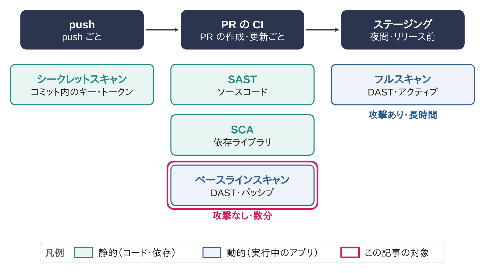
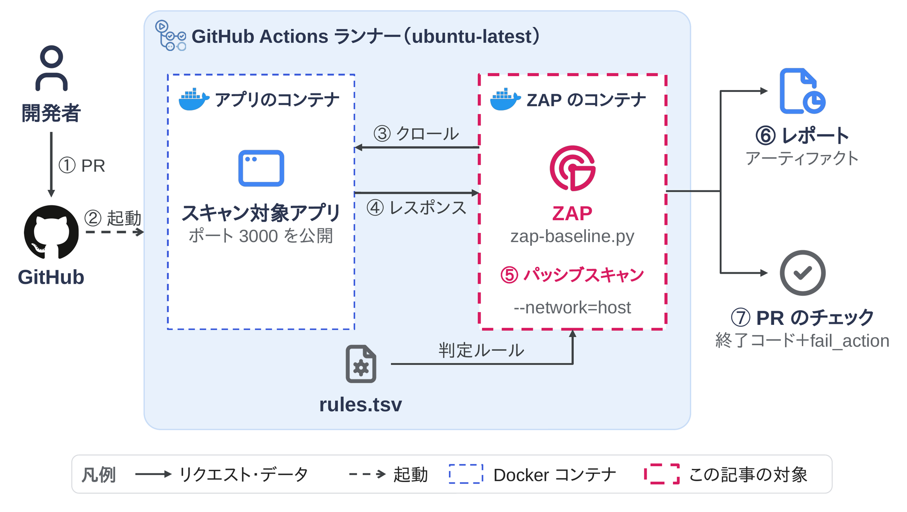
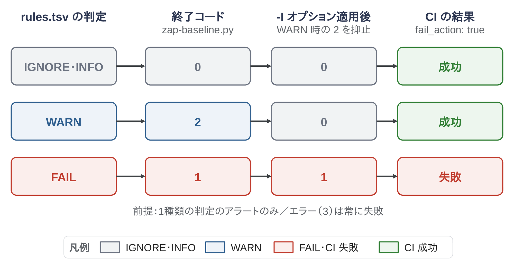

<!--
  コンパクト記事 no.38（草稿。公開前にこのコメントは削除）
  - テーマ：セキュアな開発フローの中のベースラインスキャン（ZAP Baseline Scan を GitHub Actions で PR ごとに回す）
  - Advent Calendar 2026 doctornet（12/6）用の other/drafts/no.16-github-actions-security-scan と題材が重なる。
    あちらは「手順の Tips」、こちらは「ベースラインスキャンとは何か・フローのどこに置くか・判定の仕組み」に寄せて、yaml は最小限にしている。
    公開順によっては、どちらかからもう一方へリンクする（TODO）
  - 裏取り（2026-11-12）：
    - ZAP Baseline Scan 公式ドキュメント（spider 既定1分、パッシブのみ、全アラートは既定 WARN、終了コード 0/1/2/3、-c/-g/-I/-m/-j、設定ファイルの形式、OUTOFSCOPE）
    - zaproxy/action-baseline の README と index.js（最新 v0.15.0、Node 24。--network="host" で起動、レポートは JSON/MD/HTML、
      artifact_name 既定 zap_scan、allow_issue_writing 既定 true、fail_action=true だと終了コード 1 でも 2 でも失敗、3 は常に失敗）
    - アラートIDとパッシブ/アクティブの別は zaproxy.org/docs/alerts/（10020, 10021, 10038, 10010, 10011, 10054, 10035, 10036 はパッシブ、40012・40018 はアクティブ）
    - rules.tsv：zap_common.py load_config はタブ2つ未満の行で ValueError（→終了コード3）。action-baseline の dist/index.js processLineByLine は IGNORE 行の ID だけを集め、1件以上のときだけ -c を付ける
    - -j：現行の zap-baseline.py は Client Spider が既定、--ajax-spider で Ajax Spider（usage 文の default: Ajax spider は古い）
    - 名前：2023-08 に OWASP を離れて Linux Foundation の Software Security Project へ、2024-09 から ZAP by Checkmarx
  - 図：image/01〜03_*.pptx/png（zukai-diagrams 準拠、生成 image/zukai/figs.js → render.sh）。図2のアイコンは image/zukai/icons/（Mac の アイコン・素材 の テック・SaaSロゴ総合 と Tabler outline から）
  - TODO：自分のリポジトリで実際に回したときの出力（WARN の行・集計行）を「結果の見方」に貼る
-->

# はじめに

「セキュアな開発フロー」という言葉はよく聞くけど、実際に CI に何を入れればいいのか？と考えたときに、いちばん手軽に始められるのが **ベースラインスキャン** でした。
OWASP ZAP（今の名前は ZAP）と GitHub Actions で PR ごとに回すやつです。仕組みと、フローのどこに置くのかをまとめてみました。

:::note warn
診断は、自分のアプリ（自分のリポジトリから CI 上やローカルで立ち上げたアプリ、または自分が管理する環境）にだけ実行してください。
許可なく他人のサイトに診断をかけると、不正アクセス禁止法などに触れるおそれがあります。
:::

# ひとことで言うと

- **ベースラインスキャン**は、動いている Web アプリを **攻撃のリクエストを送らずに、数分で** 外から診断し、「最低限ここは押さえておきたい」問題（セキュリティヘッダーの不足、Cookie の属性の不足など）がないかを確かめるスキャン
- ZAP の **Baseline Scan**（`zap-baseline.py`）がその代表で、ZAP 公式の GitHub Action `zaproxy/action-baseline` を使うと、**PR のたびに自動で** 回せる
- 速くて安全なぶん、SQL インジェクションや XSS のような「攻撃を送って初めてわかる穴」は見つけられない

ZAP は Web アプリの診断ツール（DAST：Dynamic Application Security Testing）です。もともとは OWASP のプロジェクトで「OWASP ZAP」と呼ばれていましたが、2023年に OWASP を離れ、2024年からは「ZAP by Checkmarx」になっています。

# セキュアな開発フローのどこに入るのか？

セキュリティのチェックは、リリース前に一度だけやるより、開発の早い段階から小さく何度も回すほうが、直すコストが小さくて済みます（いわゆるシフトレフト）。
よく使われるチェックを、開発フローの段階ごとに並べるとこうなります。


*図1：開発フローとスキャンの位置。ベースラインスキャンは、PR ごとの CI で SAST・SCA と並べて回す（よくある配置の一例）*

| 種類 | 何を見るか | 例 |
|---|---|---|
| シークレットスキャン | コミットに混ざった API キーやトークン | GitHub の Push protection |
| SAST | ソースコード（動かさずに読む） | Semgrep、CodeQL |
| SCA | 依存ライブラリの既知の脆弱性 | Dependabot |
| DAST（パッシブ） | 動いているアプリのレスポンス | **ZAP Baseline Scan** |
| DAST（アクティブ） | 動いているアプリに攻撃を送った結果 | ZAP Full Scan |

SAST と SCA がコードや依存関係を「中から」見るのに対して、ベースラインスキャンは **アプリを実際に起動して「外から」見ます**。
コードだけ見ていても気づきにくい「レスポンスヘッダーを付け忘れた」「Cookie に `HttpOnly` がない」といった、設定や組み合わせで決まる問題を拾えるのがいいところです。

一方、攻撃を送るフルスキャンは時間がかかるうえ、攻撃用のリクエストでデータが書き換わることもあるので、PR ごとに回すには向きません。ステージング環境などに対して、夜間やリリース前に回すのが一般的です。

# ベースラインスキャンは何をしていて、何をしていないのか？

ZAP の Baseline Scan は、次の順に動きます。

1. **spider**（クローラー）で対象のサイトをたどり、ページの URL を集める（既定は1分、`-m` で変えられる）
2. その間に行き来したリクエストとレスポンスを、**パッシブスキャン**のルールで調べる
3. 見つかった問題（アラート）を、ルールごとに `WARN`・`FAIL` などに振り分けて、レポートと終了コードを出す

GitHub Actions で回すときは、このあと `action-baseline` が、レポートをアーティファクトに保存し（図2の⑥）、終了コードと `fail_action` の設定をもとに PR のチェックの成否を決めます（図2の⑦）。


*図2：GitHub Actions でのベースラインスキャンの構成。PR でワークフローが起動し（①②）、ランナーの中のアプリのコンテナに ZAP のコンテナがクロールして（③④）、受け取ったレスポンスをパッシブスキャンする（⑤）。ZAP のコンテナは `--network=host` で起動するので、ランナーに公開したポートにそのまま届く*

パッシブスキャンは、**すでに受け取ったレスポンスを見るだけ** で、攻撃のための細工したリクエストは送りません。たとえばこんなアラートが出ます。

| アラート | ルールID | 種類 |
|---|---|---|
| Missing Anti-clickjacking Header（`X-Frame-Options` や CSP の `frame-ancestors` がない） | 10020 | パッシブ |
| X-Content-Type-Options Header Missing | 10021 | パッシブ |
| Content Security Policy (CSP) Header Not Set | 10038 | パッシブ |
| Cookie No HttpOnly Flag | 10010 | パッシブ |
| Cookie without SameSite Attribute | 10054 | パッシブ |
| Cross Site Scripting (Reflected) | 40012 | アクティブ（ベースラインでは出ない） |
| SQL Injection | 40018 | アクティブ（ベースラインでは出ない） |

ただし「何もリクエストを送らない」わけではありません。spider は、ページのリンクやフォームをたどるために **ふつうのリクエストを送ります**（フォームの送信を含むこともあります）。
攻撃はしないけど、アクセスはする。なので、対象はやっぱり自分のアプリに限ります。

ほかにも、ベースラインスキャンには次の限界があります。

- ログインが必要な画面は、既定ではたどれない（認証の設定を足せばたどれる）
- JavaScript で画面を組み立てる SPA は、既定の spider だとリンクを拾いきれないことがある（`-j` でブラウザを使う spider を追加できる。現行の既定は Client Spider で、`--ajax-spider` を付けると Ajax Spider）
- 既定では、見つかったアラートはすべて `WARN` になる（リスクが Informational のものは数えない。どれを `FAIL` にするかは自分で決める）

# GitHub Actions にはどう入れるのか？

ZAP 公式の `zaproxy/action-baseline` を使います。2026-11-12 時点の最新は `v0.15.0` です。
最小構成はこんな感じです。

```yaml:.github/workflows/zap-baseline.yml
name: ZAP Baseline Scan

on:
  pull_request:

permissions:
  contents: read

jobs:
  zap_scan:
    runs-on: ubuntu-latest
    steps:
      - uses: actions/checkout@v5

      # 自分のアプリを CI 上で起動する（例：docker compose で 3000 番に立てる）
      - name: Start app
        run: docker compose up -d

      # 起動を待つ（最大60秒）
      - name: Wait for app
        run: timeout 60 bash -c 'until curl -sf http://localhost:3000 >/dev/null; do sleep 2; done'

      - name: ZAP Scan
        uses: zaproxy/action-baseline@v0.15.0
        with:
          target: 'http://localhost:3000'
          rules_file_name: '.zap/rules.tsv'
          allow_issue_writing: false
          fail_action: true
          cmd_options: '-I'
```

- **対象は CI 上で立ち上げた自分のアプリ**（`localhost:3000`）。アクションは ZAP のコンテナを `--network="host"` で起動するので、ランナーの `localhost` にそのまま届きます
- `allow_issue_writing: false`：既定ではレポートを GitHub の Issue に書き込みます。PR ごとに Issue が更新されるとうるさいので切っています。切っておけば Issue の書き込み権限もいりません
- レポートは HTML・Markdown・JSON の3種類が、Actions のアーティファクト（既定の名前は `zap_scan`）に残ります
- `fail_action` と `-I` は、次の節の「判定」に関わる設定です

# 結果はどう判定されるのか？

Baseline Scan は、アラートの結果に応じて終了コードを返します。

| 終了コード | 意味 |
|---|---|
| 0 | 問題なし |
| 1 | `FAIL` が1件以上 |
| 2 | `FAIL` はなく、`WARN` が1件以上 |
| 3 | その他のエラー（対象に届かないなど） |

ここで気をつけたいのが、`action-baseline` の `fail_action: true` は、**終了コードが 1 でも 2 でも CI を失敗にする** ことです。
既定ではすべてのアラートが `WARN` なので、`fail_action: true` だけを付けると、ヘッダーが1つ足りないだけで PR が止まります。

そこで、`cmd_options: '-I'` を足します。`-I` は「`WARN` では失敗の終了コードを返さない」オプションなので、**`FAIL` にしたルールにだけ CI が落ちる** ようになります。


*図3：アラートの判定から CI の結果まで。rules.tsv でルールごとの判定を決め、`fail_action: true` と `-I` を組み合わせると、FAIL のときだけ PR が止まる（終了コード 3 のエラーは設定に関係なく失敗）*

| 結果 | `fail_action: false`（既定） | `fail_action: true` | `fail_action: true` ＋ `-I` |
|---|---|---|---|
| `FAIL` あり | 成功 | 失敗 | 失敗 |
| `WARN` だけ | 成功 | 失敗 | 成功 |
| 問題なし | 成功 | 成功 | 成功 |
| エラー（終了コード 3） | 失敗 | 失敗 | 失敗 |

## ルールごとの判定は rules.tsv で決める

どのアラートを無視し、どれで PR を止めるかは、リポジトリに置いた `.zap/rules.tsv` で決めます。

```tsv:.zap/rules.tsv
10020	FAIL	(Anti-clickjacking Header)
10021	FAIL	(X-Content-Type-Options Header Missing)
10038	WARN	(Content Security Policy (CSP) Header Not Set)
10036	IGNORE	(Server Leaks Version Information via "Server" HTTP Response Header Field)
```

- 1行に「ルールID」「判定」「（名前）」を **タブ区切り** で書く。3列目の名前はメモなので中身は何でもいいが、**列そのものは省けない**（2列だけの行があると、終了コード 3 で CI が必ず落ちる）
- 判定は `IGNORE`（無視）・`INFO`・`WARN`・`FAIL` の4つ
- ルールID は、アラートの ID（`10020-1` など）ではなく、ルールの番号（`10020`）を書く
- 全ルールのひな形は、`zap-baseline.py` に `-g gen.conf` を付けて実行すると出力される（すべて `WARN` になっている）
- 括弧の中はルールの名前なので、前の表のアラート名とは少し違うことがある（例：ルール 10020 の名前は Anti-clickjacking Header、アラート名は Missing Anti-clickjacking Header）

:::note warn
`action-baseline` は、rules.tsv に **`IGNORE` の行が1つもないと、ファイルを ZAP に渡しません**（アクションのコードが、`IGNORE` の行があるときだけ `-c` を付けている）。
このとき、`FAIL` にしたつもりのルールも `WARN` 扱いになり、`-I` を付けていると PR が止まりません。
`IGNORE` にしたいルールが1つもないうちは、使っていないルールを1つ `IGNORE` にしておくか、`cmd_options: '-I -c .zap/rules.tsv'` のように自分で `-c` を渡します（後者で `IGNORE` の行を足すと、`-c` が2回付くので注意）。
:::

「これだけは絶対に守る」というルールを `FAIL` にしていくと、それがそのまま、このアプリの **最低ライン（ベースライン）** になります。
最初は全部 `WARN` のまま様子を見て、直したものから順に `FAIL` に上げていくと、既存のアプリにも無理なく入れられます（上の注意のとおり、`IGNORE` の行か `-c` は忘れずに）。

# まとめ

- ベースラインスキャンは、動いているアプリを、攻撃を送らずに数分で外から調べるスキャン。セキュアな開発フローでは、PR ごとの CI に SAST・SCA と並べて置く
- ZAP の Baseline Scan は、spider でたどったレスポンスをパッシブスキャンのルールで調べ、アラートを `WARN`・`FAIL` に振り分けて終了コードを返す
- GitHub Actions では `zaproxy/action-baseline` を使う。`fail_action: true` は WARN でも CI を落とすので、`-I` と rules.tsv の `FAIL` を組み合わせて「守る線」を決める
- SQL インジェクションや XSS のような穴は見つけられないので、アクティブなフルスキャン（自分のステージング環境に対して）と組み合わせる

もっといい rules.tsv の育て方や、ログインが必要な画面の診断のコツがあれば、有識者の方教えて欲しいです！

# 参考

- [ZAP - Baseline Scan](https://www.zaproxy.org/docs/docker/baseline-scan/)
- [ZAP - Full Scan](https://www.zaproxy.org/docs/docker/full-scan/)
- [ZAP - Alert Details](https://www.zaproxy.org/docs/alerts/)
- [zaproxy/action-baseline](https://github.com/zaproxy/action-baseline)
- [ZAP is Joining the Software Security Project](https://www.zaproxy.org/blog/2023-08-01-zap-is-joining-the-software-security-project)
- [ZAP Has Joined Forces With Checkmarx](https://www.zaproxy.org/blog/2024-09-24-zap-has-joined-forces-with-checkmarx/)
