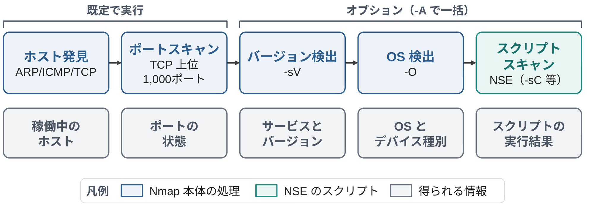
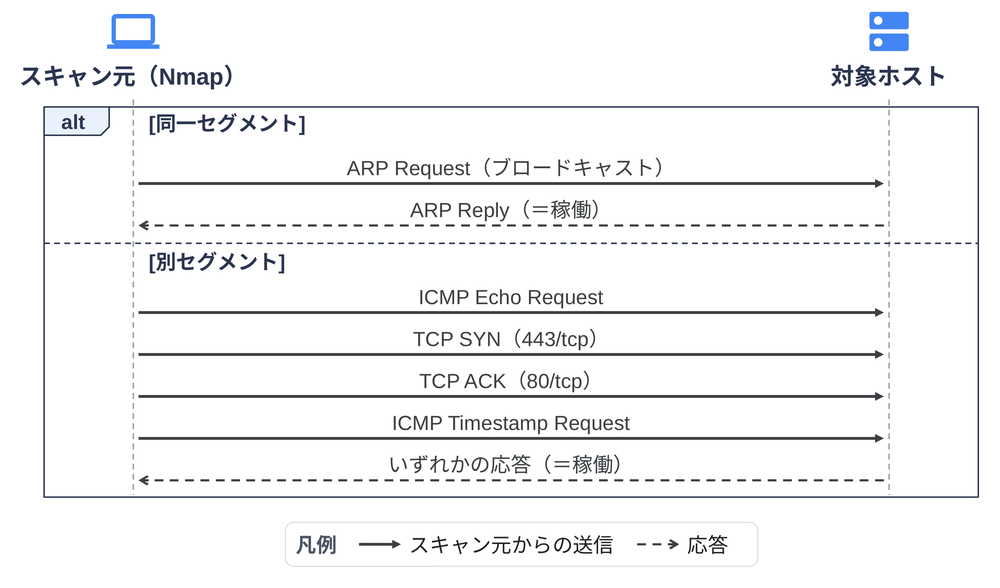
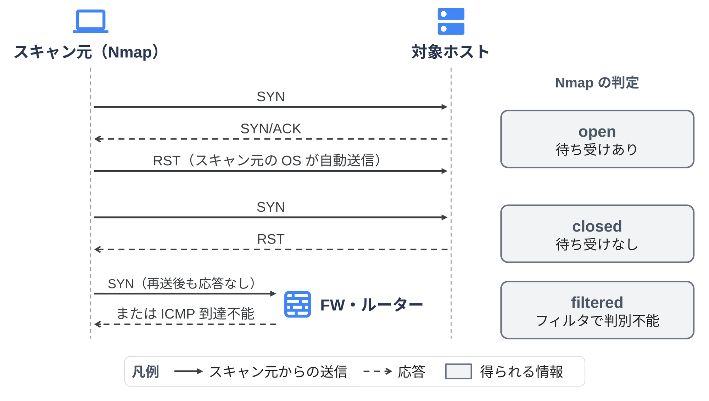
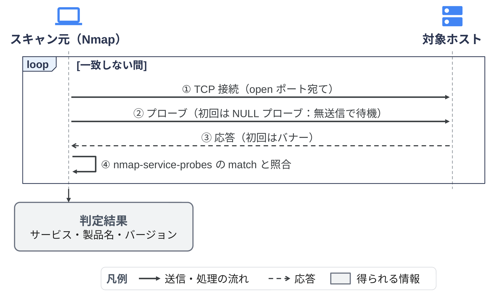
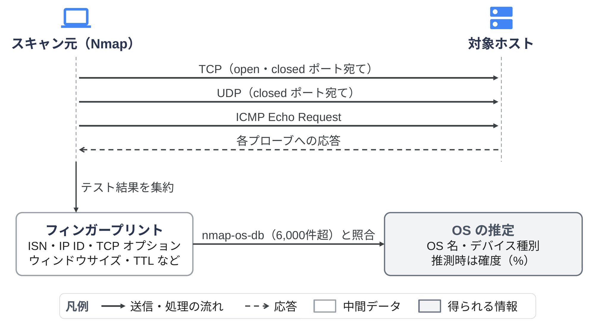
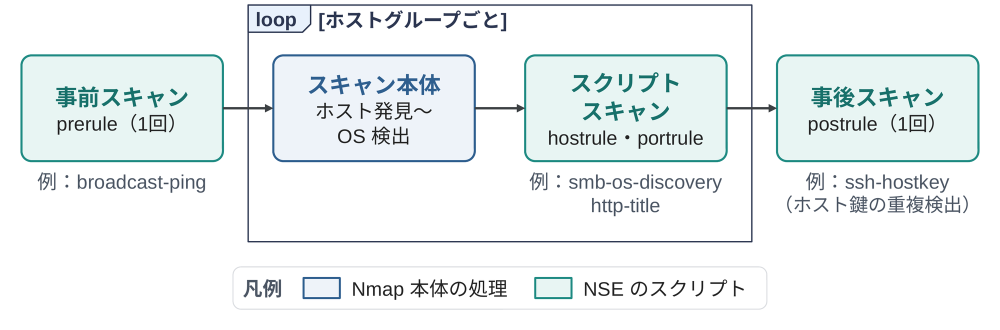

<!--
  コンパクト記事 no.39（草稿。公開前にこのコメントは削除）
  - テーマ：Nmap の主な機能（ホスト発見・ポートスキャン・バージョン検出・OS 検出・NSE）が、それぞれ何を送って何を判定しているのか
  - 姉妹記事：no.40 Nuclei、no.41 subfinder（別スレッドで執筆中）。公開順に合わせて相互リンクを足す（TODO）
  - 裏取り（2026-11-14、nmap.org の公式ドキュメント）：
    - ホスト発見：特権ユーザーの既定は ICMP Echo Request・TCP SYN→443・TCP ACK→80・ICMP Timestamp Request。非特権ユーザーは connect() で 80・443 に SYN。
      同一セグメントでは ARP（IPv4）／NDP（IPv6）。-sn はポートスキャンなし、-Pn はホスト発見を省略（man-host-discovery）
    - ポートスキャン：特権ユーザーの既定は -sS、非特権ユーザーは -sT。SYN スキャンは SYN/ACK=open、RST=closed、無応答（再送後）か
      ICMP 到達不能（type 3, code 0,1,2,3,9,10,13）=filtered。UDP は ICMP type 3 code 3=closed、ほかの type 3=filtered、無応答=open|filtered。
      既定はプロトコルごとに上位 1,000 ポート。ポートの状態は6種類（man-port-scanning-basics / techniques）
    - バージョン検出：nmap-service-probes。TCP は最初に NULL プローブ（接続して何も送らず待つ。book は約5秒と書くが、現行の nmap-service-probes は totalwaitms 6000）。
      --version-intensity は 0〜9、既定 7。最初に一致した match で確定、softmatch はサービスの種類だけ確定。
      SSL/TLS を検出したら TLS で接続し直して再判定。-sV なしの SERVICE 列は nmap-services（ポート番号の表）からの推測（man-version-detection / vscan-technique）
    - OS 検出：open と closed のポートに TCP・UDP・ICMP のプローブを最大16個（SEQ 6・ECN・T2〜T7・U1・IE 2）。
      nmap-os-db は man ページでは「2,600 件超」だが、changelog の 7.95 で 6,036 件、2026-11 の master で 6,108 件 → 本文は「6,000 件超」。open と closed の TCP ポートが各1つ以上あると精度が上がる（man-os-detection / osdetect-methods）
    - NSE：カテゴリは14種（auth, broadcast, brute, default, discovery, dos, exploit, external, fuzzer, intrusive, malware, safe, version, vuln）。
      version は -sV の拡張で、明示的に選べない。-sC = --script=default、-A = -O -sV -sC --traceroute。
      prerule は全ホストのスキャン前に1回、hostrule・portrule はホストのまとまりごとのスキャン後、postrule は最後に1回（nse-usage / nse-script-format）
    - SYN スキャンの open 時の RST はスキャン元の OS（カーネル）が返す（synscan.html）
    - script.db（2026-11 master）：vuln 106 本中 69 本が intrusive・dos・exploit のどれかを兼ねる
    - -PR は 7.80 で廃止（nmap.cc：The -PR option is deprecated）。default 128 本はすべて safe にも入る（script.db 2026-11 master）
    - バージョン検出：TCP はプローブごとに接続し直す（NULL の直後の1つだけ同じ接続、vscan-technique / service_scan.cc）
    - スクリプト数：Nmap 7.96 で 612、2026-10 のリリースで 620（changelog）→ 本文は「600本以上」
    - scanme.nmap.org：Nmap などでのスキャンは許可。サーバーに負荷をかけすぎない、1日に何度もスキャンしない、SSH の総当たりツールの試験に使わない
  - 図：image/01〜06_*.pptx/png（zukai-diagrams 準拠、生成 image/zukai/figs.js → render.sh）
  - TODO：scanme.nmap.org と自分の環境に対する実際の出力を、Nico の Mac で取って各節に貼る（出力は捏造しない）
-->

# はじめに

Nmap って `-sV` や `-A` をなんとなく付けて打っているけど、それぞれ実際に何を送って、何を見て判定しているのか？と聞かれると答えきれなかったので、機能ごとにまとめてみました。

:::note warn
スキャンは、自分が管理している機器・ネットワークか、事前に許可をもらった対象にだけ実行してください。
許可のないスキャンは、相手のサービスに負荷をかけたり、攻撃の下調べ（偵察）と受け取られて遮断・通報されたりすることがあります。ポートスキャン自体がすぐに不正アクセス行為になるわけではありませんが、NSE のスクリプトで他人のパスワードを当ててログインしたり、脆弱性を突いて認証を回避したりすれば不正アクセス禁止法、サービスを止めてしまえば業務妨害の罪などに問われるおそれがあります。
この記事の例は、Nmap のプロジェクトが練習用に公開している `scanme.nmap.org` か、自分の環境（`127.0.0.1` や、自分が管理する LAN の機器）を対象にしています。`scanme.nmap.org` も、1日に数回のスキャンならよいけれど、負荷をかけすぎたり、1日に100回もスキャンしたり、SSH のパスワード総当たりツールの試験に使ったりはしないように、とされています。
:::

# ひとことで言うと

- **Nmap**（Network Mapper）は、ネットワーク上の「どのホストが動いているか」「どのポートが開いているか」「そこで何のソフトのどのバージョンが動いているか」「OS は何か」を調べるスキャナ
- 主な機能は5つ：**ホスト発見**・**ポートスキャン**・**バージョン検出**（`-sV`）・**OS 検出**（`-O`）・**NSE**（スクリプト、`-sC`・`--script`）
- 何も付けずに実行すると、ホスト発見と、よく使われる 1,000 ポートのポートスキャンまで。残りの3つはオプションで足す（`-A` でまとめて有効になる）

Nmap は、Gordon Lyon（Fyodor）さんが 1997 年に公開した無料・オープンソースのツールです。コマンド名は `nmap` で、GUI の Zenmap や、通信ツールの Ncat なども一緒に配布されています。

# Nmap は何をどの順に調べるのか？

Nmap の1回のスキャンは、ざっくり次の順に進みます。


*図1：Nmap のスキャンの流れ（逆引き DNS や traceroute などは省いて簡略化）。ホスト発見とポートスキャンは既定で動き、バージョン検出・OS 検出・スクリプトスキャン（NSE）はオプションで足す*

```bash
# 何も付けない：ホスト発見 → 上位 1,000 の TCP ポートをスキャン
nmap scanme.nmap.org

# -A：バージョン検出・OS 検出・NSE（default）・traceroute をまとめて有効にする
sudo nmap -A scanme.nmap.org
```

`-A` は `-O -sV -sC --traceroute` をまとめたオプションです（`-O` と `--traceroute` は、特権があるときだけ有効になります）。
`sudo` を付けているのは、OS 検出や SYN スキャンが、細工したパケットを直接送るために root などの特権を必要とするからです（後述）。

以下、図1の5つを順に見ていきます。

# ホスト発見は何を送っているのか？

ポートスキャンの前に、まず「そもそもそのホストは動いているのか」を確かめます。止まっているホストに何千ものポートスキャンを送るのは無駄だからです。


*図2：ホスト発見で送るプローブ（IPv4・特権ユーザーで、オプションを指定しない場合）。どれか1つにでも応答があれば、ホストは稼働中と判定する*

何も指定しないときに送るものは、スキャンする人の権限と、対象との位置関係で変わります。

| 条件 | 送るもの |
|---|---|
| 特権ユーザー・同一セグメント（同じ LAN） | ARP Request（IPv4）／Neighbor Discovery（IPv6） |
| 特権ユーザー・別セグメント | ICMP Echo Request、TCP SYN（443 番）、TCP ACK（80 番）、ICMP Timestamp Request（IPv4 の場合） |
| 非特権ユーザー | セグメントによらず、`connect()` による 80 番・443 番への接続（SYN） |

ICMP（いわゆる ping）だけだと、ICMP を落とすファイアウォールの裏にいるホストを見落とします。TCP の SYN と ACK も混ぜて送るのはそのためです。

よく使うオプションはこのあたりです。

| オプション | 意味 |
|---|---|
| `-sn` | ホスト発見だけ（ポートスキャンをしない）。いわゆる ping スキャン |
| `-Pn` | ホスト発見を省略し、全ホストを稼働中とみなしてポートスキャンする |
| `-PS<ポート>` / `-PA<ポート>` / `-PU<ポート>` | TCP SYN／TCP ACK／UDP のプローブを、指定したポートに送る |
| `-PE` / `-PP` / `-PM` | ICMP の Echo／Timestamp／Address Mask Request を送る |
| `--disable-arp-ping` | 同一セグメントでも ARP／ND を使わない（既定では、ほかの `-P*` を指定しても同一セグメントでは ARP／ND が使われる） |

```bash
# 自分が管理する LAN の中で、動いている機器を洗い出す（ポートスキャンはしない）
sudo nmap -sn 192.168.1.0/24
```

別セグメントのホストで、ホスト発見のプローブ（ICMP Echo／Timestamp、443 番への SYN、80 番への ACK）がどれもファイアウォールで落とされると、そのホストは「止まっている」と判定され、ポートスキャンまで進みません。動いていると分かっているのに結果が出ないときは、`-Pn` を付けます。

# ポートスキャンはどうやって open／closed を見分けているのか？

ポートスキャンは、ポートごとにパケットを送り、**返ってきた応答（または応答がないこと）** から状態を判定します。
既定のスキャンは、特権ユーザーなら **TCP SYN スキャン（`-sS`）**、非特権ユーザーなら **TCP connect スキャン（`-sT`）** です。


*図3：SYN スキャンでのポートの状態の判定。SYN/ACK が返れば open、RST なら closed、再送しても応答がないか ICMP の到達不能が返れば filtered*

SYN スキャンは、TCP の 3-way ハンドシェイクの最初の SYN だけを送ります。SYN/ACK が返ってきても、Nmap は ACK を返さず、接続を確立しないまま終わります（ハーフオープンスキャン）。
このとき図3の RST を送っているのは、Nmap ではなくスキャン元の OS です。Nmap は SYN を OS の TCP スタックを通さずに送っているので、OS からすると、身に覚えのない SYN/ACK が届いたことになり、自動で RST を返します。
接続を最後まで張らないので速く、アプリケーションに接続のログが残りにくいのが特徴です。ただし、ファイアウォールや IDS からはふつうに見えています。

一方 connect スキャンは、OS の `connect()` を使って、open のポートとはハンドシェイクを最後まで終えます。特権がなくても使えますが、そのぶん遅く、相手のアプリケーションのログにも残ります。

応答がない場合は、何度か再送してから `filtered` と判定します。ICMP の到達不能（type 3 の code 0・1・2・3・9・10・13）が返ってきた場合も `filtered` です。この ICMP は、対象ホストではなく、途中のファイアウォールやルーターが返すことも多いです。

判定の結果は、次の6つの状態のどれかになります。

| 状態 | 意味 |
|---|---|
| `open` | アプリケーションが接続を待ち受けている |
| `closed` | 届いてはいるが、待ち受けているアプリケーションがない |
| `filtered` | ファイアウォールなどに遮られて、届いているか分からない |
| `unfiltered` | 届いているが、open か closed かは分からない（ACK スキャンでだけ出る） |
| `open\|filtered` | open か filtered かを区別できない（UDP スキャンなどで出る） |
| `closed\|filtered` | closed か filtered かを区別できない（IP ID アイドルスキャンで出る） |

主なスキャンの種類はこちらです。

| オプション | スキャン | 特徴 |
|---|---|---|
| `-sS` | TCP SYN | 特権ユーザーの既定。ハンドシェイクを完了しない |
| `-sT` | TCP connect | 非特権ユーザーの既定。ハンドシェイクを完了する |
| `-sU` | UDP | 応答が返らないことが多く遅い。`open\|filtered` が多く出る |
| `-sA` | TCP ACK | open／closed は判定しない。ファイアウォールがどのポートを通しているかを調べる |
| `-sN` / `-sF` / `-sX` | TCP NULL／FIN／Xmas | SYN・RST・ACK のどれも立てずに送り、closed なら RST、open なら無応答という RFC 793 の挙動を使う。結果は `open\|filtered`・`closed`・`filtered`（ICMP 到達不能のとき）のどれか。RFC どおりに応答しない OS（Windows など）では全ポートが closed と出る |

UDP スキャンでは、UDP の応答が返れば `open`、ICMP の Port Unreachable（type 3, code 3）が返れば `closed`、ほかの到達不能なら `filtered`、何も返らなければ `open|filtered` と判定します。UDP のサービスは、正しい形式のリクエストでないと何も返さないことが多いので、`open|filtered` だらけになりがちです（Nmap は、DNS などのよく使われるポートには、プロトコルに合ったペイロードを送ります）。`-sV` を一緒に付けると、`open|filtered` の一部を `open` に確定できます。

スキャンするポートは、既定ではプロトコルごとに **よく使われる上位 1,000 ポート** だけです。

```bash
# 指定したポートだけ
sudo nmap -p 22,80,443 scanme.nmap.org
# 全ポート（1〜65535）
sudo nmap -p- scanme.nmap.org
# 上位 100 ポートだけ（速い）
sudo nmap -F scanme.nmap.org
```

# -sV は何を見てバージョンを当てているのか？

ポートスキャンで open と分かったポートに、実際に話しかけて、**何のサービスの、何という製品の、どのバージョンが動いているか** を当てるのがバージョン検出（`-sV`）です。


*図4：バージョン検出のしくみ。接続して（①）プローブを送り（②、初回は何も送らずバナーを待つ）、応答（③）が来るたびに nmap-service-probes の match と照合する（④）。一致しない間は、プローブを替えて繰り返す（TCP では、NULL プローブの次のプローブ以外は毎回接続し直す）*

1. TCP で接続し、**何も送らずに数秒（現在の定義では6秒）待つ**（NULL プローブ）。SSH や FTP、SMTP のように、接続しただけで名乗る（バナーを送る）サービスは、これで判定できることが多い
2. 判定できなければ、`nmap-service-probes` に定義されたプローブ（HTTP の `GET / HTTP/1.0` を送る GetRequest など）を、そのポートで使われやすいものから順に送る。TCP では、プローブごとに接続し直す（NULL プローブの直後の1つだけは、同じ接続を使い回す）
3. 応答が来るたびに、同じファイルの `match` 行（正規表現）と照合し、**最初に一致した時点で確定** する。正規表現でバージョン番号も抜き出す。`softmatch` に一致した場合は、サービスの種類（たとえば SMTP）だけを確定し、そのサービス向けのプローブに絞って続ける

どこまで多くのプローブを試すかは `--version-intensity`（0〜9、既定は 7）で変えられます。
また、TLS を使っていると分かったら、TLS で接続し直して、暗号化の内側で動いているサービスを判定し直します（HTTPS の裏の Web サーバーなど。OpenSSL を有効にしてビルドされた Nmap の場合）。

```bash
nmap -sV -p 22,80 scanme.nmap.org
```

結果の `VERSION` 列に、製品名とバージョンが出ます。バージョンが分かれば、既知の脆弱性（CVE）と突き合わせる手がかりになります。ただし Linux ディストリビューションのパッケージは、修正を古いバージョンに取り込んで（バックポートして）配布することが多いので、バナーのバージョン番号だけで脆弱と決めつけず、パッケージの更新履歴などで確かめます。

:::note info
`-sV` を付けなくても、結果に `SERVICE` 列（`ssh`、`http` など）は出ます。でもこれは、**ポート番号から `nmap-services` の表を引いただけの推測** です。
22 番で SSH 以外のものが動いていても `ssh` と表示されるので、実際に何が動いているかを知りたいときは `-sV` を付けます。
:::

# -O はどうやって OS を当てているのか？

OS 検出（`-O`）は、**TCP/IP スタックの実装の癖** から OS を推定します。同じ TCP/IP でも、OS ごとに応答の細部が少しずつ違うからです。


*図5：OS 検出のしくみ。TCP・UDP・ICMP のプローブへの応答から指紋（フィンガープリント）を作り、nmap-os-db と照合する*

Nmap は、1回の試行で最大16個のプローブを送ります。内訳は、open と closed の TCP ポートへの TCP 13個、closed の UDP ポートへの UDP 1個、ICMP Echo Request 2個です。そして、応答の次のような特徴を調べます。うまく判定できないときは、試行を繰り返します。

- TTL の初期値、IP ヘッダーの DF ビット
- TCP のウィンドウサイズ、TCP オプションの種類と並び順
- IP ID の増え方、TCP のシーケンス番号（ISN）の規則性
- 通常ありえないフラグの組み合わせのパケットへの応答のしかた

これらをまとめた指紋（フィンガープリント）を、6,000 件を超える既知の指紋を収めた `nmap-os-db`（man ページの「2,600 件超」は古い数字）と照合して、OS 名やデバイスの種類（汎用、ルーター、プリンターなど）を表示します。ぴったり一致するものがないときは、近い候補を確度（%）付きで表示することがあります。

```bash
sudo nmap -O scanme.nmap.org
```

細工したパケットを送るので、root などの特権が必要です。また、**open と closed の TCP ポートが少なくとも1つずつ見つかる** と精度が上がります。ファイアウォールで closed のポートの応答まで落とされていると、推定の精度が落ちます。

# NSE でどこまでできるのか？

NSE（Nmap Scripting Engine）は、Lua で書かれたスクリプトを Nmap のスキャンの中で動かす仕組みです。Nmap には 600 本以上のスクリプトが同梱されていて、ここまでの4つの機能だけでは分からない、より詳しい情報の収集や、既知の脆弱性の確認ができます。


*図6：NSE のスクリプトが動くタイミング（ホスト発見や traceroute の位置は省いて簡略化）。hostrule・portrule のスクリプトは、ホストグループのスキャンが終わるたびに動く*

Nmap は、大量のホストを一度にではなく、いくつかのまとまり（ホストグループ）に分けてスキャンします。スクリプトは、どの段階で動くかで4種類に分かれます。

| rule | 動くタイミング | 例 |
|---|---|---|
| prerule | 全ホストのスキャンの前に1回 | `broadcast-ping`（LAN にブロードキャストの ping を流し、応答したホストを表示する） |
| hostrule | ホストグループのスキャンが終わるたびに、条件に合うホストごと | `smb-os-discovery`（SMB で OS やホスト名を聞く） |
| portrule | ホストグループのスキャンが終わるたびに、条件に合うポートごと | `http-title`（Web ページのタイトルを取る） |
| postrule | 全ホストのスキャンの後に1回 | `ssh-hostkey`（portrule で集めたホスト鍵から、同じ鍵を使い回しているホストを列挙する） |

使うスクリプトは、名前かカテゴリで選びます。カテゴリは全部で14種類です。

| カテゴリ | 中身 |
|---|---|
| `default` | `-sC`（と `-A`）で動く標準のセット |
| `safe` | 対象を落としたり、攻撃と受け取られたりするおそれが小さいもの |
| `discovery` | ホストやサービスの詳しい情報を集めるもの |
| `broadcast` | ブロードキャストで、LAN にいる（コマンドで指定していない）ホストを見つけるもの |
| `vuln` | 特定の既知の脆弱性があるかを確かめるもの |
| `auth` | 認証まわり（匿名ログインできるかなど）を調べるもの |
| `version` | バージョン検出の拡張。`-sV` のときに自動で動き、直接は選べない |
| `external` | whois などの外部のデータベースにデータを送るもの |
| `intrusive` | 対象を落としたり負荷をかけたりするおそれがあり、`safe` に入れられないもの |
| `brute` | パスワードの総当たりで認証情報を探すもの |
| `dos` | 対象をサービス不能にするおそれがあるもの |
| `exploit` | 脆弱性を実際に悪用するもの |
| `fuzzer` | 想定外のデータを送りつけてバグを探すもの |
| `malware` | バックドアなど、マルウェアに感染していないかを調べるもの |

1つのスクリプトが複数のカテゴリに属することもあります。`default` のスクリプトは（2026-11 時点の script.db では）すべて `safe` にも入っていますが、一方で `vuln` のスクリプトの多くは `intrusive`・`dos`・`exploit` も兼ねています（2026-11 時点の script.db で、`vuln` 106 本のうち 69 本）。
カテゴリは `and`・`or`・`not` で組み合わせられるので、たとえば `--script "vuln and safe and not external"` とすれば、`vuln` のうち `safe` にも入っていて、外部のサービスに情報を送らないものだけに絞れます。
ただし `safe` は「対象を落としたり、攻撃と受け取られたりするおそれが小さい」という意味で、おそれがゼロという保証ではありません。`-sC` の `default` も含めて、許可のない相手には使いません。

```bash
# default のスクリプトをバージョン検出と一緒に
nmap -sC -sV scanme.nmap.org
# スクリプトを名前で指定
nmap --script http-title -p 80 scanme.nmap.org
# カテゴリを条件式で指定（default のうち、http- で始まるもの以外）
nmap --script "default and not http-*" scanme.nmap.org
# スクリプトの説明を見る（スキャンはしない）
nmap --script-help http-title
```

:::note warn
`intrusive`・`brute`・`dos`・`exploit` のスクリプトは、対象のサービスを止めたり、アカウントをロックさせたり、データを書き換えたりするおそれがあります。前述のとおり、`vuln` のスクリプトにもこれらを兼ねるものが多くあります。
これらは `scanme.nmap.org` にも向けず、自分で立てた検証用の環境（Docker のコンテナなど）に対してだけ使ってください。`external` のスクリプトは、対象の情報を第三者のサービスに送る点にも注意が必要です。
:::

# よくある勘違い

最後に、Nmap の結果を読むときに勘違いしやすいところをまとめておきます。

- **何も付けないと、全ポートは見ていない**：既定はよく使われる上位 1,000 ポートだけ（1〜1000 番ではなく、使用頻度の順）。そこに入らないポートで動いているサービスは、`-p-` を付けないと見落とします
- **`filtered` は「閉じている」ではない**：届いているかどうか分からない、という意味です。ファイアウォールの裏でサービスが動いている可能性は残ります
- **`-sV` なしの `SERVICE` 列は推測**：ポート番号から表を引いただけです（前述）
- **`sudo` の有無で動きが変わる**：特権がないと、既定のスキャンが connect スキャンになり、ホスト発見のプローブも変わります。OS 検出は使えません

# まとめ

- Nmap は、ホスト発見 → ポートスキャン → バージョン検出 → OS 検出 → NSE の順に、ネットワーク上のホストとサービスを調べるスキャナ
- ホスト発見は ARP や ICMP・TCP のプローブで稼働中のホストを絞り、ポートスキャンは SYN などへの応答で open／closed／filtered を判定する
- バージョン検出は、バナーとプローブへの応答を nmap-service-probes の正規表現と照合し、OS 検出は TCP/IP スタックの癖から作った指紋を nmap-os-db と照合する
- NSE は、600 本以上の Lua スクリプトで、情報収集から脆弱性の確認までを足せる。ただし `intrusive` などのカテゴリは対象に影響しうるので、自分の検証環境だけで使う
- どの機能も、許可のない相手には使わない。練習は `scanme.nmap.org`（負荷をかけない範囲で）か、自分の環境で

# 参考

- [Nmap Reference Guide（man ページ）](https://nmap.org/book/man.html)
- [Host Discovery](https://nmap.org/book/man-host-discovery.html)
- [Port Scanning Basics](https://nmap.org/book/man-port-scanning-basics.html)
- [Port Scanning Techniques](https://nmap.org/book/man-port-scanning-techniques.html)
- [Service and Version Detection](https://nmap.org/book/man-version-detection.html) / [Technique Described](https://nmap.org/book/vscan-technique.html)
- [OS Detection](https://nmap.org/book/man-os-detection.html) / [TCP/IP Fingerprinting Methods Supported by Nmap](https://nmap.org/book/osdetect-methods.html)
- [Nmap Scripting Engine (NSE)](https://nmap.org/book/nse-usage.html) / [NSE Script Format](https://nmap.org/book/nse-script-format.html) / [NSEDoc](https://nmap.org/nsedoc/)
- [scanme.nmap.org](http://scanme.nmap.org/)
- [Nmap Changelog](https://nmap.org/changelog.html)
