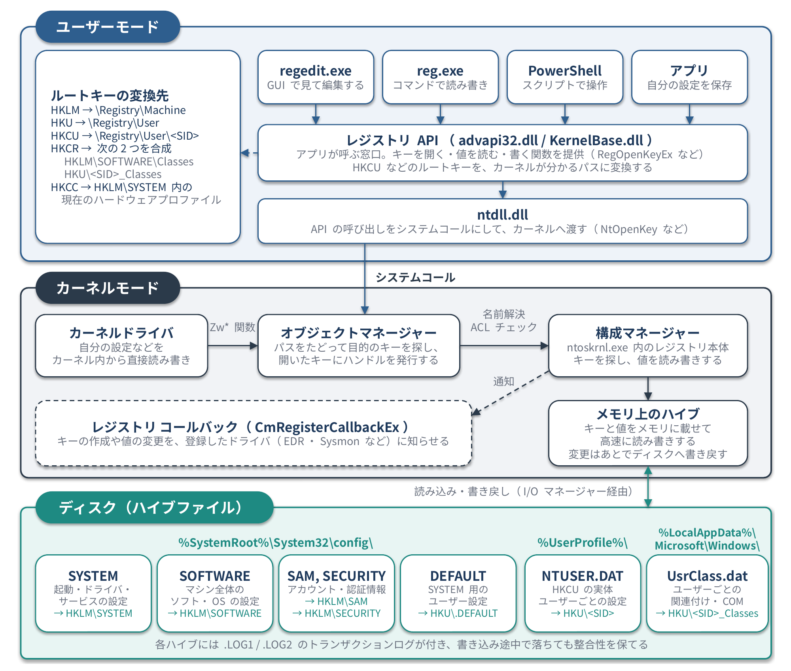

<!--
  コンパクト記事 no.4（草稿。公開前にこのコメントは削除）
  - 裏取り：Microsoft Learn の reg コマンドのページ、レジストリのルートキーと値の型のページ
  - 足したいもの：実際に reg query を叩いた結果のスクショ（自分の検証用 VM で）
  - 注意：レジストリを書き換えるコマンドは、試す前にバックアップ（reg export）をとるよう書く
-->

# はじめに

インシデント対応の記事を読んでいると「Run キーに登録されていた」がよく出てくるので、レジストリとその操作コマンドをまとめておきます。
EDR ログ分析のハンズオンに参加したときにもレジストリの話が出てきたので、そこで学んだことも混ぜています。

# ひとことで言うと

**レジストリは、Windows の OS とアプリの設定を入れておく、階層型のデータベース**です。
`regedit`（GUI）、`reg`（コマンドプロンプト）、PowerShell で読み書きできます。

# 構造

フォルダのような「キー」の中に、名前・型・データを持つ「値」が入っています。
パスは `ルートキー\サブキー\…\値` の形で書きます。

```text
HKLM\SOFTWARE\Microsoft\Windows NT\CurrentVersion  の  ProductName
```

ここには Windows のエディション名が入っています。
ただし Windows 11 でもこの値は「Windows 10 Pro」のままになっていて、11 かどうかはビルド番号（`CurrentBuild` が 22000 以上）で見分けます。ちょっとした罠ですね。

## ルートキー

| ルートキー | 略称 | 中身 |
|---|---|---|
| HKEY_LOCAL_MACHINE | HKLM | コンピューター全体の設定 |
| HKEY_CURRENT_USER | HKCU | ログオン中のユーザーの設定 |
| HKEY_USERS | HKU | 読み込まれているユーザーごとの設定（`HKU\<SID>`） |
| HKEY_CLASSES_ROOT | HKCR | ファイルの関連付けや COM の情報 |
| HKEY_CURRENT_CONFIG | HKCC | 現在のハードウェア構成 |

HKCU は独立した場所ではなく、`HKU\<ログオン中のユーザーの SID>` を指しているだけです。

## 値の主な型

| 型 | 中身 |
|---|---|
| REG_SZ | 文字列 |
| REG_EXPAND_SZ | 環境変数（`%SystemRoot%` など）を含む文字列 |
| REG_MULTI_SZ | 複数の文字列 |
| REG_DWORD | 32ビットの数値 |
| REG_QWORD | 64ビットの数値 |
| REG_BINARY | バイナリ |

## 身近なキーの例

| 設定 | キー |
|---|---|
| マウスの速度 | `HKCU\Control Panel\Mouse` の `MouseSensitivity` |
| デスクトップの壁紙 | `HKCU\Control Panel\Desktop` の `Wallpaper` |
| 拡張子を表示するか | `HKCU\Software\Microsoft\Windows\CurrentVersion\Explorer\Advanced` の `HideFileExt` |
| 最近開いたファイル | `HKCU\Software\Microsoft\Windows\CurrentVersion\Explorer\RecentDocs` |
| インストール済みのソフト | `HKLM\SOFTWARE\Microsoft\Windows\CurrentVersion\Uninstall` |
| USB ストレージの接続履歴 | `HKLM\SYSTEM\CurrentControlSet\Enum\USBSTOR` |

普段 GUI で変えている設定も、裏ではこういうキーに保存されています。

## どのレイヤーで動いているか


*図1：レジストリを読み書きするときの流れ*

`regedit` も `reg` も PowerShell も、最後は同じ道を通ります。

1. ユーザーモードのレジストリ API（advapi32.dll / KernelBase.dll）が、`HKCU` などのルートキーを `\Registry\User\<SID>` のようなカーネル内のパスに変換します
2. ntdll.dll が、その呼び出しを `NtOpenKey` などのシステムコールにしてカーネルへ渡します
3. オブジェクトマネージャーがパスをたどって目的のキーを探し、ACL をチェックしてからハンドルを発行します
4. レジストリの本体は、カーネル（ntoskrnl.exe）の中の**構成マネージャー**です。キーと値をメモリ上のハイブに載せて高速に読み書きし、変更はあとでディスクのハイブファイル（`SYSTEM`、`NTUSER.DAT` など）へ書き戻します

構成マネージャーには、キーの作成や値の変更を通知してもらう仕組み（`CmRegisterCallbackEx`）があります。EDR や Sysmon がレジストリの変更をログに残せるのは、ここで通知を受け取っているからです。

# コマンド

## reg（コマンドプロンプト）

```bat
:: 読む
reg query "HKCU\Software\Microsoft\Windows\CurrentVersion\Run"

:: バックアップをとる（書き換える前に必ずやる）
reg export "HKCU\Software\Example" backup.reg

:: 値を追加する
reg add "HKCU\Software\Example" /v Sample /t REG_SZ /d "hello" /f

:: 値を消す
reg delete "HKCU\Software\Example" /v Sample /f

:: バックアップから戻す
reg import backup.reg
```

## PowerShell

PowerShell では、レジストリを `HKLM:` や `HKCU:` というドライブとして扱えます。

```powershell
# 読む
Get-ItemProperty -Path "HKCU:\Software\Microsoft\Windows\CurrentVersion\Run"

# キーを作る
New-Item -Path "HKCU:\Software\Example"

# 値を書く
Set-ItemProperty -Path "HKCU:\Software\Example" -Name "Sample" -Value "hello"

# 値を消す
Remove-ItemProperty -Path "HKCU:\Software\Example" -Name "Sample"
```

# セキュリティでの見どころ

次のキーは、ログオン時にプログラムを自動で起動させるために使われます。
正規のアプリも使いますが、マルウェアが居座る（永続化する）ためにも使われるので、インシデント対応ではまず確認する場所です（MITRE ATT&CK の T1547.001）。

- `HKCU\Software\Microsoft\Windows\CurrentVersion\Run`
- `HKCU\Software\Microsoft\Windows\CurrentVersion\RunOnce`
- `HKLM\Software\Microsoft\Windows\CurrentVersion\Run`
- `HKLM\Software\Microsoft\Windows\CurrentVersion\RunOnce`

Run キー以外にも、上の「身近なキーの例」にある `RecentDocs`（何のファイルを開いたか）、`USBSTOR`（どの USB メモリが挿されたか）、`Uninstall`（何がインストールされているか）は、「その端末で何が起きたか」をたどる手がかりになります。

# まとめ

レジストリは「Windows の設定の置き場所」ですが、調べる側から見ると「その端末で何が起きたか」が残っている記録でもありました。
ただし、Windows 11 でも `ProductName` が「Windows 10 Pro」のままだったように、値をそのまま信じると読み違える場所もあります。
Run キーは調査のときに真っ先に見る場所なので、自分の PC で一度 `reg query` してみると、知らない登録が見つかるかもしれません。
ほかにも見ておくべきキーがあれば、有識者の方教えて欲しいです！

# 参考

- Microsoft Learn「reg」 <https://learn.microsoft.com/ja-jp/windows-server/administration/windows-commands/reg>
- Microsoft Learn「定義済みのキー」 <https://learn.microsoft.com/ja-jp/windows/win32/sysinfo/predefined-keys>
- Microsoft Learn「レジストリ値の型」 <https://learn.microsoft.com/ja-jp/windows/win32/sysinfo/registry-value-types>
- Microsoft Learn「CmRegisterCallbackEx 関数」 <https://learn.microsoft.com/ja-jp/windows-hardware/drivers/ddi/wdm/nf-wdm-cmregistercallbackex>
- MITRE ATT&CK T1547.001 Registry Run Keys / Startup Folder <https://attack.mitre.org/techniques/T1547/001/>
