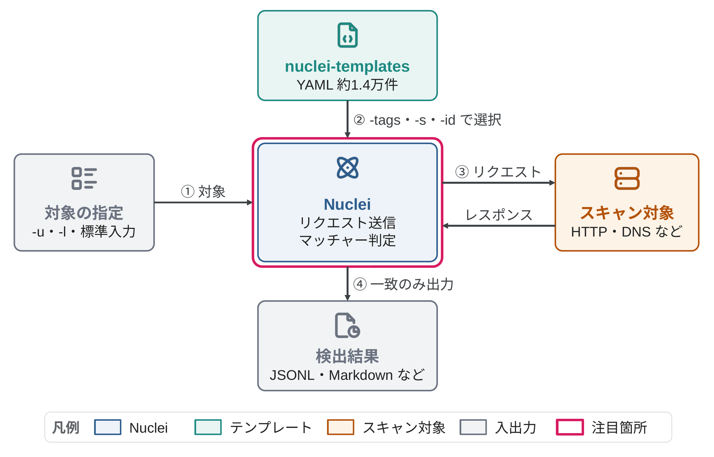
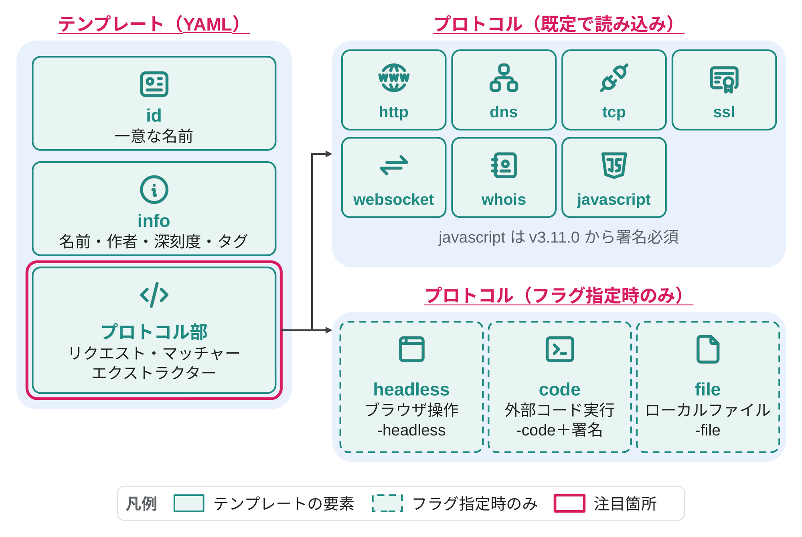
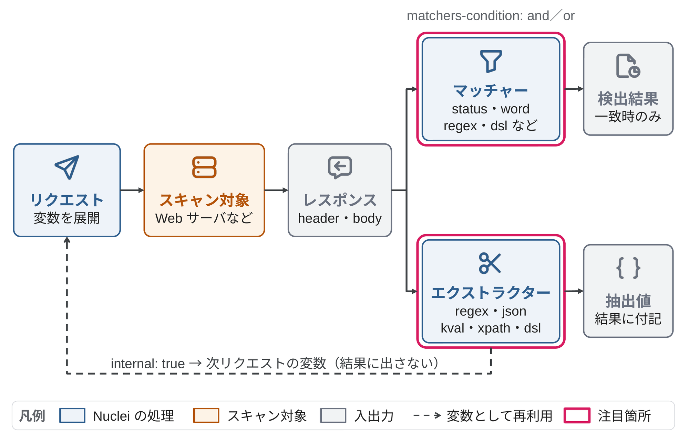
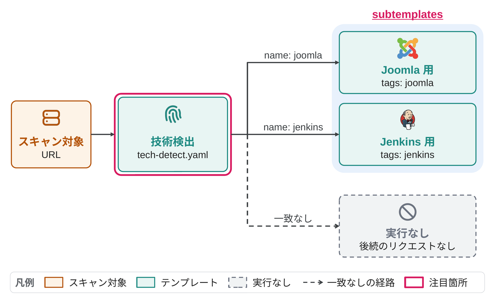
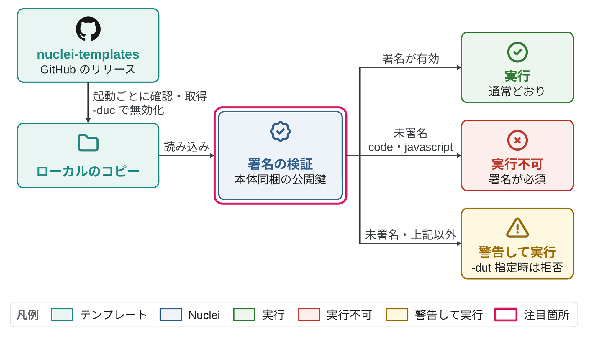
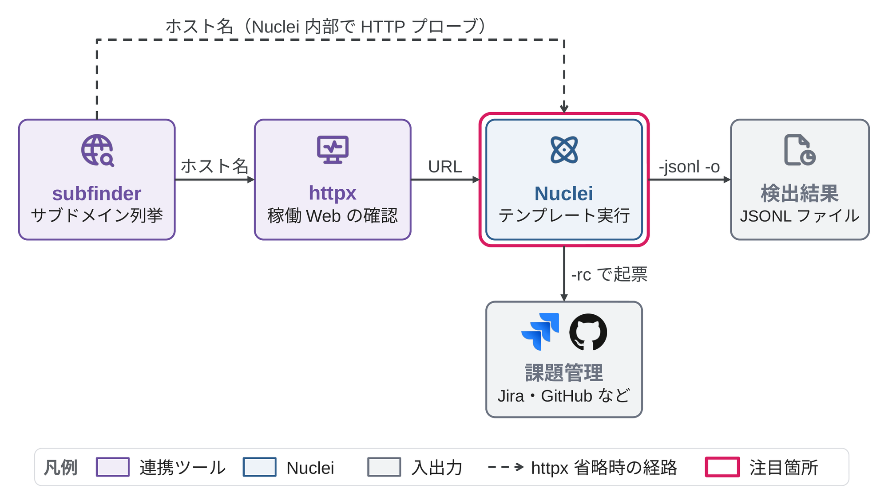

<!--
  コンパクト記事 no.40（草稿。公開前にこのコメントは削除）
  - テーマ：Nuclei の主な機能（YAMLテンプレート、プロトコル、マッチャー/エクストラクター、ワークフロー、テンプレート更新と署名、他ツールとのパイプ連携）と、それぞれで何ができるか
  - シリーズ：no.39 nmap、no.41 subfinder と3本セット（別スレッドで執筆）。公開順が決まったら相互リンクを足す（TODO）
  - 裏取り（2026-11-14）：
    - 基準は v3.11.1 のタグ（README とソース）。dev ブランチの README には未リリースの機能（-im har、-llm など）が入っているので使わない
    - -pt の値 dns/file/http/headless/tcp/workflow/ssl/websocket/whois/code/javascript、-code・-file・-headless・-dast・-as・-w・-ut・-up・-duc・-dut・-sign・-nh・-no-stdin・-ni・-iserver
    - 最新リリース v3.11.1（GitHub Releases、2026-08-08）。v3.11.0（2026-07-06）の破壊的変更で javascript テンプレートも署名が必須に（loader.go の IsUnsignedJavascriptTemplate。docs の Template Signing ページは未反映で「code だけ」のまま）
    - -sign の鍵は NUCLEI_USER_PRIVATE_KEY / NUCLEI_USER_CERTIFICATE（signer/handler.go）。-h の説明文の NUCLEI_SIGNATURE_PRIVATE_KEY は古い文言
    - -im の値（v3.11.1）：list, burp, jsonl, yaml, openapi, swagger（har・http は dev のみ）
    - whois プロトコルの実体は RDAP（ドメイン・IP・AS 番号）。matcher の part の既定はプロトコルごとに違う（HTTP は body）
    - tech-detect.yaml のマッチャー名：joomla・jenkins は実在（wordpress はなし、Jira は atlassian-jira）
    - docs.projectdiscovery.io：matchers（7種、既定は OR、matchers-condition、negative、internal）、extractors（regex/kval/json/xpath/dsl、internal、name）、workflows（generic / conditional、subtemplates、matchers の name で分岐）、template-signing（公式テンプレートは全部署名付き、未署名の code は実行不可、それ以外は警告。javascript は上記のとおり v3.11.0 から必須）、running（起動ごとに更新確認、-duc、-rl 既定 150/秒）
    - 法令：総務省「国民のためのサイバーセキュリティサイト」の不正アクセス禁止法・電子計算機損壊等業務妨害罪の解説
    - nuclei-templates：TEMPLATES-STATS の severity 合計 14,018 件（info 5397 / high 3081 / medium 2898 / critical 2063 / low 520 / unknown 59）、.nuclei-ignore の既定除外タグ dos・local・fuzz・bruteforce・txt-service
  - 図：image/01〜06_*.pptx/png（zukai-diagrams 準拠、生成 image/zukai/figs.js → render.sh。色は6枚共通：navy＝Nuclei、teal＝テンプレート、orange＝スキャン対象、gray＝入出力、purple＝連携ツール、ピンク枠＝注目箇所、破線＝既定では通らない要素・経路）
  - 2026-11 時点で dev ブランチに llm 型の matcher / extractor が入っている。次のリリースで「7種・5種」が変わったら直す
  - TODO：自分の検証環境（自前の脆弱なコンテナ等）で実際に回した出力を「使ってみる」に貼る
-->

# はじめに

nmap でポートを見たあと、「じゃあそのサービスに既知の脆弱性があるのか？」を手で一個ずつ調べるのはしんどい…と思っていたところで出会ったのが **Nuclei** でした。
「テンプレートを読んでリクエストを投げるだけのツール」くらいの理解だったので、機能ごとに何をしてくれるのかを整理してみました。

:::note warn
スキャンは、自分が管理するサーバや、診断の許可を書面などで得た対象にだけ実行してください。
許可なくスキャンして相手のサービスに負荷や障害を与えると、電子計算機損壊等業務妨害罪などに問われたり、損害賠償を求められたりするおそれがあります。
また Nuclei のテンプレートには、初期パスワードでのログインや認証回避、脆弱性の悪用を試すものなど、攻撃に近いリクエストを送るものも含まれます。これらを許可なく実行すると、不正アクセス禁止法に触れるおそれがあります。
:::

# ひとことで言うと

- **Nuclei** は、ProjectDiscovery が作っているオープンソースの脆弱性スキャナ（Go 製、MIT ライセンス）
- 「何を送って、返ってきたものが何なら脆弱とみなすか」を **YAML のテンプレート** に書き、それを大量の対象に高速に当てる
- テンプレートはコミュニティが育てている公式リポジトリ `nuclei-templates` に **約1.4万件**（2026-11-14 時点）あり、新しい CVE のテンプレートもどんどん追加される
- 2026-11-14 時点の最新版は `v3.11.1`

# 全体としては何をしているのか？


*図1：Nuclei の全体像。対象を受け取り（①）、テンプレートを選び（②）、リクエストを送ってレスポンスを判定し（③）、一致したものだけを結果に出す（④）*

Nuclei の仕事はシンプルで、

1. 対象（URL・ホスト・IP・CIDR）を `-u`・`-l`・標準入力で受け取る
2. テンプレートの中から、今回使うものを選ぶ（`-tags cve`、`-s critical,high`、`-id` など）
3. テンプレートに書かれたリクエストを対象に送り、レスポンスをテンプレートの条件（マッチャー）で判定する
4. 条件に一致したものだけを、検出結果として出す

という流れです。スキャンの「中身」は全部テンプレート側にあり、Nuclei 本体はそれを並列に、速く、正確に実行するエンジンに徹しています。
なので、Nuclei で何ができるかは、ほぼ **テンプレートで何が書けるか** で決まります。

# テンプレートには何が書けるのか？


*図2：テンプレートの構造と、プロトコル部で使える種類。headless・code・file はフラグを付けたときだけ読み込まれる*

テンプレートは、`id`（一意な名前）、`info`（名前・作者・深刻度・タグ）、そして **プロトコル部**（何を送り、どう判定するか）の3つでできています。
たとえば、公開ディレクトリに `.git/config` が見えてしまっていないかを確かめるテンプレートは、こんな感じで書けます（説明用に簡略化しています）。

```yaml:git-config-exposure.yaml
id: git-config-exposure

info:
  name: Git Config Exposure
  author: nico
  severity: medium
  tags: git,config,exposure

http:
  - method: GET
    path:
      - "{{BaseURL}}/.git/config"

    matchers-condition: and
    matchers:
      - type: word
        part: body
        words:
          - "[core]"
      - type: status
        status:
          - 200
```

`http:` の部分がプロトコル部です。HTTP 以外にも、次のプロトコルが使えます。

| キー | 何を送るか・調べるか | 既定で読み込まれるか |
|---|---|---|
| `http` | HTTP リクエスト | ○ |
| `dns` | DNS クエリ | ○ |
| `tcp` | 生の TCP 通信（バナーやプロトコル固有のやり取り） | ○ |
| `ssl` | TLS ハンドシェイク・証明書 | ○ |
| `websocket` | WebSocket 通信 | ○ |
| `whois` | RDAP で引く登録情報（ドメイン・IP・AS 番号） | ○ |
| `javascript` | JS で書いた手順（SSH・SMB・Redis などのモジュールを使う） | ○（v3.11.0 から署名が必須） |
| `headless` | ヘッドレスブラウザの操作 | `-headless` が必要 |
| `code` | 外部のコード（Python・シェルなど）の実行 | `-code` が必要、さらに署名が必須 |
| `file` | ローカルのファイルの中身 | `-file` が必要 |

`headless`・`code`・`file` は、手元のマシンでブラウザを動かしたりコードを実行したりファイルを読んだりするので、明示的にフラグを付けないと読み込まれません。
`javascript` はフラグなしで読み込まれますが、v3.11.0 からは署名のないものが読み込まれなくなりました（署名については後半で説明します。公式のテンプレートは署名済みです）。
なお、`dos`・`fuzz`・`bruteforce` などのタグが付いたテンプレートも、既定の除外リスト（`.nuclei-ignore`）で外されていて、`-include-tags` などで明示したときだけ動きます。

# 「脆弱」はどうやって判定しているのか？


*図3：マッチャーとエクストラクター。マッチャーは「一致したら検出」、エクストラクターは「値を抜き出す」。抜き出した値は次のリクエストの変数にも使える*

判定を担うのが **マッチャー**、値の抜き出しを担うのが **エクストラクター** です。

**マッチャー** は、レスポンスのどこ（`part`：HTTP なら既定は `body`、ほかに `header` など）に何があれば一致とみなすかを書きます。種類は7つです（v3.11.1 時点）。

| 種類 | 見るもの |
|---|---|
| `status` | ステータスコード |
| `size` | レスポンスの長さ |
| `word` | 文字列が含まれるか |
| `regex` | 正規表現に一致するか |
| `binary` | バイト列が含まれるか |
| `dsl` | 式（例：`status_code == 200 && len(body) < 1024`） |
| `xpath` | HTML・XML の XPath |

- 複数のマッチャーは、既定では **どれか1つ** が一致すれば検出（OR）。全部そろったときだけにするなら `matchers-condition: and`
- 1つのマッチャーの中の複数の `words` も、既定は OR（`condition: and` で AND）
- `negative: true` で「含まれて **いない** とき」に一致させられる（ヘッダーが欠けているかの確認など）

上の例の `matchers-condition: and` は、「ステータスが 200 で、**かつ** 本文に `[core]` がある」ときだけ検出する、という意味です。
200 だけで判定すると、存在しないパスにも 200 を返すサーバで誤検知になるので、複数の条件を AND で重ねるのが誤検知を減らす基本です。

**エクストラクター** は、レスポンスから値を抜き出します（`regex`・`kval`・`json`・`xpath`・`dsl` の5種類、v3.11.1 時点）。
抜き出したバージョン番号などはそのまま結果に表示されるほか、`internal: true` と `name` を付けると結果には出さずに **変数として次のリクエストで使えます**。ログインページから CSRF トークンを抜いて、次のリクエストに載せる、といった多段の手順が書けるのはこのおかげです。

# 全テンプレートを毎回投げるしかないのか？


*図4：ワークフローによる条件付き実行。技術検出のテンプレートで一致したマッチャーの名前に応じて、後続のテンプレートだけを実行する*

1万件を超えるテンプレートを全部の対象に投げると、時間もリクエスト数もかかります。WordPress が動いていないサーバに WordPress のプラグインの脆弱性を当てても意味がありません。
そこで使えるのが **ワークフロー** です。

```yaml:wordpress-workflow.yaml
id: wordpress-workflow

info:
  name: WordPress Workflow
  author: nico

workflows:
  - template: http/technologies/wordpress-detect.yaml
    subtemplates:
      - tags: wordpress
```

- 基点のテンプレート（ここでは WordPress の検出）が一致したときだけ、`subtemplates` のテンプレート（`wordpress` タグが付いたもの）を実行する
- 図4のように、基点のテンプレートの **マッチャーの名前** ごとに後続を分けることもできる（`matchers:` の `name` で指定）
- 同じワークフローの中では、前のテンプレートのエクストラクターで抜いた値を後のテンプレートで使える

実行は `nuclei -u https://example.com -w wordpress-workflow.yaml` です。
もっと手軽にやりたいときは、`-as`（automatic scan）を付けると、Wappalyzer の技術検出の結果をタグに対応づけて、関係するテンプレートだけを自動で選んでくれます。

# テンプレートはどうやって最新に保たれるのか？


*図5：テンプレートの更新と署名の検証。起動のたびに新しいリリースを確認し、読み込むときに署名を確かめる。改ざんなどで検証に失敗したものは未署名と同じ扱い*

- Nuclei は **起動するたびに** `nuclei-templates` の新しいリリースを確認し、あればローカルに取り込む（`-duc` で無効化）
- 手動で更新するなら、テンプレートは `-ut`、Nuclei 本体は `-up`
- `-nt` を付けると、最新のリリースで **新しく追加されたテンプレートだけ** を実行できる。新しい CVE が出た直後に、手持ちの対象を一通り確認する、といった使い方ができる

更新とセットで押さえておきたいのが **テンプレートの署名** です。
公式のテンプレートにはすべて ProjectDiscovery のデジタル署名が付いていて、Nuclei は本体に同梱された公開鍵で読み込み時に検証します。

| テンプレート | 署名がない（または改ざんされた）とき |
|---|---|
| `code` | **実行されない**（署名が必須。さらに `-code` も必要） |
| `javascript` | **読み込まれない**（v3.11.0 から署名が必須） |
| それ以外 | 警告を出して実行（`-dut` で未署名を拒否できる） |

`code` は手元のマシンで任意のコードを動かせ、`javascript` も Go で実装されたモジュール（SSH・SMB など）を JS から呼べます。出どころの分からないものを誤って実行しないための仕組みです。
自作の `code`・`javascript` テンプレートは、自分の鍵で署名します（`nuclei -sign -t my-template.yaml`）。鍵がなければ初回に生成を求められ、設定ディレクトリの `keys/` に保存されます。CI などで環境変数から渡すときは、秘密鍵を `NUCLEI_USER_PRIVATE_KEY`、証明書を `NUCLEI_USER_CERTIFICATE` に入れます（`-h` の説明文にある `NUCLEI_SIGNATURE_PRIVATE_KEY` は古い表記で、実装は読みません）。

:::note info
署名の公式ドキュメント（Template Signing）は、2026-11-14 時点でまだ「署名が必須なのは `code` だけ」と書かれています。`javascript` も必須になったのは v3.11.0 のリリースノートとソースで確認しました。
:::

# 他のツールとはどう組み合わせるのか？


*図6：他ツールとのパイプ連携。subfinder → httpx → nuclei を標準入力でつなぐのが定番。結果は JSONL に出したり、課題管理ツールに起票したりできる*

Nuclei は標準入力から対象を受け取れるので、同じ ProjectDiscovery の subfinder（サブドメイン列挙）や httpx（稼働している Web サーバの確認）とパイプでつなぐのが定番です。

```bash
# 自分が管理するドメインに対してだけ実行すること
subfinder -d example.com -silent \
  | httpx -silent \
  | nuclei -tags exposure,misconfig -s medium,high,critical -jsonl -o result.jsonl
```

- httpx を挟まずに subfinder の出力（ホスト名）をそのまま渡しても、Nuclei は URL でない入力を内部で HTTP プローブしてから使う（`-nh` で無効化）
- 結果は `-jsonl`（1行1件の JSON。`jq` で集計しやすい）で保存したり、`-markdown-export` で Markdown のレポートとして書き出したりできる
- `-rc` で設定ファイルを渡すと、検出結果を GitHub・GitLab・Jira などに起票できる（Elasticsearch や Splunk に送ることもできる）

# ほかに知っておきたいこと

- **送信の速さ**：既定のレート制限は 150 リクエスト/秒（`-rl`）。許可を得た本番環境でも、相手の負荷を考えて下げておくのが無難
- **OAST**：ブラインド系の脆弱性（応答に出ない SSRF など）は、外部のサーバへのコールバックで確かめる。既定では ProjectDiscovery の公開 interactsh サーバ（`oast.pro` など）を使うので、気になる場合は `-iserver` で自前のサーバを指定するか、`-ni` で無効化する（`-ni` だと OAST を使うテンプレート自体が外れる）
- **DAST（ファジング）**：`-dast` を付けると、既存のリクエスト（URL のクエリパラメータや、`-im` で読み込ませた Burp のエクスポート、OpenAPI・Swagger の定義など）を元に値を差し替えて送る、ファジング用のテンプレートだけが動く。攻撃に近いリクエストになるので、検証環境で使う
- **テンプレートの検証**：自作のテンプレートは `nuclei -validate -t my-template.yaml` で文法を確認できる

# まとめ

- Nuclei は、YAML のテンプレートに書いた「送るもの」と「判定の条件」を、大量の対象に高速に当てる脆弱性スキャナ
- プロトコル部で HTTP・DNS・TCP・TLS など多くの通信が扱え、マッチャーで判定、エクストラクターで値の抽出と多段のリクエストができる
- ワークフローで「技術を検出してから関係するテンプレートだけ」を実行でき、テンプレートは起動ごとに更新され、署名で出どころが確かめられる（`code`・`javascript` は署名が必須）
- 標準入力で subfinder・httpx とつなげて、偵察から診断までを1本のパイプラインにできる

スキャンは許可を得た対象にだけ、が大前提です。

# 参考

- [projectdiscovery/nuclei](https://github.com/projectdiscovery/nuclei)
- [projectdiscovery/nuclei-templates](https://github.com/projectdiscovery/nuclei-templates)
- [Nuclei Documentation - Running Nuclei](https://docs.projectdiscovery.io/tools/nuclei/running)
- [Matchers](https://docs.projectdiscovery.io/templates/reference/matchers)
- [Extractors](https://docs.projectdiscovery.io/templates/reference/extractors)
- [Workflows](https://docs.projectdiscovery.io/templates/workflows/overview)
- [Template Signing](https://docs.projectdiscovery.io/templates/reference/template-signing)
- [Nuclei v3.11.0 リリースノート（javascript テンプレートの署名必須化）](https://github.com/projectdiscovery/nuclei/releases/tag/v3.11.0)
- [nuclei-templates の TEMPLATES-STATS.md（テンプレート数の統計）](https://github.com/projectdiscovery/nuclei-templates/blob/main/TEMPLATES-STATS.md)
- [不正アクセス禁止法について（総務省 国民のためのサイバーセキュリティサイト）](https://www.soumu.go.jp/main_sosiki/cybersecurity/kokumin/basic/legal/09/)
