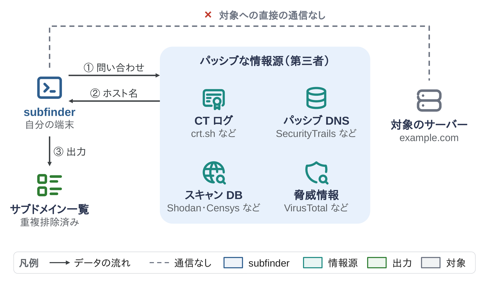
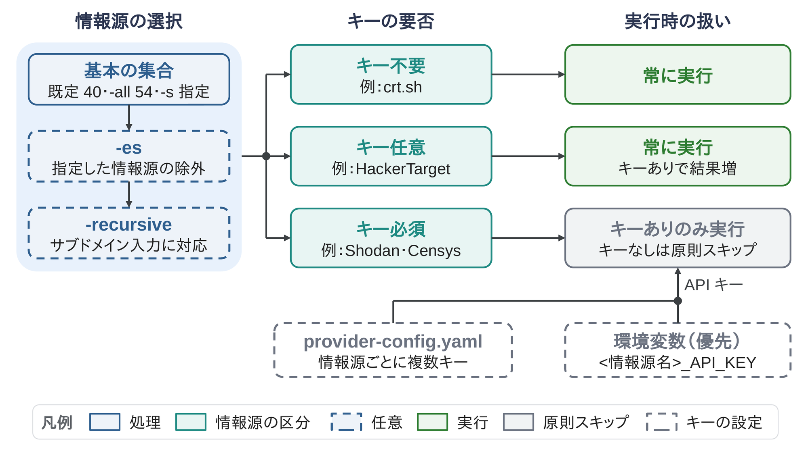
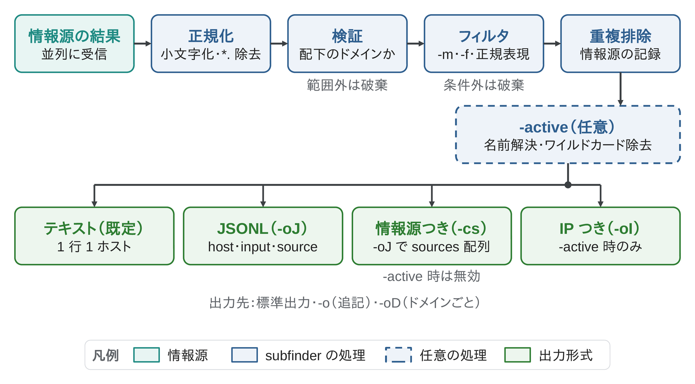
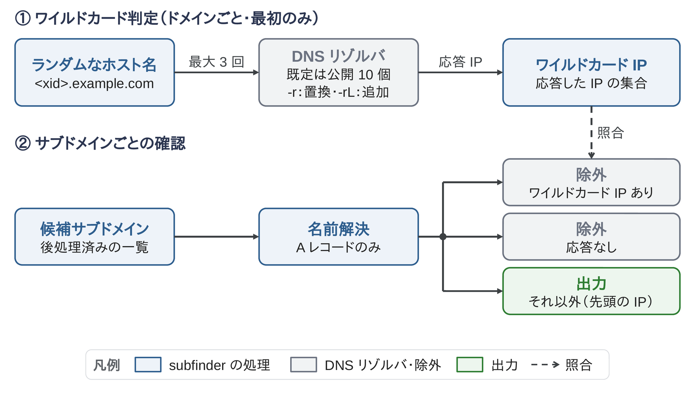
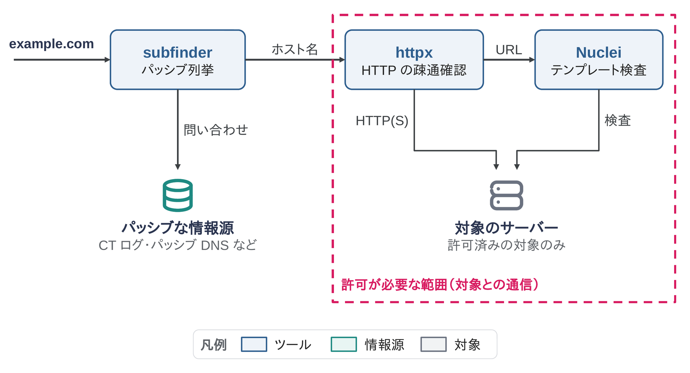

<!--
  コンパクト記事 no.41（草稿。公開前にこのコメントは削除）
  - テーマ：subfinder（ProjectDiscovery のパッシブなサブドメイン列挙ツール）の機能とできること
  - 同時に書いている no.39 nmap、no.40 Nuclei とセット。公開順に合わせて相互リンクを足す（TODO）
  - 裏取り（2026-11-14）：subfinder v2.17.0（最新リリース。タグ c97f258、2026-10-08）のソースと README、docs.projectdiscovery.io。
    既定ブランチ dev（e708670、2026-11-09）は未リリースの変更を含む（例：ホスト名の形式チェック isValidSubdomain は dev にだけある）ので、記事はリリース版に合わせる
    - 情報源：AllSources は 54 個（pkg/passive/sources.go）。IsDefault が true は 40 個、HasRecursiveSupport が true は 16 個
    - キー要件：NoKey 12・OptionalKey 5・RequiredKey 37。必須キーがない情報源は Run の中で何もせず終わる（例 virustotal.go の PickRandom が空）。ただし v2.17.0 では driftnet・leakix・netlas の3つはキーなしでも問い合わせを送る（dev ではスキップに変わっている）。-stats では VirusTotal・BuiltWith・DNSDB はスキップ欄ではなく Requests 0 の行で出る
    - provider-config.yaml：情報源名 → キーの配列。PickRandom でドメインごとにランダムに1つ選ぶ。環境変数 <情報源名>_API_KEY があればその情報源のキーを置き換える（pkg/runner/initialize.go）
    - 後処理の順番：小文字化・末尾の . を除去 → "*." "http://" などを除去 → 対象ドメインの配下か（.<domain> で終わるか）を確認 → -m/-f/-match-regex/-filter-regex → 重複排除（pkg/runner/enumerate.go）
    - -active：ランダムな <xid>.<domain> を最大3回解決してワイルドカード IP を集め、各サブドメインを解決。応答なし・ワイルドカード IP と一致は除外（pkg/resolve/resolve.go）。既定のリゾルバは公開リゾルバ10個（pkg/resolve/client.go）
    - 出力：テキストは1行1ホスト、-oJ は host/input/source（ワイルドカード証明書なら wildcard_certificate）、-cs で sources 配列、-oI（-active 必須）で IP つき（pkg/runner/outputter.go、validate.go）
    - subagent の事実確認（dev とリリース版のバイナリをそれぞれビルドして確認。dev ビルドも -version は v2.17.0 と出るので注意）：-recursive は選んだ情報源から再帰非対応を外すだけ（既定と組み合わせると 14 個、-all と組み合わせると 16 個）。-r は既定のリゾルバを置き換え、-rL は既定に追加。-active の名前解決は A と AAAA を問い合わせ、使うのは A だけ（dnsx Lookup）。ワイルドカード判定は <xid>.<入力ドメイン> だけ。-active を付けると -cs は無視。-o は追記。入力ドメインそのものは出力しない。crt.sh はまず公開 PostgreSQL（5432/tcp）に直接つなぎ、つながらないときや 0 件のときは HTTP にフォールバック
    - 設定ファイルの場所は os.UserConfigDir 配下（Linux は ~/.config/subfinder/、macOS は ~/Library/Application Support/subfinder/）
  - 図：image/01〜05_*.pptx/png（zukai-diagrams 準拠、生成 image/zukai/figs.js → render.sh）
  - TODO：自分の管理するドメインで実際に回した出力（件数・所要時間）を貼る
-->

# はじめに

ペネトレーションテストやバグバウンティの記事を読んでいると、だいたい最初の一手で出てくるのが `subfinder` です。
「サブドメインを集めるツール」くらいの理解で使っていたので、何をどこから集めていて、どこまでできるのかをソースまで見てまとめてみました。

:::note warn
サブドメインの調査は、自分が管理しているドメインか、診断の許可を得たドメイン（バグバウンティなら対象範囲として明示されているもの）に限ってください。
subfinder 自体は対象に直接アクセスしませんが、集めた結果を httpx や Nuclei に流すと対象へリクエストを送ることになります。許可のない対象への診断は、不正アクセス禁止法などに触れるおそれがあります。
:::

# ひとことで言うと

- **subfinder** は、ドメインを渡すと、そのサブドメインを **公開されている第三者の情報源から集めてくる** ツール（パッシブなサブドメイン列挙）
- 情報源は証明書透明性（CT）ログ、パッシブ DNS、スキャン結果のデータベースなど 54 個（v2.17.0 時点）。多くは API キーを入れると使えるようになる
- 集めた結果は重複を除いて、テキストや JSON Lines で出す。標準入出力に対応しているので、httpx や Nuclei にそのままパイプでつなげる

ProjectDiscovery が開発している OSS で、Go で書かれています。本記事の内容は v2.17.0（2026-11-14 時点の最新リリース）のソースで確認しています。

```bash
go install -v github.com/projectdiscovery/subfinder/v2/cmd/subfinder@latest
subfinder -d example.com
```

`go install` には Go 1.26 以上が必要です。

# パッシブなサブドメイン列挙とは何をしているのか？

subfinder がやっているのは、「`example.com` のサブドメインを知りませんか？」と **第三者のサービスに聞いて回る** ことです。


*図1：パッシブなサブドメイン列挙の全体像。subfinder は第三者の情報源に問い合わせて（①）、そこに記録されているホスト名を受け取り（②）、まとめて出力する（③）。既定の動作では、対象のサーバーには一切リクエストを送らない*

情報源には、たとえばこんな種類があります。

| 種類 | 何が記録されているか | 例 |
|---|---|---|
| CT ログ | 発行された TLS 証明書（SAN に書かれたホスト名） | crt.sh、Cert Spotter |
| パッシブ DNS | 過去に観測された名前解決の記録 | SecurityTrails、DNSDB |
| スキャン DB | インターネット全体をスキャンした結果 | Shodan、Censys |
| 脅威情報 | マルウェア解析や URL スキャンで観測したホスト名 | VirusTotal、AlienVault OTX |

たとえば CT ログには、公開されている Web サイトの証明書がほぼすべて記録されます。`api.example.com` 用の証明書を発行すれば、その名前は誰でも検索できる状態になる、というわけです。
ちなみに問い合わせの方法は情報源ごとに違っていて、多くは HTTP(S) の API ですが、crt.sh だけは公開されている PostgreSQL のデータベースに直接つなぎにいきます（つながらないときや 0 件のときは HTTP の API を使う）。

このやり方を **パッシブ** と呼ぶのは、対象に対して何も送らないからです。
対象の DNS サーバーに総当たりで問い合わせる（ブルートフォース）や、ゾーン転送を試すといった **アクティブ** な列挙は、subfinder はやりません。そのぶん速くて対象に気づかれにくいですが、「どこにも記録されていないサブドメイン」は見つけられません。

# 情報源はどう選ばれて、API キーはどう効くのか？

情報源は全部で 54 個あり、何もオプションを付けないと、そのうち「既定」の 40 個に問い合わせます。
ただし、40 個がすべて動くわけではありません。情報源ごとに API キーの要否が決まっていて、**キーが必須の情報源は、キーを入れていないと基本的にスキップされます**（v2.17.0 では driftnet・leakix・netlas の3つだけ、キーなしでも問い合わせを送ります）。


*図2：情報源の選び方と API キー。オプションで問い合わせ先を選び、キーの要否によって実行するかどうかが決まる。キーは provider-config.yaml か環境変数で渡す*

| キーの要否 | 個数（全 54 個中） | 例 |
|---|---|---|
| 不要 | 12 | crt.sh、Digitorus、HudsonRock |
| 任意（あると結果が増える） | 5 | HackerTarget、Subdomain Center |
| 必須 | 37 | Shodan、Censys、SecurityTrails、VirusTotal、GitHub |

既定の 40 個のうち、キーが不要か任意なのは 10 個だけです。キーを入れずに回すと結果が少なく感じるのはこのためで、無料枠のある情報源のキーを入れると、そのぶん問い合わせ先が増えます。
`subfinder -ls` を実行すると、情報源の一覧が `*`（キー必須）・`~`（キー任意）の印つきで出ます。実行時に `-stats` を付けると、情報源ごとの件数や所要時間と一緒に、キーがなくてスキップされた情報源も表示されます（VirusTotal など一部は、スキップ欄ではなく Requests が 0 の行として出ます）。

情報源の選び方は、次のオプションで変えられます。

| オプション | 動作 |
|---|---|
| （指定なし） | 既定の 40 個 |
| `-all` | 54 個すべて（遅くなる） |
| `-s crtsh,github` | 指定したものだけ |
| `-es alienvault` | 指定したものを除外 |
| `-recursive` | 選んだ情報源のうち、サブドメイン（`sub.example.com`）を渡しても検索できるものだけに絞る |

`-recursive` は名前から「見つけたサブドメインをさらに掘っていく」機能に見えますが、そうではありません。**サブドメインを入力として受け付けられる情報源だけを使う** という絞り込みです。対応しているのは 54 個中 16 個で、既定の 40 個と組み合わせると 14 個、`-all` と組み合わせると 16 個になります。`sub.example.com` の配下を調べたいときに、`-d sub.example.com -recursive` のように使います。

## API キーの設定

キーは `provider-config.yaml` に、情報源の名前ごとに配列で書きます。場所は Linux なら `~/.config/subfinder/`、macOS なら `~/Library/Application Support/subfinder/` で、初回の実行時に作られます。

```yaml:provider-config.yaml
securitytrails:
  - YOUR_SECURITYTRAILS_KEY
virustotal:
  - YOUR_VT_KEY_1
  - YOUR_VT_KEY_2
censys:
  - YOUR_CENSYS_PAT
```

- 1つの情報源に複数のキーを書くと、ドメインを列挙するたびにランダムに1つ選ばれる（複数のドメインを回すときに無料枠を分散できる）
- `SECURITYTRAILS_API_KEY` のように `<情報源名>_API_KEY` の環境変数を設定すると、その情報源のキーは環境変数のほうが使われる。CI で回すときに便利
- 2つの値を使う情報源は、`値1:値2` のように `:` でつないで書く。たとえば Censys は PAT だけでも使え、組織 ID も渡すなら `PAT:組織ID` にする

情報源ごとの問い合わせ速度は、`-rl`（全体）や `-rls "hackertarget=10/s"`（情報源ごと）で抑えられます。VirusTotal（`4/m`）や Shodan（`1/s`）のような無料枠の厳しい情報源には、何も指定しなくても既定の上限が組み込まれています。

# 集めた結果はどう処理されて、どんな形で出せるのか？

情報源から返ってきた名前は、そのまま出るわけではありません。いくつかの後処理を通ってから出力されます。


*図3：結果の後処理と出力形式。情報源ごとの結果を正規化・検証・フィルタ・重複排除してから、指定した形式で出す。-active は任意（次の節）*

1. **正規化**：小文字にして、`*.`（ワイルドカード証明書の名前）や `http://` などを取り除く
2. **検証**：`.example.com` で終わらない名前（対象の配下でない名前）を捨てる。入力した `example.com` 自身も、ここで落ちるので出力されない
3. **フィルタ**：`-m`・`-match-regex` に一致したものだけを残し、`-f`・`-filter-regex` に一致したものを捨てる
4. **重複排除**：同じ名前は1つにまとめ、どの情報源が見つけたかを記録しておく

出力形式は次のとおりです。

| 形式 | オプション | 1行の中身 |
|---|---|---|
| テキスト（既定） | なし | `api.example.com` |
| JSON Lines | `-oJ` | `{"host":"api.example.com","input":"example.com","source":"crtsh"}` |
| 情報源つき | `-oJ -cs` | `{"host":"api.example.com","input":"example.com","sources":["crtsh","hackertarget"]}` |
| IP つき | `-active -oI` | `api.example.com,192.0.2.10,crtsh` |

- `-o` でファイルに、`-oD` でドメインごとのファイルに書き出せる。`-o` は上書きではなく **追記** なので、同じファイル名で何度も回すと結果が積み重なる
- JSON の `source` は最初に見つけた情報源。全部知りたいときは `-cs` を付ける（`-active` と一緒に使うと `-cs` は効かない）
- 出力はドメインごとに、列挙が終わってからまとめて出る（見つけたそばから流れてくるわけではない）
- ワイルドカード証明書（`*.dev.example.com` など）から見つかった名前には、`"wildcard_certificate":true` が付く

# -active は何をしているのか？

既定の subfinder は名前を集めるだけで、その名前が今も使われているかは確かめません。CT ログやパッシブ DNS には、もう消えたサブドメインも残っているからです。
`-active` を付けると、集めた名前を DNS で名前解決して、**今も解決できるものだけ** を残します。

このとき厄介なのが、**ワイルドカード DNS**（`*.example.com` にレコードがあり、どんな名前でも解決できてしまう設定）です。何も考えずに名前解決すると、存在しない名前まで「生きている」と判定されます。
そこで subfinder は、最初にワイルドカードかどうかを確かめてから、各サブドメインを判定します。


*図4：-active によるワイルドカード除去。ランダムな名前を名前解決して、ワイルドカードが返す IP を先に集めておき（①）、各サブドメインの解決結果がその IP と一致したら除外する（②）*

1. `<ランダムな文字列>.example.com` のような、まず存在しない名前を名前解決する（最大3回）。解決できたら、そのとき返ってきた IP を「ワイルドカード IP」として覚えておく
2. 各サブドメインの A レコードを引いて、応答がないものと、ワイルドカード IP が返ってきたものを捨てる

確かめるのは入力したドメインの直下（`*.example.com`）だけなので、`*.dev.example.com` のような一段下のワイルドカードは除けません。また、見るのは A レコード（IPv4）だけなので、AAAA レコードしかないホストは「応答なし」として落ちます。

名前解決には、既定では Cloudflare・Google・Quad9 などの公開リゾルバ10個を使います。`-r` で指定すると既定のリゾルバと置き換わり、`-rL`（ファイル）だけで指定すると既定の10個に追加されます。
`-oI` は、このとき得た IP を出力に足すオプションなので、`-active` と一緒にしか使えません。

なお `-active` で送るのは DNS の問い合わせで、リゾルバを経由して対象の権威 DNS サーバーまで届くことがあります。完全に「何も送らない」わけではなくなるので、ここでも対象は許可を得たものに限ります。

# ほかのツールとはどうつなぐのか？

subfinder は「サブドメインを集める」ことしかしません。その先は、同じ ProjectDiscovery のツールにパイプで渡すのが定番です。


*図5：httpx・Nuclei へのパイプ連携。subfinder が集めたホスト名を httpx に渡して Web サーバーが動いているものを絞り込み、その URL を Nuclei に渡して検査する。subfinder は（-active なしなら）対象と通信せず、httpx から先が対象にリクエストを送る*

```bash
# 自分が管理するドメイン（または診断の許可を得たドメイン）に限る
echo example.com | subfinder -silent | httpx -silent | nuclei
```

- `-silent` を付けると、バナーやログを出さずにサブドメインだけを標準出力に出す
- ドメインは `-d` のほか、`-dL`（ファイル）や標準入力でも渡せる
- **httpx**：受け取ったホストに HTTP(S) でアクセスして、応答があるものを URL として出す
- **Nuclei**：受け取った URL に、テンプレートに書かれたリクエストを送って脆弱性や設定ミスを検査する（詳しくは Nuclei の記事で）

図5のとおり、subfinder までは対象と通信しませんが、**httpx から先は対象に直接リクエストを送ります**。パイプでつなぐと途中で止まらずに次のツールへ渡っていくので、渡すドメインが許可された範囲に入っているかは、実行前に確かめておきたいところです。

# ほかに知っておくと便利なオプション

| オプション | 動作 |
|---|---|
| `-timeout`（既定 30） | 1回の問い合わせを待つ秒数 |
| `-max-time`（既定 10） | 1ドメインの列挙全体を待つ分数 |
| `-mr` | 情報源ごとの結果の上限（ページ送りする情報源で API の消費を抑える） |
| `-proxy` | HTTP プロキシを通す（crt.sh のデータベース接続は通らない） |
| `-duc` | 起動時の更新確認の通信を止める |

Go のライブラリとしても使えるので、自前のツールに組み込むこともできます（リポジトリの `examples/main.go` に最小例があります）。

# まとめ

- subfinder は、CT ログやパッシブ DNS などの第三者の情報源からサブドメインを集めるツール。既定の動作では対象と直接通信しない
- 情報源は 54 個で、既定は 40 個。キーが必須の情報源は（一部を除き）キーがないとスキップされるので、provider-config.yaml（か環境変数）にキーを入れると結果が増える
- 集めた名前は正規化・検証・フィルタ・重複排除されて、テキストや JSON Lines で出る。`-active` を付けると、DNS で解決できてワイルドカードでないものだけに絞れる
- 標準入出力に対応していて、httpx や Nuclei にパイプでつなげる。ただし httpx から先は対象と通信するので、許可された範囲に限る

もっといい情報源の組み合わせや、無料枠で効くキーの入れ方があれば、有識者の方教えて欲しいです！

# 参考

- [projectdiscovery/subfinder（GitHub）](https://github.com/projectdiscovery/subfinder)
- [Subfinder - ProjectDiscovery Documentation](https://docs.projectdiscovery.io/tools/subfinder/overview)
- [Installing Subfinder（Post Install Configuration）](https://docs.projectdiscovery.io/tools/subfinder/install)
- [Running Subfinder](https://docs.projectdiscovery.io/tools/subfinder/running)
- [Certificate Transparency](https://certificate.transparency.dev/)
