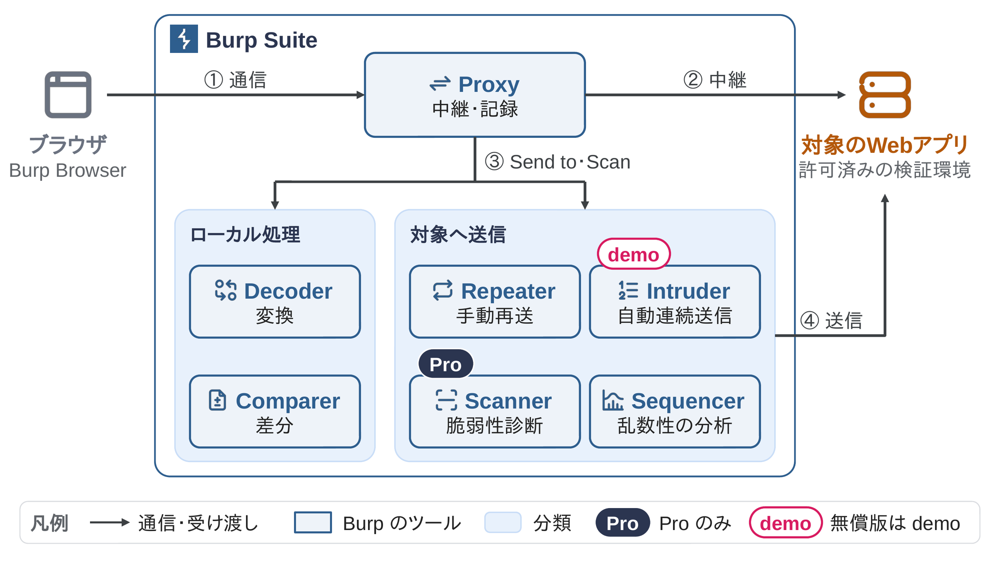
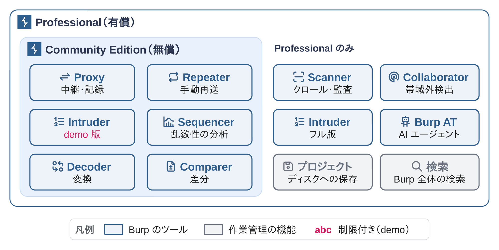

<!--
  コンパクト記事 no.42（草稿。公開前にこのコメントは削除）
  - Burp Suite シリーズ（no.42〜50）の入口。機能ごとの記事：
    no.43 Proxy／no.44 Repeater／no.45 Intruder／no.46 Scanner／no.47 Collaborator／no.48 Sequencer／no.49 Decoder／no.50 Comparer
    公開したら、各記事へのリンクを「機能ごとの記事」の節に貼る（TODO）
  - 裏取り（2026-11-14、PortSwigger 公式）：
    - Tools 一覧（Dashboard, Target, Burp's browser, Proxy, Scanner[Pro], Intruder, Repeater, Sequencer, Decoder, Comparer, Logger, Inspector, Collaborator[Pro], DOM Invader, Organizer など）
    - Community のダウンロードページの比較：Community は Proxy と履歴、Repeater・Decoder・Sequencer・Comparer、Intruder はデモ版。
      Pro のみ：プロジェクトファイル、Intruder の完全版、Web 脆弱性スキャナ、Pro 限定 BApp、検索、Collaborator、自動クロール
    - 2026.7（2026-07-16）リリースノート：Burp AT（エージェント型 AI、Pro）、内蔵ブラウザの名称が Burp Browser に
    - Burp AT の AI クレジット：Pro ライセンスに毎月の Starter 枠が付く。Burp AT のリリースノート（2026-11-10）に「early access period」の記述
  - 図：image/01〜02_*.pptx/png（zukai-diagrams 準拠、生成 image/zukai/figs.js → render.sh。no.43〜50 の図も同じスクリプトで出力）
  - 価格は改定があるので本文には書いていない（公式サイト参照）
-->

# はじめに

Web アプリの脆弱性診断をやっていると、まず名前が出てくるのが **Burp Suite** です。
ただ、機能が多すぎて「結局どのタブが何をしてくれるの？」となりがちなので、機能ごとに1本ずつまとめることにしました。この記事はその入口で、全体像と Community 版・Professional 版の違いだけを扱います。

:::note warn
Burp Suite での検査は、自分が管理するアプリか、検査の許可をもらった対象にだけ行ってください。
許可なく他人のサイトにリクエストを書き換えて送ったり、自動で大量に送ったりすると、不正アクセス禁止法や業務妨害などに問われるおそれがあります。
練習するなら、PortSwigger 公式の [Web Security Academy](https://portswigger.net/web-security) のラボ（演習用にわざと脆弱に作られた環境）が使えます。
:::

# ひとことで言うと

- **Burp Suite** は、PortSwigger 社が作っている **Web アプリの脆弱性診断ツールのセット**
- 中心は **Proxy**。ブラウザと Web アプリの間に入って通信を中継・記録し、記録したリクエストを **Repeater・Intruder・Scanner** などのツールに渡して検査する
- 無償の **Community Edition** と、有償の **Professional** がある。自動スキャン（Scanner）と帯域外検出（Collaborator）は Professional だけ

# 各ツールはどう分担しているのか？

Burp Suite の画面には、ツールごとのタブが並んでいます。主なツールの関係を1枚にするとこうなります。

*図1：Burp Suite の全体像。ブラウザの通信を Proxy が中継・記録し（①②）、記録したリクエストを各ツールに渡して（③）、対象へ送り直す（④）*

基本の流れは、

1. **Burp Browser**（Burp に組み込まれたブラウザ。Proxy を通る設定済み）で対象のアプリを普通に操作する
2. **Proxy** がその通信を中継し、**HTTP history** にすべて記録する
3. 気になるリクエストを右クリックして **Send to Repeater** のように、ほかのツールに渡す（Scanner には **Scan** で渡す）
4. 渡した先のツールで、リクエストを書き換えて送り直したり、値を変換したりする

です。ツールは大きく、**対象にリクエストを送るもの** と **手元のデータを処理するだけのもの** に分けられます。

| ツール | ひとことで | 対象へ送信 | 記事 |
|---|---|---|---|
| Proxy | ブラウザと対象の間で通信を止めて見る・書き換える・記録する | 中継 | no.43 |
| Repeater | 1つのリクエストを手で書き換えて、何度も送り直す | する | no.44 |
| Intruder | リクエストの一部に値のリストを差し込んで、自動で連続送信する | する | no.45 |
| Scanner | サイトをクロールして、脆弱性を自動で検出する（Pro） | する | no.46 |
| Collaborator | 対象からの DNS・HTTP の問い合わせで、ブラインドな脆弱性を見つける（Pro） | する | no.47 |
| Sequencer | セッショントークンなどの乱数性を統計的に分析する | する | no.48 |
| Decoder | Base64・URL エンコードなどを変換する | しない | no.49 |
| Comparer | 2つのリクエスト・レスポンスの差分を見る | しない | no.50 |

このほかにも、Burp が送ったすべての通信を記録する **Logger**、メッセージを残してメモを付ける **Organizer**、DOM ベースの XSS を探す **DOM Invader**（Burp Browser の拡張機能）などがあります。

# Community と Professional は何が違うのか？

*図2：Community と Professional で使える機能。Professional は Community の機能をすべて含み、右側の機能が加わる*

| | Community Edition | Professional |
|---|---|---|
| 料金 | 無償 | 有償（ユーザーごとの年額ライセンス） |
| Proxy・HTTP history | ○ | ○ |
| Repeater・Decoder・Comparer・Sequencer | ○ | ○ |
| Intruder | デモ版（制限つき） | ○ |
| Scanner（クロール・監査） | × | ○ |
| Collaborator | × | ○ |
| プロジェクトをファイルに保存 | ×（一時プロジェクトのみ） | ○ |
| 検索（Burp 全体を横断） | × | ○ |
| Burp AT（エージェント型 AI） | × | ○（毎月の利用枠つき、early access） |

手で1つずつ確かめる作業（Proxy で見て、Repeater で送り直す）は Community でも十分できます。
一方で、**大量の自動送信（Intruder）・自動スキャン（Scanner）・帯域外検出（Collaborator）** を使いたくなったら Professional、という分かれ方です。

Community は作業内容をファイルに保存できないので、Burp を閉じると HTTP history なども消えます。ここはけっこう地味に効いてきます…。

ちなみに、Burp AT は 2026.7（2026年7月）で入った新しい機能で、目標を伝えると Burp のツールを使って検査を進めてくれる AI エージェントです。Professional のライセンスに毎月の利用枠（Starter）が含まれ、使った分だけ AI クレジットを消費します。2026年11月時点では early access（先行提供）期間中です。

# 機能を足したいときは？

足りない機能は **拡張機能（Extensions）** で足せます。

- **BApp Store**：PortSwigger が審査した、コミュニティ製の拡張機能のストア。Burp の中から入れられる（Professional 限定の BApp もある）
- **Montoya API**：自分で拡張機能を書くための Java の API
- **Bambda**：HTTP history のフィルタなどを、短い Java のコードで書ける仕組み

# まとめ

- Burp Suite は、Proxy を中心に、Repeater・Intruder・Scanner などのツールを組み合わせて Web アプリを検査するツールのセット
- 流れは「Burp Browser で操作 → Proxy が記録 → Send to で各ツールへ → 書き換えて送り直す」
- 手作業の検査は Community で十分。自動スキャン・帯域外検出・作業の保存が必要になったら Professional
- 検査は、自分の環境か許可をもらった対象だけで

機能ごとの中身は、no.43（Proxy）から順にまとめていきます。

# 参考

- [Burp Suite documentation - Tools](https://portswigger.net/burp/documentation/desktop/tools)
- [Burp Suite Community Edition（ダウンロードページの比較表）](https://portswigger.net/burp/communitydownload)
- [Professional / Community 2026.7 リリースノート](https://portswigger.net/burp/releases/professional-community-2026-7)
- [Burp AT - AI credits](https://portswigger.net/burp/documentation/desktop/burp-at/ai-credits)
- [Burp AT release notes](https://portswigger.net/burp/burp-at/release-notes)
- [Burp extensions](https://portswigger.net/burp/documentation/desktop/extend-burp/extensions)
- [Web Security Academy](https://portswigger.net/web-security)
