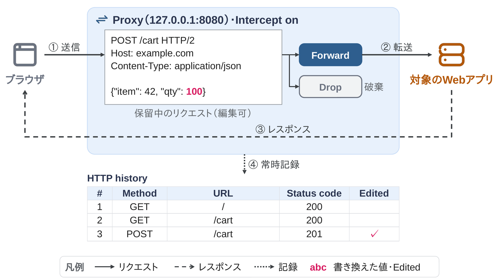
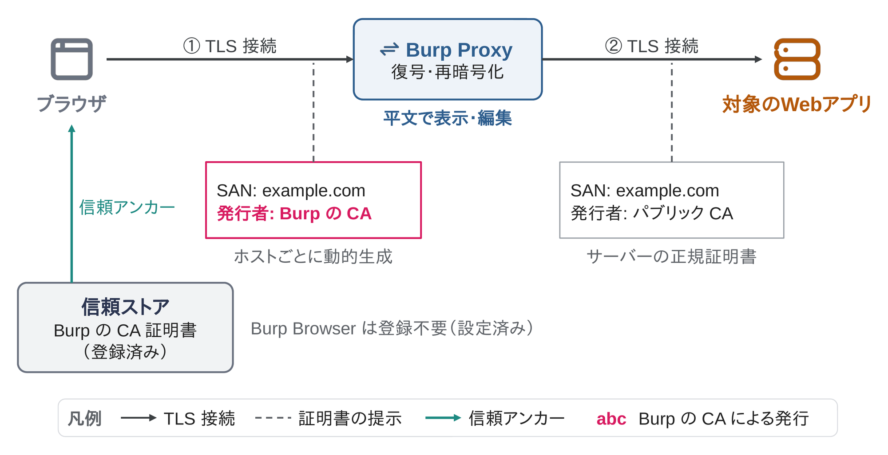

<!--
  コンパクト記事 no.43（草稿。公開前にこのコメントは削除）
  - Burp Suite シリーズ（no.42〜50）。全体像は no.42（公開したらリンク、TODO）
  - 裏取り（2026-11-14、PortSwigger 公式）：
    - Proxy：ブラウザと対象の間の Web プロキシ。HTTPS を含む双方向の通信を止めて見る・書き換えられる。本番以外で使うよう注意書きあり
    - Intercept：Intercept on/off、Forward（Forward all）、Drop（Drop all）、インターセプトのルール
    - HTTP history：Intercept off でも常に更新。フィルタは Settings mode と Script mode（Java、Bambda）
    - Burp Browser：Proxy > Intercept > Open browser。Proxy を通る設定済みで、CA 証明書の登録は外部ブラウザのときだけ必要
    - 証明書：Burp はホストごとに TLS 証明書を生成し、自分の CA で署名する。外部ブラウザでは CA 証明書を信頼済みルートに登録する
    - 既定のリスナーは 127.0.0.1:8080
  - 図：image/01〜02_*.pptx/png（生成スクリプトは no.42-burp-suite/image/zukai/figs.js）
-->

# はじめに

Burp Suite で最初に触るのが **Proxy** です。「ブラウザとサーバーの間に入る」とはよく聞くけど、HTTPS なのになぜ中身が見えるのか？がずっとふわっとしていたので、そこも含めてまとめました。

:::note warn
Proxy での書き換え・再送は、自分が管理するアプリか、検査の許可をもらった対象にだけ行ってください。許可のない対象への検査は、不正アクセス禁止法などに触れるおそれがあります。
公式ドキュメントでも、思わぬ影響が出ることがあるので本番ではない環境で使うよう注意されています。
:::

# ひとことで言うと

- **Proxy** は、ブラウザと Web アプリの間に入る **中継役（Web プロキシ）**。既定では `127.0.0.1:8080` で待ち受ける
- **Intercept on** にすると、リクエストを **いったん止めて、中身を見て、書き換えてから送る（Forward）か、捨てる（Drop）** ことができる
- 止めていなくても、通ったリクエストとレスポンスは **HTTP history** にすべて記録される。ここから Repeater などのツールに渡すのが Burp の基本の流れ

# インターセプトで何ができるのか？

*図1：Proxy のインターセプトと記録。ブラウザが送ったリクエスト（①）を Proxy が止め、書き換えてから対象へ転送する（②）。レスポンス（③）も含め、通信は HTTP history に常に記録される（④）*

Intercept を on にした状態でブラウザを操作すると、リクエストが Proxy で止まります。止まったリクエストは編集できるので、

- フォームの値やパラメータを、画面ではできない値に書き換える（例：数量 `qty=1` を `qty=100` に、価格や ID を変える）
- 画面側の JavaScript による入力チェックを通ったあとの値を書き換える（クライアント側のチェックだけで守っていないかの確認）
- 送ってほしくないリクエストを **Drop** で捨てる

といったことができます。確認が終わったら **Forward** で送り出します。全部まとめて流すなら Forward all です。

なお、レスポンスを止めたり、特定のリクエストだけ止めたりするのは、インターセプトのルール（設定）で決められます。毎回止まると操作が進まないので、ふだんは **Intercept off** にしておき、必要なときだけ on にする使い方が多いです。

# HTTP history には何が残るのか？

**HTTP history は、Intercept が off でも常に更新されます**。Proxy を通ったリクエスト・レスポンスが1行ずつ並び、ホスト・メソッド・URL・ステータスコード・長さ・MIME タイプなどの列で並べ替えやフィルタができます。インターセプトで書き換えたものは、Edited の列に印が付きます。

診断では、まず Burp Browser でアプリを一通り操作して HTTP history を埋め、そこから気になるリクエストを右クリックして **Send to Repeater**（no.44）や **Send to Intruder**（no.45）に渡します。

# HTTPS なのに、なぜ中身が見えるのか？

HTTPS の通信は暗号化されているので、間に入っただけでは中身は読めません。Burp は **ブラウザとの間、対象との間で、それぞれ別の TLS 接続を張る** ことで中身を見ています。

*図2：Proxy での HTTPS の中継。ブラウザとの TLS 接続（①）では、Burp が生成して自分の CA で署名した証明書を出し、対象とは別の TLS 接続（②）を張る。間の Burp では平文で見える*

1. ブラウザが `example.com` に接続しようとすると、Burp が代わりに受ける
2. Burp は `example.com` 用の証明書をその場で生成し、**Burp 自身の CA（認証局）で署名** してブラウザに見せる
3. Burp は本物の `example.com` に別の TLS 接続を張る
4. 間にいる Burp の中では、通信が平文のまま見える

ブラウザ側から見ると「知らない CA が署名した証明書」なので、そのままでは警告が出ます。外部のブラウザ（Chrome や Firefox など）を使うときは、**Burp の CA 証明書を信頼済みのルート証明書として登録** する必要があります。
**Burp Browser は最初から Proxy を通る設定になっていて、この登録はいりません**。迷ったら Burp Browser を使うのが楽です。

:::note info
外部ブラウザに Burp の CA 証明書を入れる場合は、ふだん使いのプロファイルではなく、検証専用のプロファイルやブラウザに入れるのがおすすめです。信頼した CA の証明書は、そのブラウザで見るすべての HTTPS サイトに対して有効になるためです。
:::

# まとめ

- Proxy は、ブラウザと Web アプリの間に入って、通信を止めて見る・書き換える・記録する中継役
- Intercept on で止めて書き換え、Forward か Drop。ふだんは off にして HTTP history に記録させる
- HTTP history から Send to で Repeater・Intruder などに渡すのが基本の流れ
- HTTPS は、Burp がホストごとの証明書を自分の CA で署名して出すことで、間で平文にしている。外部ブラウザでは CA 証明書の登録が必要、Burp Browser なら不要

# 参考

- [Burp Proxy](https://portswigger.net/burp/documentation/desktop/tools/proxy)
- [Checking your proxy listener is active](https://portswigger.net/burp/documentation/desktop/getting-started/proxy-setup/check-listener)
- [Intercepting HTTP traffic with Burp Proxy](https://portswigger.net/burp/documentation/desktop/tools/proxy/intercept-messages)
- [HTTP history](https://portswigger.net/burp/documentation/desktop/tools/proxy/http-history)
- [Installing Burp's CA certificate](https://portswigger.net/burp/documentation/desktop/external-browser-config/certificate)
