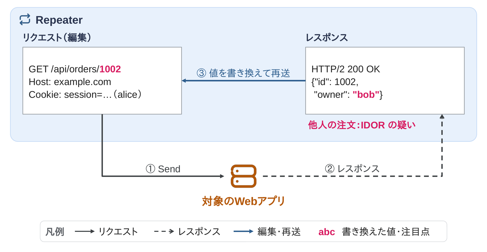

<!--
  コンパクト記事 no.44（草稿。公開前にこのコメントは削除）
  - Burp Suite シリーズ（no.42〜50）。全体像は no.42（公開したらリンク、TODO）
  - 裏取り（2026-11-14、PortSwigger 公式）：
    - Repeater：HTTP・WebSocket のメッセージを手で書き換えて何度も送る。タブごとに1メッセージ、タブごとに変更履歴とメモ
    - タブグループ：Send group in sequence（single connection / separate connections）、Send group in parallel
      （HTTP/1 は last-byte synchronization、HTTP/2 以降は single-packet attack。レースコンディション向け）
    - 並列送信の前提：同じホスト・ポート・プロトコル、HTTP/1 の keep-alive を無効に。マクロのリクエストは並列にできない
    - Group send は Community・Professional 両方（Trigger race conditions のカスタムアクションは Pro）
  - 例の IDOR は架空のもの（example.com）
  - 図：image/01_*.pptx/png（生成スクリプトは no.42-burp-suite/image/zukai/figs.js）
-->

# はじめに

Burp Suite でいちばん長く開いているタブはどれか？と聞かれたら、たぶん **Repeater** です。やっていることは「リクエストを書き換えて送り直す」だけなのに、手で確かめる診断のほとんどはここでやっている気がします。

:::note warn
Repeater での書き換え・再送は、自分が管理するアプリか、検査の許可をもらった対象にだけ行ってください。許可のない対象への検査は、不正アクセス禁止法などに触れるおそれがあります。
:::

# ひとことで言うと

- **Repeater** は、**1つのリクエストを手で書き換えて、何度でも送り直し、レスポンスを見比べる** ためのツール
- HTTP history（no.43）から **Send to Repeater** で渡すのが基本。タブごとに1つのリクエストを持ち、変更の履歴も残る
- タブを **グループ** にまとめると、複数のリクエストを **順番に** 送ったり、**同時に** 送ってレースコンディションを確かめたりできる

# 何をしてくれるのか？

*図1：Repeater での手動再送。リクエストを書き換えて送り（①）、レスポンスを確かめ（②）、値を変えてまた送る（③）*

画面の左にリクエスト、右にレスポンスが並びます。リクエストの好きなところを書き換えて **Send** を押すと、そのまま対象に送られ、右にレスポンスが出ます。

たとえば図1の例では、

1. alice でログインした状態の `GET /api/orders/1001`（自分の注文）を Repeater に送る
2. ID だけを `1002` に書き換えて Send する
3. bob の注文が返ってきたら、**アクセス制御の不備（IDOR）** が疑われる

という確かめ方をしています。ブラウザの画面からはできない書き換え（ヘッダーを消す、メソッドを変える、JSON の型を変える…）も、テキストを直すだけでできるのが便利なところです。

ほかにも、

- タブごとに書き換えの履歴が残り、前の版に戻れる
- タブにメモを付けられる
- Inspector のパネルで、パラメータや Cookie をデコードした状態で見たり直したりできる

といった機能があります。

# 複数のリクエストをまとめて送るには？

Repeater のタブは **タブグループ** にまとめられ、グループ単位で送る方法を選べます。

| 送り方 | 動き | 向いていること |
|---|---|---|
| 順次（single connection） | 1本の接続で、グループのリクエストを順に送る | クライアントサイドのデシンクの検証、接続を張る時間のぶれを減らしたいタイミング検証 |
| 順次（separate connections） | タブの順に、リクエストごとに新しい接続で送る | ログイン → 操作 → 確定のような多段の手順 |
| 並列（in parallel） | すべてのリクエストを同時に届くように送る | **レースコンディション** の検証 |

並列送信では、HTTP/1 なら各リクエストの最後の1バイトだけを残しておき、最後にまとめて送る方法（last-byte synchronization）を、HTTP/2 以降なら **複数のリクエストを1つの TCP パケットに詰める方法（single-packet attack）** を使います。ネットワークの揺らぎに左右されずに「ほぼ同時」に届けられるので、たとえばクーポンの二重適用のような競合の検証に使えます。

並列送信は、同じホスト・ポート・プロトコル宛てのリクエストに限られ、HTTP/1 では keep-alive を切っておく必要があります。

# まとめ

- Repeater は、1つのリクエストを手で書き換えて送り直し、レスポンスを確かめるツール
- HTTP history から Send to Repeater で渡し、ID・ヘッダー・メソッドなどを書き換えて挙動の違いを見る
- タブグループで、多段の手順を順に送ったり、並列送信でレースコンディションを確かめたりできる

Repeater で「この値を変えると挙動が変わる」と分かったら、次は値のリストを差し込んで自動で送る Intruder（no.45）の出番です。

# 参考

- [Burp Repeater](https://portswigger.net/burp/documentation/desktop/tools/repeater)
- [Sending grouped HTTP requests](https://portswigger.net/burp/documentation/desktop/tools/repeater/send-group)
- [New techniques and tools for web race conditions](https://portswigger.net/blog/new-techniques-and-tools-for-web-race-conditions)
