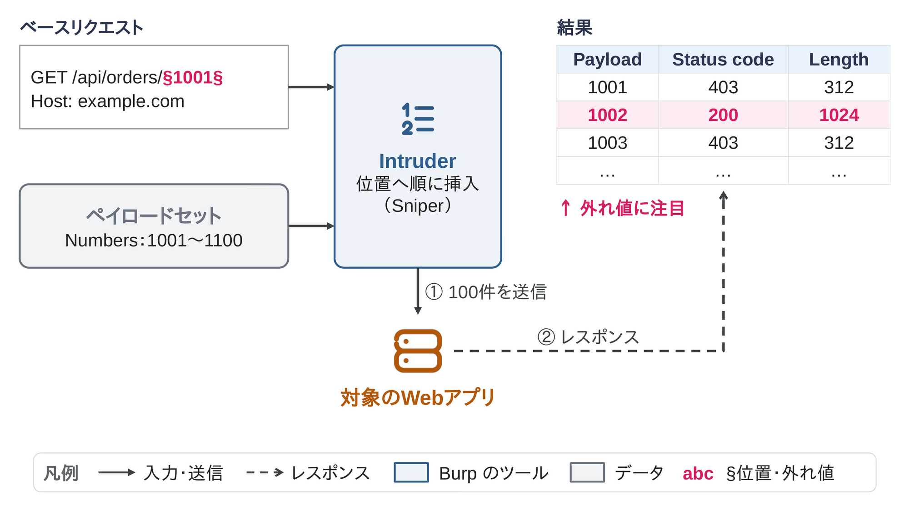
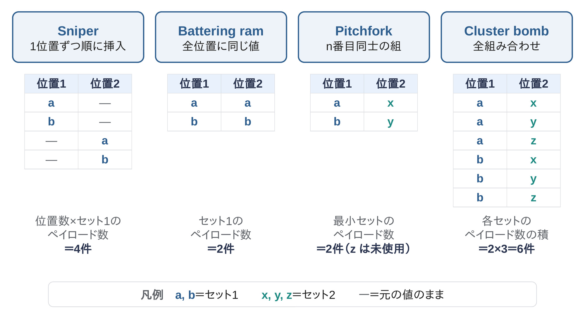

<!--
  コンパクト記事 no.45（草稿。公開前にこのコメントは削除）
  - Burp Suite シリーズ（no.42〜50）。全体像は no.42（公開したらリンク、TODO）
  - 裏取り（2026-11-14、PortSwigger 公式）：
    - Intruder：同じリクエストを、ペイロード位置に違うペイロードを入れながら何度も送る
    - 攻撃タイプと件数：Sniper＝位置数×ペイロード数（1セット、1位置ずつ）、Battering ram＝ペイロード数（同じ値を全位置）、
      Pitchfork＝最小セットのペイロード数（位置ごとのセットを並行）、Cluster bomb＝各セットのペイロード数の積
    - ペイロードの種類：Simple list, Runtime file, Numbers, Dates, Brute forcer, Null payloads, Username generator ほか。定義済みのペイロードリストは Pro
    - 設定：Grep - match / Grep - extract / Grep - payloads、Redirections など
    - Community のダウンロードページの比較：Community の Intruder はデモ版、完全版は Pro
  - 例の ID 列挙は架空のもの（example.com）
  - 図：image/01〜02_*.pptx/png（生成スクリプトは no.42-burp-suite/image/zukai/figs.js）
-->

# はじめに

Repeater（no.44）で「ID を変えたら他人のデータが返ってきた」と分かったとき、1001 から 1100 まで手で書き換えて送るのはさすがに無理です。それを自動でやってくれるのが **Intruder** です。攻撃タイプの名前が物騒で覚えにくかったので、図にして整理しました。

:::note warn
Intruder は短時間に大量のリクエストを送ります。自分が管理するアプリか、検査の許可をもらった対象にだけ使ってください。許可のない対象へのパスワードの総当たりや ID の列挙は、不正アクセス禁止法や業務妨害などに問われるおそれがあります。許可がある場合でも、アカウントのロックや負荷に注意してください。
:::

# ひとことで言うと

- **Intruder** は、**リクエストの一部（ペイロード位置）に値のリストを順に差し込んで、自動で連続送信する** ツール
- 返ってきたレスポンスを **ステータスコード・長さ・含まれる文字列** で並べ、ほかと違う「外れ値」を探す
- 位置と値の組み合わせ方は **Sniper・Battering ram・Pitchfork・Cluster bomb** の4種類
- Community 版はデモ版扱いの制限つきで、本格的に使うなら Professional

# 何をしてくれるのか？

*図1：Intruder の自動送信。ベースリクエストの `§…§` の位置にペイロードセットの値を1つずつ差し込んで送り（①）、レスポンス（②）を一覧にする*

使い方は3ステップです。

1. **ペイロード位置を決める**：HTTP history や Repeater から Send to Intruder で渡したリクエストの、値を入れ替えたい部分を `§` で囲む（例：`/api/orders/§1001§`）
2. **ペイロードを決める**：差し込む値のリスト（ペイロードセット）を選ぶ。単語リスト（Simple list）、連番（Numbers）、日付（Dates）、総当たり（Brute forcer）、ファイルから読む（Runtime file）など
3. **攻撃を開始して、結果を見る**：1件ごとにステータスコードと長さが並ぶので、並べ替えて外れ値を探す

図1の例では、ほとんどが `403` なのに `1002` だけ `200` で長さも違う、という結果から「1002 は見えてはいけないデータが見えている」と当たりを付けています。

結果の見方を助ける設定もあります。

- **Grep - match**：レスポンスに指定した文字列（例：`Invalid password`）が含まれるかで印を付ける
- **Grep - extract**：レスポンスの一部（例：エラーメッセージ）を抜き出して列にする
- **Redirections**：リダイレクトを追うかどうか

# 攻撃タイプは何が違うのか？

ペイロード位置が2つ以上あるとき、値をどう組み合わせるかを **攻撃タイプ** で選びます。

*図2：Intruder の4つの攻撃タイプ。位置が2つ、セット1に a・b、セット2に x・y・z があるときに送られるリクエスト*

| 攻撃タイプ | 組み合わせ方 | 件数 | 向いていること |
|---|---|---|---|
| Sniper | 1つのセットを、1つの位置ずつ順に入れる（ほかの位置は元の値） | 位置数×値の数 | どのパラメータが効くかを1つずつ調べる |
| Battering ram | 同じ値を、すべての位置に同時に入れる | 値の数 | 同じ値を複数箇所に入れる必要があるとき |
| Pitchfork | 位置ごとに別のセットを用意し、1番目どうし、2番目どうし…と並行に入れる | いちばん少ないセットの値の数 | ユーザー名とパスワードのように、対応が決まったペアを試す |
| Cluster bomb | 位置ごとのセットの、すべての組み合わせを入れる | 各セットの値の数の積 | ユーザー名×パスワード候補の総当たり |

Cluster bomb は件数が掛け算で増えるので、100×100 で 10,000 件になります。件数を見積もってから始めないと、対象にも自分の時間にも優しくないことになります…。

# まとめ

- Intruder は、ペイロード位置に値のリストを差し込んで自動で連続送信し、レスポンスの外れ値を探すツール
- 「位置を `§` で囲む → ペイロードを選ぶ → 結果をステータス・長さ・Grep で見る」の3ステップ
- 攻撃タイプは、1位置ずつの Sniper、全位置同じ値の Battering ram、ペアで並行の Pitchfork、総当たりの Cluster bomb
- 大量に送るツールなので、許可のある対象で、件数と負荷を見積もってから使う

# 参考

- [Burp Intruder](https://portswigger.net/burp/documentation/desktop/tools/intruder)
- [Attack types](https://portswigger.net/burp/documentation/desktop/tools/intruder/configure-attack/attack-types)
- [Payload types](https://portswigger.net/burp/documentation/desktop/tools/intruder/configure-attack/payload-types)
- [Attack settings](https://portswigger.net/burp/documentation/desktop/tools/intruder/configure-attack/settings)
- [Burp Suite Community Edition（ダウンロードページの比較表）](https://portswigger.net/burp/communitydownload)
