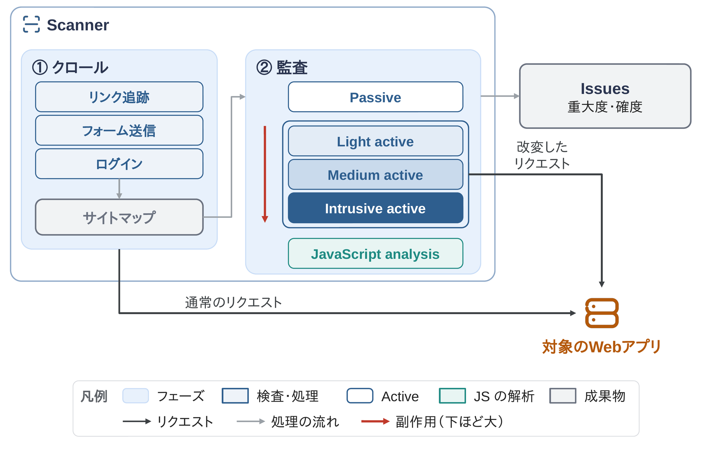

<!--
  コンパクト記事 no.46（草稿。公開前にこのコメントは削除）
  - Burp Suite シリーズ（no.42〜50）。全体像は no.42（公開したらリンク、TODO）
  - 裏取り（2026-11-14、PortSwigger 公式）：
    - Burp Scanner：DAST の Web 脆弱性スキャナ。デスクトップの Professional と Burp Suite DAST で動く（Community にはない）
    - クロール：リンクをたどり、フォームを送信し、必要ならログインしてアプリの中身と遷移を把握する
    - 監査：Passive（通常の通信を見るだけ）、Light active（悪意に見えにくい少数の変更リクエスト。例：任意の Origin を信頼する CORS）、
      Medium active（悪意と見なされうるリクエスト。例：OS コマンドインジェクション。アラート・ログアウトなどの副作用）、
      Intrusive active（実際の攻撃に近い。例：SQL インジェクション。アプリやデータを壊すリスク）、
      JavaScript analysis（静的：実行せず source→sink を追う／動的：ヘッドレスブラウザで DOM にペイロードを入れる）
    - 帯域外の検出には Collaborator を使う（no.47）
  - 図：image/01_*.pptx/png（生成スクリプトは no.42-burp-suite/image/zukai/figs.js）
-->

# はじめに

Proxy と Repeater で手作業の診断ができるようになると、「この作業、全ページ分は無理では…」となります。そこで出てくるのが Professional 版の **Scanner** です。ボタンひとつで何をしているのか、どこまで任せていいのかを整理しました。

:::note warn
Scanner は、ページをたどりながら大量のリクエストを送り、攻撃に近いリクエストも含みます。自分が管理する環境か、検査の許可をもらった対象にだけ使ってください。許可のない対象へのスキャンは、不正アクセス禁止法や業務妨害などに問われるおそれがあります。
許可がある場合でも、データの書き換えや削除が起きうるので、本番ではなく検証環境に対して実行してください。
:::

# ひとことで言うと

- **Scanner** は、Web アプリを **自動でクロールし（① クロール）、見つけたページやパラメータに検査のリクエストを送って脆弱性を探す（② 監査）** スキャナ。いわゆる DAST
- 監査には、通信を見るだけの **Passive** から、実際の攻撃に近い **Intrusive active** まで段階があり、強いものほど副作用のリスクが大きい
- **Professional だけ** の機能（Community にはない）

# 何をしてくれるのか？

*図1：Scanner のクロールと監査。クロールでリンク・フォームをたどってサイトマップを作り、監査で検査の種類ごとにリクエストを送って、見つかった問題を Issues に出す*

スキャンは2つのフェーズで進みます。

**① クロール**
起点の URL から、リンクをたどり、フォームを送信し、必要ならログインしながら、アプリのページと遷移を集めます。集めた結果はサイトマップ（Target タブ）にたまります。

**② 監査**
クロールで見つけたページ・パラメータに対して、検査のリクエストを送り、レスポンスや挙動から脆弱性を判定します。検査には次の種類があります。

| 種類 | やること | 例 | 副作用 |
|---|---|---|---|
| Passive | 通常の通信を見るだけ。追加のリクエストは送らない | HTTP メッセージの中のシリアライズされたオブジェクト | なし |
| Light active | 悪意に見えにくい、少数の書き換えたリクエストを送る | 任意の Origin を信頼する CORS | 小 |
| Medium active | アプリから悪意と見なされうるリクエストを送る | OS コマンドインジェクション | アラート・ログアウトなど |
| Intrusive active | 実際の攻撃に近いリクエストで、悪用できるかを確かめる | SQL インジェクション | アプリやデータを壊すおそれ |
| JavaScript analysis | 返ってきた JavaScript を解析して、DOM ベースの脆弱性を探す | DOM ベースの XSS | — |

JavaScript analysis には、コードを実行せずにデータの流れ（source → sink）を追う **静的解析** と、ヘッドレスブラウザで実際に動かしてペイロードが危険な sink に届くかを見る **動的解析** があります。
また、レスポンスに何も出ない「ブラインド」な脆弱性は、Collaborator（no.47）を使った帯域外の検出で見つけます。

見つかった問題は **Issues** に、重大度（High・Medium・Low・Information）と確度（Certain・Firm・Tentative）付きで並びます。根拠のリクエストとレスポンスも一緒に残るので、Repeater に送って手で確かめ直せます。

# どこまで任せていいのか？

Scanner はかなり優秀ですが、

- 業務ロジックの不備（例：他人の注文を見られる、手順を飛ばせる）は、アプリの意味が分からないと判定しにくい
- 確度が Tentative のものは誤検知のこともある

ので、**Scanner で広く当たりを付けて、Repeater・Intruder で手で確かめる** のが基本の使い分けです。スキャンの設定（スキャン設定）では、使う検査の種類や速度を選べるので、検証環境でも Intrusive な検査を外すといった調整ができます。

ちなみに、ZAP の Baseline Scan（no.38）は、このうちクロールと Passive に当たる部分だけを CI で回すイメージです（ツールが違うので、検査の中身は同じではありません）。

# まとめ

- Scanner は、クロールでページを集め、監査で検査のリクエストを送って脆弱性を探す、Professional 版の自動スキャナ
- 監査は Passive から Intrusive active まで段階があり、強いほど副作用のリスクが大きい。JavaScript analysis で DOM ベースの脆弱性も探す
- 結果は Issues に重大度・確度付きで並ぶ。業務ロジックの不備は苦手なので、手作業と組み合わせる
- 実行は、許可のある検証環境に対してだけ

# 参考

- [Burp Scanner](https://portswigger.net/burp/documentation/scanner)
- [Auditing](https://portswigger.net/burp/documentation/scanner/auditing)
- [Burp Suite Community Edition（ダウンロードページの比較表）](https://portswigger.net/burp/communitydownload)
