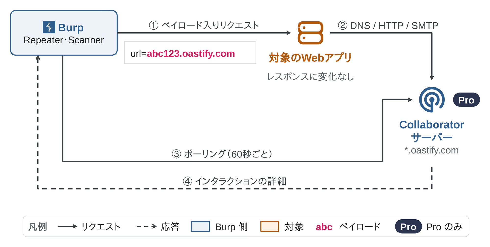

<!--
  コンパクト記事 no.47（草稿。公開前にこのコメントは削除）
  - Burp Suite シリーズ（no.42〜50）。全体像は no.42（公開したらリンク、TODO）
  - 裏取り（2026-11-14、PortSwigger 公式）：
    - Collaborator（Pro のみ）：帯域外（out-of-band）の脆弱性を見つける。手順は「ペイロードを作る → 対象に送る → サーバーをポーリング」
    - ペイロードは Collaborator サーバーのドメインのサブドメイン。Repeater では右クリック → Insert Collaborator payload、Intruder は自動で差し込める
    - 対象がペイロードのサブドメインを DNS で引き、続いて HTTP や SMTP の接続をすることがある。結果は HTTP・DNS・SMTP で絞り込める
    - 既定の公開サーバーは *.burpcollaborator.net か *.oastify.com（バージョンによる。WAF に弾かれにくくするためドメインは入れ替わる）。専用サーバーも立てられる
    - 60 秒ごとに自動でポーリング、Poll now で手動
    - 使いどころ（Typical uses）：外部サービスとのやり取り（メールヘッダーインジェクションも）、ブラインド SQL インジェクション、ブラインド XSS（あとから描画されたときの遅れたやり取り）、二次の SQL インジェクション
  - 図：image/01_*.pptx/png（生成スクリプトは no.42-burp-suite/image/zukai/figs.js）
-->

# はじめに

SSRF やコマンドインジェクションを試していると、「たぶん刺さってるのに、レスポンスには何も出ない」という場面があります。そういう **ブラインド** な脆弱性を、対象からの「問い合わせ」で見つけるのが **Collaborator** です。仕組みがちょっと独特なので、図で整理しました。

:::note warn
Collaborator のペイロードを送るのは、自分が管理するアプリか、検査の許可をもらった対象だけにしてください。許可のない対象への検査は、不正アクセス禁止法などに触れるおそれがあります。
:::

# ひとことで言うと

- **Collaborator** は、**PortSwigger が用意した外部のサーバー** を使って、対象のサーバーが **外に向けて DNS の問い合わせや HTTP の接続をしたかどうか** を記録するツール
- レスポンスに何も出ない脆弱性でも、「対象が Collaborator のドメインに問い合わせてきた」ことで、ペイロードが実行された証拠がつかめる。これを **OAST**（Out-of-band Application Security Testing、帯域外での検査）と呼ぶ
- **Professional だけ** の機能。Scanner の検査でも使われる

# 何をしてくれるのか？

*図1：Collaborator での帯域外検出。ペイロード入りのリクエストを送り（①）、対象が Collaborator のドメインに問い合わせる（②）。Burp は Collaborator サーバーをポーリングして（③）、インタラクション（受け取った DNS・HTTP・SMTP のやり取り）の詳細を表示する（④）*

流れは次のとおりです。

1. **ペイロードを作る**：`abc123.oastify.com` のような、Collaborator サーバーのドメインのサブドメインを1つ発行する（`abc123` の部分がこのペイロード専用の ID）。Repeater なら右クリックの **Insert Collaborator payload** で差し込める
2. **対象に送る**：たとえば、URL を受け取ってサーバー側で取りに行く機能のパラメータに `http://abc123.oastify.com/` を入れて送る
3. **対象が問い合わせる**：ペイロードが効いていれば、対象のサーバーがこのドメインを **DNS で名前解決** し、続いて HTTP や SMTP で接続してくる。レスポンスには何も出なくてかまわない
4. **Burp が受け取る**：Burp は Collaborator サーバーを **60 秒ごとにポーリング**（Poll now で手動でも可）し、届いた DNS・HTTP・SMTP のやり取りを、送信元や時刻と一緒に表示する

ポイントは、**対象から Burp に直接つながる必要がない** ことです。対象が外のドメインを引きに行くだけで、その痕跡が Collaborator サーバーに残り、Burp はそれをあとから取りに行きます。

# どんな脆弱性に使えるのか？

公式ドキュメントで代表的な使いどころとして挙がっているのは、たとえばこんなものです。

| 使いどころ | 何が起きると検出できるか |
|---|---|
| 外部サービスとのやり取り（ブラインド SSRF など） | 対象のサーバーが、ペイロードの URL に DNS・HTTP でアクセスする |
| ブラインド SQL インジェクション | 注入が成功したときに、DB から外向きの問い合わせが発生するペイロードを使う |
| ブラインド XSS | 保存されたペイロードが、あとで管理画面などで表示されたときに問い合わせが来る |
| メールヘッダーインジェクション | 対象から、ペイロードのドメイン宛てに SMTP のやり取りが発生する |

ブラインド XSS のように、**ペイロードを送ってから何時間もあとに** 問い合わせが来ることもあります。レスポンスだけ見ていたら絶対に気づけないやつです。

# 気をつけることは？

- 既定では PortSwigger の **公開サーバー**（`*.oastify.com` や `*.burpcollaborator.net`）を使う。社内ルールで外部サーバーを使えない場合は、**自前の Collaborator サーバー** を立てることもできる
- Burp を動かしている端末から Collaborator サーバーに届く必要がある（プロキシやファイアウォールで止められていないか）
- 対象の環境から外向きの DNS や HTTP が止められていると、脆弱性があっても問い合わせが来ない。「来なかった＝安全」とは言い切れない

# まとめ

- Collaborator は、外部のサーバーを使って、対象が外に問い合わせたかどうかでブラインドな脆弱性を見つけるツール（OAST）
- 流れは「ペイロード（専用のサブドメイン）を作る → 対象に送る → 対象が DNS・HTTP で問い合わせる → Burp がポーリングで受け取る」
- ブラインド SSRF・ブラインド SQL インジェクション・ブラインド XSS など、レスポンスに出ない問題に効く
- Professional だけ。公開サーバーが使えなければ自前のサーバーも立てられる

ほかに Collaborator の面白い使い方があれば、有識者の方教えて欲しいです！

# 参考

- [Burp Collaborator](https://portswigger.net/burp/documentation/desktop/tools/collaborator)
- [Typical uses for Burp Collaborator](https://portswigger.net/burp/documentation/collaborator/uses)
- [Deploying a private Burp Collaborator server](https://portswigger.net/burp/documentation/collaborator/deploying)
- [Lab: Blind SSRF with out-of-band detection（Web Security Academy）](https://portswigger.net/web-security/ssrf/blind/lab-out-of-band-detection)
