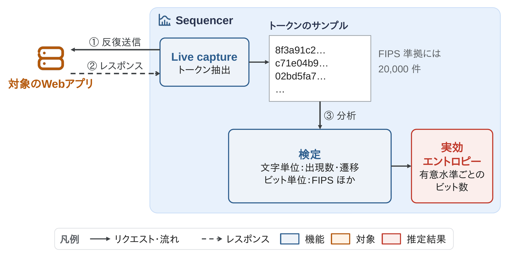

<!--
  コンパクト記事 no.48（草稿。公開前にこのコメントは削除）
  - Burp Suite シリーズ（no.42〜50）。全体像は no.42（公開したらリンク、TODO）
  - 裏取り（2026-11-14、PortSwigger 公式）：
    - Sequencer：セッショントークン・CSRF 対策トークン・パスワードリセットのトークンなど、予測できてはいけない値の乱数性を分析する
    - サンプルの集め方：Live capture（リクエストを繰り返し送ってレスポンスからトークンを取り出す）、手動で読み込み
    - 検定：文字単位（Character count analysis / Character transition analysis）、
      ビット単位（FIPS monobit / poker / runs / long runs、Spectral tests、Correlation test、Compression test）
    - 実効エントロピー：有意水準ごとに、乱数と見なせるビット数を出す。FIPS に準拠した結果には 20,000 件のサンプルが必要
    - 有意水準：科学実験では 1〜5%、FIPS の検定では 0.002〜0.03%
    - Community・Professional の両方で使える
  - 図：image/01_*.pptx/png（生成スクリプトは no.42-burp-suite/image/zukai/figs.js）
-->

# はじめに

セッション ID が連番だったら危ない、というのは分かるけど、ランダムっぽく見える文字列が **本当に予測できないか** は、目で見ても分かりません。それを統計で確かめてくれるのが **Sequencer** です。

:::note warn
Sequencer の Live capture は、同じリクエストを数千〜数万回送ります。自分が管理するアプリか、検査の許可をもらった対象にだけ使い、負荷にも注意してください。許可のない対象への検査は、不正アクセス禁止法や業務妨害などに問われるおそれがあります。
:::

# ひとことで言うと

- **Sequencer** は、**セッショントークンなど「予測できてはいけない値」をたくさん集めて、乱数としての質を統計的に検定する** ツール
- 文字単位とビット単位の検定を行い、結果を **実効エントロピー**（乱数と見なせるビット数）で示す
- Community・Professional のどちらでも使える

# 何をしてくれるのか？

*図1：Sequencer の乱数性分析。同じリクエストを繰り返し送り（①）、レスポンス（②）からトークンを取り出して、文字単位・ビット単位の検定（③）で実効エントロピーを推定する*

対象になるのは、たとえば次のような値です。

- ログイン後に発行される **セッショントークン**（`Set-Cookie: session=…`）
- **CSRF 対策のトークン**
- **パスワードリセット** のメールに入るトークン

使い方は、

1. トークンが発行されるリクエスト（ログインなど）を HTTP history から **Send to Sequencer** で渡す
2. レスポンスのどこにトークンがあるか（Cookie・フォームの値など）を指定する
3. **Live capture** を始めると、Sequencer がそのリクエストを繰り返し送り、トークンを集める（手元にあるトークンの一覧を読み込むこともできる）
4. 集まったところで分析する

という流れです。

# どんな検定をしているのか？

| 単位 | 検定 | 見ていること |
|---|---|---|
| 文字単位 | Character count analysis | 各桁で、文字の出現回数が偏っていないか |
| 文字単位 | Character transition analysis | 前のトークンから次のトークンへの文字の変わり方に偏りがないか |
| ビット単位 | FIPS monobit / poker / runs / long runs | 0 と 1 の割合、ビットの並びのパターン、同じ値の連続の長さ |
| ビット単位 | Spectral tests、Correlation test、Compression test | 周期性、ビットどうしの相関、圧縮できてしまうか（ZLIB） |

各検定は「このサンプルは乱数である」という仮説を、**有意水準**（どこまで珍しい結果なら仮説を捨てるか）に照らして判定します。
最終的には、有意水準ごとに「乱数と見なせるビットが何ビットあるか」が **実効エントロピー** として出ます。トークンの長さが 128 ビットあっても、実効エントロピーが小さければ、実際に推測しなければならない範囲はそれだけ狭いということです。

サンプルの数は多いほど結果が信頼できます。**FIPS に準拠した結果を出すには 20,000 件** が必要です。

# まとめ

- Sequencer は、セッショントークンなどを大量に集めて、乱数の質を統計的に検定するツール
- 「Send to Sequencer → トークンの場所を指定 → Live capture で収集 → 分析」の流れ
- 文字単位・ビット単位の検定の結果を、有意水準ごとの実効エントロピー（ビット数）で示す
- Live capture は大量に送るので、許可のある対象で、負荷に注意して使う

# 参考

- [Burp Sequencer](https://portswigger.net/burp/documentation/desktop/tools/sequencer)
- [Randomness tests](https://portswigger.net/burp/documentation/desktop/tools/sequencer/results/tests)
- [Burp Sequencer 101](https://portswigger.net/blog/burp-sequencer-101)
