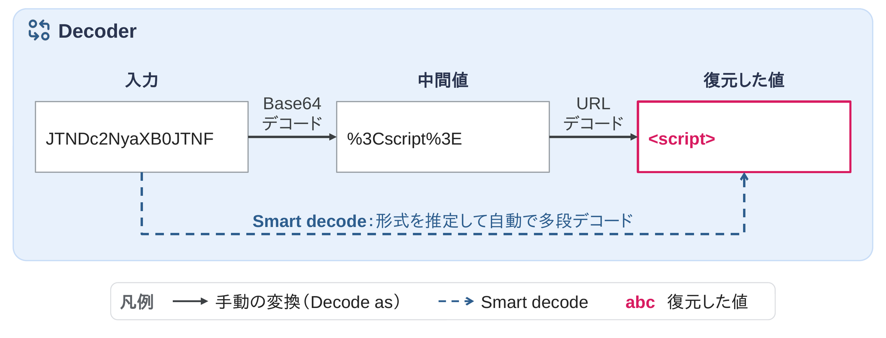

<!--
  コンパクト記事 no.49（草稿。公開前にこのコメントは削除）
  - Burp Suite シリーズ（no.42〜50）。全体像は no.42（公開したらリンク、TODO）
  - 裏取り（2026-11-14、PortSwigger 公式）：
    - Decoder：アプリのデータを手動・自動でエンコード／デコードする
    - 対応：URL, HTML, Base64, ASCII hex, Hex, Octal, Binary, GZIP。ハッシュは Java の実行環境が対応するものが使える
    - Smart decode：よくあるエンコード形式をヒューリスティックに見分けて自動でデコードする
    - Community・Professional の両方で使える
  - 図の例：echo -n '%3Cscript%3E' | base64 → JTNDc2NyaXB0JTNF（確認済み）
  - 図：image/01_*.pptx/png（生成スクリプトは no.42-burp-suite/image/zukai/figs.js）
-->

# はじめに

Cookie やパラメータに入っている `JTNDc2NyaXB0JTNF` みたいな文字列、これって何？となったときに、毎回 CyberChef を開いていました。Burp の中で済ませられるのが **Decoder** です。

:::note warn
Decoder 自体は手元で変換するだけで、対象にリクエストは送りません。ただし、変換した値を使って対象を検査するのは、自分が管理するアプリか、許可をもらった対象だけにしてください。
:::

# ひとことで言うと

- **Decoder** は、**URL エンコード・Base64・HTML エンティティなどを、手元でデコード／エンコードする** ツール
- 変換を何段でも重ねられるので、Base64 の中に URL エンコード、のような **入れ子のエンコード** をほどくのに便利
- **Smart decode** を使うと、形式を推定して自動でデコードしてくれる
- Community・Professional のどちらでも使える

# 何をしてくれるのか？

*図1：Decoder の多段デコード。Base64 デコードで URL エンコードされた文字列が出てきて、それを URL デコードすると元のデータになる。Smart decode はこの判断を自動で行う*

HTTP history などで気になる値を選び、右クリックの **Send to Decoder** で渡します（直接貼り付けてもよい）。
あとは **Decode as …** で形式を選ぶと、変換結果が下に新しい段として出ます。その段に対して、また別の変換を重ねられます。

図1の例では、

1. `JTNDc2NyaXB0JTNF` を **Base64** としてデコードすると `%3Cscript%3E`
2. それを **URL** としてデコードすると `<script>`

と、2段のエンコードがほどけています。WAF やアプリの入力チェックが「1段だけデコードして判定」している場合、こういう入れ子のエンコードですり抜けられることがあるので、診断ではよく出てくる形です。

逆に、**Encode as …** で、ペイロードを対象が受け取る形式に変換することもできます。

# どんな変換ができるのか？

| 機能 | 内容 |
|---|---|
| Decode as / Encode as | URL、HTML、Base64、ASCII hex、Hex、Octal、Binary、GZIP |
| Hash | ハッシュ値の計算（使えるアルゴリズムは Java の実行環境しだい） |
| Smart decode | よくあるエンコード形式を推定して、デコードできなくなるまで自動で重ねる（各段の結果は別のパネルに出るので、推定ミスにも気づける） |

表示はテキストと16進数（Hex）を切り替えられるので、バイナリが混ざったデータも見られます。

:::note info
Repeater や Proxy でリクエストを選んだときに出る **Inspector** のパネルでも、パラメータや Cookie を自動でデコードした状態で見られます。ちょっと確かめるだけなら Inspector、何段も変換を重ねたいときは Decoder、という使い分けが楽です。
:::

# まとめ

- Decoder は、URL・Base64・HTML などのエンコードを手元でデコード／エンコードするツール
- 変換を段ごとに重ねられるので、入れ子のエンコードをほどくのに便利
- Smart decode で形式の推定も自動。ちょっと見るだけなら Inspector でもよい

# 参考

- [Burp Decoder](https://portswigger.net/burp/documentation/desktop/tools/decoder)
- [Inspector](https://portswigger.net/burp/documentation/desktop/tools/inspector)
