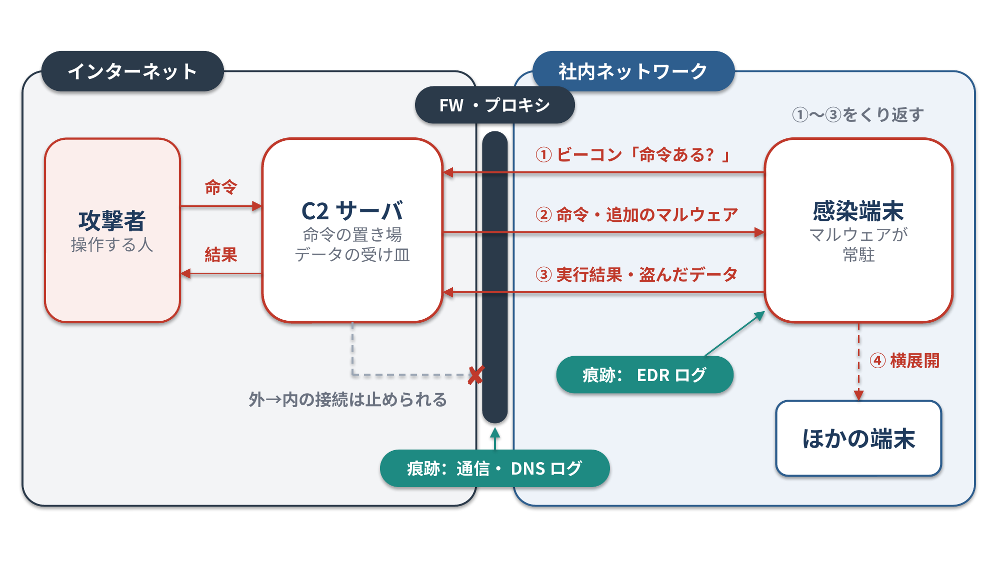

<!--
  コンパクト記事 no.5（草稿。公開前にこのコメントは削除）
  - 書き方：攻撃の仕組みの説明は常体寄りの平易な文で、軽いノリは入れない（語調スキルのルール）
  - 裏取り：MITRE ATT&CK（TA0011 ほか参考に挙げた各テクニック）
  - 図1：image/01_C2サーバの通信の流れ.pptx/png（生成スクリプト image/図生成スクリプト.py）
  - ハンズオン資料は再配布不可なので、スライドの中身・画面・通信先はそのまま載せない
-->

# はじめに

EDR のログを読んでマルウェアの動きを追うハンズオンに参加したとき、「この通信はたぶん C2 だね」と言われても、C2サーバが何をしているのかちゃんと分かっていなかったので、まとめておきます。

この記事でわかること

- C2サーバは何をするためのものなのか
- マルウェア解析で、C2 とのやり取りの痕跡がどこに残るのか

# ひとことで言うと

**C&C（Command and Control、C2）サーバは、攻撃者がマルウェアに感染した端末へ命令を送り、結果を受け取るためのサーバ**です。
感染した端末を遠隔操作するための「司令塔」にあたります。

# C2サーバは何をするためのものなのか？

マルウェアは、感染した時点でやることが全部決まっているとは限りません。
攻撃者は感染後に「次に何をさせるか」を決めて、C2サーバ経由で指示を出します。

C2サーバの主な役割は次の4つです。

| 役割 | 中身 |
| --- | --- |
| 命令を出す | コマンドの実行、端末内の探索、ほかの端末への横展開などを指示する |
| 追加のマルウェアを渡す | 最初に入った小さなマルウェア（ローダー）に、本命のマルウェアをダウンロードさせる |
| 結果やデータを受け取る | コマンドの実行結果や、盗んだファイル・認証情報を受け取る |
| 感染端末を管理する | どの端末が感染していて、今も生きているかを把握する |

## やり取りの流れ

感染した端末（ボット、エージェントとも呼ばれる）は、C2サーバと次のようにやり取りします。

1. 感染した端末が、C2サーバに定期的に接続する（**ビーコン**）
2. C2サーバが、待機中の命令があれば返す
3. 端末が命令を実行し、結果やデータを送り返す
4. 1 に戻る


*図1：C2サーバの通信の流れ。感染端末のほうから外へ問い合わせ（①）、その応答で命令を受け取り（②）、結果を送り返す（③）。外から社内への接続はファイアウォールで止められるので、この向きになる*

ポイントは、**端末の側から外へ接続しにいく**ことです。
外から社内の端末へ直接つなぐ通信はファイアウォールで止められやすい一方、社内から外への Web 通信はふつう許可されています。
そのため、端末から「何か命令ある？」と聞きにいく形にしておけば、ファイアウォールを通り抜けやすくなります。

## 通信の隠し方

C2 の通信は、見つかると遮断されるので、ふつうの通信にまぎれるように作られます。

| 手口 | 中身 |
| --- | --- |
| ふつうの Web 通信にまぎれる | HTTP / HTTPS でやり取りし、ふつうの閲覧に見せかける |
| DNS を使う | DNS の問い合わせや応答にデータを埋め込む |
| 正規のサービスを使う | クラウドストレージや SNS、チャットツールを中継に使う |
| DGA（ドメイン生成アルゴリズム） | 接続先のドメインを日付などから自動生成し、ブロックされにくくする |

## 構成の種類

| 構成 | 中身 | 弱点 |
| --- | --- | --- |
| 集中型 | 1か所（または少数）のサーバがすべての端末に命令する | サーバを止められると全体が止まる |
| P2P 型 | 感染端末どうしで命令を中継する | 作りが複雑になる |

# マルウェア解析では、どこに痕跡が残るのか？

C2 とやり取りするには、マルウェアが端末の上で動き、外と通信する必要があります。
そのため、痕跡は「端末の中」と「ネットワークの出口」の両方に残ります。

## 端末（EDR のログ）に残るもの

EDR（Endpoint Detection and Response）は、端末上のプロセスの起動、ファイル・レジストリの操作、通信などを記録する製品です。
C2 に関係する痕跡は、主に次の場所に出ます。

| 見る場所 | 何がわかるか | C2 との関係 |
| --- | --- | --- |
| 通信のログ | どのプロセスが、どの IP アドレス・ドメインに、どれくらいの間隔で接続したか | C2サーバの接続先そのもの。一定間隔の接続はビーコンの可能性がある |
| DNS 問い合わせ | どのドメインの名前解決をしたか | C2 のドメインや、DGA で作られたランダムなドメインが出る |
| プロセスの親子関係 | どのプロセスが、どのプロセスを起動したか | Word やブラウザから見慣れないプロセスが起動していれば、侵入の入口と C2 を担うプロセスが分かる |
| コマンドライン | プロセスがどんな引数で起動されたか | C2 から受け取った命令の実行結果として、不審なコマンドが残る |
| 作成されたファイル | 新しく置かれたファイル、そのハッシュ値やコード署名の有無 | C2 からダウンロードされた追加のマルウェアが見つかる |
| レジストリ・タスク・サービス | 自動起動の登録 | 再起動後も C2 との通信を続けるための**永続化**の跡が残る |

コマンドラインでは、たとえば次のような形がよく話題になります。

```text
powershell.exe -WindowStyle Hidden -ExecutionPolicy Bypass -EncodedCommand <Base64文字列>
```

ウィンドウを隠し、スクリプトの実行制限を回避し、実行内容を Base64 で符号化して読みにくくしています。
`-EncodedCommand` の中身は UTF-16LE の文字列を Base64 にしたものなので、デコードすると、C2 の URL や次に実行する処理が出てくることがあります。

永続化でよく使われる場所の例は次のとおりです。

| 場所 | 中身 |
| --- | --- |
| `HKCU\Software\Microsoft\Windows\CurrentVersion\Run` など | ログオン時に自動で起動するプログラムの登録 |
| スタートアップフォルダ | ログオン時に自動で起動するファイルの置き場所 |
| タスクスケジューラ | 決まった時刻や条件で起動するタスク |
| サービス | OS の起動時に動くプログラム |

## ネットワークの出口に残るもの

端末の外でも、次のログに C2 との通信が残ります。

- プロキシやファイアウォールのログ：接続先、通信量、接続の間隔
- DNS サーバのログ：問い合わせたドメイン

端末のログと違って「どのプロセスが通信したか」は分かりませんが、組織内の複数の端末が同じ宛先に通信していないかを横断して確認できます。

## マルウェア本体の中にも残る

C2サーバの接続先は、マルウェアの中に設定（コンフィグ）として埋め込まれていることが多いです。
暗号化や難読化されていることもありますが、マルウェアを解析して取り出せれば、ログに出ていない予備の接続先まで分かることがあります。

## どう追っていくか

端末の上では多くのプロセスが同時に動いているので、ログを時系列で眺めるだけでは C2 とのやり取りが埋もれます。
次のように、怪しいプロセスを起点に広げていくと追いやすくなります。

1. 不審な通信や不審なファイルから、関係するプロセス（PID）を特定する
2. そのプロセスの親と子をたどり、どこから侵入して何を起動したかを確認する
3. そのプロセスが行った通信・ファイル作成・レジストリ操作をまとめて確認する
4. 見つかった接続先のドメインや IP アドレス、ファイルのハッシュ値を、脅威インテリジェンスや VirusTotal などのレピュテーションで調べる

# 守る側から見ると

- 決まった間隔で同じ宛先に通信している端末は、ビーコンの可能性がある
- 脅威インテリジェンスで共有されている C2 のドメインや IP アドレスと突き合わせる
- 警察やセキュリティ企業が C2サーバを差し押さえたり、ドメインを乗っ取って無害なサーバに向けたり（シンクホール）して、ボットネットを止めることがある

# 正規のレッドチーム用途

ペネトレーションテストやレッドチーム演習では、許可を得た範囲で C2 フレームワーク（Cobalt Strike、Sliver、Mythic など）を使います。
同じ仕組みを、守る側が攻撃を再現して対策を確かめるために使っている、ということです。

# まとめ

- C2サーバは、感染端末に命令を出し、結果やデータを受け取る「司令塔」
- 感染端末の側から定期的に外へ接続しにいく（ビーコン）形が多い
- 痕跡は、EDR のログ（通信・プロセスの親子関係・コマンドライン・ファイル・永続化）、プロキシや DNS のログ、マルウェア本体の設定に残る

「どのプロセスが、どこへ、どんな間隔で通信しているか」を押さえるのが、C2サーバ発見の鍵となりそう。

# 参考

- MITRE ATT&CK TA0011 Command and Control <https://attack.mitre.org/tactics/TA0011/>
- MITRE ATT&CK T1071 Application Layer Protocol <https://attack.mitre.org/techniques/T1071/>
- MITRE ATT&CK T1568.002 Domain Generation Algorithms <https://attack.mitre.org/techniques/T1568/002/>
- MITRE ATT&CK T1102 Web Service <https://attack.mitre.org/techniques/T1102/>
- MITRE ATT&CK T1059.001 PowerShell <https://attack.mitre.org/techniques/T1059/001/>
- MITRE ATT&CK T1547.001 Registry Run Keys / Startup Folder <https://attack.mitre.org/techniques/T1547/001/>
- MITRE ATT&CK T1053.005 Scheduled Task <https://attack.mitre.org/techniques/T1053/005/>
