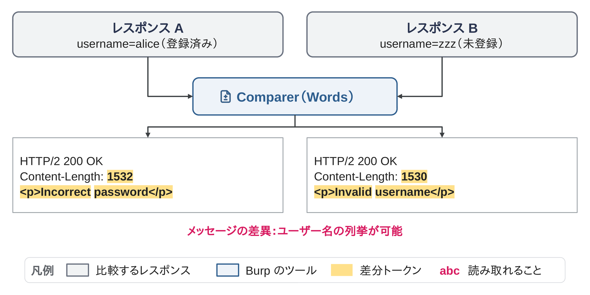

<!--
  コンパクト記事 no.50（草稿。公開前にこのコメントは削除）
  - Burp Suite シリーズ（no.42〜50）の最後。全体像は no.42（公開したらリンク、TODO）
  - 裏取り（2026-11-14、PortSwigger 公式）：
    - Comparer：2つのデータ（HTTP メッセージなど）の差分を表示する
    - 読み込み：右クリック → Send to Comparer、Paste、Load（ファイル）。2つの表から1つずつ選ぶ
    - Words：空白で区切ったトークン単位で、1つ目を2つ目に変えるための編集を表示。Bytes：バイト単位（処理が重いので Words で分からないときに）
    - 結果：左右に並べ、変更・削除・追加を色分け。差分の総数をタイトルバーに表示。Sync views で同時にスクロール。Text と Hex の表示
    - Community・Professional の両方で使える
  - 図の例は架空（Incorrect password と Invalid username の差 2 文字に合わせて Content-Length を 1532 / 1530 にしている）
  - 図：image/01_*.pptx/png（生成スクリプトは no.42-burp-suite/image/zukai/figs.js）
-->

# はじめに

ログインに失敗したときのレスポンス、ユーザー名が存在する場合としない場合で、ぱっと見は同じに見える。でも本当に同じなのか？を確かめるのが **Comparer** です。地味ですが、ユーザー名の列挙やアクセス制御の確認で意外と出番があります。

:::note warn
Comparer 自体は手元で比較するだけで、対象にリクエストは送りません。比較するレスポンスを取りに行くのは、自分が管理するアプリか、許可をもらった対象だけにしてください。許可のない対象でのユーザー名の列挙などは、不正アクセス禁止法などに触れるおそれがあります。
:::

# ひとことで言うと

- **Comparer** は、**2つのリクエスト・レスポンスを左右に並べて、違うところを色分けして見せる** ツール（diff）
- 比べ方は、空白で区切った単語ごとに比べる **Words** と、バイトごとに比べる **Bytes** の2つ
- Community・Professional のどちらでも使える

# 何をしてくれるのか？

*図1：Comparer での差分比較。存在するユーザー名と存在しないユーザー名でログインに失敗したときのレスポンスを Words で比べると、メッセージと長さの違いが浮かび上がる*

使い方は、

1. 比べたい2つのメッセージを、HTTP history や Repeater から右クリックの **Send to Comparer** で送る（貼り付けやファイルからの読み込みもできる）
2. Comparer のタブで、2つの表から1つずつ選ぶ
3. **Words** か **Bytes** を押す

だけです。結果は左右に並び、1つ目を2つ目に変えるのに必要な **変更・削除・追加** が色分けされ、差分の数もタイトルバーに出ます。**Sync views** をオンにすると、左右が一緒にスクロールします。

図1の例では、

- ユーザー名が存在する（`alice`）と `Incorrect password`
- ユーザー名が存在しない（`zzz`）と `Invalid username`

と、メッセージが違っていました。この違いがあると、**どのユーザー名が存在するかを外から判定できてしまう**（ユーザー名の列挙）ので、ログインの失敗メッセージは同じにするのが基本です。

メッセージが同じに見えても、HTML のコメントや空白、長さのような細かい違いが残っていることがあるので、目で見比べるより Comparer に任せたほうが確実です。

# Words と Bytes はどう使い分けるのか？

| 比べ方 | 単位 | 使いどころ |
|---|---|---|
| Words | 空白で区切ったトークン | ふつうはこちら。HTML や JSON のレスポンスの違いを見る |
| Bytes | 1バイトずつ | Words では違いが見つからないとき。処理が重いので最後の手段 |

ほかにも、

- 一般ユーザーと管理者で同じ画面を開いたときのレスポンスを比べて、隠された項目がないか見る
- Sequencer（no.48）で集めたトークンのうち、2つを並べて、変わらない部分を見る

といった使い方ができます。

# まとめ

- Comparer は、2つのリクエスト・レスポンスの違いを色分けして見せる diff ツール
- Send to Comparer で2つ送って、Words（単語ごと）か Bytes（バイトごと）で比べる
- ログインの失敗メッセージの違い（ユーザー名の列挙）や、権限による表示の違いを見つけるのに使える

これで Burp Suite の主なツールは一通りです。全体像は no.42 にまとめています。

# 参考

- [Burp Comparer](https://portswigger.net/burp/documentation/desktop/tools/comparer)
- [Enumerating usernames（Burp のドキュメント）](https://portswigger.net/burp/documentation/desktop/testing-workflow/vulnerabilities/authentication-mechanisms/enumerating-usernames)
