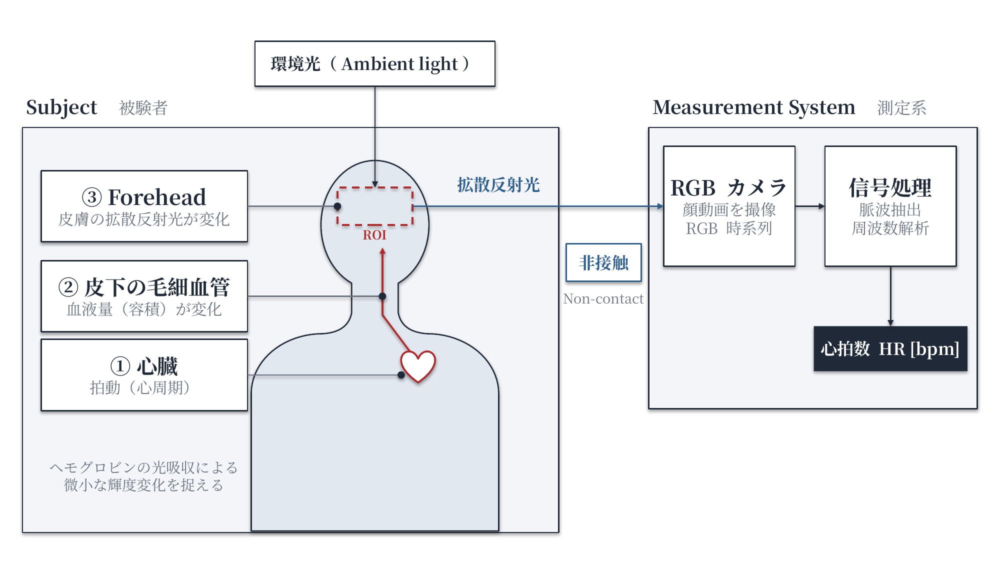
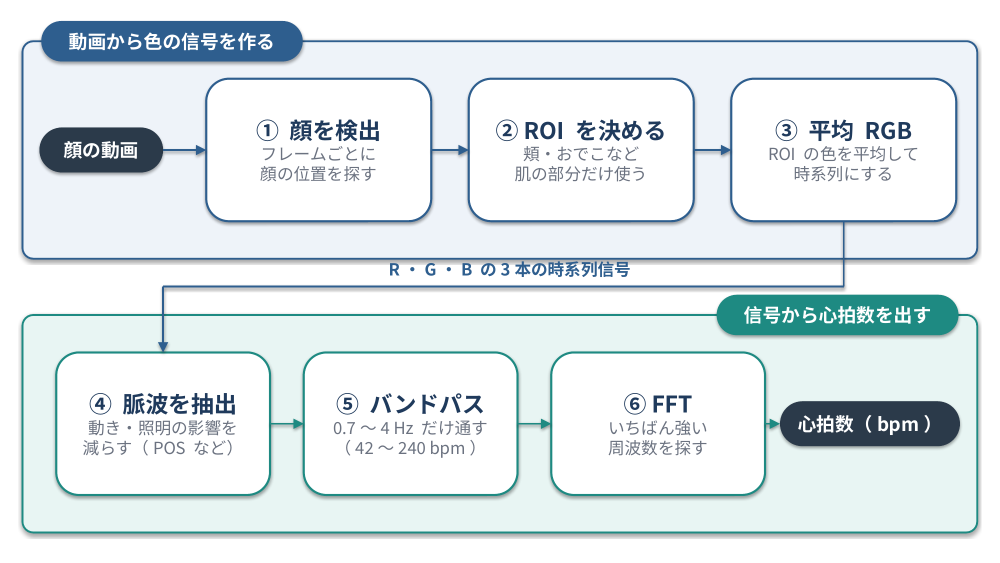

<!--
  コンパクト記事 no.7（草稿。公開前にこのコメントは削除）
  - 裏取り：Verkruysse ら (2008)、Poh ら (2010)、de Haan & Jeanne (2013)、Wang ら (2017)、DeepPhys (Chen & McDuff, ECCV 2018)、PhysNet (Yu ら, BMVC 2019)
  - 構成は推敲＋図のみ（コードは載せない、Nico 2026-10-31）
  - 図1：image/01_rPPGの全体像.pptx/png（生成 image/図生成スクリプト_全体像.py）
  - 図2：image/02_rPPGの処理の流れ.pptx/png（生成 image/図生成スクリプト_処理の流れ.py）
  - 関連：other no.10 Googleの自撮り動画認証（なりすまし検知の研究で rPPG が使われることがある。Google が使っているとは書かない）
-->

# はじめに

研究室の留学生が rPPG の技術を再現しようとしていて、どんな技術なのか興味を持ったので調べてみました！

# ひとことで言うと

**rPPG（remote Photoplethysmography、非接触型容積脈波測定法）は、カメラで撮ったおでこや頬の肌で反射した光の RGB 値の、わずかな変化から脈波を取り出し、心拍数を推定する方法**です。

いちばんの特徴は、既存の心拍計と違って**肌に何も触れずに（非接触で）測れる**ことです。

心臓の拍動で血液の量が変わり、おでこの肌で反射する光の色がわずかに変わります。それを離れたところのカメラで撮って、PC で心拍数に直します。

# なぜ肌の色から脈が分かるのか？

- 心臓が拍動するたびに、皮膚の下の血管を流れる血液の量が少しだけ変わる
- 血液中のヘモグロビンは光を吸収するので、血液の量が変わると、肌で反射する光の量も少しだけ変わる
- この変化は目では分からないほど小さいが、カメラの画素値の時間変化としてなら取り出せる
- RGB のうち、**緑のチャンネルにいちばんはっきり出る**ことが知られている（Verkruysse ら、2008）

# 既存の心拍計と何が違うのか？

| | 心電計（ECG） | 接触型 PPG（スマートウォッチ、パルスオキシメータ） | rPPG |
|---|---|---|---|
| 肌との接触 | 電極を肌に貼る | センサーを肌に密着させる | 触れない（離れたカメラで撮る） |
| 測っているもの | 心臓の電気信号 | LED の光の反射・透過の変化 | 周りの光（室内灯や日光）の反射の変化 |
| 光源 | なし | 専用の LED | 周りの光 |

スマートウォッチの心拍センサー（PPG）は rPPG と同じ原理で、LED で肌を照らし、受光素子で反射光を測っています。rPPG はそれをカメラと周りの光で、離れたところからやるイメージです。

また、心電計が心臓の電気信号を直接測るのに対して、PPG と rPPG は「血液の量の変化 → 光の変化」を通して**間接的に**脈を推定しています。rPPG は、非接触なぶん肌とセンサーのあいだに距離があり、周りの光や顔の動きの影響を受けやすくなります。

# 処理の流れ

1. 動画から顔を検出する
2. 頬やおでこなど、肌が映っている領域（ROI）を決める
3. フレームごとに ROI の平均 RGB を計算し、時系列の信号にする
4. 動きや照明の変化による成分を取り除き、脈波の成分を取り出す（下の表の手法）
5. 心拍の範囲（だいたい 0.7〜4 Hz、つまり 42〜240 bpm）だけを通すフィルタをかける
6. FFT などで、いちばん強い周波数を見つけて心拍数にする

上の段（①〜③）で動画を R・G・B の3本の時系列信号にして、下の段（④〜⑥）でその信号から心拍数を出します。

# 主な手法

| 手法 | 提案 | 中身 |
|---|---|---|
| Green | Verkruysse ら（2008） | 緑チャンネルの変化をそのまま使う |
| ICA | Poh ら（2010） | 独立成分分析で RGB から脈波の成分を分ける |
| CHROM | de Haan & Jeanne（2013） | 色差の信号を組み合わせて、動きの影響を減らす |
| POS | Wang ら（2017） | 肌の色に直交する平面に投影して脈波を取り出す |
| 深層学習 | DeepPhys（2018）、PhysNet（2019）など | 動画から脈波をニューラルネットワークで直接推定する |

下に行くほど新しく、CHROM や POS は Green や ICA より顔の動きや照明の変化に強くなるよう工夫されています。

# 難しいところ

- 顔が動くと、色の変化よりも動きによる変化のほうが大きくなる
- 照明のちらつきや明るさの変化に弱い
- 肌の色や化粧、カメラの圧縮（動画の画質）で精度が変わる

# まとめ

rPPG は「血液の量の変化 → 肌の色のわずかな変化 → カメラで取り出す」という流れで心拍数を推定します。
ほかにも押さえておくべき手法があれば、有識者の方教えて欲しいです！

# 参考

- W. Verkruysse, L. O. Svaasand, J. S. Nelson, "Remote plethysmographic imaging using ambient light", Optics Express, 2008
- M.-Z. Poh, D. J. McDuff, R. W. Picard, "Non-contact, automated cardiac pulse measurements using video imaging and blind source separation", Optics Express, 2010
- G. de Haan, V. Jeanne, "Robust pulse rate from chrominance-based rPPG", IEEE Trans. Biomed. Eng., 2013
- W. Wang, A. C. den Brinker, S. Stuijk, G. de Haan, "Algorithmic principles of remote PPG", IEEE Trans. Biomed. Eng., 2017
- W. Chen, D. McDuff, "DeepPhys: Video-Based Physiological Measurement Using Convolutional Attention Networks", ECCV, 2018
- Z. Yu, X. Li, G. Zhao, "Remote Photoplethysmograph Signal Measurement from Facial Videos Using Spatio-Temporal Networks", BMVC, 2019
