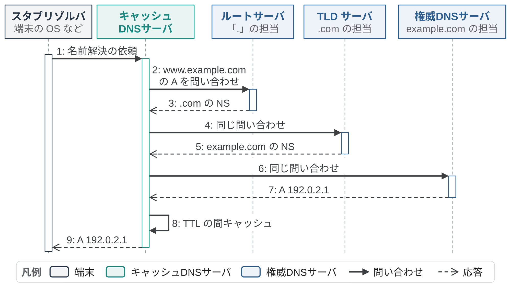
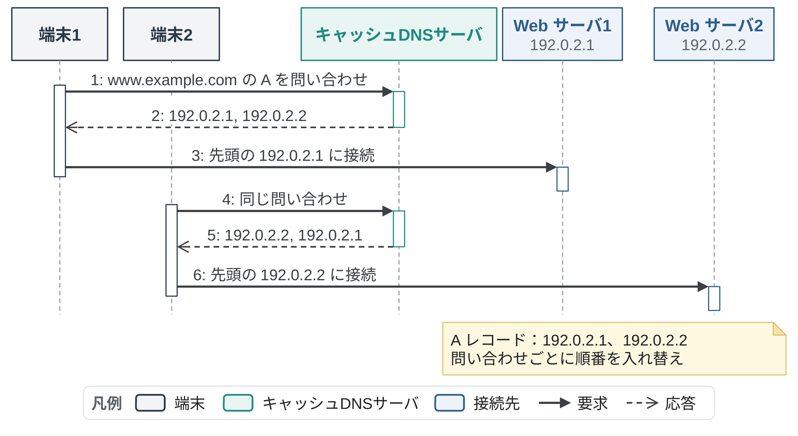
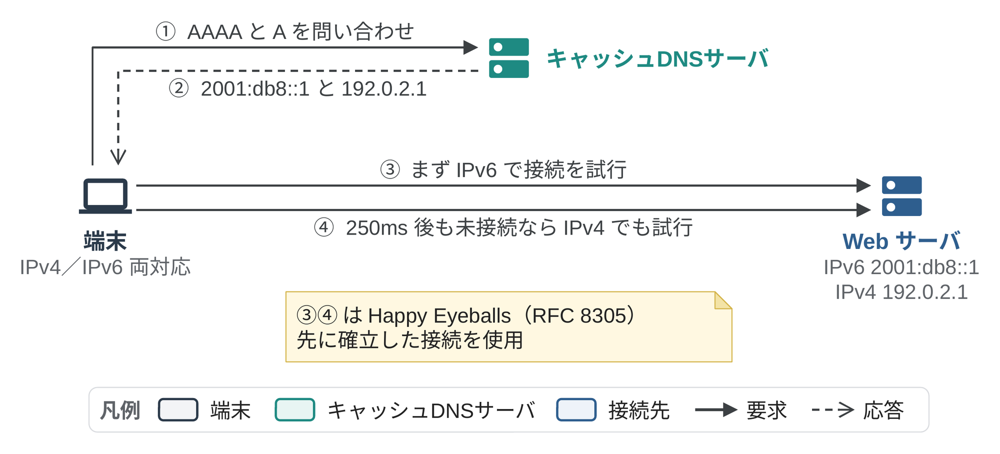
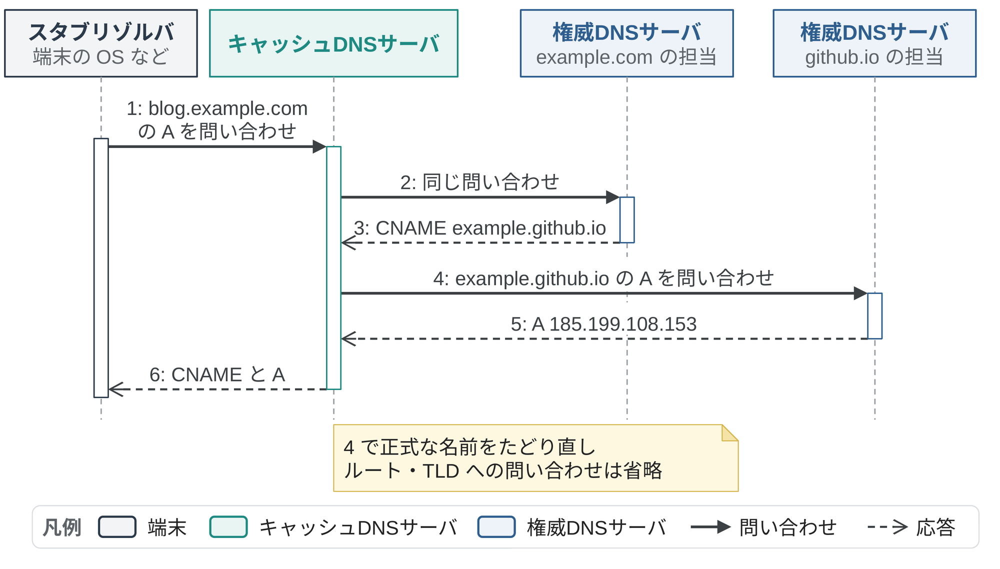
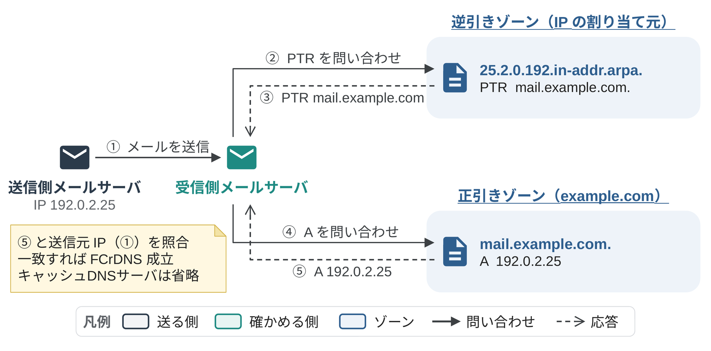
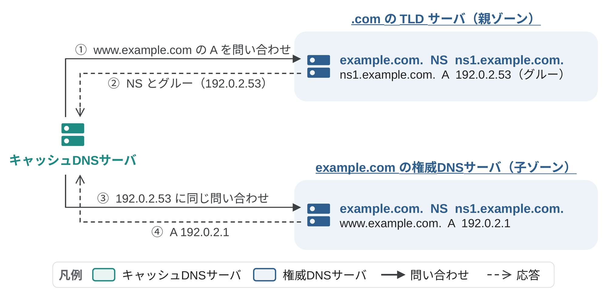
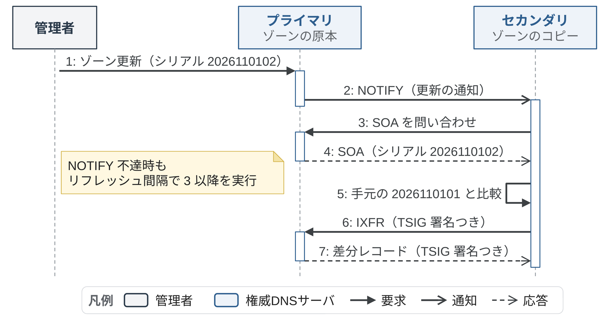
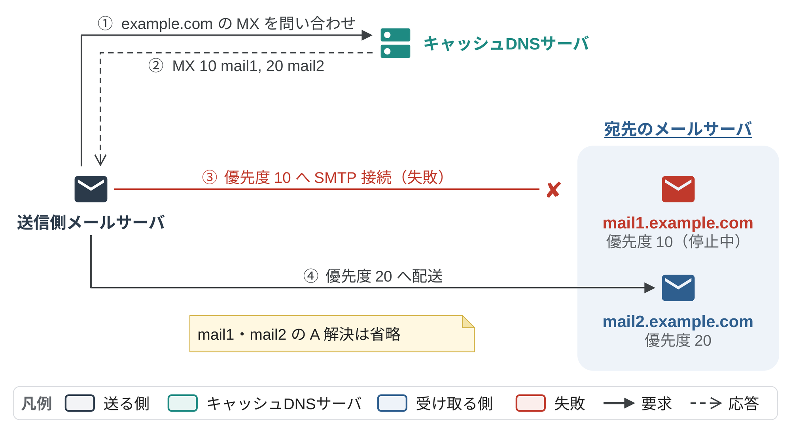
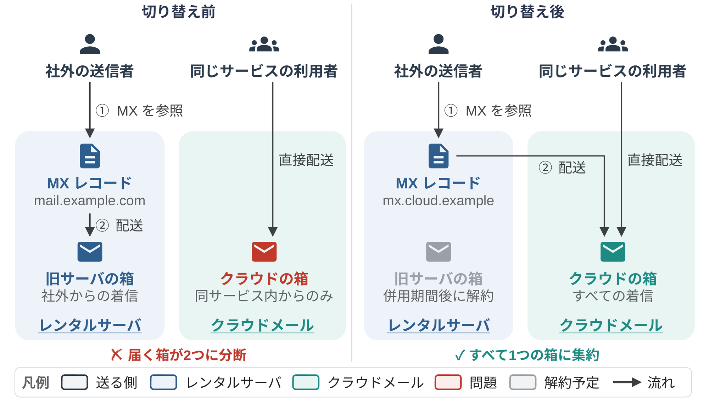
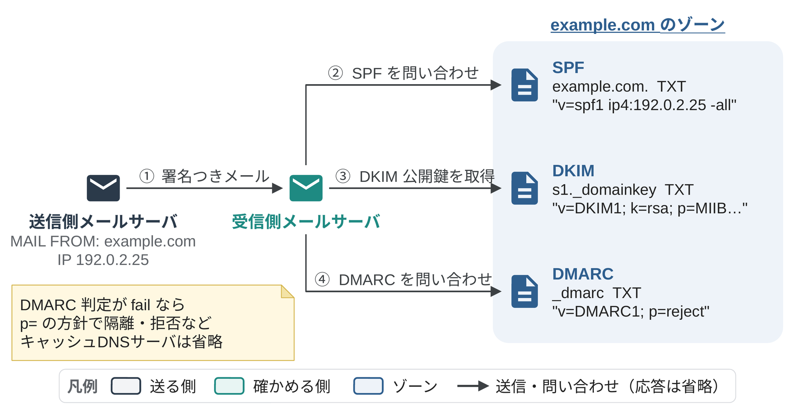

<!--
  コンパクト記事 no.8（草稿。公開前にこのコメントは削除）
  - 扱うレコード：A・AAAA・CNAME・PTR・NS・SOA・MX・TXT の8つ（Nico の指定、2026-11-01）
  - 裏取り：各節に書いた RFC。CNAME の制約は RFC 1034 3.6.2、MX・NS の宛先に CNAME 不可は RFC 2181 10.3、ネガティブキャッシュは RFC 2308、メール配送は RFC 5321 5.1、SPF の DNS 参照10回制限は RFC 7208 4.6.4
  - 図：image/01〜10_*.pptx/png（zukai-diagrams 準拠。生成スクリプト image/zukai/figs.js、`node figs.js <出力先>` → `./render.sh <出力先>`）
  - TODO：「確かめるコマンド」に、Nico の Mac で dig を実際に叩いた結果を貼る（作業環境から DNS に出られず未取得）
-->

# はじめに

仕事で DNS を触ることがあったので、この機会に DNS の主要なレコードを振り返ってみました。

# ひとことで言うと

**DNS は、ドメイン名から IP アドレスなどの情報を引くための、世界中に分散したデータベース**です。
そのデータベースの1行1行が**レコード（リソースレコード）**で、種類ごとに役割が決まっています。

# 名前解決はどう進むのか？

`www.example.com` の IP アドレスを調べるときは、次の順に問い合わせます。

1. 端末（スタブリゾルバ）が、キャッシュDNSサーバ（フルサービスリゾルバ）に問い合わせる
2. キャッシュになければ、キャッシュDNSサーバがルートサーバに聞く。ルートサーバは答えを知らないので、「`.com` は TLD サーバに聞いて」と担当を紹介する
3. `.com` の TLD サーバに聞くと、`example.com` の権威DNSサーバを紹介される
4. `example.com` の権威DNSサーバに聞いて、`192.0.2.1` という答えをもらう
5. キャッシュDNSサーバは端末に答えを返し、その答えを TTL の間だけ覚えておく


*図1：名前解決の流れ。端末が聞くのはキャッシュDNSサーバだけで、ルートから順にたどる（2〜7）のはキャッシュDNSサーバの仕事*

このように、上位のサーバが下位の担当サーバを紹介していく仕組みを**委任**と呼びます。
ルートサーバが全部の答えを持っているわけではなく、各ゾーンの答えはそれぞれの権威DNSサーバが持っています。

# レコードはどう書くのか？

ゾーンファイルでは、レコードを `名前 TTL クラス タイプ 値` の形で書きます。

```text
www.example.com.  3600  IN  A  192.0.2.1
```

| 欄 | 中身 |
|---|---|
| 名前 | どの名前についての情報か。末尾の `.` はルートを表す |
| TTL | キャッシュしてよい秒数 |
| クラス | ほぼ `IN`（インターネット）だけ |
| タイプ | レコードの種類（A、MX など）。この記事の主役 |
| 値 | タイプごとに決まった形式のデータ |

同じ名前・同じタイプのレコードの集まりを **RRset** と呼び、DNS は RRset 単位で答えを返します。
以降の例では、TTL と `IN` を省略します。

## この記事で扱うレコード

| レコード | 中身 | 例 |
|---|---|---|
| A | ドメイン名 → IPv4 アドレス | `www.example.com. A 192.0.2.1` |
| AAAA | ドメイン名 → IPv6 アドレス | `www.example.com. AAAA 2001:db8::1` |
| CNAME | 別名 → 正式な名前 | `blog.example.com. CNAME example.github.io.` |
| PTR | IP アドレス → ドメイン名（逆引き） | `1.2.0.192.in-addr.arpa. PTR www.example.com.` |
| NS | そのゾーンを担当する権威DNSサーバ | `example.com. NS ns1.example.net.` |
| SOA | ゾーンの管理情報 | `example.com. SOA ns1.example.net. hostmaster.example.com. 2026110101 7200 3600 1209600 3600` |
| MX | メールの受け取り先サーバ | `example.com. MX 10 mail.example.com.` |
| TXT | 任意の文字列（送信ドメイン認証など） | `example.com. TXT "v=spf1 -all"` |

ここからは、用途ごとに1つずつ仕組みを見ていきます。

# 名前とアドレスをつなぐレコード

## A：名前から IPv4 アドレスを引く

A レコードは「この名前のサーバはこの IPv4 アドレスにいる」を表します（RFC 1035）。
ブラウザで `https://www.example.com` を開くと、`www.example.com` の A レコードを引いて、出てきた IP アドレスに接続します。

```text
www.example.com.  A  192.0.2.1
www.example.com.  A  192.0.2.2
```


*図2：A レコードの仕組み。同じ名前に A を2つ置くと、答えの順番が入れ替わりながら返り、端末ごとに接続先の Web サーバが分かれる*

- 同じ名前に A を複数置くと、答えの順番が入れ替わりながら返り、接続先が分散する（DNS ラウンドロビン）。ただし、止まったサーバを外してくれるわけではない
- `*.example.com. A 192.0.2.1` のようにワイルドカードも書ける。ほかに何も定義していない名前すべてに、この答えが返る
- MX や NS の値はホスト名なので、最終的な接続先はそのホスト名の A（または AAAA）で決まる

## AAAA：名前から IPv6 アドレスを引く

AAAA レコードは、A と同じことを IPv6 アドレスで表します（RFC 3596）。
IPv4 の4倍（32ビット→128ビット）の長さなので、A を4つ並べた名前になっています。

```text
www.example.com.  A     192.0.2.1
www.example.com.  AAAA  2001:db8::1
```


*図3：AAAA レコードの仕組み。IPv6 が使える端末は AAAA と A を両方引き、まず IPv6 で接続を試す。250ms たってもつながらなければ IPv4 でも試し、先につながった方を使う*

- IPv4 と IPv6 の両方が使える端末は、AAAA と A を両方引く。まず IPv6 で接続を試し、少し待って（推奨値 250ms）もつながらなければ IPv4 でも試して、先につながった方を使う（Happy Eyeballs、RFC 8305）
- AAAA を置いたのにサーバ側の IPv6 が正しく動いていないと、IPv6 の端末だけ表示が遅い・つながらない、ということが起きる
- 書き方は IPv6 の省略表記（`2001:db8:0:0:0:0:0:1` → `2001:db8::1`）がそのまま使える

## CNAME：別名を正式な名前に向ける

CNAME は「この名前は別名で、正式な名前はあっち」を表します（RFC 1035）。

```text
blog.example.com.   CNAME  example.github.io.
example.github.io.  A      185.199.108.153
```


*図4：CNAME の仕組み。`blog.example.com` を聞くと CNAME が返り、キャッシュDNSサーバが正式な名前 `example.github.io` をたどり直して A を返す*

- 外部サービス（GitHub Pages、CDN など）の IP アドレスが変わっても、こちらの設定を変えずに済む
- CNAME の先がまた CNAME でもよい（CNAME チェーン）。ただし、たどる回数が増えるほど名前解決は遅くなる
- CNAME を置いた名前には、ほかのタイプのレコードを置けない（RFC 1034 3.6.2）。そのため、NS と SOA が必ずあるゾーンの頂点（`example.com` そのもの）には CNAME を置けない
- 頂点を外部サービスに向けたいときは、DNS サービス独自の ALIAS / CNAME フラットニングを使うか、HTTPS レコード（RFC 9460）の AliasMode を使う
- MX と NS の値には、CNAME の名前を書けない（RFC 2181 10.3）

## PTR：IP アドレスから名前を引く（逆引き）

PTR は、IP アドレスからドメイン名を引くためのレコードです（RFC 1035）。
IP アドレスを逆順に並べて `in-addr.arpa`（IPv6 は `ip6.arpa`）の下に置いた名前で引きます。

```text
25.2.0.192.in-addr.arpa.  PTR  mail.example.com.
mail.example.com.        A    192.0.2.25
```


*図5：逆引きの仕組み。`192.0.2.25` は `25.2.0.192.in-addr.arpa` という名前になり、IP アドレスを割り当てた側（プロバイダなど）のゾーンで PTR を引く。メールの受信サーバは、返ってきた名前の A がもとの IP と一致するかも確かめる*

- 逆引きゾーンを管理するのは、ドメインの持ち主ではなく **IP アドレスの割り当て元**（プロバイダやクラウド事業者）。自分のゾーンに書いても効かない
- メールの受信サーバは、送ってきた IP アドレスの PTR と、その名前の A が一致するか（正引きと逆引きの一致、FCrDNS）を確認することが多い。PTR がないと迷惑メール扱いされやすい
- IPv6 は4ビットずつ区切って逆順にする（`1.0.0.0. ... .8.b.d.0.1.0.0.2.ip6.arpa`）

# ゾーンと委任を管理するレコード

## NS：ゾーンの担当サーバを示す（委任）

NS は、そのゾーンを担当する権威DNSサーバを表します（RFC 1035）。
親ゾーン（`.com`）と子ゾーン（`example.com`）の両方に置かれ、親側の NS が**委任**の役割を果たします。

```text
; .com のゾーン（親）
example.com.      NS  ns1.example.com.
ns1.example.com.  A   192.0.2.53      ; グルーレコード

; example.com のゾーン（子）
example.com.      NS  ns1.example.com.
```


*図6：NS による委任。親ゾーンの NS が子ゾーンの担当サーバを紹介する。担当サーバの名前が子ゾーンの中にあるときは、親にグルー（A / AAAA）も置く*

- 担当サーバ `ns1.example.com` が `example.com` の中にあると、「`example.com` を聞くには `ns1.example.com` の IP が要り、それを聞くには `example.com` に聞く必要がある」と堂々巡りになる。そのため、親ゾーンに IP アドレス（**グルーレコード**）も置いておく
- ドメインを登録したレジストラで「ネームサーバの設定」をすると、この親側の NS が書き換わる
- 親の NS と子の NS が食い違っていると、問い合わせ先によって答えが変わる原因になる
- 親の NS に書かれたサーバが、実際にはそのゾーンを持っていない状態を**レームデリゲーション**と呼ぶ。サーバを移したあとに古い NS を消し忘れると起きる
- NS は最低2つ置き、別々のネットワークに分けておくのが基本（どれか1つが止まっても答えられるように）

## SOA：ゾーンの管理情報とゾーン転送

SOA は、ゾーンの頂点に必ず1つだけ置く、ゾーンの管理情報です（RFC 1035）。

```text
example.com.  SOA  ns1.example.net. hostmaster.example.com. (
                   2026110101 ; シリアル番号
                   7200       ; リフレッシュ（セカンダリが確認する間隔）
                   3600       ; リトライ（確認に失敗したときの再試行間隔）
                   1209600    ; 期限（プライマリと連絡が取れないまま答え続けてよい期間）
                   3600 )     ; ネガティブキャッシュの TTL
```

`hostmaster.example.com.` は管理者のメールアドレス `hostmaster@example.com` を表します（最初の `.` を `@` に読み替える）。


*図7：SOA とゾーン転送。プライマリが更新を NOTIFY で知らせ、セカンダリは SOA のシリアル番号を比べて、増えていればゾーンを転送してもらう*

- 権威DNSサーバは、ふつう**プライマリ**（原本を持つ）と**セカンダリ**（コピーを持つ）の複数台で動かす
- プライマリでゾーンを変えると、NOTIFY（RFC 1996）でセカンダリに知らせる。セカンダリは SOA のシリアル番号を比べ、増えていればゾーンを取り寄せる。NOTIFY が届かなくても、リフレッシュ間隔ごとに自分から確認する
- 取り寄せには、全体を送る **AXFR**（RFC 5936）と、差分だけを送る **IXFR**（RFC 1995）がある
- ゾーン転送は、共有鍵で署名する **TSIG**（RFC 8945）で相手を確かめることが多い。誰にでも AXFR を許していると、ゾーンの中身を丸ごと抜き取られる
- **シリアル番号を増やし忘れると、セカンダリが更新されない**。日付＋連番（`2026110101`）で管理するのが定番
- 最後の値は「その名前は存在しない」という答えをキャッシュする時間に使われる（RFC 2308）

# メールのレコード

## MX：メールの受け取り先を示す

MX は、そのドメイン宛てのメールを受け取るサーバを表します（RFC 1035、RFC 5321）。
値は「優先度（小さいほど優先）」と「ホスト名」の組です。

```text
example.com.        MX  10 mail1.example.com.
example.com.        MX  20 mail2.example.com.
mail1.example.com.  A   192.0.2.25
mail2.example.com.  A   192.0.2.26
```


*図8：MX の仕組み。送信側のメールサーバは優先度 10 のサーバから試し、つながらなければ優先度 20 のサーバに送る*

`user@example.com` 宛てのメールは、送る側のメールサーバが次の順に処理します。

1. 宛先のドメイン `example.com` の MX レコードを引く
2. MX に書かれたホスト名の A（または AAAA）レコードを引いて、IP アドレスを知る
3. その IP アドレスに SMTP（25番ポート）で接続して、メールを渡す
4. 受け取ったメールサーバが、`user` のメールボックス（箱）に入れる。利用者は、メールソフト（IMAP / POP）や Web メールでその箱から読む

- DNS が決めるのは「どのサーバに届けるか」までで、そのサーバの中のどの箱に入れるかは、メールサーバ側の設定で決まる
- 優先度が同じ MX が複数あるときは、ランダムに選んで負荷を分ける
- MX レコードが1つもないときは、ドメインそのものの A（AAAA）レコードの宛先に送る（RFC 5321 5.1）
- メールを一切受け取らないドメインは、`example.com. MX 0 .`（Null MX、RFC 7505）と書いて、送ってこないよう伝えられる
- MX の値に CNAME の名前は書けない（RFC 2181 10.3）

### メールサービスを乗り換えるとき

メールの受け取り先を別のサービスに移すときは、MX の向き先を新しいサービスに変えます。
ただし、切り替えの前後で、メールが2つの箱に分かれて届くことがあります。


*図9：MX を切り替える前と後で、メールが届く箱。切り替え前は、社外からのメールは MX が指す旧サーバの箱に、同じクラウドサービスの利用者からのメールはクラウドの箱に届いてしまう。切り替え後は、DNS のゾーンの MX だけを書き換えて、どちらもクラウドの箱に届くようにする*

分かれる理由は2つあります。

- クラウドのメールサービスにドメインを登録すると、同じサービスの利用者から送ったメールは、MX を引かずにサービスの中で直接配送されることがある
- MX を変えても、古い MX の答えは TTL の間キャッシュに残るので、しばらくは旧サーバにも届く

そのため、MX を切り替えたあとも旧サーバの箱はすぐに解約せず、しばらく併用して、取りこぼしたメールがないか確認してから止めます。

## TXT：任意の文字列（送信ドメイン認証など）

TXT は、任意の文字列を置けるレコードです（RFC 1035）。
1つの文字列は255バイトまでで、長い値は複数の文字列に分けて書きます。
自由に書ける分、いろいろな仕組みが「決まった名前に、決まった形式の TXT を置く」というルールで使っています。


*図10：TXT を使った送信ドメイン認証。受信側のメールサーバが、送信元ドメインの SPF・DKIM・DMARC の TXT を引いて、なりすましでないかを確かめる*

| 用途 | 置く名前 | 例 |
|---|---|---|
| SPF（RFC 7208） | ドメインそのもの | `example.com. TXT "v=spf1 ip4:192.0.2.0/24 include:_spf.mail.example -all"` |
| DKIM（RFC 6376） | `セレクタ._domainkey.ドメイン` | `s1._domainkey.example.com. TXT "v=DKIM1; k=rsa; p=MIIBIjAN..."` |
| DMARC（RFC 7489） | `_dmarc.ドメイン` | `_dmarc.example.com. TXT "v=DMARC1; p=reject; rua=mailto:dmarc@example.com"` |
| MTA-STS（RFC 8461） | `_mta-sts.ドメイン` | `_mta-sts.example.com. TXT "v=STSv1; id=20261101"` |
| TLS-RPT（RFC 8460） | `_smtp._tls.ドメイン` | `_smtp._tls.example.com. TXT "v=TLSRPTv1; rua=mailto:tls@example.com"` |
| ドメインの所有確認 | ドメインそのもの など | `example.com. TXT "google-site-verification=..."` |

- **SPF**：このドメインのメールを送ってよいサーバの IP アドレスを書く。受信側は、送ってきた IP がリストに入っているかを見る
- **DKIM**：送信側はメールに電子署名を付け、公開鍵を TXT に置く。受信側は公開鍵を引いて署名を検証する
- **DMARC**：SPF と DKIM のどちらも、From ヘッダのドメインと一致する形で合格しなかったメール（DMARC の fail）をどう扱うか（`none` / `quarantine` / `reject`）と、レポートの送り先を書く
- SPF の TXT は1つのドメインに1つだけ。2つあるとエラー扱いになる
- SPF の評価で DNS を引く回数（`include` など）は10回までと決まっていて（RFC 7208 4.6.4）、外部サービスの `include` を足しすぎると超えてしまう
- SPF 専用の `SPF` タイプもあったが、今は使わない（RFC 7208 で TXT に一本化）

# ハマりやすいところ

- **CNAME は、同じ名前にほかのレコードと一緒に置けない**。ゾーンの頂点には CNAME を置けない
- **MX と NS の宛先には、CNAME の名前を書かない**。A（または AAAA）レコードを持つ名前を直接書く
- レコードを変えても、古い答えが TTL の間はキャッシュに残る。切り替える前に TTL を短くしておくとよい
- 「その名前は存在しない」という答えもキャッシュされる（ネガティブキャッシュ）。レコードを作る前に一度引いてしまうと、作った直後でもしばらく引けないことがある
- SOA のシリアル番号を増やし忘れると、セカンダリが更新されない
- 逆引き（PTR）は、自分のゾーンではなく IP アドレスの割り当て元で設定する

# 確かめるコマンド

```sh
# A レコードを引く
dig www.example.com A

# MX レコードを引く
dig example.com MX

# 答えだけを表示する
dig +short example.com TXT

# 逆引きする
dig -x 192.0.2.1

# SOA を引く（シリアル番号を確かめる）
dig example.com SOA

# NS を引く
dig example.com NS

# ルートから権威サーバまで順にたどる様子を見る（図1の2〜7）
dig +trace www.example.com
```

# まとめ

8つのレコードを並べてみると、A・AAAA・CNAME・PTR は「名前とアドレスをつなぐ」、NS・SOA は「誰がそのゾーンを持つか」、MX・TXT は「その上にメールの仕組みを載せる」と、役割で3つに分かれます。
設定で迷うのはたいてい CNAME の制約とキャッシュで、どちらも「答えは分散して置かれ、しばらく覚えられている」という DNS の基本から来ています。
ここで扱わなかった SRV・CAA・HTTPS や DNSSEC のレコードも、この基本の上に載っています。
よくあるハマりどころがほかにもあれば、有識者の方教えて欲しいです！

# 参考

- RFC 1034 / RFC 1035（DNS の基本仕様）、RFC 2181（仕様の明確化）、RFC 2308（ネガティブキャッシュ）
- RFC 3596（AAAA）、RFC 8305（Happy Eyeballs）
- RFC 1996（NOTIFY）、RFC 1995（IXFR）、RFC 5936（AXFR）、RFC 8945（TSIG）
- RFC 5321（SMTP）、RFC 7505（Null MX）
- RFC 7208（SPF）、RFC 6376（DKIM）、RFC 7489（DMARC）、RFC 8461（MTA-STS）、RFC 8460（TLS-RPT）
