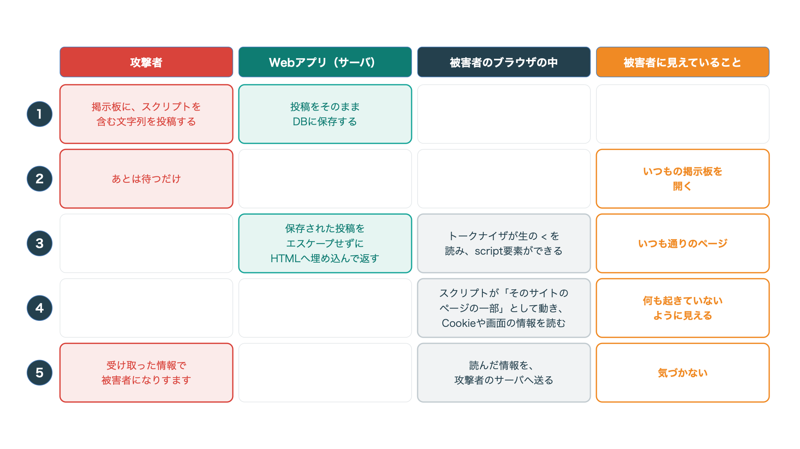
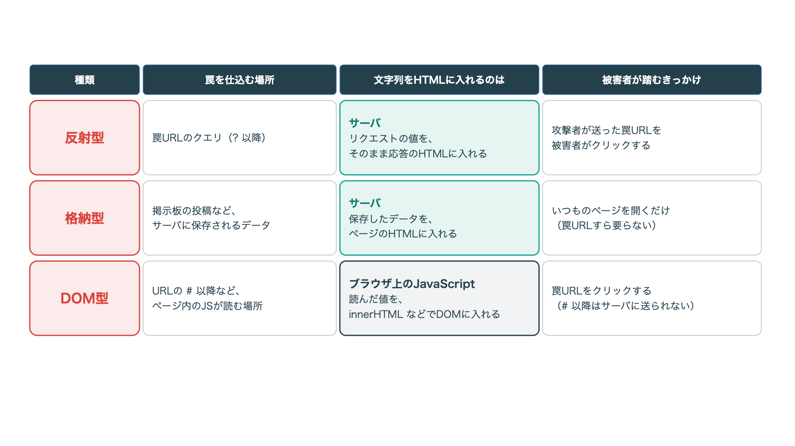
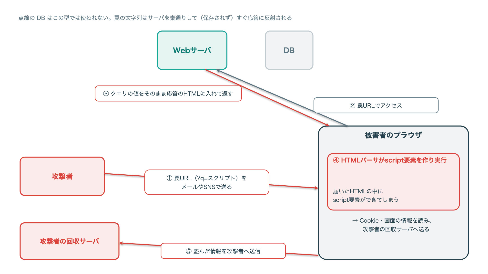
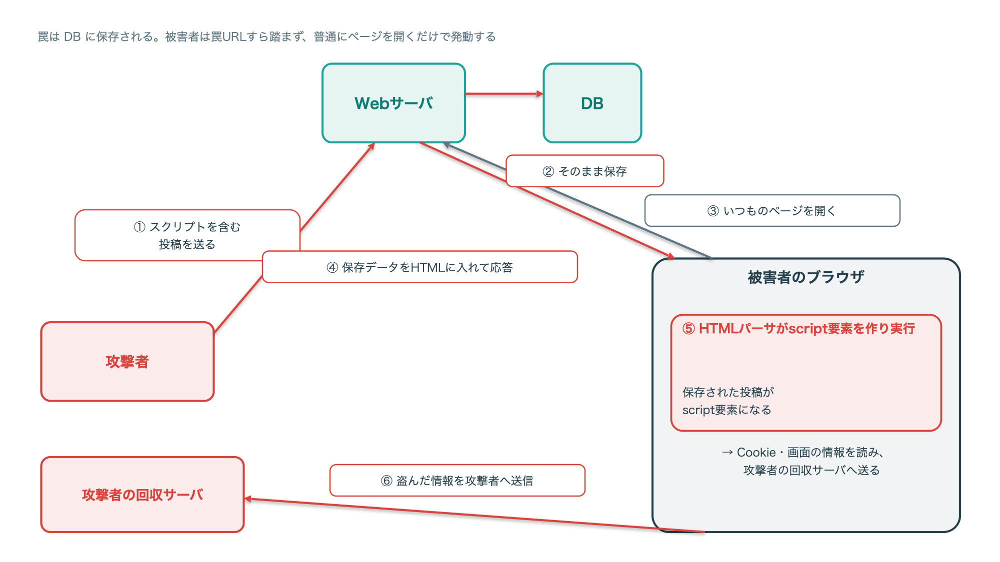
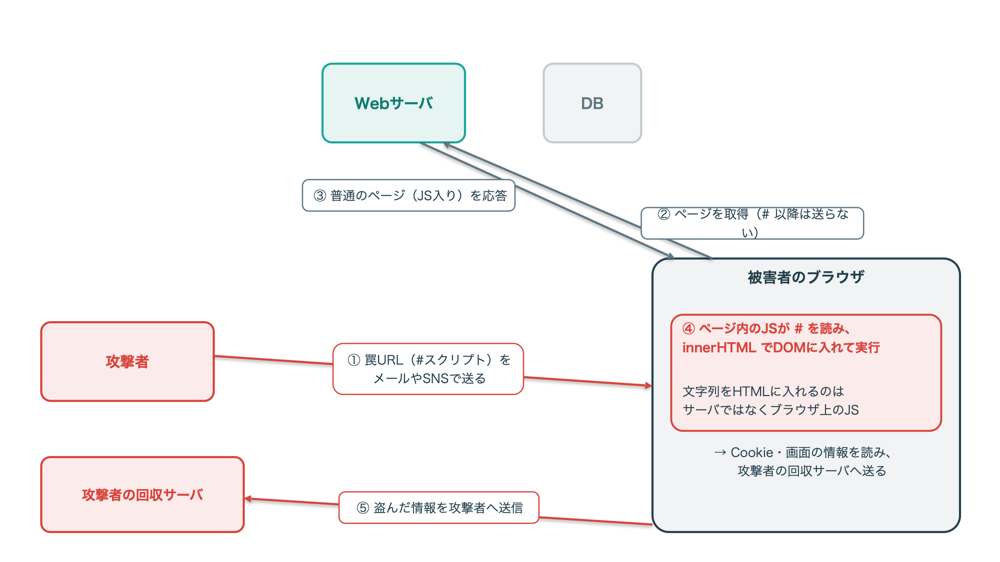
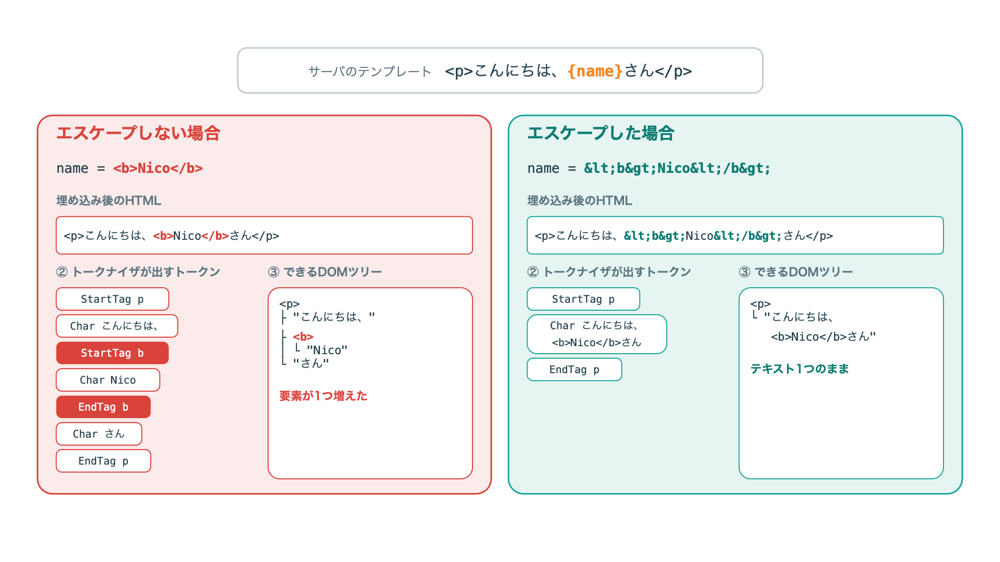
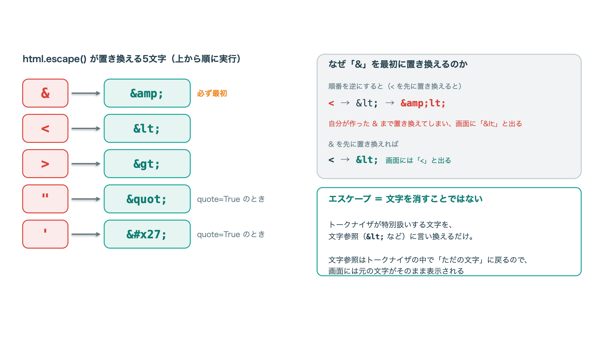
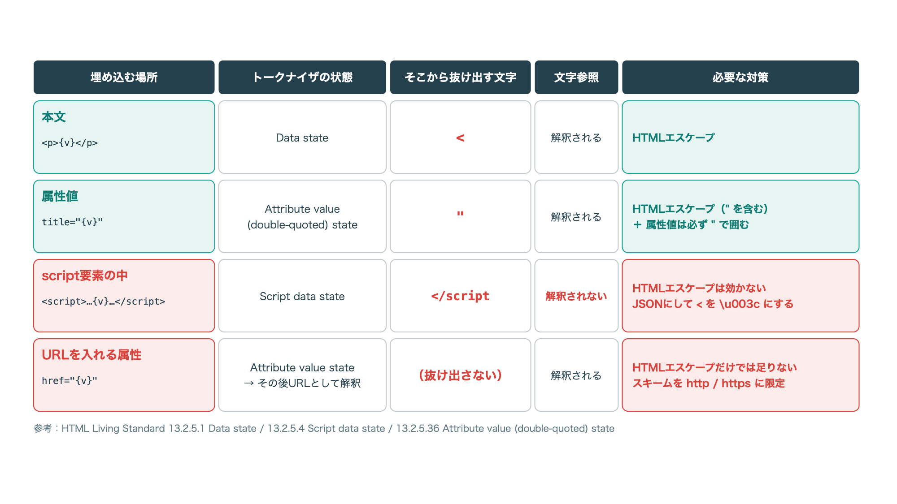

<!--
  深ぼり隊 記事テンプレート（公開前にこのコメントは削除）

  構成の考え方
  1. 「自分が知っていること」= 壁打ち前の自分の理解。教科書レベルでOK。正直に書く。
  2. 「わからないこと」= 1で書いた内容に「なぜ？」「中では？」を突っ込んで出てきた疑問。
  3. 「AIとの壁打ち」= 疑問1つにつき1ラウンド。
       問い → AIの答え（要約） → 自分で手を動かして確認 → わかったこと
     AIの答えは鵜呑みにせず、必ず「確認」で実行結果・仕様書・ソースを示す。
     AIが間違えた／曖昧だった箇所はむしろ載せる（読み物として面白くなる）。
  4. 「壁打ちで変わった理解」= 1と比べてどう変わったかを並べる。ここが記事の結論。

  書き方メモ
  - 壁打ちは実際のやりとりを全文貼らず、要点に絞って会話形式で書く
  - ラウンド数は3〜5くらいが読みやすい
  - 攻撃手法を扱うので、冒頭の注意書き（:::note warn）は必ず残す
-->

# はじめに

こんにちは、「技術を深ぼり隊」です。
このシリーズでは、攻撃や脆弱性について「自分が知っていること」から出発して、
**わからない部分をAIとの壁打ちで掘り下げ、低レイヤーで何が起きているのか** を明らかにしていきます。

今回のテーマは **クロスサイトスクリプティング（XSS）** です。
名前はよく聞くし、「対策はエスケープでしょ」くらいは知っているつもりでした。でも「じゃあブラウザの中で実際に何が起きてるの？」と聞かれると、正直あいまいにしか答えられません。そこを壁打ちで掘っていきます。

:::note warn
この記事の内容は、自分で用意したローカル環境で仕組みを理解するためのものです。
許可なく他人のシステムに試すことは、不正アクセス禁止法などの法律に触れるおそれがあります。
:::

## この記事でわかること

- XSSで悪意のあるコードが動くのは、サーバではなく被害者のブラウザの中であること
- ブラウザのHTMLパーサ（トークナイザ）が、どの瞬間に文字列を「タグ」だと判断しているか
- エスケープ処理が中で何をしているか、そして埋め込む場所によって必要な対策が変わる理由

## 検証環境

- macOS / Google Chrome 152（`DOMParser` でHTMLをパースして確認）
- ローカルのHTTPサーバ：`python3 -m http.server`（Python 3.12）

# 自分が知っていること（壁打ち前）

<!--
  ✍️ Nico が書く欄
  - 〇〇とは何か、自分の言葉で
  - どうやって攻撃されるか（知っている範囲で）
  - 対策として知っていること
  - 「たぶんこうだと思う」という推測も、推測だと明記して書いてOK
  例:
    「SQLインジェクションは、入力値に ' を混ぜてSQL文を壊す攻撃。
     対策はプリペアドステートメント。エスケープしてくれるから安全、だと思っていた。」
-->

:::note warn
ここから先の「自分が知っていること」は、壁打ち **前** のあやふやな理解です。あとで間違いだとわかる部分も、恥を忍んでそのまま残しています（どこがどう違ったかは後半で直していきます）。なので、この節の内容は鵜呑みにしないでください。
:::

XSS（クロスサイトスクリプティング）は、利用者のブラウザ上で悪意のあるJavaScriptなんかを実行させる攻撃です。

種類は3つあったはず、くらいの記憶です。

- **反射型**：URLの `?` 以降にスクリプトを仕込むやつ
- **格納型**：掲示板やフォームの入力欄にスクリプトを仕込んで、あとで実行させるやつ
- **DOM型**：サーバを介さずに実行させるやつ

攻撃のペイロードは、たしか `'<script>OR 1=1<script>'` みたいなの…だった気がします（完全にうろ覚え）。

攻撃されると、Cookieを盗まれたり、情報が漏れたりします。対策はエスケープが有効、というのは知っています。ただ、そのエスケープが中で何をやっているのかは、正直まったく把握できていません。

# わからないこと

こうして書き出してみると、「なぜ？」「中では何が起きてるの？」と突っ込まれたら答えられない部分がけっこうありました。整理するとこの3つです。

1. 攻撃はどんな手順で進むのか。攻撃者から見た流れと、被害者から見た流れを整理したい
2. 悪意のあるコードはどこで処理されて、どうやって情報が漏れるのか（ブラウザ？サーバ？）
3. エスケープ処理は、低レイヤーや内部処理のレベルで何をしているのか

# AIとの壁打ち

## ラウンド1：攻撃はどんな手順で進む？

> **自分**：XSSの攻撃がどう進むのか、攻撃者と被害者の両方の視点で整理したい。あと、悪意のあるコードがサーバに送られて、そこで処理されて情報が漏れるイメージなんだけど合ってる？

> **AI**：先に2つズレを指摘させてください。まず、`OR 1=1` はSQLインジェクションの文字列で、XSSでは意味を持ちません。XSSでブラウザに渡るのはSQLではなくHTMLやJavaScriptです。次に、XSSのコードはサーバでは実行されません。動くのは被害者のブラウザの中で、サーバは入力を「HTMLの一部として返す」だけです。

というわけで、いちばんイメージしやすい格納型を例に、時間の流れに沿ってAIに整理してもらいました。
「攻撃者」「サーバ」「被害者のブラウザの中」に加えて、**被害者本人に見えていること** も並べてもらっています。

<!-- TODO: Qiitaのエディタで画像をアップロードしてURLを差し替える -->

*図1：格納型XSSの流れ。攻撃者・Webアプリ（サーバ）・被害者のブラウザの中・被害者に見えていることを、手順ごとに並べたもの*

**攻撃者から見ると**、やることは「スクリプトを含む文字列を投稿する」と「送られてきた情報を受け取る」の2つだけです。被害者のブラウザに直接触ることはありません。手順2〜4は、サイトとブラウザが勝手に進めてくれます。投稿したらあとは放置でいい、というわけです。

**被害者から見ると**、やったことは「いつもの掲示板を開いた」だけ。画面はいつも通りだし、裏で手順3〜5が進んでいても、気づくきっかけがありません。ここがXSSのいやらしいところだと思います。

**サーバから見ると**、受け取った投稿を保存して、HTMLに埋め込んで返しただけです。サーバの中でスクリプトが動いたわけではありません。エスケープせずに埋め込んだ、というその一点だけが問題でした。

> **自分**：反射型とDOM型だと、この流れのどこが変わるの？

> **AI**：変わるのは「罠をどこに置くか」と「誰がその文字列をHTMLに入れるか」です。最後にスクリプトが被害者のブラウザの中で動く、という点はどの型でも同じです。

<!-- TODO: Qiitaのエディタで画像をアップロードしてURLを差し替える -->

*図2：反射型・格納型・DOM型の違い。罠を仕込む場所、文字列をHTMLに入れる主体、被害者が踏むきっかけを比べたもの*

次に、文字列がネットワークのどこを通ってブラウザに届くのかを、型ごとにデータフローで追ってみました。

<!-- TODO: Qiitaのエディタで画像をアップロードしてURLを差し替える -->

*図3：反射型のデータフロー。罠URLのクエリを、サーバがそのまま応答のHTMLに反射する（DBは使わない）*

<!-- TODO: Qiitaのエディタで画像をアップロードしてURLを差し替える -->

*図4：格納型のデータフロー。罠がDBに保存され、被害者は普通にページを開くだけで発動する*

<!-- TODO: Qiitaのエディタで画像をアップロードしてURLを差し替える -->

*図5：DOM型のデータフロー。文字列をHTMLに入れるのはサーバではなくブラウザ上のJavaScript。URLの `#` 以降はサーバに届かない*

3枚を並べて見ると、違うのは **罠がどこに置かれ、誰が文字列をHTMLに入れるか** だけ。最後にスクリプトが被害者のブラウザの中で動いて、Cookieなんかが攻撃者の回収サーバへ送られる、という終わり方はどの型も同じでした。

- **反射型**：罠はURLの中にあります。被害者が罠URLを開くと、サーバがURLの値をそのまま応答のHTMLに入れて返します。被害者に罠URLを踏ませる必要があるので、メールやSNSで送りつける形になります
- **格納型**：罠はサーバに保存されています。被害者はいつものページを開くだけで踏んでしまうので、罠URLすら要りません
- **DOM型**：HTMLに入れるのはサーバではなく、ページ内のJavaScriptです。罠をURLの `#` 以降に置いた場合、その部分はサーバに送られないので、サーバのログには残りません

:::note info
壁打ち前は「DOM型はサーバを介さない」と覚えていました。半分は合っていて、正確には「ページ自体はサーバから届くけど、罠の文字列をHTMLに入れる処理がブラウザ上のJavaScriptで起きる」でした。惜しい。
:::

### わかったこと

まず、壁打ち前のペイロードの記憶は、見事にSQLiと混ざっていました（お恥ずかしい）。

そして一番の勘違いは、情報が漏れる理由でした。「サーバが悪意のあるコードを処理したから」だと思い込んでいたんですが、違います。**被害者のブラウザが、サイト自身のスクリプトと区別できずに実行してしまったから** でした。

SQLiは「データのつもりの文字列が、DBのパーサで命令として解釈される」のが正体でしたよね。XSSも構図はまったく同じで、すり替わる場所が **DBのパーサからブラウザのHTMLパーサに変わっただけ** と言えそうです。じゃあそのブラウザのHTMLパーサは、どの瞬間に文字列を「タグ」や「スクリプト」として扱うと決めているのか。ここが気になってきました。

## 寄り道：ブラウザのHTMLパーサの基本

ラウンド2に進む前に、HTMLパーサの仕組みをAIにざっと説明してもらいました。
意外だったんですが、HTMLの解析手順ってブラウザごとの独自実装ではなく、仕様書（HTML Living Standard の 13.2「Parsing HTML documents」）でかなり細かく決められているんですね。

### 全体像

<!-- TODO: Qiitaのエディタで画像をアップロードしてURLを差し替える -->

*図6：ブラウザのHTMLパーサの全体像。サーバから届いたバイト列は、デコード・トークナイザ・ツリー構築を経て画面とスクリプトになる*

サーバから届くのは、ただのバイト列です。ブラウザはこれを次の順番で料理していきます。

1. **デコード**：文字コード（UTF-8など）に従って、バイト列を文字の並びにする
2. **トークナイザ（字句解析）**：文字を1つずつ読み、「開始タグ」「終了タグ」「文字」などのトークンに分ける
3. **ツリー構築**：トークンを積み上げて、DOMツリーを作る
4. **その先**：DOMツリーをもとに画面を描画する。`script` 要素ができた場合は、その中身をJavaScriptエンジンに渡して実行する

SQLiのときの「字句解析 → 構文解析 → バイトコード生成 → 実行」と、ほぼ同じ形ですよね。
そして、**どこからどこまでがタグなのかを決めているのは、2番目のトークナイザ** です。

### トークナイザは状態を切り替えながら読む

<!-- TODO: Qiitaのエディタで画像をアップロードしてURLを差し替える -->

*図7：トークナイザの状態遷移。同じ「<」でも、生の文字で来るか文字参照（`&lt;`）で来るかで、たどる状態がまったく違う*

トークナイザは「状態機械」です。今いる「状態」と「次の1文字」だけを見て、次の状態とトークンの出力を決めていきます。
仕様書には80個くらい状態が定義されているんですが、XSSを理解するだけなら次の3つを押さえれば十分です。

| 状態 | どんなときにいるか | 主な遷移 |
| --- | --- | --- |
| データ状態（Data state） | 普通の本文を読んでいるとき | `<` が来たらタグ開始状態へ、`&` が来たら文字参照状態へ。それ以外は「文字」として出力 |
| タグ開始状態（Tag open state） | `<` を読んだ直後 | 英字が来たらタグ名状態へ |
| 文字参照状態（Character reference state） | `&` を読んだ直後 | `&lt;` などを解釈して、対応する1文字を「文字」として出力し、元の状態に戻る |

ポイントは、**タグ開始状態に入れるのは、データ状態で生の `<` を読んだときだけ** という点です。
`&lt;` と書かれていた場合は文字参照状態のほうを通って、`<` という **文字** として出力されます。
このときトークナイザはすでにタグ開始状態への分岐を通り過ぎているので、あとから `<` が出てきてもタグにはなりません。ここ、あとで効いてきます。

もうひとつ。`<script>` の開始タグを読むと、ツリー構築の段階がトークナイザを専用の状態（Script data state）に切り替えます。
この状態では中身をHTMLとして解釈せず、`</script>` が来るまでの文字をまるごとJavaScriptエンジンに渡します。

## ラウンド2：パーサはどこで「タグ」だと決める？

> **自分**：パーサの仕組みはわかった。じゃあ実際に、エスケープしていない入力とエスケープした入力を本物のブラウザのパーサに通したら、結果はどう違うの？

> **AI**：ブラウザの `DOMParser` を使うと、HTML文字列をブラウザと同じパーサに通して、できたDOMツリーを確認できます。`DOMParser` はパースするだけで `script` を実行しないので、安全に試せます。サーバのテンプレートに名前を埋め込む想定で、入力だけを変えて比べてみましょう。

### 自分で確かめる

次のHTMLファイルをローカルのHTTPサーバ（`python3 -m http.server` など）で開きます。

```html:parse-check.html
<!doctype html>
<meta charset="utf-8">
<pre id="out"></pre>
<script>
// サーバ側のテンプレートに name を埋め込んだ結果を、ブラウザのHTMLパーサに通す
const render = (name) => `<p>こんにちは、${name}さん</p>`;

// DOMツリーを木の形で文字列にする
function dump(node, indent = "") {
  let s = "";
  for (const child of node.childNodes) {
    if (child.nodeType === Node.ELEMENT_NODE) {
      s += `${indent}要素 <${child.nodeName.toLowerCase()}>\n` + dump(child, indent + "  ");
    } else if (child.nodeType === Node.TEXT_NODE) {
      s += `${indent}テキスト ${JSON.stringify(child.data)}\n`;
    }
  }
  return s;
}

const inputs = [
  "Nico",
  "<b>Nico</b>",
  "&lt;b&gt;Nico&lt;/b&gt;",
  "<script>console.log('hello')<\/script>",
  "&lt;script&gt;console.log('hello')&lt;/script&gt;",
];

let out = "";
for (const name of inputs) {
  const html = render(name);
  // DOMParser はパースするだけで、script を実行しない
  const doc = new DOMParser().parseFromString(html, "text/html");
  out += `== 入力: ${name}\n埋め込み後: ${html}\n` + dump(doc.body) + "\n";
}
document.getElementById("out").textContent = out;
</script>
```

実行結果はこうなりました（Chrome 152）。

```text
== 入力: Nico
埋め込み後: <p>こんにちは、Nicoさん</p>
要素 <p>
  テキスト "こんにちは、Nicoさん"

== 入力: <b>Nico</b>
埋め込み後: <p>こんにちは、<b>Nico</b>さん</p>
要素 <p>
  テキスト "こんにちは、"
  要素 <b>
    テキスト "Nico"
  テキスト "さん"

== 入力: &lt;b&gt;Nico&lt;/b&gt;
埋め込み後: <p>こんにちは、&lt;b&gt;Nico&lt;/b&gt;さん</p>
要素 <p>
  テキスト "こんにちは、<b>Nico</b>さん"

== 入力: <script>console.log('hello')</script>
埋め込み後: <p>こんにちは、<script>console.log('hello')</script>さん</p>
要素 <p>
  テキスト "こんにちは、"
  要素 <script>
    テキスト "console.log('hello')"
  テキスト "さん"

== 入力: &lt;script&gt;console.log('hello')&lt;/script&gt;
埋め込み後: <p>こんにちは、&lt;script&gt;console.log('hello')&lt;/script&gt;さん</p>
要素 <p>
  テキスト "こんにちは、<script>console.log('hello')</script>さん"
```

<!-- TODO: Qiitaのエディタで画像をアップロードしてURLを差し替える -->

*図8：同じテンプレートに、エスケープしない入力とエスケープした入力を埋め込んだときの、トークンとDOMツリーの違い*

### わかったこと

エスケープしない入力では、`p` 要素の中に **`b` 要素や `script` 要素が新しく生まれています**。入力が変えたのは「表示される文字」ではなく、**DOMツリーの構造そのもの** でした。`script` 要素ができてしまえば、普通のページ読み込みなら、ブラウザはその中身をJavaScriptエンジンに渡して実行します。これが発火の瞬間です。

一方、エスケープした入力のほうは、見た目は同じ `<b>Nico</b>` という文字なのに、DOMツリーには **テキストが1つあるだけ**。図7で見たとおり、`&lt;` は文字参照状態を通って「`<` という文字」として出てくるので、そもそもタグ開始状態に入る道がないんですね。

並べてみると面白くて、SQLiはインジェクションで **バイトコードの命令が消えました**。XSSはインジェクションで **DOMツリーに要素が増えます**。消えると増えるで逆向きですが、どちらも「データのつもりの入力が、パーサによって構造の一部として解釈された」結果という点は同じです。

## ラウンド3：エスケープは中で何をしている？

> **自分**：エスケープが効くのはわかった。でも、エスケープ処理って中で具体的に何をしているの？それに、どこに埋め込むときも同じエスケープでいいの？

> **AI**：たとえばPythonの `html.escape()` は、5種類の文字を文字参照に置き換えているだけです。ソースを見るとわかります。ただし、それで安全になるのは「トークナイザがその文字を特別扱いする場所」に埋め込んだときだけです。埋め込む場所によってトークナイザの状態が違うので、必要な対策も変わります。

### 自分で確かめる（1）：html.escape の中身

`inspect` で標準ライブラリのソースをそのまま表示してみます。

```python:show_escape.py
import html, inspect

print(inspect.getsource(html.escape))
print(html.escape('<b class="x">Tom & Jerry\'s</b>'))
```

```text
def escape(s, quote=True):
    """
    Replace special characters "&", "<" and ">" to HTML-safe sequences.
    If the optional flag quote is true (the default), the quotation mark
    characters, both double quote (") and single quote (') characters are also
    translated.
    """
    s = s.replace("&", "&amp;") # Must be done first!
    s = s.replace("<", "&lt;")
    s = s.replace(">", "&gt;")
    if quote:
        s = s.replace('"', "&quot;")
        s = s.replace('\'', "&#x27;")
    return s

&lt;b class=&quot;x&quot;&gt;Tom &amp; Jerry&#x27;s&lt;/b&gt;
```

中身は `str.replace` を5回呼んでいるだけでした。拍子抜けするくらいシンプルで、特別な解析をしているわけではありません。

<!-- TODO: Qiitaのエディタで画像をアップロードしてURLを差し替える -->

*図9：`html.escape()` が置き換える5文字と、`&` を最初に置き換える理由*

`# Must be done first!` というコメントが地味に気になります。もし `&` を最後に置き換えると、`<` を置き換えて作った `&lt;` の `&` まで置き換えてしまって、`&amp;lt;` になります。すると画面には `<` ではなく `&lt;` という文字列がそのまま表示されてしまう（二重エスケープ）。だから `&` が最初なんですね。

### 自分で確かめる（2）：埋め込む場所を変えてみる

ラウンド2と同じく `DOMParser` を使って、今度は「属性値の中」と「script要素の中」に埋め込んで比べてみます。
`escapeHtml` は `html.escape()` と同じ順番で置き換えるようにしています。

```html:context-check.html
<!doctype html>
<meta charset="utf-8">
<pre id="out"></pre>
<script>
// Python の html.escape と同じ順番で置き換える
const escapeHtml = (s) => s
  .replaceAll("&", "&amp;")
  .replaceAll("<", "&lt;")
  .replaceAll(">", "&gt;")
  .replaceAll('"', "&quot;")
  .replaceAll("'", "&#x27;");

// script 要素の中に値を埋め込むときの方法：JSONにして「<」を \u003c にする
const toScriptLiteral = (s) => JSON.stringify(s).replaceAll("<", "\\u003c");

// DOMツリーを、属性と script の中身も含めて文字列にする
function dump(node, indent = "") {
  let s = "";
  for (const child of node.childNodes) {
    if (child.nodeType === Node.ELEMENT_NODE) {
      const attrs = [...child.attributes].map(a => ` ${a.name}=${JSON.stringify(a.value)}`).join("");
      s += `${indent}要素 <${child.nodeName.toLowerCase()}${attrs}>\n` + dump(child, indent + "  ");
    } else if (child.nodeType === Node.TEXT_NODE) {
      s += `${indent}テキスト ${JSON.stringify(child.data)}\n`;
    }
  }
  return s;
}

const parse = (html) => new DOMParser().parseFromString(html, "text/html");

const cases = [
  // 1. 属性値の中
  ["属性値・そのまま", `<p title="${'Nico" data-x="1'}">こんにちは</p>`],
  ["属性値・エスケープ", `<p title="${escapeHtml('Nico" data-x="1')}">こんにちは</p>`],
  // 2. script 要素の中
  ["script・そのまま", `<script>const name = "${'Nico<\/script><b>Nico</b>'}";<\/script><p>おわり</p>`],
  ["script・HTMLエスケープ", `<script>const name = "${escapeHtml('Nico<\/script><b>Nico</b>')}";<\/script><p>おわり</p>`],
  ["script・JSON+\\u003c", `<script>const name = ${toScriptLiteral('Nico<\/script><b>Nico</b>')};<\/script><p>おわり</p>`],
];

let out = "";
for (const [label, html] of cases) {
  out += `== ${label}\n埋め込み後: ${html}\n` + dump(parse(html).documentElement) + "\n";
}
document.getElementById("out").textContent = out;
</script>
```

実行結果です（Chrome 152）。

```text
== 属性値・そのまま
埋め込み後: <p title="Nico" data-x="1">こんにちは</p>
要素 <head>
要素 <body>
  要素 <p title="Nico" data-x="1">
    テキスト "こんにちは"

== 属性値・エスケープ
埋め込み後: <p title="Nico&quot; data-x=&quot;1">こんにちは</p>
要素 <head>
要素 <body>
  要素 <p title="Nico\" data-x=\"1">
    テキスト "こんにちは"

== script・そのまま
埋め込み後: <script>const name = "Nico</script><b>Nico</b>";</script><p>おわり</p>
要素 <head>
  要素 <script>
    テキスト "const name = \"Nico"
要素 <body>
  要素 <b>
    テキスト "Nico"
  テキスト "\";"
  要素 <p>
    テキスト "おわり"

== script・HTMLエスケープ
埋め込み後: <script>const name = "Nico&lt;/script&gt;&lt;b&gt;Nico&lt;/b&gt;";</script><p>おわり</p>
要素 <head>
  要素 <script>
    テキスト "const name = \"Nico&lt;/script&gt;&lt;b&gt;Nico&lt;/b&gt;\";"
要素 <body>
  要素 <p>
    テキスト "おわり"

== script・JSON+\u003c
埋め込み後: <script>const name = "Nico\u003c/script>\u003cb>Nico\u003c/b>";</script><p>おわり</p>
要素 <head>
  要素 <script>
    テキスト "const name = \"Nico\\u003c/script>\\u003cb>Nico\\u003c/b>\";"
要素 <body>
  要素 <p>
    テキスト "おわり"
```

:::note info
この確認用ページ、最初に作ったときにJavaScriptの文字列の中へ `</script>` をそのまま書いてしまって、**確認用ページ自体の script 要素がそこで閉じて壊れました**。
script要素の中では、JavaScriptの文字列の途中かどうかなんて関係なく `</script` でHTMLのトークナイザが抜け出す、というのを身をもって体験した瞬間です。上のコードでは `<\/script>` と書いて避けています（JavaScriptとしては同じ文字列です）。
:::

<!-- TODO: Qiitaのエディタで画像をアップロードしてURLを差し替える -->

*図10：埋め込む場所ごとの、トークナイザの状態・そこから抜け出す文字・必要な対策*

### わかったこと

**属性値の中** では、トークナイザは「Attribute value (double-quoted) state」にいて、`"` が来ると属性値が終わります。だからエスケープしないと `"` で属性値が閉じて、入力から `data-x` という属性が **新しく生まれて** しまいました。`&quot;` にエスケープしておけば、`"` はただの文字として属性値の中に収まります。ちなみに属性値を `"` で囲まずに書くと、今度は空白で属性値が終わってしまうので、囲むのが前提です。

**script要素の中** は、ちょっと話が違いました。ここではトークナイザは「Script data state」にいて、仕様上そもそも **文字参照を解釈しません**。

- そのまま埋め込むと、JavaScriptの文字列の途中でも `</script` でscript要素が閉じて、後ろの `<b>` が要素になってしまう
- HTMLエスケープすると、構造は壊れないんですが、`&lt;` が **デコードされずにそのままJavaScriptに渡ります**。つまりJavaScriptから見た値が変わってしまって、対策としては正しくない
- JSONにして `<` を `\u003c` に置き換えると、`</script` という並びが消えるので構造は壊れません。`\u003c` はJavaScriptの文字列としては `<` に戻るので、値も元のまま

最後に **URLを入れる属性**（`href` など）です。これは確認コードには入れていないんですが、AIに聞いたところ、HTMLエスケープしても `javascript:` で始まるURLみたいな「スキームそのものが危ないURL」は防げない、とのことでした。HTMLとしては正しい属性値なので、トークナイザの段階では何も起きません。リンクを開いたあと、ブラウザがURLとして解釈した段階で問題になる、というわけです。なので、URLを入れる場所では `http:` / `https:` など、許可するスキームを決めておく必要があります。

というわけで、エスケープは「危ない文字を消す魔法」ではありませんでした。**埋め込む場所でトークナイザがどの状態にいて、何の文字でそこから抜け出すのか** に合わせて、その文字だけを言い換えてあげる処理だったんですね。

# 壁打ちで変わった理解

| 壁打ち前 | 壁打ち後 |
| --- | --- |
| XSSのペイロードは `'<script>OR 1=1<script>'` みたいな感じ | `OR 1=1` はSQLiの文字列だった。XSSでブラウザに届くのはHTMLやJavaScript |
| 悪意のあるコードがサーバに送られて、そこで処理されて情報が漏れる | サーバは文字列をHTMLに埋め込んで返すだけ。コードが動くのは被害者のブラウザの中 |
| エスケープ処理が有効（中身はよくわからない） | 中身は `str.replace` 5回。トークナイザが特別扱いする文字を文字参照に言い換えて、タグ開始状態に入る道をふさいでいる |
| エスケープすればどこでも安全 | 埋め込む場所でトークナイザの状態が違う。script要素の中ではHTMLエスケープは効かず、URLではスキームの確認が要る |

# まとめ

- XSSのコードは被害者のブラウザの中で動く。サーバは文字列を埋め込んで返すだけ
- ブラウザのHTMLパーサでは、トークナイザが生の `<` を読んだ瞬間に「タグ」が始まる。入力がDOMツリーに要素を増やすのがXSSの正体
- エスケープは、特別扱いされる文字を文字参照に言い換えて、トークナイザの状態遷移を変えない処理
- 埋め込む場所（本文・属性値・script要素の中・URL）ごとに、抜け出す文字も必要な対策も違う

こうして見ると、SQLiは「DBのパーサ」、XSSは「ブラウザのHTMLパーサ」で、どちらもデータが構造にすり替わっていました。パーサが変わると攻撃の顔つきも変わるんだな、というのが今回いちばんの収穫です。次回も、別の脆弱性で「どのパーサで何がすり替わっているのか」を深ぼっていく予定です。

# 参考

- [HTML Living Standard 13.2 Parsing HTML documents](https://html.spec.whatwg.org/multipage/parsing.html)
  - 13.2.5.1 Data state / 13.2.5.4 Script data state / 13.2.5.6 Tag open state / 13.2.5.36 Attribute value (double-quoted) state / 13.2.5.77 Character reference state
- [MDN: DOMParser](https://developer.mozilla.org/ja/docs/Web/API/DOMParser)
- [Python ドキュメント: html.escape](https://docs.python.org/ja/3/library/html.html#html.escape)
- [OWASP Cross Site Scripting Prevention Cheat Sheet](https://cheatsheetseries.owasp.org/cheatsheets/Cross_Site_Scripting_Prevention_Cheat_Sheet.html)
- [IPA 安全なウェブサイトの作り方](https://www.ipa.go.jp/security/vuln/websecurity/about.html)
