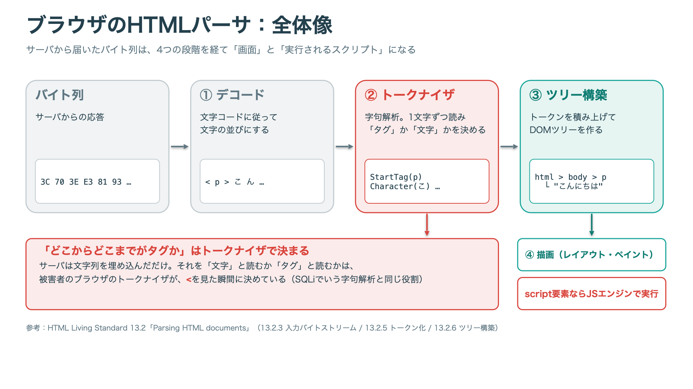
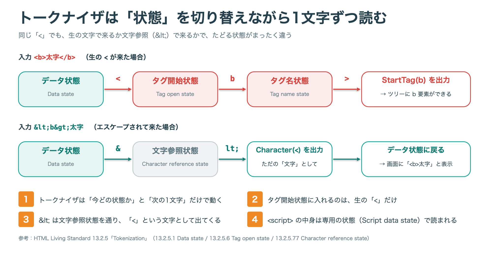

<!--
  深ぼり隊 記事テンプレート（公開前にこのコメントは削除）

  構成の考え方
  1. 「自分が知っていること」= 壁打ち前の自分の理解。教科書レベルでOK。正直に書く。
  2. 「わからないこと」= 1で書いた内容に「なぜ？」「中では？」を突っ込んで出てきた疑問。
  3. 「AIとの壁打ち」= 疑問1つにつき1ラウンド。
       問い → AIの答え（要約） → 自分で手を動かして確認 → わかったこと
     AIの答えは鵜呑みにせず、必ず「確認」で実行結果・仕様書・ソースを示す。
     AIが間違えた／曖昧だった箇所はむしろ載せる（読み物として面白くなる）。
  4. 「壁打ちで変わった理解」= 1と比べてどう変わったかを並べる。ここが記事の結論。

  書き方メモ
  - 壁打ちは実際のやりとりを全文貼らず、要点に絞って会話形式で書く
  - ラウンド数は3〜5くらいが読みやすい
  - 攻撃手法を扱うので、冒頭の注意書き（:::note warn）は必ず残す
-->

# はじめに

こんにちは、「技術を深ぼり隊」です。
このシリーズでは、攻撃や脆弱性について「自分が知っていること」から出発して、
**わからない部分をAIとの壁打ちで掘り下げ、低レイヤーで何が起きているのか** を明らかにしていきます。

今回のテーマは **クロスサイトスクリプティング（XSS）** です。

:::note warn
この記事の内容は、自分で用意したローカル環境で仕組みを理解するためのものです。
許可なく他人のシステムに試すことは、不正アクセス禁止法などの法律に触れるおそれがあります。
:::

## この記事でわかること

- （例）〇〇が起きたときに、内部のどの処理で何が変わっているか
- （例）よく言われる対策「△△」が効く本当の理由

## 検証環境

- （例）Python 3.x / SQLite 3.x / macOS

# 自分が知っていること（壁打ち前）

<!--
  ✍️ Nico が書く欄
  - 〇〇とは何か、自分の言葉で
  - どうやって攻撃されるか（知っている範囲で）
  - 対策として知っていること
  - 「たぶんこうだと思う」という推測も、推測だと明記して書いてOK
  例:
    「SQLインジェクションは、入力値に ' を混ぜてSQL文を壊す攻撃。
     対策はプリペアドステートメント。エスケープしてくれるから安全、だと思っていた。」
-->

XSS（クロスサイトスクリプティング）は、利用者のブラウザ上で悪意のあるJavaScriptなどを実行させる攻撃です。

種類は3つあると記憶しています。

- **反射型**：URLの `?` 以降にスクリプトを仕込む
- **格納型**：掲示板やフォームの入力欄にスクリプトを仕込んで、あとで実行させる
- **DOM型**：サーバを介さずに実行させる

攻撃のペイロードは、たしか `'` が来るまでの文字をまとめてJavaScriptエンジンに渡します。

## ラウンド2：（疑問2を短く）

> **自分**：

> **AI**：

### 自分で確かめる

### わかったこと

## ラウンド3：（疑問3を短く）

> **自分**：

> **AI**：

### 自分で確かめる

### わかったこと

# 壁打ちで変わった理解

| 壁打ち前 | 壁打ち後 |
| --- | --- |
| （例）〇〇だと思っていた | （例）実際は△△だった |
|  |  |

# まとめ

- （ラウンドごとの「わかったこと」を1行ずつ）

次回は（次のテーマ）を深ぼりする予定です。

# 参考

- （公式ドキュメント・仕様書・ソースコードなど、確認に使った一次情報）
