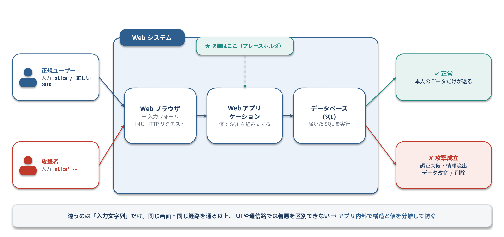
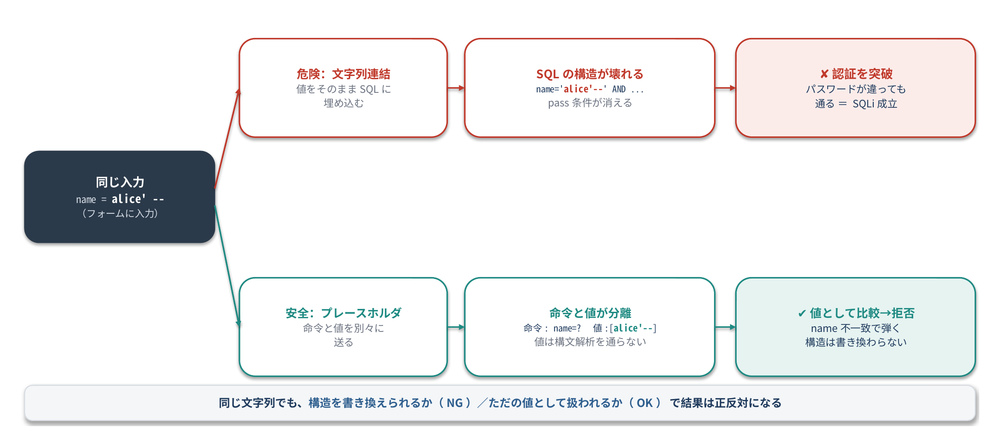
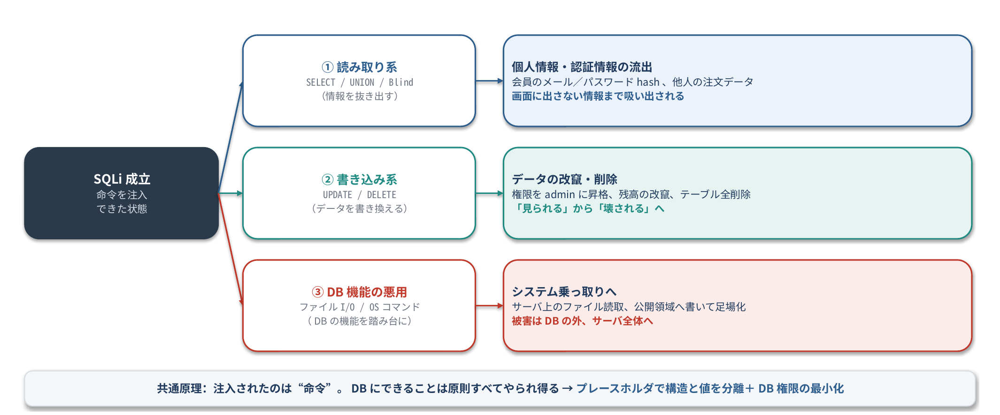

<!--
  下書きメモ（公開前に削除）
  - 深ぼり隊テンプレート（deep-dive/templates/fukabori-tai_template.md）の構成に組み直した版
  - 「AI」の発言は、元の下書きの解説を会話形式に要約したもの。実際の壁打ちログがあれば差し替える
  - コードと EXPLAIN の出力は Python 3 + SQLite 3.45.1 で実行確認済み
    （SQLiteのバージョンが違うとバイトコードの番号や並びが変わる可能性あり）
  - TODO: PostgreSQL の Parse/Bind/Execute を Wireshark でキャプチャした図を入れると「深ぼり感」が増す
  - 続編案: XSS編「ブラウザのパーサはどこでスクリプトを実行すると判断するのか」
-->

# はじめに

こんにちは、「技術を深ぼり隊」です。
このシリーズでは、攻撃や脆弱性について **わからない部分をAIとの壁打ちで掘り下げて、低レイヤーで何が起きているのか** を明らかにしていきます。

今回のテーマは **SQLインジェクション（SQLi）** です。
プリペアドステートメントを使っておけば安全、とよく言われます。でも「DBの中で実際なにが起きているのか」は、正直あまり知りませんでした。気になったので深ぼってみます。
具体的には、SQLiteの仮想マシンが実行する「バイトコード」を覗いて、SQLiが起きたときにDBの中で何が変わっているのかを確かめます。

:::note warn
この記事の内容は、自分で用意したローカル環境で仕組みを理解するためのものです。
許可なく他人のシステムに試すことは、不正アクセス禁止法などの法律に触れるおそれがあります。
:::

## この記事でわかること

- SQL文がDBの中でどう処理されるか（字句解析 → 構文解析 → バイトコード生成 → 実行）
- SQLiが「データ」を「命令」に変えてしまう瞬間を、バイトコードの差分で確認する方法
- プリペアドステートメントが安全な本当の理由と、それでも残る落とし穴
- ユーザー・攻撃者・ブラウザ・Webアプリ・DBの関係（アーキテクチャ構成）
- 入力フォームの文字列がSQLになるまで、どの層を通るのか（データフロー）
- 発火したSQLが情報流出・改竄・削除・システム乗っ取りにどう広がるのか

## 検証環境

- Python 3 標準の `sqlite3`（SQLite 3.45.1）。追加インストールは不要です

# 登場人物と全体像の関係

細かい処理に入る前に、まず全体の登場人物と関係を整理します。SQLiで最初に押さえておきたいのは、**正規ユーザーも攻撃者も、まったく同じ画面・同じ経路を通る**という点です。



- 正規ユーザーも攻撃者も、ブラウザの同じ入力フォームから、同じ形のHTTPリクエストでWebアプリに届きます
- Webアプリは受け取った値でSQLを組み立て、データベースは届いたSQLをそのまま実行します。DBは「送ってきたのが悪意のある相手かどうか」を判断しません
- 違うのは **入力した文字列だけ** です。だから「怪しいアクセスを入口で弾く」発想だけでは防ぎきれず、アプリの内部（SQLの組み立て方）で守る必要があります

この「同じ経路を通る／違うのは入力だけ」という構図を押さえた上で、次の章からは、その入力がアプリとDBの内部でどう扱われるのかを層ごとに見ていきます。

# 全体像：フォームに入れた文字列はどこを通るのか

バイトコードを覗く前に、そもそも入力フォームの文字列がSQLになるまで、どこをどう通っているのかを整理しておきます。SQLiは「この経路のどこで、データが命令に変わるか」の話だからです。



普通のWebアプリだと、入力はだいたいこの順で流れます。

1. **ブラウザ**：フォームに入力した文字列が、HTTPリクエストのパラメータ（POSTボディやクエリ文字列）として送られる
2. **Webアプリ**：リクエストから値を取り出す。この時点では、入力はまだ「ただの文字列」
3. **SQLの組み立て**：取り出した値を使ってSQL文を作る。**ここが分岐点**
4. **DBドライバ／プロトコル**：できたSQLをDBへ送る
5. **DB**：受け取ったSQLを字句解析 → 構文解析 → コード生成 → 実行する

危ないのは手順3です。値を文字列連結でSQLにはめ込むと、入力に混ざった `'` や `--` が、手順5の字句解析・構文解析で「命令の一部」として読まれてしまいます。入力した文字列が、データの欄をはみ出して命令の側に入り込む、というイメージです。

プレースホルダを使うと、手順3でSQLに値を埋め込みません。SQL文（命令）と値を別々にDBへ渡し、DB側で「ここは値」と分かった状態で受け取ります。だから値がどれだけ変な文字を含んでいても、構文解析に影響しません。この「別々に渡す」が具体的にDBの中でどう効くのかを、次からバイトコードで確かめていきます。

# まず、やられる様子を見てみる

SQLiは、入力欄に `'` などを混ぜてSQL文を壊し、想定外のSQLを実行させる攻撃です。
たとえばログイン処理を文字列連結で書いていると、こうなります。

```python:demo.py
import sqlite3

conn = sqlite3.connect(":memory:")
conn.executescript("""
CREATE TABLE users(id INTEGER PRIMARY KEY, name TEXT, password TEXT);
INSERT INTO users(name, password) VALUES ('alice', 'alice-pass'), ('bob', 'bob-pass');
""")

def login_vulnerable(name, password):
    # 文字列連結でSQLを組み立てている（ダメな例）
    sql = f"SELECT id, name FROM users WHERE name = '{name}' AND password = '{password}'"
    print("実行されるSQL:", sql)
    return conn.execute(sql).fetchall()

def login_safe(name, password):
    # プレースホルダを使う（良い例）
    sql = "SELECT id, name FROM users WHERE name = ? AND password = ?"
    return conn.execute(sql, (name, password)).fetchall()

print(login_vulnerable("alice", "wrong"))
print(login_vulnerable("alice' --", "wrong"))
print(login_safe("alice' --", "wrong"))
```

実行結果です。

```text
実行されるSQL: SELECT id, name FROM users WHERE name = 'alice' AND password = 'wrong'
[]
実行されるSQL: SELECT id, name FROM users WHERE name = 'alice' --' AND password = 'wrong'
[(1, 'alice')]
[]
```

ユーザー名に `alice' --` と入れるだけで、パスワードが違うのにログインできてしまいます。
`'` で文字列リテラルが閉じられ、`--` 以降がコメントになって、パスワードのチェックが消えたためです。

対策はプリペアドステートメント（プレースホルダ）を使うこと。よく **「危ない文字をエスケープしてくれるから安全」** と説明されます。ただ、これは壁打ちしてみると少し違っていました（後半で確かめます）。

# わからないこと

ここまでは有名な話です。でも「なぜ？」と聞かれると答えられない点がありました。

1. DBはSQLの文字列を受け取ってから、中で何をしているのか
2. インジェクションされたとき、DBの中では具体的に何が変わっているのか
3. プレースホルダを使うと、なぜ同じ入力でも安全になるのか。本当に「エスケープ」なのか
4. SQLite以外のDBでも同じ仕組みなのか
5. プリペアドステートメントを使っていれば、もう安心なのか

# AIとの壁打ち

## ラウンド1：DBはSQL文字列をどう処理している？

> **自分**：アプリがDBにSQLを送ったあと、DBの中ではどういう順番で処理されるの？

> **AI**：SQLはDBにとってただの文字列です。まず字句解析で単語（トークン）に分け、構文解析で「何をする命令か」の構造を作り、そこから実行用のコードを生成して実行します。SQLiteの場合は、VDBEという仮想マシン用のバイトコードが作られます。

```text
SQL文字列
  ↓ 字句解析（トークナイザ）  … 'alice' は文字列リテラル、AND はキーワード、と単語に分ける
  ↓ 構文解析（パーサ）        … 単語の並びから「何をする命令か」の構造を作る
  ↓ 実行計画・コード生成      … SQLiteの場合は仮想マシン（VDBE）用のバイトコードを作る
  ↓ 実行
結果
```

### わかったこと

**「どこまでが命令で、どこからがデータか」は字句解析と構文解析の段階で決まる。**
SQLiとは、データとして渡したつもりの文字列が、この段階で命令の一部として解釈されてしまう問題だと言えそうです。
では、実際に「命令の一部として解釈された」結果を見ることはできるのか。

## ラウンド2：インジェクションでDBの中の何が変わる？

> **自分**：`alice' --` を入れたとき、DBの中で何が変わっているのか実際に見る方法はある？

> **AI**：SQLiteでは、SQLの先頭に `EXPLAIN` を付けると、実行される仮想マシンのバイトコードを表示できます。正常な入力とインジェクションされた入力で比べてみると違いがわかります。

### 自分で確かめる

```python:explain.py
import sqlite3

conn = sqlite3.connect(":memory:")
conn.execute("CREATE TABLE users(id INTEGER PRIMARY KEY, name TEXT, password TEXT)")

def show(sql, params=()):
    print("==", sql)
    for addr, opcode, p1, p2, p3, p4, p5, comment in conn.execute("EXPLAIN " + sql, params):
        print(f"{addr:>3} {opcode:<12} {p1!s:>3} {p2!s:>3} {p3!s:>3} {p4!s}")

show("SELECT id, name FROM users WHERE name = 'alice' AND password = 'wrong'")
show("SELECT id, name FROM users WHERE name = 'alice' --' AND password = 'wrong'")
show("SELECT id, name FROM users WHERE name = ? AND password = ?", ("alice' --", "wrong"))
```

正常な入力のとき：

```text
  0 Init           0  12   0 None
  1 OpenRead       0   2   0 3
  2 Rewind         0  11   0 None
  3 Column         0   1   1 None      ← name列を読む
  4 Ne             2  10   1 BINARY-8  ← 'alice' と違えばスキップ
  5 Column         0   2   1 None      ← password列を読む
  6 Ne             3  10   1 BINARY-8  ← 'wrong' と違えばスキップ
  7 Rowid          0   4   0 None
  8 Column         0   1   5 None
  9 ResultRow      4   2   0 None      ← 両方一致した行だけ返す
 10 Next           0   3   0 None
 11 Halt           0   0   0 None
 12 Transaction    0   0   1 0
 13 String8        0   2   0 alice
 14 String8        0   3   0 wrong
 15 Goto           0   1   0 None
```

比較命令 `Ne`（Not Equal）が **2つ** あります。name と password の両方をチェックしています。

インジェクションされたとき：

```text
  0 Init           0  10   0 None
  1 OpenRead       0   2   0 2
  2 Rewind         0   9   0 None
  3 Column         0   1   1 None      ← name列を読む
  4 Ne             2   8   1 BINARY-8  ← 'alice' と違えばスキップ
  5 Rowid          0   3   0 None
  6 Column         0   1   4 None
  7 ResultRow      3   2   0 None      ← name だけ一致すれば返してしまう
  8 Next           0   3   0 None
  9 Halt           0   0   0 None
 10 Transaction    0   0   1 0
 11 String8        0   2   0 alice
 12 Goto           0   1   0 None
```

### わかったこと

**password をチェックする命令が丸ごと消えています。**
入力値が変えたのは「比較する値」ではなく、**DBが実行するプログラムそのもの** でした。
これがSQLiの正体です。データを渡したつもりが、命令を書き換えてしまっています。

## ラウンド3：プレースホルダはなぜ安全？エスケープしてるの？

> **自分**：プレースホルダを使うと安全なのは、`'` をエスケープしてくれるからだよね？

> **AI**：そうとは限りません。SQLiteのプレースホルダは、SQL文を先にバイトコードへ変換し、値はその後に「変数」として渡します。値はパーサを通らないので、エスケープする必要自体がありません。同じ `EXPLAIN` で確認できます。

### 自分で確かめる

`explain.py` の3つ目、`?` を使ったときの出力です。

```text
  0 Init           0  12   0 None
  1 OpenRead       0   2   0 3
  2 Rewind         0  11   0 None
  3 Column         0   1   1 None
  4 Ne             2  10   1 BINARY-8
  5 Column         0   2   1 None
  6 Ne             3  10   1 BINARY-8  ← password のチェックが残っている
  7 Rowid          0   4   0 None
  8 Column         0   1   5 None
  9 ResultRow      4   2   0 None
 10 Next           0   3   0 None
 11 Halt           0   0   0 None
 12 Transaction    0   0   1 0
 13 Variable       1   2   0 None      ← 1番目の値を「変数」としてレジスタに入れる
 14 Variable       2   3   0 None      ← 2番目の値も同様
 15 Goto           0   1   0 None
```

### わかったこと

命令の構造は正常なときとまったく同じです。違いは最後の `String8`（SQL文に埋め込まれた文字列）が `Variable`（あとから渡される値）に変わっている点だけです。

`alice' --` という値は、**バイトコードが完成した後に** レジスタへ入る単なるデータです。
そのため、中に `'` や `--` が含まれていても、命令の構造に影響を与えようがありません。

よく言われる「エスケープしてくれるから安全」という説明は、少なくともSQLiteでは正確ではありませんでした。

## ラウンド4：SQLite以外のDBでも同じ？

> **自分**：SQLite以外、たとえばPostgreSQLやMySQLでも同じ仕組み？

> **AI**：考え方は同じです。どちらもSQL文と値を別々のメッセージとしてサーバに送るプロトコルを持っています。

| DB | 命令を送る | 値を送る |
| --- | --- | --- |
| PostgreSQL | 拡張クエリプロトコルの `Parse` メッセージ | `Bind` メッセージ（その後 `Execute`） |
| MySQL | `COM_STMT_PREPARE` | `COM_STMT_EXECUTE` |

### わかったこと

SQL文と値が **別々のメッセージ** としてDBに届くので、値がパーサを通ることはありません。
<!-- TODO: PostgreSQL の通信を Wireshark でキャプチャして、Parse と Bind が別パケットになっていることを自分で確かめる -->

## ラウンド5：プリペアドステートメントなら完璧？

> **自分**：じゃあ、プリペアドステートメントを使っていればもう安心？

> **AI**：落とし穴が2つあります。ひとつは、見た目はプリペアドステートメントでも、内部ではクライアント側でエスケープして1本のSQLに組み立てる「エミュレート」があること。もうひとつは、プレースホルダで渡せるのは値だけで、テーブル名や列名などは渡せないことです。

### 1. 「エミュレート」されたプリペアドステートメント

ライブラリによっては、内部でエスケープして1本のSQL文字列に組み立ててから送るものがあります（例：PHPのPDOの `PDO::ATTR_EMULATE_PREPARES`）。
この場合、安全性はエスケープ処理の正しさに依存します。過去には、文字コードの扱いの違いを突いてエスケープをすり抜ける問題も知られています。
使っているライブラリが「本当にサーバ側でprepareしているか」を確認しておくと安心です。

### 2. プレースホルダにできない場所

```python
# これはできない（列名はプレースホルダにできない）
conn.execute("SELECT * FROM users ORDER BY ?", (sort_key,))
```

こうした部分をユーザー入力で切り替えたい場合は、許可する値を決めておく（許可リスト）のが基本です。

```python
ALLOWED_SORT_KEYS = {"id", "name"}
if sort_key not in ALLOWED_SORT_KEYS:
    raise ValueError("invalid sort key")
conn.execute(f"SELECT * FROM users ORDER BY {sort_key}")
```

### わかったこと

ラウンド3でわかった「値は後から渡される」という仕組みが効くのは、**値** の部分だけです。
仕組みが崩れる場所（エミュレート、識別子）では、別の対策が必要になります。

# 発火したSQLは何をするのか（被害の具体像）

ここまでで「入力が命令に変わる」仕組みはわかりました。では、命令に変わると実際どこまでやられるのか。「ログインを突破できる」で止まらないのが怖いところです。被害は大きく3系統に分かれます。



:::note warn
以下は、自分のローカル環境で仕組みと被害範囲を理解するための説明です。具体的な攻撃文字列の組み立て方そのものは載せません。他人のシステムで試すことは法律に触れます。
:::

## 1. 読み取り系：個人情報・認証情報の流出

一番イメージしやすいのが、本来返らないはずのデータを引っ張り出される被害です。

攻撃者がSQLの構造に割り込めると、元のSELECTに別のSELECTをつなげて、別テーブルの中身まで結果に混ぜ込めます（UNIONを使う手口が代表的です）。会員テーブルのメールアドレスやパスワードのハッシュ、他人の注文履歴など、画面に出すつもりのなかったデータが一覧で取れてしまいます。

さらに、エラーメッセージや「結果が返るか返らないか」の反応差だけを手がかりに、1文字ずつ中身を推測して抜き出す手口（ブラインドSQLi）もあります。画面に何も表示されなくても、時間をかければデータは漏れます。

## 2. 書き込み系：データの改竄・削除

SELECTだけとは限りません。割り込んだ命令がUPDATEやDELETEなら、被害は「見られる」から「書き換えられる・消される」に変わります。

- 自分の権限を管理者に書き換える（`UPDATE users SET role='admin'`）
- 残高や在庫の数値を書き換える
- テーブルごとデータを消す

DBドライバの設定によっては、1回の送信で複数のSQLを続けて実行できてしまう（スタッククエリ）場合があり、そうなると「読む」と「書く」を一度にやられることもあります。

## 3. DB機能の悪用：システム乗っ取りへ

DBは単なる表の保管庫ではなく、ファイルの読み書きやOSコマンド実行といった強力な機能を持っていることがあります。SQLiの入り口から、これらの機能に手が届いてしまうケースがあります。

- 設定ファイルやパスワードファイルなど、サーバ上のファイルを読む
- Webで公開されるディレクトリにファイルを書き込み、そこから遠隔操作の足場を作る
- DBが持つ拡張機能からOSコマンドを実行する

ここまで来ると、被害はDBの中だけに収まりません。DBサーバ、そしてその先のシステム全体の乗っ取りにつながります。「たかが入力フォーム1個」が、最終的にサーバごと持っていかれる入り口になり得る、というのがSQLiの本当の怖さです。

## なぜ1か所の綻びがここまで広がるのか

共通しているのは、**攻撃者が送り込んでいるのは「データ」ではなく「命令」** だという点です。ラウンド2でバイトコードを見たとおり、入力はDBが実行するプログラムそのものを書き換えています。プログラムを書き換えられるなら、そのDB（やDBユーザー）にできることは原則なんでもやられる、と考えるのが安全側です。

だからこそ対策は、個々の危ない文字をつぶすより、**そもそも値を命令として解釈させない**（プレースホルダで構造と値を分離する）のが本筋になります。あわせて、DBユーザーの権限を必要最小限にしておく、ファイル読み書きやコマンド実行の機能を切っておく、といった「万一入られても被害を広げない」備えも効いてきます。

# 壁打ちでわかった、ありがちな勘違い

掘ってみて「あ、そこ勘違いしてたな」と思ったポイントを、実際のところと並べておきます。

| ありがちな勘違い | 実際はこう |
| --- | --- |
| SQLiは入力でSQL文を「壊す」攻撃 | 入力で、DBが実行する **プログラム（バイトコード）そのもの** が書き換わる攻撃 |
| プリペアドステートメントはエスケープしてくれるから安全 | 命令の構造を先に確定させ、値は後からデータとして渡すから安全。エスケープはしていない |
| プリペアドステートメントを使えば安心 | エミュレートされたprepareや、プレースホルダにできない識別子には別の対策が要る |

# まとめ

- SQLiは「値」が字句解析・構文解析を通ることで、**DBが実行するプログラムそのものが書き換わる** 問題
- SQLiteの `EXPLAIN` を使うと、インジェクションで比較命令が消える様子をバイトコードで確認できる
- プリペアドステートメントは、命令の構造を先に確定させ、値を後からデータとして渡すので安全
- ただし、エミュレートされたprepareや、プレースホルダにできない識別子には注意が必要

バイトコードまで覗くと、プリペアドステートメントの「なんとなく安全」が「仕組みでわかる安全」に変わるのよ🙌

次回も、別の脆弱性で「どの層で何がすり替わっているのか」を深ぼっていく予定です。

エミュレートされたprepareの実際の挙動や、他のDBでの違いに詳しい方がいたら、有識者の方ぜひ教えて欲しいです！

# 参考

- [The SQLite Bytecode Engine](https://www.sqlite.org/opcode.html)
- [SQLite: EXPLAIN](https://www.sqlite.org/lang_explain.html)
- [PostgreSQL: Message Flow（Extended Query）](https://www.postgresql.org/docs/current/protocol-flow.html)
- [OWASP SQL Injection Prevention Cheat Sheet](https://cheatsheetseries.owasp.org/cheatsheets/SQL_Injection_Prevention_Cheat_Sheet.html)
- [IPA 安全なウェブサイトの作り方](https://www.ipa.go.jp/security/vuln/websecurity/about.html)
