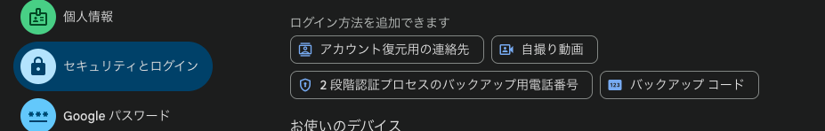
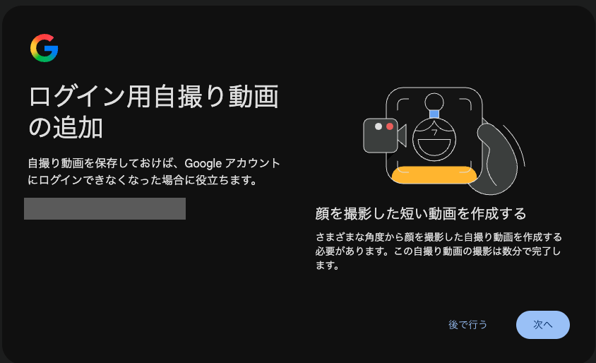
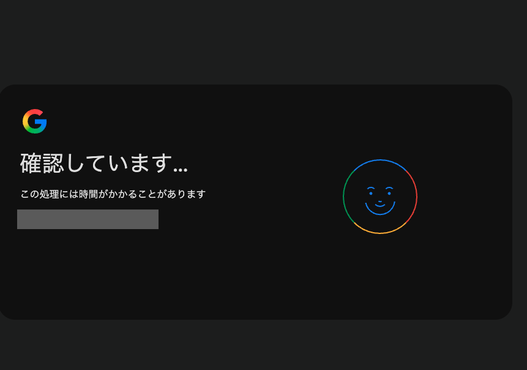
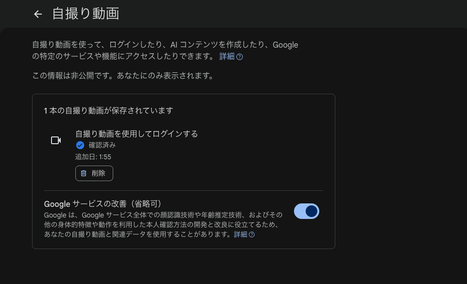

<!--
  Googleアカウントの自撮り動画認証（公開前にこのコメントは削除）

  書き方メモ
  - 語調はスキル nico-tech-article-tone に従う（個性は導入・見出し・まとめ・記事末に3〜5か所まで）。
  - 仕様・導入時期・対象・データの扱いは Google の公式ブログ／ヘルプで確認済みの範囲だけ書いている。
    公式に書かれていないことは「公開情報では確認できない」と明記している。
  - 自分の画面で見たことを書く場合は、いつ・どの端末・どの操作で表示されたかをセットで書く。
  - スクショは個人情報（メールアドレス、顔、端末名など）を隠してから貼る。
-->

# はじめに

最近、仕事用に Gmail の個人アカウントを新しく作ろうとしたら、認証方法の選択肢に見慣れない「自撮り動画」が出てきました。なんか若者受けしそう…と漠然と思いつつ、普通の顔認証と何が違うのか、ディープフェイクで突破されないのかが気になったので調べてみました。

:::note info
この記事は、2026年10月27日時点の公開情報をもとにしています。機能は順次展開中なので、仕様は変わる可能性があります。
:::

# 自撮り動画サインインってどんな機能？

Google が2026年7月23日に公式ブログで発表した、Googleアカウントの新しいサインイン方法です。英語では「selfie video sign-in」と呼ばれています。

| 項目 | 内容 | 出典 |
| --- | --- | --- |
| 何をするのか | 端末のカメラに顔を向け、案内に従って頭を数回動かす短い動画を撮る | 公式ブログ |
| 登録時 | 複数の角度から撮った自撮り動画を Google アカウントに保存する | 公式ブログ、ヘルプ |
| サインイン時 | 新しく撮った動画を、登録した動画と照合して本人か確かめる | 公式ブログ、ヘルプ |
| どんなときに使うか | ロックアウトされたときや、いつものスマホ・PCが手元にないとき | 公式ブログ |
| 位置づけ | パスキーや再設定用の連絡先と並ぶ、追加の選択肢 | 公式ブログ |
| 対象外 | Google Workspace アカウント、子ども用アカウント、高度な保護機能プログラムに登録したアカウント | ヘルプ |
| 提供状況 | 順次展開中。g.co/signin-selfie で自分のアカウントが対象か確認できる | 公式ブログ、ヘルプ |

ヘルプでは、AdSense や Merchant Center の支払い手続きで求められる「自撮りによる本人確認」とは別の仕組みだと説明されています。

## 実際の画面

自分のアカウント（Gmail の個人アカウント）で、PC のブラウザから登録してみました。画面は2026年10月27日（日本時間）に撮ったものです。

Google アカウントの「セキュリティとログイン」を開くと、ログイン方法を追加する選択肢の中に「自撮り動画」が並んでいます。

*図1：ログイン方法の選択肢に「自撮り動画」がある*

選ぶと、ログイン用自撮り動画の追加画面が出ます。さまざまな角度から顔を撮る必要があり、撮影は数分で終わると書かれています。

*図2：ログイン用自撮り動画の追加画面（メールアドレスは隠しています）*

撮影が終わると「確認しています…」の画面になり、しばらく待ちます。

*図3：撮影した自撮り動画を確認している画面（メールアドレスは隠しています）*

# なぜ自撮り動画なのか？

公式ブログが挙げている用途は、**いつもの端末が使えないときのアカウント復旧**です。

パスキーや認証アプリのコードは「持っているもの」で本人を確かめる方法です。そのため、スマホをなくしたり壊したりすると、本人なのにログインできなくなります。顔は端末をなくしても変わらないので、「持っているもの」がないときの最後の手段として使える、というのが自分の理解です（この部分は公式の説明ではなく自分の考察です）。

静止画ではなく動画にしているのは、**その場で撮った生きた人の顔か**を確かめるためです。公式ブログでは、登録時もサインイン時も簡単な動き（頭を動かす）を求め、動画がライブであることを確認すると説明しています。写真を1枚撮るだけだと、他人の写真をカメラにかざすだけで通ってしまうおそれがあります。

# 普通の生体認証との違い

iPhone の Face ID のような端末の顔認証と比べると、違いは「どこに顔データがあって、何を証明するのか」です。

| 比べるところ | 端末の顔認証（Face ID の例） | Google の自撮り動画サインイン |
| --- | --- | --- |
| 顔データの保存場所 | 端末の中（Secure Enclave で保護）。端末の外に出ず、iCloud にもバックアップされない | Google アカウントに保存され、ほかの端末からのサインインにも使える |
| 証明すること | この端末の持ち主であること | このアカウントの持ち主であること |
| 使うカメラ | TrueDepth カメラ（赤外線で顔の深度を測る） | 端末のカメラ（深度センサーを前提にするという記述は公式にない） |
| 主な用途 | 端末のロック解除、パスキーの利用 | 端末が使えないときのサインイン・復旧 |

いちばん大きいのは、**顔データが端末の外（Google アカウント側）にある**点です。Face ID はデータが端末から出ないことを前提に作られています。一方で自撮り動画サインインは「端末をなくした人」を救うための仕組みなので、端末の外に顔の情報を置く必要があります。

もう1つの違いは、普通のスマホのカメラで撮った映像を使う点です。Face ID は、印刷した写真や2Dのデジタル写真には深度の情報がないことを使って偽物を見分けています。自撮り動画サインインは深度センサーを前提にしていないので、別の方法で偽物を見分ける必要があります。それが次のディープフェイク対策の話につながります。

なお、ヘルプには「双子のように顔が似ている人は通過できる可能性がある」とはっきり書かれています。

# ディープフェイクで突破されないのか？

最初は「ディープフェイク対策のために動画にしたのかな？」と予想していました。調べると、公式ブログでも偽の写真・動画（ディープフェイク）によるなりすましを想定していると書かれていました。

## Google が公開している対策

公式ブログとヘルプで確認できた対策は、次の3つです。

1. **ライブネス検出**：頭を動かすなどの簡単な動きを求め、その場で撮った動画か確かめる
2. **顔の照合**：新しい動画を、登録時に保存した自撮り動画と照合する
3. **不審なサインインの検知**：Google がふだんから使っている仕組みで、怪しいサインインの試みを検知して防ぐ

ヘルプには「録画した自分の顔の動画では、このチャレンジを通過できない」とも書かれています。

一方で、**どんなアルゴリズムで照合しているか、ライブネスをどう判定しているか、照合の基準（しきい値）はいくつかは公開されていません**。

## 業界ではどう対策しているのか

顔の本人確認への攻撃は、大きく2種類に分けて考えられています。

| 攻撃の種類 | やり方 | 対策 | 規格 |
| --- | --- | --- | --- |
| プレゼンテーション攻撃 | 写真・画面に映した動画・マスクなどをカメラに見せる | ライブネス検出（PAD） | ISO/IEC 30107-3 |
| インジェクション攻撃 | カメラを通さず、仮想カメラやエミュレータで作った映像を直接流し込む | インジェクション攻撃検出（IAD）：映像が本物のカメラから来たか確かめる | CEN/TS 18099（2024年11月発行） |

ここで大事なのは、**ライブネス検出はプレゼンテーション攻撃への対策で、インジェクション攻撃は防げない**という点です。精巧なディープフェイク動画を仮想カメラで流し込まれると、映像としては「動いている生きた顔」に見えるからです。そのため、2つの対策を重ねて使うのが前提とされています。インジェクション攻撃については、国際規格 ISO/IEC 25456 の策定も2025年から始まっています。

Google の自撮り動画サインインがインジェクション攻撃検出をしているかどうかは、**公開情報では確認できませんでした**。公式が挙げている3つめの対策「不審なサインインの検知」がどこまでカバーしているかもわかりません。

# 気になるところ（プライバシー）

公式ブログとヘルプで確認できたデータの扱いは次のとおりです。

- 自撮り動画は本人の同意のうえで記録・保存され、保存時は暗号化される
- 公式ブログでは、用途はサインインの手助けで、本人が追加の用途に同意しない限りほかの目的には使われないと説明されている
- myaccount.google.com/video-verification からいつでも削除できる
- 保存期間は公開されていない

## 登録画面に書かれていたこと

実際に登録するときの画面には、もっと細かい説明がありました。

**使われ方**

- Google はモデルを使って自撮り動画を審査し、その人が特定の Google サービスを使える年齢に達した実在の人物かどうかを判断する
- 自撮り動画と関連データは、Google アカウントのセキュリティ設定に保存される
- ログインできなくなったとき、2回目の自撮り動画を撮るよう求められることがあり、顔認識技術でアカウントの持ち主か確かめる

**管理**

- 自撮り動画はいつでも削除・差し替えできる
- 定期的に自撮り動画の更新を求められることがある

**処理**

- 自撮り動画は住んでいる国以外で保存・処理されることがあり、人による確認（手動審査）の対象になることもある
- 処理は Google のプライバシーポリシーに沿って行われる

つまり、自撮り動画はログインのためだけでなく、**年齢確認にも使われる**ということです。登録後の管理画面にも、自撮り動画を使って「ログインしたり、AI コンテンツを作成したり、Google の特定のサービスや機能にアクセスしたり」できると書かれていました。

*図4：登録後の自撮り動画の管理画面*

管理画面には「Google サービスの改善（省略可）」という設定もあります。これをオンにすると、自撮り動画と関連データが、顔認識技術や年齢推定技術、身体的特徴や動作を使った本人確認方法の開発・改良に使われることがあります。省略可とあるとおり任意の設定で、あとから変更や削除もできます。

ただ、**自分が登録したときは、この設定が最初からオンになっていました**（図4もオンの状態です）。自分で選んだ覚えはないので、気にしていないと顔の動画が技術の開発・改良にも使われる状態になります。アカウントや時期によって初期値が違う可能性もありますが、自撮り動画を登録したら、この設定がどうなっているか一度確かめておくのがおすすめです。

ヘルプには、リスクがあると感じるなら有効にしなくてよいとも書かれています。自撮り動画は「アカウントの持ち主か確かめる機能の1つで、唯一の方法ではない」という位置づけです。

# まとめ

自撮り動画サインインは、パスキーで端末に縛られる分、端末なしで戻ってくる手段も要る、というトレードオフへの答えの1つなのだと思います。
動画にしているのはライブネス検出のためで、公式もディープフェイクを想定しています。ただし、仮想カメラで映像を流し込むインジェクション攻撃への対策は、公開情報では確認できませんでした。
また、顔データは端末ではなく Google アカウント側に保存され、技術の改善に使う設定が自分のときは最初からオンだったので、登録した人は一度設定を見直しておくと安心です。

# 参考

- [Introducing selfie for sign-in: a new, easy way to access your Google Account（Google公式ブログ, 2026-07-23）](https://blog.google/innovation-and-ai/technology/safety-security/selfie-video-sign-in/)
- [Selfie sign-in FAQ（Google アカウント コミュニティ）](https://support.google.com/accounts/community-guide/456196158/selfie-sign-in-faq?hl=en)
- [About Face ID advanced technology（Apple）](https://support.apple.com/102381)
- [Injection attack: a major threat against remote identity verification（NIST IFPC 2025 発表資料, CLR Labs）](https://pages.nist.gov/ifpc/2025/presentations/09.pdf)
- [Google アカウントに「自撮り」認証が追加　AIによる偽動画に耐えられるか？（ITmedia エンタープライズ）](https://www.itmedia.co.jp/enterprise/articles/2607/26/news008.html)
