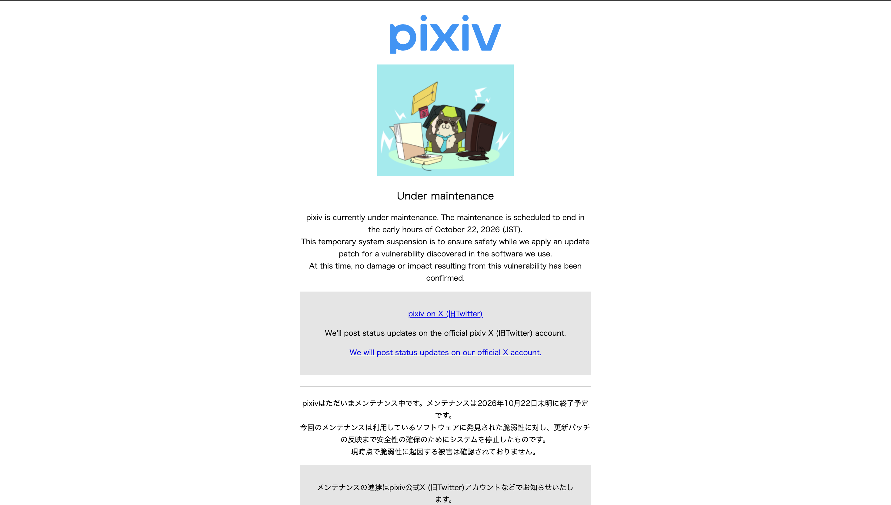
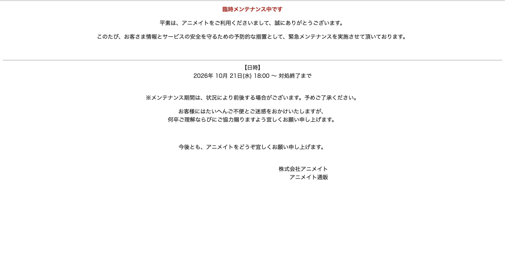
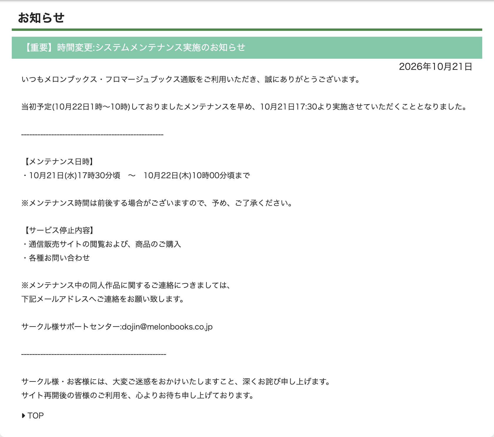

<!--
  PHPの緊急セキュリティリリース（2026年10月21日）の解説（公開前にこのコメントは削除）

  書き方メモ
  - 語調はスキル nico-tech-article-tone に従う（個性は導入・見出し・まとめ・記事末に3〜5か所まで）。
  - 2026-10-27 時点の公開情報でまとめている（公開前に、10-26 の悪用確認の報道と CISA KEV の状況を反映）。
    悪用状況・PoC の状況は変わりやすいので、更新するときは「参考」の一次情報を読み直す。
  - 攻撃の再現手順やリクエストの組み立て方は書かない。仕組みは「何が壊れるか」が分かる粒度にとどめる。
  - 画像は image/ に置いている。Qiita に出すときは、リポジトリにコミットしたあとの raw URL に差し替える。
  - pixiv・アニメイト・メロンブックスの告知には「PHP」とは書かれていない（pixiv は技術ブログで PHP 8.5.12 への
    対応だったと説明している）。本文でも「時期が重なった」以上のことは断定しない。
  - 図の候補：タイムライン（予告 → 各サイト停止 → 公開 → 再開）と、
    「修正パッチの公開で攻撃者・運営者それぞれに何の情報が渡るか」の図。
-->

# はじめに

20:30 pixiv、21:00 アニメイト通販、21:01 メロンブックス通販。
2026年10月21日の夜、よく利用するサービスが、30分のあいだに立て続けにメンテナンス画面になりました。

告知に書かれていたのは「利用しているソフトウェアの脆弱性」「予防的な措置」といった言葉だけで、何が起きているのかは分かりませんでした。たまたま同じ日にメンテが重なっただけ…ではなさそうだと思って調べてみると、同じ夜に国内の数十のサービスが止まっていて、その中心にあったのが **PHPそのものの脆弱性**、通称 PHP2Shell でした。

調べるほど、気になることが増えていきました。

- なぜ各社は、修正が出る「23時」を待たずに、夕方から先にサイトを止めたのか？
- 修正パッチが公開されると、運営者と攻撃者にそれぞれ何の情報が渡るのか？
- なぜ一部の古いゲームは、メンテナンスでは済まずにサービス終了を選んだのか？

この記事では、この3つの疑問をベースに、その夜に何が起きていたのかを初学者にも分かるように整理します。
ちなみに、私のインターン先はPHPを使ったサービスやサイトがなかったので、今回はセーフでした。

:::note warn
この記事は、2026年10月27日時点の公開情報をもとにしています。攻撃に使える具体的な手順は書いていません。自分が管理するサーバーの確認と対策のための記事です。
:::

# 10月21日の夜、軒並みサイトが止まった

21日の夕方から夜にかけて、国内のいろいろなサービスがメンテナンスや一時停止に入りました。私が実際に見たのは、次の画面です。

*pixiv（2026年10月21日 20:30ごろ撮影）。「利用しているソフトウェアに発見された脆弱性に対し、更新パッチの反映まで安全性の確保のためにシステムを停止」と書かれている*

*アニメイト通販（21:00ごろ撮影）。「予防的な措置として」10月21日18:00から緊急メンテナンス*

*メロンブックス通販（21:01ごろ撮影）。22日1時からの予定だったメンテナンスを、21日17:30からに前倒し*

この3つの告知には「PHP」とは書かれていません。ただ、pixiv は翌日に技術ブログで「PHP 8.5.12 の緊急リリースにどう対応したか」を公開していて、今回のPHPの件への対応だったことが分かります。アニメイトとメロンブックスについては、PHPが理由かどうかは告知からは分からず、時期が重なっていたということだけ書いておきます。

告知の中で「PHP」と明記していたものもたくさんあります。一例を挙げると次のとおりです。

| サービス | 告知の内容（要約） |
| --- | --- |
| Shadowverse: Worlds Beyond / ウマ娘 / グランブルーファンタジー | 当初23時の予定だったメンテナンスを22時ごろに前倒し |
| BASE | 利用中のPHPの重大な脆弱性に対する予防措置として、21日15:50から停止 |
| カラーミーショップ | IPAの注意喚起を受けた予防措置として、21日22:00から停止 |
| あすけん | 21日22:50ごろに停止し、22日9:25に再開。被害はないと確認 |

21時55分には、高市総理もXで、PHPを使っているサイトの管理者に向けて「23時に公開される修正パッチをすぐ当てられるよう準備を」と呼びかけました。投稿には、次の一文も入っていました。

> 修正パッチを速やかに適用することが困難な場合は、例えばウェブサイト等を一時的に停止させることも、リスクを低減させるための有効策の一つと考えられます。
> （[高市早苗 on X](https://x.com/takaichi_sanae/status/2112890642590564386)）

総理が「サイトを止める」ことを勧めるほどの脆弱性だった、ということです。

# 今回のPHPの脆弱性とは？

## そもそもPHPとは

PHPは、Webサーバーの上で動くプログラミング言語です。
ブラウザからリクエストが来ると、サーバーの上でPHPのプログラムが動いて、HTMLなどの結果を返します。WordPressもPHPで作られているので、ブログや企業サイトなど、身の回りの多くのWebサイトがPHPで動いています。

ここで大事なのは、**今回の問題は「PHPで書かれたアプリ」ではなく「PHPそのもの（言語の処理系）」にあった** という点です。
アプリ側のコードがどれだけ丁寧に書かれていても、その土台であるPHPに穴があれば影響を受けます。だからこそ、業種に関係なく一斉に止まったわけです。

## 見つかった2件の脆弱性

見つかったのは2件で、セキュリティ業界では2件まとめて「PHP2Shell」と呼ばれています。どちらも深刻度の指標である CVSS v4.0 で **9.2（Critical）** です。
条件がそろうと、**ログインなしで、外からサーバー上のプログラムを実行される（リモートコード実行）** おそれがあります。

2件を理解するために、まずPHPの動き方を押さえておきます。
Webサーバーでは、PHPは「ワーカー」と呼ばれるプロセスでリクエストを処理します。ワーカーは1回使ったら捨てるのではなく、**1つのワーカーが、何件ものリクエストを順番に処理します**。1件終わるたびに、そのリクエストで使ったメモリを片付けて（解放して）、次のリクエストに備えます。

### CVE-2026-109618：メモリが足りなくなったときの片付けの失敗

PHPには、1回のリクエストで使ってよいメモリの上限（`memory_limit`）があります。上限を超えると、PHPはその場で処理を打ち切ります。

問題は、**打ち切るタイミング** でした。
リクエストの中身を読み込んでいる途中で上限に達すると、内部のデータが「中途半端に準備された」状態のまま処理が止まります。そのあとの片付けで、正しく準備されていないデータを正常なものとして扱ってしまい、メモリの中身が壊れる、というものです。

### CVE-2026-109619：前のリクエストの「残りかす」を使ってしまう

こちらは「1つのワーカーが順番に処理する」仕組みに関係します。

リクエストの処理中に致命的なエラーやタイムアウトが起きると、片付けが途中で止まることがあります。すると、**すでに解放したメモリを指したままの情報** がワーカーの中に残ります。
次のリクエストが同じワーカーに来たとき、その古い情報を使ってしまう。これが **use-after-free（解放後のメモリを使ってしまう）** と呼ばれる種類の不具合です。PHPの開発チームは、メモリの中身が漏れること（情報漏えい）も影響として確認しています。

## どの環境が影響を受けたのか

| 項目 | 内容 |
| --- | --- |
| 影響を受けるバージョン | PHP 8.5.12 / 8.4.27 / 8.3.36 / 8.2.35 より前。サポートが終わった 8.1 以前も影響を受ける |
| 影響を受ける動かし方 | Webのリクエストを処理しているもの全般（PHP-FPM、Apache の mod_php、php-cgi、FrankenPHP、LiteSpeed など） |
| 特に危険とされたもの | Apache の mod_php。アプリのコードが動く前の段階で攻撃が成立しうるとされた |
| 修正版 | 8.5.12 / 8.4.27 / 8.3.36 / 8.2.35 |
| サポート終了版 | 7.4・8.0・8.1 向けには、最低限の修正（ソースコードのバックポート）だけが公開された。7.3 以前は修正なし |

# なぜ「23時」に合わせて急いで対応しないといけなかったのか？

## タイムライン

時刻は日本時間（JST）で書いています。

| 日時（JST） | 出来事 |
| --- | --- |
| 10月17日 | Amazon（AWS）が、公開の4日前の時点で、この脆弱性を狙ったとみられる攻撃の試みを観測していたと報告（Datadog・Tenable の解説による） |
| 10月20日 | 脆弱性の情報の一部が、公開前にSNSに出回る（watchTowr による） |
| 10月21日 4:33ごろ | PHPの開発チームが、公式のメーリングリストで「重大な脆弱性2件を直すリリースを、21日 23:00（JST）に出す」と予告。中身は書かれていない |
| 予告より前 | Linuxディストリビューションや長期サポートを提供する事業者には、修正が先に渡されていた |
| 10月21日 夕方〜夜 | 国内の多くのサービスが、予防措置としてメンテナンスや一時停止に入る |
| 10月21日 21:55ごろ | 高市総理がXで、サイト管理者に修正の準備を呼びかけ |
| 10月21日 22:30ごろ | 予告より早く、修正版（PHP 8.5.12 / 8.4.27 / 8.3.36 / 8.2.35）が公開される。あわせて脆弱性の詳細も公開 |
| 10月21日 23:16 | pixiv が修正版への入れ替えを終えてメンテナンスを解除（公開から約30分） |
| 10月22日 | IPA・JPCERT/CC などが注意喚起を出す。一部のサービスは停止が続く |
| 10月26日ごろ | 研究者のハニーポットで、実際の攻撃によりプログラムの実行まで成功した証拠が見つかったと報じられる |

公開時刻は、予告では14:00 UTC（23:00 JST）でしたが、CERT-EU の勧告では13:30 UTC（22:30 JST）と書かれていて、pixiv も「23時より前に公開されていたことに22:41に気づいた」と書いています。予告にも「詳細が漏れたら早めに出すかもしれない」と書かれていました。

## なぜ「予告だけ」して、中身を隠したのか？

脆弱性の中身を修正より先に公開してしまうと、攻撃者に「ここを狙えばいい」と教えることになります。かといって、何も言わずにいきなり修正を出すと、サーバーの管理者は準備ができません。
そこで、次のような段取りが取られました。

1. **先に配る人に配る**：Linuxディストリビューションなど、PHPを多くの人に配布している事業者には、修正を先に渡して、更新パッケージを準備してもらう
2. **「いつ出すか」だけを公開する**：重大度と公開日時だけを予告して、管理者が更新の時間を空けられるようにする。中身は伏せる
3. **修正と詳細を同時に出す**：修正版が手に入るタイミングで、初めて中身を公開する

このように、見つけた人・開発者・配布する人が調整しながら、修正の準備ができてから公表するやり方を **協調された開示（Coordinated Disclosure）** と呼びます。

## 修正パッチの公開は、誰に何の情報をもたらすのか

ここが今回いちばん大事なところだと思います。
修正パッチが公開された瞬間に、運営者（直す側）と攻撃者の両方に、同時に情報が渡ります。

| | 運営者（直す側）が得るもの | 攻撃者が得るもの |
| --- | --- | --- |
| 修正版そのもの | 当てれば穴がふさがる「答え」 | 修正前と修正後のソースコードを比べれば、どこが壊れていたかが分かる「ヒント」 |
| 脆弱性の詳細（アドバイザリ） | 自分の環境が対象か、緩和策は何かが分かる | どんな条件で、どこを狙えばいいかが分かる |
| 「修正済み」のバージョン番号 | 更新できたかの確認に使える | まだ古いバージョンのままのサーバーが「狙える相手」になる |

PHPはオープンソースなので、修正版のソースコードは誰でも見られます。修正前と修正後を比べる（パッチの差分を見る）と、どの処理がどう直されたかが分かり、そこから逆算して攻撃方法を組み立てることができます。
つまり、**修正パッチの公開は「攻撃者向けの答え合わせ」の公開でもある** わけです。修正が出たのに当てていないサーバーは、穴の場所が公開された状態で放置されていることになります。

さらに今回は、

- 公開前にSNSに情報が出回っていた
- 公開の4日前に、攻撃の試みが観測されていたという報告もあった
- 予告より30分早く修正が出た

という状況でした。
「23時に修正が出たら、攻撃者もそこから一斉に動き出す。だからこちらも23時ちょうどに当てる、当てられないなら先に止めておく」。夕方から各サービスが予防的に止まっていたのは、こういう理由です。

## そのとき管理者は何をしていたのか

予告から公開までの間、サーバーを管理する側では、だいたい次のような動きがありました。

1. **自分のサーバーのPHPのバージョンを調べる**：どのサーバーで、どのバージョンが、どんな動かし方（FPM か mod_php か）で動いているかを洗い出す
2. **先に止めるかを決める**：修正をすぐ当てられないサービスは、公開前にメンテナンスに入れて外から触れないようにする
3. **公開されたらすぐ更新する**：PHP公式の修正版か、使っているLinuxディストリビューションの更新パッケージを入れる。ワーカーの再起動まで忘れずに行う
4. **すぐ更新できない場合は、一時的な緩和策を入れる**：各注意喚起では、次のような設定変更が挙げられていた
   - アップロードの進み具合を記録する機能（`session.upload_progress.enabled`）を切る
   - リクエストの大きさの上限（`post_max_size` など）を小さめにして、Webサーバーやプロキシの側でも制限する
   - インターネットに直接さらしているサーバーを、更新が終わるまで切り離す

pixiv の技術ブログを読むと、公式のDockerイメージを待たずにソースからビルドする準備をしておき、公開に気づいてから約6分でイメージを作り直し、約30分でメンテナンスを解除していました。準備しておくとここまで早く戻せるのか、と感心しました。さすが技術者集団Pixiv！！

ただし、一時的な緩和策はあくまで「穴を小さくする」だけで、**根本的に直すには更新するしかない** と、どの注意喚起でも強調されていました。

# 古いゲームがサービス終了したのはなぜか？

今回、メンテナンスでは済まずに、サービス終了を選んだゲームが出ました。

| ゲーム | 発表 | 公式の説明（要約） |
| --- | --- | --- |
| ワールドクエスト | 10月21日、同日で終了 | 古い仕組みのため十分な対策がとれない。利用者の情報を守ることを優先した |
| 僕の魔界を救って！ | 10月22日 | 深刻なPHP脆弱性への対応が困難となったため終了。10年以上運営してきたが、今のシステムやハードウェアのままでは安全に対応できず、新しい環境への移行も現実的ではない |

「PHPを更新すればいいだけでは？」と思うかもしれませんが、古いサービスほど、それが難しくなります。ここからは各社の説明ではなく、一般的な事情として書きます。

- **古いPHPには修正が出ない**：今回、公式の修正が出たのは 8.2 以降で、7.4〜8.1 にはソースコードの最低限の修正だけ、7.3 以前には修正自体がありません。10年以上前に作られたサービスは、7.x や 5.x で動いていることがあります
- **PHPのバージョンを上げるとプログラムが動かなくなる**：PHPはメジャーバージョンが変わると、使えなくなる機能が出ます。たとえば PHP 7.0 では、古いMySQL接続用の関数（`mysql_*`）がまるごと削除されました。古いコードを新しいPHPで動かすには、書き直しが必要になります
- **OSやサーバーごと古い**：新しいPHPは、古いOSの上では動かないことがあります。そうなると、PHPだけでなくOSやサーバーの入れ替えまで必要になります
- **直すコストに見合わない**：書き直し・移行には人手とお金がかかります。運営が長く続いて利用者が少なくなったゲームでは、その費用をかけられないことがあります

その結果、「穴があると分かったまま動かし続けて、利用者の情報が盗まれるリスクを負う」か「サービスを終える」かの二択になってしまい、終了を選んだということだと思います。

# どうやって悪用されるのか？

攻撃の再現手順は書きませんが、「何が起きるのか」の全体像だけ整理しておきます。

- **ログイン不要、リクエスト1回から**：解説記事によると、CVE-2026-109618 は、ログインなしで送れる普通のフォーム送信（POSTリクエスト）が入り口になるとされています。CVE-2026-109619 は、ファイルのアップロードに関わる経路が入り口です
- **アプリのコードが動く前に起きる**：PHPがリクエストを受け取って中身を読み込む段階で問題が起きるので、アプリ側のログイン確認や入力チェックでは防げません。mod_php が特に危険とされたのはこのためです
- **起きうること**：AWS の説明では、狙われたワーカーの上で「任意のコードの実行」「そのプロセスが読めるデータへのアクセス」「サービス停止」が起こりうるとされています。被害の範囲は、そのワーカーと、アプリに与えられた権限の範囲です
- **実際の動き**：watchTowr は、自社のおとり用サーバー（ハニーポット）で21日から攻撃の試みを観測したと報告しています。また、対象を選ばずに広くスキャンする動きも報告されています

サーバー上でコードを実行されると、一般的には、裏口（Webシェル）を置かれる、データベースの中身を抜かれる、別の攻撃の踏み台にされる、といった被害につながります。今回の件で、侵入後に実際に何をされたかの具体的な報告は、27日時点では見つけられませんでした。

# 公開後の状況（2026年10月27日時点）

- 公開の直後は、悪用状況について情報源によって見解が分かれていた
  - watchTowr は「実際に悪用されている」としていた
  - Rapid7 は、攻撃の試みの報告は複数あるものの、実際の悪用は確認していないとしていた。また、公開されている PoC（検証用の攻撃コード）は特定のOS・バージョン・Webサーバーの組み合わせでしか動かず、どこでも通用するものではないと分析している
  - IPA の注意喚起（22日）にも、悪用を確認したという記載はなかった
- 26日には、研究者のハニーポット（Apache の mod_php ＋ PHP 8.4.26）で、実際の攻撃によってプログラムの実行まで成功した証拠が見つかったと報じられ、別の研究者もこれを確認している。Amazon も「広く悪用されている」としている
- 一方で、米 CISA の「実際に悪用された脆弱性の一覧（KEV）」には、27日時点ではまだ載っていない
- Amazon は、被害の調査は公開日からではなく、少なくとも10月17日からさかのぼって行うよう勧めている
- WordPress は、WordPress 本体の更新は不要で、PHPを更新すればよいと案内している

# この件から学べること

- **土台のソフトウェアも更新の対象**：アプリのコードだけでなく、PHPのような実行環境やOSのパッケージも、脆弱性が見つかれば更新が必要になる
- **修正パッチの公開は、攻撃開始の合図でもある**：修正が出た時点で、攻撃者も同じ情報を手に入れる。「出たらすぐ当てる」が基本になる
- **サポートが終わったバージョンは危ない**：古いPHPには修正が出ない。最悪の場合、サービスを終えるしかなくなる
- **「どこで何が動いているか」を把握しておく**：予告が出たときにすぐ動けるかどうかは、自分のサーバーの一覧があるかどうかで決まる

# まとめ

- 2026年10月21日、PHPそのものに見つかった重大な脆弱性2件（CVE-2026-109618 / CVE-2026-109619、通称 PHP2Shell、どちらも CVSS v4.0 で 9.2）の修正版が公開された
- 前日に「日時と重大度だけ」が予告され、多くのサービスが修正の公開に備えて夕方から予防的に止まった
- 修正パッチの公開は、運営者には「答え」、攻撃者には「どこが壊れていたかのヒント」を同時に渡す。だから公開の瞬間に合わせて急いで当てる必要があった
- 古いPHPで動いていたゲームの中には、更新や移行ができずにサービス終了を選んだものもあった

普段なにげなく使っている土台ほど、こういうときの段取りが大事ですね🙌

ほかにも「こういう準備をしておくといい」という知見があれば、有識者の方教えて欲しいです！

# 参考

（2026年10月27日に確認）

- [[ANNOUNCE] Upcoming Critical PHP Security Release（PHP公式 php.announce）](https://news-web.php.net/php.announce/509)
- [RCE via OOM corruption（GHSA-w8hw-w9fx-j79w / CVE-2026-109618、php-src GitHub Security Advisory）](https://github.com/php/php-src/security/advisories/GHSA-w8hw-w9fx-j79w)
- [RCE via stale global state（GHSA-6wmf-4rv5-p3rp / CVE-2026-109619、php-src GitHub Security Advisory）](https://github.com/php/php-src/security/advisories/GHSA-6wmf-4rv5-p3rp)
- [Critical Vulnerabilities in PHP（CERT-EU Security Advisory 2026-018）](https://cert.europa.eu/publications/security-advisories/2026-018/)
- [IPA 注意喚起（2026年10月22日）](https://www.ipa.go.jp/security/security-alert/2026/alert20261022.html)
- [PHP 8.5.12の緊急リリースにpixivはどう対応したか（pixiv inside）](https://inside.pixiv.blog/2026/10/22/193321)
- [CVE-2026-109618 and CVE-2026-109619: Critical Unauthenticated Remote Code Execution in PHP（Rapid7）](https://www.rapid7.com/blog/post/etr-cve-2026-109618-and-cve-2026-109619-critical-unauthenticated-remote-code-execution-in-php/)
- [php2shell (CVE-2026-109618, CVE-2026-109619): Critical PHP RCE FAQ（Tenable）](https://www.tenable.com/blog/php2shell-cve-2026-109618-cve-2026-109619-frequently-asked-questions-about-critical-php-remote)
- [PHP2Shell - Critical vulnerabilities in PHP（Datadog Security Labs）](https://securitylabs.datadoghq.com/articles/php2shell-critical-vulnerabilities-in-php/)
- [PHP2Shell FAQ（watchTowr）](https://watchtowr.com/intelligence/php-cve-2026-109618-faq/)
- [AWS Security Bulletin 2026-143](https://aws.amazon.com/security/security-bulletins/2026-143-aws/)
- [PHP2Shell security flaws now successfully exploited in the wild（BleepingComputer）](https://www.bleepingcomputer.com/news/security/php2shell-security-flaws-now-sucessfully-exploited-in-the-wild/)
- [Known Exploited Vulnerabilities Catalog（CISA）](https://www.cisa.gov/known-exploited-vulnerabilities-catalog)
- [PHPで確認された深刻な脆弱性を巡り，ゲームのサービス終了が続く（4Gamer.net）](https://www.4gamer.net/games/999/G999904/20261022019/)
- [旅行ゲーム「ワールドクエスト」、PHP脆弱性で即日サービス終了（ITmedia NEWS）](https://www.itmedia.co.jp/news/article/2610/22/2000002493/)
- [PHP重大脆弱性で影響さまざま、各社対応に追われる（J-CASTニュース）](https://www.j-cast.com/2026/10/22518637.html)
- [高市早苗 on X（2026年10月21日）](https://x.com/takaichi_sanae/status/2112890642590564386)
- [PHP脆弱性で停止・メンテ中の国内サービス一覧（Webセキュリティ診断センター）](https://websec-center.com/blog/kokunai-kigyou-taiou/)
