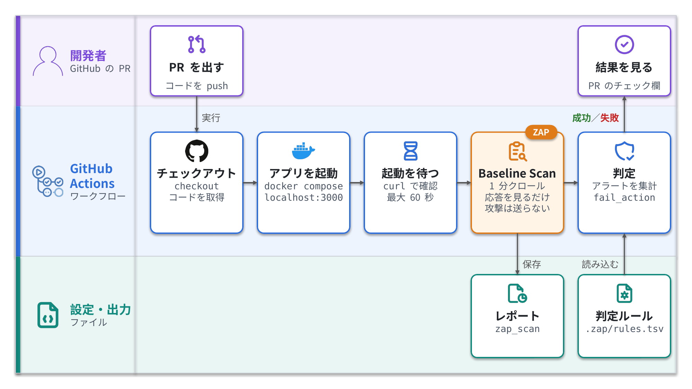

<!--
  Qiita Advent Calendar 2026「開発をちょっと楽にしたTipsを投稿しよう！by DoctorNet」12/6（シリーズ2）用（公開前にこのコメントは削除）
  https://qiita.com/advent-calendar/2026/doctornet

  公開前にやること
  - [ ] Tip1 の yaml を自分のリポジトリで実際に動かし、Actions の画面・レポートのスクショを image/ に入れる
        （「実行結果」の節の TODO を、実際に出たアラートに差し替える）
  - [ ] Tip2 の設定画面のスクショを撮る（Settings → Advanced Security）
  - [ ] action-baseline の最新タグを確認する（2026-11-04 時点で README の例は v0.15.0）
  - [ ] 投稿後、記事をカレンダーに紐付ける（12/31まで）
  - 語調はスキル nico-tech-article-tone。まとめに「〜なのよ🙌」は付けない。
-->

# はじめに

最近のニュースを見ていると、「脆弱性を突かれて被害が出た」という話が毎週のように流れてくるんですよね…
個人開発でもセキュリティをちゃんとやりたいけど、診断ツールを覚える時間はない。じゃあ **GitHub Actions に数十行足すだけ** でどこまでできるのか？と思ったので、やってみました。

:::note warn
この記事の診断は、自分のアプリ（自分のリポジトリと、CI上やローカルで立ち上げたアプリ）にだけ実行してください。
許可なく他人のサイトに診断をかけると、不正アクセス禁止法などに触れるおそれがあります。
:::

## この記事でわかること

- **Tip1**：ZAP の Baseline Scan を GitHub Actions に入れて、PR ごとにアプリを自動で診断する
- **Tip2**：GitHub の無料機能（Dependabot とシークレットスキャン）をオンにして、依存ライブラリの脆弱性と API キーの漏れを見張る

## なぜ今セキュリティ診断なのか？

IPA の「情報セキュリティ10大脅威 2026」（組織向け）では、4位に「システムの脆弱性を悪用した攻撃」、2位に「サプライチェーンや委託先を狙った攻撃」が入っています。
自分のコードの穴だけでなく、**使っているライブラリの穴** も攻撃の入り口になる、ということです。

この記事の2つの Tip は、ちょうどこの2つに対応しています。

| 見たいもの | 使うもの | Tip |
|---|---|---|
| 動いているアプリの穴（ヘッダー不足、Cookie の設定ミスなど） | ZAP Baseline Scan | Tip1 |
| 依存ライブラリの既知の脆弱性 | Dependabot | Tip2 |
| コミットに混ざった API キーやトークン | シークレットスキャン | Tip2 |

# Tip1：ZAP の Baseline Scan を PR ごとに回す

## ZAP ってなに？

ZAP は、Web アプリに外からリクエストを送って脆弱性を探す、無料・オープンソースの診断ツールです（DAST と呼ばれる種類のツール）。
もともとは OWASP のプロジェクトで「OWASP ZAP」と呼ばれていましたが、2023年に OWASP を離れ、今は「ZAP by Checkmarx」という名前になっています。

## Baseline Scan は攻撃しないのか？

ZAP にはいくつかの診断方法がありますが、CI で回すなら **Baseline Scan** がおすすめです。

- spider（クローラー）で対象のページを既定で1分間たどる
- 返ってきたレスポンスを **見るだけ**（パッシブスキャン）で問題を探す
- 攻撃のリクエスト（アクティブスキャン）は送らない
- 時間は長くても数分

攻撃をしないぶん見つかる問題は限られますが、そのかわり速くて、CI に入れても邪魔になりません。

## まずは手元で1コマンド

Docker が入っていれば、これだけで試せます。`-t` に、自分のPCで立ち上げた自分のアプリの URL を入れてください。

```bash
docker run -t ghcr.io/zaproxy/zaproxy:stable \
  zap-baseline.py -t http://host.docker.internal:3000
```

`host.docker.internal` は、コンテナの中から自分のPC（ホスト）を指す名前です。Docker Desktop（Mac・Windows）ではそのまま使えます。Linux では `--add-host=host.docker.internal:host-gateway` を付けてください。

<!-- TODO: 自分のアプリで実行した出力（WARN の行など）を貼る -->

最後に `FAIL-NEW: 0 WARN-NEW: 〇 ...` のような集計が出ます。終了コードは次のとおりです。

| 終了コード | 意味 |
|---|---|
| 0 | 問題なし |
| 1 | FAIL が1件以上 |
| 2 | WARN だけが1件以上 |
| 3 | その他のエラー |

## GitHub Actions に入れる

手元で動いたら、同じことを PR ごとに自動でやらせます。公式の `zaproxy/action-baseline` を使います。


*図1：PRを出すと、CI上でアプリを立ち上げ、ZAPがそのアプリを診断してレポートを残す*

`.github/workflows/zap-baseline.yml` を作ります。

```yaml:.github/workflows/zap-baseline.yml
name: ZAP Baseline Scan

on:
  pull_request:

jobs:
  zap_scan:
    runs-on: ubuntu-latest
    steps:
      - uses: actions/checkout@v5

      # 自分のアプリを CI 上で起動する（例：docker compose で 3000 番に立てる）
      - name: Start app
        run: docker compose up -d

      # 起動を待つ（最大60秒）
      - name: Wait for app
        run: |
          for i in $(seq 1 30); do
            curl -sf http://localhost:3000 && exit 0
            sleep 2
          done
          exit 1

      - name: ZAP Scan
        uses: zaproxy/action-baseline@v0.15.0
        with:
          target: 'http://localhost:3000'
          rules_file_name: '.zap/rules.tsv'
          allow_issue_writing: false
          fail_action: true
```

ポイントは3つです。

- **診断の対象は CI 上で立ち上げた自分のアプリ**（`localhost:3000`）。本番サイトや他人のサイトに向けないようにします。
- `allow_issue_writing: false`：このアクションは既定だとレポートを GitHub の Issue に書き込みます。PR ごとに Issue が更新されるとうるさいので、この記事では切っています。レポートは Actions のアーティファクト（既定の名前は `zap_scan`）からダウンロードできます。
- `fail_action: true`：アラートが出たら CI を失敗にします。最初は外しておき、慣れてから付けるのもアリです。

## 実行結果

<!-- TODO: Actions の画面のスクショ、レポート（HTML）のスクショ、実際に出たアラートを載せる -->

## 誤検知は rules.tsv で黙らせる

Baseline Scan は既定ですべてのアラートを WARN として出すので、「自分のアプリでは問題にならないもの」も混ざります。
そういうものは、リポジトリに `.zap/rules.tsv` を置いて IGNORE にします。

```tsv:.zap/rules.tsv
10021	IGNORE	(X-Content-Type-Options Header Missing)
10020	FAIL	(X-Frame-Options Header Scanner)
```

- 1行に「ルールID」「判定」「（名前）」を **タブ区切り** で書く
- 判定は `IGNORE`（無視）、`INFO`、`WARN`（既定）、`FAIL`（CI を落とす）
- 全ルールの一覧は、`zap-baseline.py` に `-g gen.conf` を付けて実行すると、ひな形として出力される

逆に「これだけは絶対に見逃したくない」ルールは `FAIL` にしておくと、そのアラートが出た PR はマージ前に止まります。

<!-- TODO: ハマったことがあればここに（例：タブではなくスペースで書いて効かなかった、など。実際にハマったものだけ） -->

# Tip2：GitHub の無料機能をオンにする

Tip1 は「動いているアプリ」を外から見ますが、使っているライブラリそのものに脆弱性があるかどうかは見ていません。
そこは GitHub の機能に任せます。設定画面のボタンを押すだけで、yaml すら書かなくていいものもあります。

## Dependabot：依存ライブラリの脆弱性を教えてもらう

リポジトリの **Settings → Advanced Security** を開き、次の2つを **Enable** にします。

- **Dependabot alerts**：使っているライブラリに既知の脆弱性が見つかると、アラートで知らせてくれる
- **Dependabot security updates**：脆弱性を直したバージョンへ上げる PR を自動で作ってくれる

<!-- TODO: 設定画面のスクショ -->

Dependabot が作った PR でも、Tip1 の ZAP の診断はちゃんと走ります。「ライブラリを上げたらアプリが壊れた」「上げたら新しいアラートが出た」もあわせて見られるので、2つを組み合わせると気持ちいいです。

ついでに、GitHub Actions のアクション自体（`zaproxy/action-baseline@v0.15.0` など）も古くなっていくので、`dependabot.yml` で更新の PR を出してもらうと楽です。

```yaml:.github/dependabot.yml
version: 2
updates:
  - package-ecosystem: "github-actions"
    directory: "/"
    schedule:
      interval: "weekly"
```

## シークレットスキャン：API キーの漏れを止める

うっかり API キーやトークンをコミットしてしまう事故を防ぐ機能です。
同じ **Settings → Advanced Security** の「Secret Protection」から有効にでき、その中の **Push protection** を Enable にすると、シークレットが入ったコミットの push 自体をブロックしてくれます。

注意点として、**無料で使えるのはパブリックリポジトリ** です。組織が持っているプライベートリポジトリで使うには、有料の GitHub Secret Protection が必要です。

# まとめ

- **Tip1**：ZAP の Baseline Scan を GitHub Actions に入れると、yaml 1ファイルで PR ごとに自分のアプリを診断できる
- **Tip2**：Dependabot とシークレットスキャンは、設定画面でオンにするだけで依存ライブラリと API キーの漏れを見張ってくれる

ただし、これで「セキュリティ診断は終わり」ではありません。Baseline Scan は攻撃を送らないので、SQL インジェクションのような穴は見つけられませんし、ログインが必要な画面も既定ではたどれません。
それでも、何もしていない状態から「最低限の穴を PR のたびに自動で見つける」状態にするには、数十行で十分です。まずはここから始めて、余裕が出てきたらアクティブスキャン（自分の環境に対してだけ）にも手を広げてみてください。

もっと手軽な方法や、おすすめの rules.tsv の設定があれば、有識者の方教えて欲しいです！

# 参考

- [ZAP - Baseline Scan](https://www.zaproxy.org/docs/docker/baseline-scan/)
- [zaproxy/action-baseline](https://github.com/zaproxy/action-baseline)
- [Configuring Dependabot security updates - GitHub Docs](https://docs.github.com/en/code-security/dependabot/dependabot-security-updates/configuring-dependabot-security-updates)
- [About secret scanning - GitHub Docs](https://docs.github.com/en/code-security/secret-scanning/introduction/about-secret-scanning)
- [Enabling push protection for your repository - GitHub Docs](https://docs.github.com/en/code-security/secret-scanning/enabling-secret-scanning-features/enabling-push-protection-for-your-repository)
- [情報セキュリティ10大脅威 2026 - IPA](https://www.ipa.go.jp/security/10threats/10threats2026.html)
