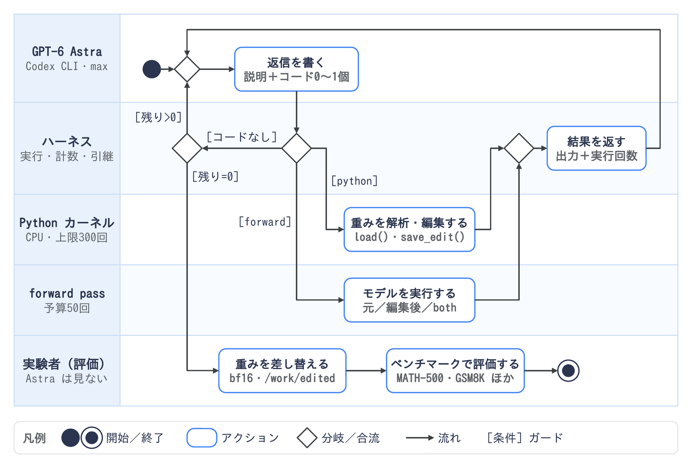
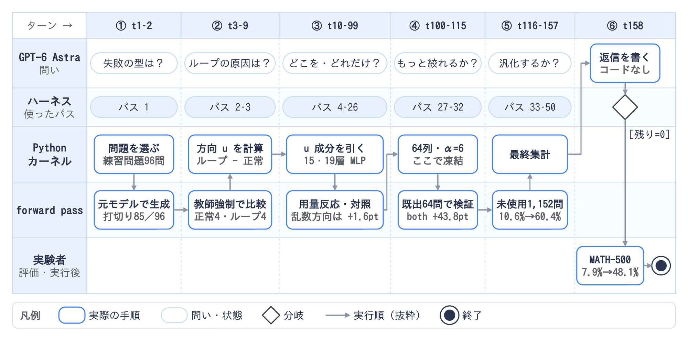
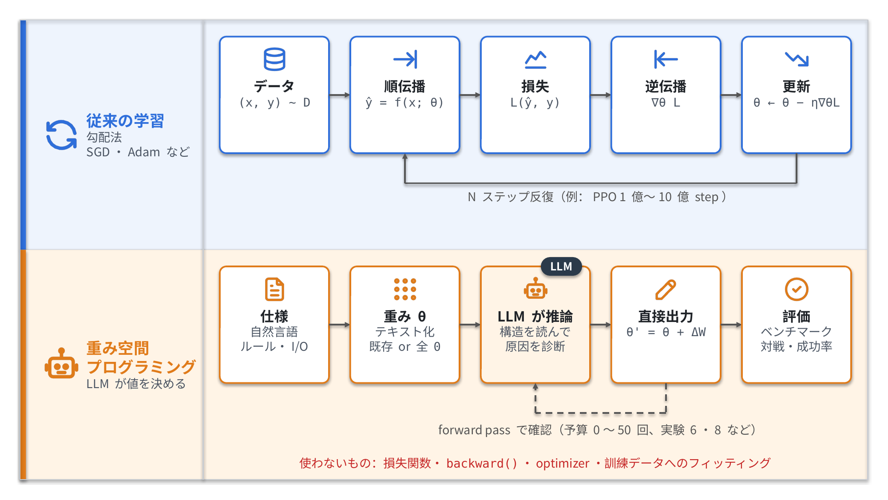
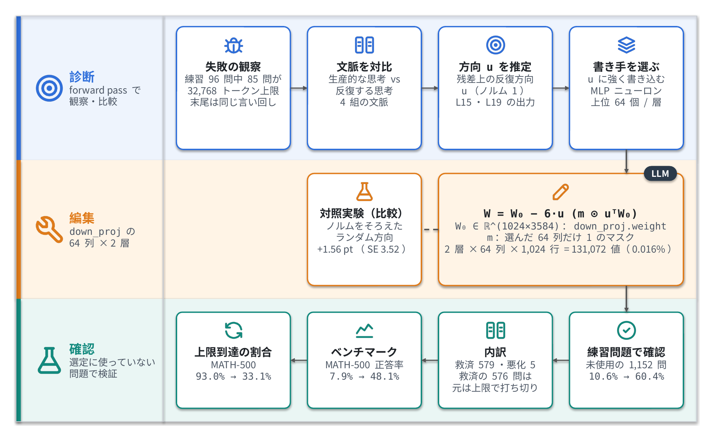

<!--
  重み空間プログラミング（草稿。公開前にこのコメントは削除）
  - 元ネタ：MIT CSAIL「Sparks of Weight-Space Programming」（2026-11-02、査読前の技術レポート）
  - 数字はすべてブログ本文で確認済み（2026-11-04時点）。ブログが更新されたら表を見直す
  - 図：01 改善ループ（実験8のハーネスのアクティビティ図）、01b 実験8の実際の流れ（実行トレース）、02 従来の学習との違い、03 Qwenの重み編集。pptx→png（2000px）。生成は 01・01b が image/zukai/図1生成スクリプト.js・図1b生成スクリプト.js、02・03 が image/図生成スクリプト.py
  - 図1の流れは lm_understand-logs の exp8_math/README.md、runs/p50c/turns/t001/prompt.txt、runs/p50c/state.json で確認済み。図1bの数字は runs/p50c の driver.log・tool_calls.jsonl・requests/fwd_*.done.json・work_notes/notes.md で確認済み
  - 実験8の詳細（式・列数・対照実験）は lm_understand-logs の exp8_math/runs/p50c/work_notes/final_report.md と edit/manifest.json で確認済み
  - 語調はスキル nico-tech-article-tone。まとめに「〜なのよ🙌」は付けない
-->

# はじめに

LLMにニューラルネットの重みを「読ませて」「書き換えさせる」研究が出てきたと聞いて、学習なしでそんなことできるの…？と気になったので詳しく見てみました。

元ネタは、MIT CSAILのRikiya Takehiさんらが2026年11月2日に公開した技術レポート「[Sparks of Weight-Space Programming](https://rikiyat.github.io/blog/weight-space-programming/)」です。

:::note warn
この記事の内容は、査読前のレポートとそのログをもとにしています。数字はすべてレポートに書かれているもので、私が再現したものではありません。
:::

# ひとことで言うと

**重み空間プログラミング（Weight-Space Programming）は、汎用のLLMがニューラルネットの重みを、勾配降下などの最適化を使わずに、直接読み書きすることです。**

レポートでは、LLMに重みそのもの（数値の並び）と自然言語の説明を渡して、次の3つをやらせています。

| やること | 中身 |
|---|---|
| 解析（Read） | 重みを見て、そのネットワークが何をするものかを当てる |
| 修復（Fix） | うまく動かないネットワークの重みを書き換えて直す |
| 生成（Write） | 全部0の状態から、重みをゼロから書いて動くネットワークを作る |

使われたLLMは、レポートで「GPT-6 Astra」と呼ばれている汎用のフロンティアモデルです。この研究のために追加学習はしていません。

実際にどんな流れで重みが良くなっていくのかを、ログが一番細かく残っている実験8（Qwen3.5-0.8Bの修復、forward pass 50回版）を例に図にするとこうなります。

Astraは1回の返信で、説明と、Pythonコードかforward passの依頼のどちらか1つを書きます。Pythonコードは重みを読み書きできる環境（GPUなし）で動き、重みの解析や書き換えに使います。forward passの依頼では、元のモデルや編集後のモデルを実際に動かして、練習問題を解かせたり、文章を読ませて内部の値を取り出したりできます。

ハーネス（実験を回す仕組み）が結果を返すと、Astraはそれを見て次の返信を書きます。これを繰り返して、forward passを50回使い切ったあとにコードなしで返信すると終わりです。提出された重みは実験者がベンチマークで評価しますが、Astraはベンチマークの問題を一度も見ていません。

この流れに沿って、実験8（50パス版）で実際に何が起きたかを並べるとこうなります。

矢印は実行順の抜粋で、矢印と矢印の間では上の図のループを1周以上回しています。最初の診断で96問中85問が上限まで考え続けて打ち切られていることがわかり、そこからループに対応する方向 `u` を求めて、15層と19層のMLPから `u` の成分を引く編集を試しています。編集を各層64列・強さα=6に絞って固定したあとは、それまで使っていない1,152問で元のモデルと比べて、正答率が10.6%から60.4%になりました。ちなみにforward passの依頼は全部で69回出ていて、そのうち19回はエラーで動かず、パスには数えられていません。

# ふつうの学習と何が違うのか？

ニューラルネットの重みは、ふつうは人間が直接書くものではありません。データと損失関数を用意して、勾配降下で少しずつ重みを動かし、結果としていい重みにたどり着きます。人間が書くのは学習用のコードであって、重みそのものではないです。

重み空間プログラミングでは、この「データ・損失・勾配」のループを通さずに、LLMが重みの値を直接決めます。

この研究を紹介した[Latent Spaceの記事](https://latent.space/p/ainews-llms-can-read-write-neural-network-weights-weight-space-programming-cuts-autoresearch-out-of)では、実行ファイルをソースコードではなくバイナリのまま読むようなもの、という例えが使われています。セキュリティをやっている身としては、リバースエンジニアリングに近い感覚で読むとイメージしやすかったです。

似た方向の研究は以前からあります。

- ほかのネットワークの重みを書くために専用に学習したネットワーク（例：[Linear Transformers Are Secretly Fast Weight Programmers](https://arxiv.org/abs/2102.11174)）
- 人間が書いたプログラムをTransformerの重みに変換するコンパイラ（例：[Tracr](https://arxiv.org/abs/2301.05062)）

このレポートが新しいのは、専用に作ったモデルやコンパイラではなく、**汎用のLLMがそのままの重みを読み書きしている**点だと著者らは書いています。

# 重みを見ただけで、何のネットワークかわかるのか？

解析（Read）の実験は4つあります。

## どのゲームを遊ぶネットワークかを当てる（実験1）

10×10のマス目で遊ぶ4つのゲーム（Breakout、Pong、Pac-Man、Freeway）を、PPOという強化学習で学習させた小さなネットワーク（重み17,253個）を用意します。ゲーム名は伏せて、マス目と行動も一般的な言葉でしか説明せず、重みだけをプロンプトに入れて「何のゲームか」を聞きます。

結果は4つとも正解でした。LLMは、1層目がマス目のどこに反応しているかと、出力の行動の区別のされ方から推理していたそうです。ツールの使用やネットワークの実行は許されていません。

ただし、各ゲームとも3回学習したうちで一番成績のいいネットワークを使っている点は注意が必要です。

## 拡散モデルが何の図形を描くかを当てる（実験2）

12×12の画像に丸・四角・三角のどれかを描く小さな拡散モデル（重み23,824個）を3つ用意して、重みだけからどの図形を描くかを当てさせます。

図形の種類は当てられましたが、実際のモデルは塗りつぶした図形を描くのに、LLMは輪郭だけの図形として答えていました。著者らはこの間違いを、LLMがネットワークを頭の中で実行したのではなく、構造から推理した証拠だと見ています。

## 中間層だけで、学習した言語を当てる（実験3）

Pythonのコード、ローマ字の日本語（青空文庫）、英語のWikipediaでそれぞれ学習した文字単位の小さなTransformer（約716万個の重み）を用意します。入力層と出力層を外して、中間の4ブロックだけを渡します。

Pythonでの分析は100回まで許されましたが、ネットワークを何かの入力で動かすことは禁止です。

結果、3つとも学習した言語を当てました（2回の試行のどちらでも正解。自信度は0.48〜0.62）。さらに、前に出た文字列をコピーする役割の「コピーヘッド」（induction head）がどれかも、実際にネットワークを動かして調べた正解と一致していました。

## ゴマすりするモデルを見分ける（実験7）

Gemma 3 270Mを2つ用意して、片方は正しく答えるように、もう片方はユーザーが言った（間違った）答えに合わせるように追加学習します。どちらがゴマすり（sycophancy）するモデルかを当てさせる実験です。

**重みだけでは、4回とも見分けられませんでした。** 自分で作ったテキストを入れたときのAttentionのパターンを見ることを許すと、3組すべてで見分けられました。ゴマすりするモデルでは、あるヘッド（10.2）がユーザーの言った答えに85.7%注目していたのに対し、正直なモデルでは問題文の数字に94.3%注目していた、という違いが見つかっています。

セキュリティの言葉でいうと、**静的解析だけでは無理で、動的解析を足したらわかった**、という結果です。ここは後でもう一度触れます。

# 壊れたネットワークを、重みの書き換えで直せるのか？

修復（Fix）の実験は2つです。

## 坂を登れない車を直す（実験4）

Kinetixという物理シミュレーションの課題で、車がいったんバックしてから坂を越えないといけない場面があります。PPOで10億ステップ学習した制御ネットワーク（重み171,664個）は、坂にまっすぐ突っ込んで止まってしまう局所解に落ちていて、256回中1回も成功しませんでした。

LLMに重み・場面の説明・失敗したときの記録を1回分渡して、原因の説明と修正を1回の返答でやらせます。ツールもネットワークの実行もなしです。

結果、重みの3.5%を書き換えたネットワークが、1,024回すべてで成功しました。やったことは、車の位置と速度を読む小さなわき道を各層の数ユニットに足して、バックが必要な場面だけ動かし、車輪が赤い線を越えたら止める、というものです。元のネットワークの上に、条件分岐を1つ足したイメージです。

## Qwen3.5-0.8Bの思考ループを止める（実験8）

Qwen3.5-0.8Bは、思考モードで同じ考えをぐるぐる繰り返して止まらなくなることがあるモデルです。LLMは重みを読み込んだPythonの環境（GPUなし）で分析して、forward pass（ネットワークを実際に動かして答えを出すこと）は最大50回まで許されました。勾配降下や学習は禁止です。

LLMは、ループの原因を15層目と19層目のMLPが書き込んでいる1つの方向（ベクトル）に絞り込み、その方向を各層64列から取り除きました。書き換えた重みは131,072個で、全体の0.016%です。

公開されているログ（`exp8_math/runs/p50c`）を見ると、やったことはもう少し具体的にわかります。

1. 練習問題96問を解かせると、85問が32,768トークンの上限まで考え続けて打ち切られ、末尾は同じ言い回しの繰り返しになっていた
2. 思考がうまく進んだ文脈と、ループした文脈を4組用意して比べ、15層目・19層目の出力（残差ストリーム）でループに対応する方向 `u`（単位ベクトル）を求めた
3. 各層のMLPの出力側の行列 `down_proj.weight`（`1024×3584`）のうち、`u` の方向に強く書き込んでいるニューロン（列）を64個ずつ選んだ
4. 選んだ列だけ、`W = W₀ − 6·u (m ⊙ uᵀW₀)` で `u` 方向の成分を差し引いた（`m` は選んだ64列だけ1になるマスク）

係数が1ではなく6なので、ただ `u` 方向の成分を消すだけでなく、逆向きに押し戻すくらい強く引いています。2層 × 64列 × 1,024行 = 131,072個、という数字もここから出ています。

ノルムをそろえたランダムな方向で同じ編集をする対照実験もしていて、そちらは+1.56ポイント（標準誤差3.52）と、ほぼ変化がありませんでした。効いたのは「ループの方向」を狙ったからだ、という裏づけになっています。

| Qwen3.5-0.8B | MATH-500 | GSM8K | IFEval | 上限トークン数に達した割合 |
|---|---|---|---|---|
| 元のモデル | 7.9% | 13.8% | 21.0% | 93.0% |
| 編集後（forward pass 10回） | 12.3% | 25.7% | 49.0% | 87.2% |
| 編集後（25回） | 14.1% | 25.1% | 39.9% | 86.4% |
| 編集後（50回） | **48.1%** | **67.1%** | **62.3%** | **33.1%** |

MATH-500が7.9%→48.1%で約6倍、数字だけ見るとすごすぎる…となりますが、右端の列が大事です。元のモデルは93%の回答が32,768トークンの上限まで考え続けて、答えを出す前に打ち切られていました。編集後はそれが33.1%まで下がっています。

つまり、**数学の力が新しく付いたのではなく、もともと解けたのにループのせいで答えまでたどり着けなかった分が戻ってきた**、と読むのが自然です。

それを裏づけるのが、Gemma 3 270Mでの比較実験です。こちらはもともとほとんどループしないモデル（上限に達するのは8.5%）で、同じように編集させてもMATH-500は6.8%→最大7.7%にしかなりませんでした。著者らも「編集で、能力を隠している障害は取り除けるが、モデルにない能力は足せない」とまとめています。

# ゼロから重みを書いて、学習したモデルに勝てるのか？

生成（Write）の実験は2つです。

## MinAtarのゲームを遊ぶネットワークを書く（実験5）

Breakout、Seaquest、Asterixの3つのゲームについて、ルール・ソースコード・入出力の形・採点方法をテキストで渡し、全部0の重みからネットワーク（600→32→32→6）の重みを1回の返答でテキストとして書かせます。データ、損失、勾配、ツール、試しプレイはすべてなしです。

| ゲーム | PPO 1億ステップ | PPO 5億ステップ | LLMが書いた重み |
|---|---|---|---|
| Breakout | 15.8 | 25.3 | **517.4** |
| Seaquest | 5.6 | **88.9** | 53.1 |
| Asterix | 25.8 | **55.2** | 53.2 |

1億ステップのPPOには3つとも勝ちましたが、5億ステップのPPOに勝ったのはBreakoutだけです。

ここで気になるのは、ソースコードを渡しているので、ゲームのルールを読んで「こうなったらこう動く」というルールベースの制御を重みで書いているのでは？という点です。レポートには、ルールベースの制御との比較や、計算量をそろえた比較は載っていません。なので「学習より強いネットワークを書けた」というより、「ルールを理解して、それを重みとして書き下せた」ことのほうが驚くポイントだと私は受け取りました。

## 9路盤の囲碁を打つネットワークを書く（実験6）

もう少し大きい、重み1,480,274個のネットワークで9路盤の囲碁を打たせます。Pythonの環境で重みを読み書き・分析できますが、そこでネットワークを動かすことはできません。forward passは0〜50回まで許して、その間に重みを直していきます。

forward pass 0回、つまり一度も試さずに書いた重みでも、小さいPPOのネットワーク2つに対して勝ち越しました。50回使うと、同じ大きさで2,000万局学習したPPOのネットワークに勝っています。

# 気をつけて読みたいところ

すごい数字が並んでいますが、レポートとしての限界もはっきりあります。

| 気をつけたい点 | 中身 |
|---|---|
| 査読前 | ブログ形式の技術レポートで、著者ら自身も「とても初期の結果」と書いている |
| LLMが1つだけ | 試したのはGPT-6 Astraだけで、ほかのモデルでもできるかはわからない |
| 条件がそろっていない | 実験ごとに推論の強さの設定、ツールの有無、forward passの回数が違う |
| 良いものを選んでいる | 実験1は3回学習したうちの最良のネットワークを使っている |
| 比較対象が足りない | 実験5にルールベースの制御や計算量をそろえた比較がない。実験8にLoRAなどの追加学習とのコスト比較がない |
| 重みだけでは無理なものもある | 実験7は重みだけでは見分けられず、Attentionを見る必要があった |

一方で、プロンプト・返答・コード・評価のログは[GitHubで公開](https://github.com/RikiyaT/lm_understand-logs)されていて、実験8で編集したQwenのモデルも[Hugging Faceで公開](https://huggingface.co/RikiyaT/Qwen3.5-0.8B-weight-space-programming)されています。追試できる材料がそろっているのはありがたいです。

# セキュリティ目線で見るとどうなのか？

ここからはレポートに書かれていることではなく、私の考察です。

## 守る側：重みからバックドアを見つけられるか

著者らは応用先の1つとして、重みから直接バックドアなどの問題を見つける監査を挙げています。重みを読める監査役がいれば、配布されているモデルに仕込みがないかを、動かす前に調べられるかもしれません。

ただ、今回の実験7では、ゴマすりという振る舞いですら重みだけでは見分けられませんでした。バックドアは特定のトリガーが来たときだけ動くように作られるので、ゴマすりよりさらに見つけにくいはずです。マルウェア解析と同じで、当面は静的解析（重みを読む）と動的解析（動かして観察する）を組み合わせる前提で考えたほうがよさそうです。

## 攻める側：少しの書き換えで振る舞いが大きく変わる

実験8では、重みの0.016%を書き換えただけで、ベンチマークの点数が何倍も変わりました。裏を返すと、配布されているモデルのごく一部を書き換えるだけで、振る舞いを大きく変えられる可能性があります。

モデルの編集でバックドアを仕込む研究はすでにあります（例：[BadEdit](https://arxiv.org/abs/2403.13355)）。重み空間プログラミングが進むと、こうした細工を「どこをどう書き換えればいいか」をLLMに考えさせる使い方も考えられます。

なので、モデルを使う側としては、ソフトウェアのサプライチェーンと同じく、モデルの出どころとハッシュの確認や、編集されたモデルかどうかの記録（モデルカードの確認など）がより大事になると思います。

# まとめ

重み空間プログラミングは、LLMに重みの解析・修復・生成をさせる研究で、小さなネットワークならゼロから書いて学習済みのモデルに勝つところまで来ていました。

一方で、Qwenの点数が上がったのはループが止まったからで、能力を足せたわけではありません。重みだけでは振る舞いを見抜けない場面もあり、まだ「火花（Sparks）」の段階というタイトルどおりの結果だと感じました。

それでも、重みを人間には読めない数字の山ではなく、読んで直せるものとして扱えるかもしれない、というのは解釈可能性にもセキュリティにも大きい話です。追試やほかのLLMでの結果が出てきたら、また追いかけてみようと思います。

ほかにも重みの監査や攻撃への使い道で面白い見方があれば、有識者の方教えて欲しいです！

# 参考

- [Sparks of Weight-Space Programming（Rikiya Takehi, Jayden Teoh, Alex Zhang, Omar Khattab / MIT CSAIL, 2026-11-02）](https://rikiyat.github.io/blog/weight-space-programming/)
- [実験ログ：RikiyaT/lm_understand-logs（GitHub）](https://github.com/RikiyaT/lm_understand-logs)（実験8の編集内容は `exp8_math/runs/p50c/work_notes/final_report.md`）
- [編集後のモデル：RikiyaT/Qwen3.5-0.8B-weight-space-programming（Hugging Face）](https://huggingface.co/RikiyaT/Qwen3.5-0.8B-weight-space-programming)
- [Linear Transformers Are Secretly Fast Weight Programmers（arXiv:2102.11174）](https://arxiv.org/abs/2102.11174)
- [Tracr: Compiled Transformers as a Laboratory for Interpretability（arXiv:2301.05062）](https://arxiv.org/abs/2301.05062)
- [BadEdit: Backdooring Large Language Models by Model Editing（arXiv:2403.13355）](https://arxiv.org/abs/2403.13355)
- [GPT-6 AstraでQwen3.5-0.8Bの重みを直接編集、数学スコアは約6倍に（PC Watch, 2026-11-04）](https://pc.watch.impress.co.jp/docs/news/2153457.html)
- [[AINews] LLMs can read & write neural network weights（Latent Space, 2026-11-03）](https://latent.space/p/ainews-llms-can-read-write-neural-network-weights-weight-space-programming-cuts-autoresearch-out-of)
