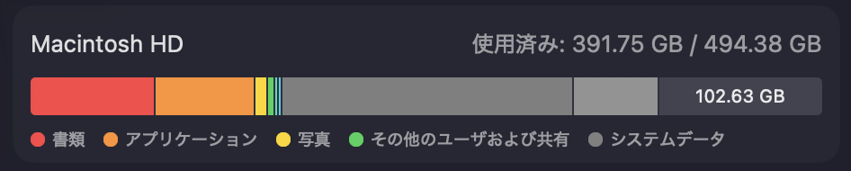

<!--
  年末の大掃除でストレージ確保（草稿。公開前にこのコメントは削除）
  - 数値はすべて Nico の Mac で実測した値（2026-11-21 に Nico から受け取った素材）
  - 掃除後のストレージ画面は Nico のスクショ（使用済み 391.75GB / 494.38GB、空き 102.63GB）
  - コマンドの挙動は 2026-11-21 に確認：
    - docker system prune：Docker 公式リファレンス。-a で「使われていないイメージ全部」、ボリュームは --volumes を付けたときだけ消える
    - Chrome の code_sign_clone：Chromium のソース code_sign_clone_manager.mm（X ディレクトリは起動時にしか掃除されない、終了後に helper が消す）
    - Chrome のオンデバイス AI：Google のヘルプ「Manage on-device generative AI models in Chrome」（オフにするとモデルを削除し、オフの間は再ダウンロードしない）
  - Nico確認済み（2026-11-22）
    1. Docker は 42GB → 9.5GB で「32.5GB回収」と書く
    2. 掃除前は使用済みが約490GB（2026-11-24 Nico確認済み）
    3. Claude君との進め方：Claude デスクトップで、容量の大きい場所・消してよい場所を全ディレクトリから網羅的に探させてリスト化→一緒に確認→削除までやってもらった
    4. Chrome の設定は英語版の表記（AI innovations > On-device AI）のままでOK
  - 語調はスキル nico-tech-article-tone。まとめに「〜なのよ🙌」は付けない
  - 図は作っていない（効果の比較は表で見せている）。入れるなら掃除前のストレージ画面のスクショ
-->

# はじめに

年末なので、Macのストレージも大掃除することにしました。気づいたら494GBのディスクのうち約490GBが埋まっていて、空きはほぼゼロでした…

そこで、Claude デスクトップのClaude君に手伝ってもらいました。やったことは3ステップです。

1. 容量の大きい場所と、消しても良さそうな場所を、すべてのディレクトリから網羅的に探させてリストにしてもらう
2. 出てきたリストを見ながら、本当に消していいものを一緒に確認する
3. 消していいと決めたものを、実際に消してもらう

その結果、使用済みは約490GBから **391.75GB** まで減って、空きは **102.63GB** になりました。項目ごとに測れた分だけでも **約83GB** あります。



この記事では、減らせたものを効果が大きい順に並べて、どこにあって、どう確認して、どう消したかをまとめます。数字はすべて今回のMacで実際に測った値です。

# この記事でわかること

- 大きいフォルダを上から掘っていく調べ方
- 今回減らせた7つのポイントと、それぞれの消し方・注意点
- 消すと困るので触らなかったもの

# 減らせたものの一覧

先に結果だけ並べておきます。

| 順位 | 対象 | 減った量 |
|---|---|---|
| 1 | Docker | 32.5GB |
| 2 | Chrome（一時コピー＋オンデバイスAIのモデル） | 19GB |
| 3 | After Effects のディスクキャッシュ | 9.9GB |
| 4 | Electron製アプリの自動アップデートの残りファイル | 約8GB |
| 5 | Homebrew Cask のインストーラ（.pkg） | 5.6GB |
| 6 | VS Code 拡張機能の旧バージョン | 4.0GB |
| 7 | 開発系のパッケージキャッシュ | 約4GB |

# まずはどこが重いのか調べる

基本は、ホームディレクトリの直下から大きい順に並べて、大きいフォルダに入って同じことを繰り返すやり方です。

```bash
du -xhd1 ~ 2>/dev/null | sort -rh | head -20
```

- `-x`：別のボリューム（外付けディスクなど）には入らない
- `-h`：GB・MBなど読みやすい単位で出す
- `-d1`：1階層下までの合計を出す

大きいフォルダが見つかったら、`du -xhd1 ~/Library | sort -rh | head -20` のようにパスを変えて掘っていきます。

今回は、ホームディレクトリの228GBのうち **148GBが `~/Library`** にありました。半分以上が、Finderで普段開かない場所にあったことになります。

:::note info
ターミナルにフルディスクアクセスの権限がないと、`~/Library` の一部で `Operation not permitted` が出て、その分が集計から漏れます。正確に測りたいときは「システム設定 > プライバシーとセキュリティ > フルディスクアクセス」でターミナルを許可してから実行します。
:::

# 1. Docker（32.5GB）

Docker Desktop は、イメージやコンテナを `Docker.raw` という1つの大きなファイルの中にまとめて持っています。

- 場所：`~/Library/Containers/com.docker.docker/.../Docker.raw`
- 今回のサイズ：42GB → 9.5GB

中身の内訳は `docker system df` で確認できます。

```bash
docker system df
```

イメージ・コンテナ・ローカルボリューム・ビルドキャッシュごとに、使用量と「消せる量（RECLAIMABLE）」が出ます。

消すときは `docker system prune -a` を使いました。今回はこれで32.5GB回収できました。

```bash
docker system prune -a
```

このコマンドで消えるのは次の4つです。

- 停止しているコンテナ
- どのコンテナからも使われていないネットワーク
- 動いているコンテナが使っていないイメージ全部（`-a` を付けない場合は、タグのない dangling イメージだけ）
- ビルドキャッシュ

ボリュームは `--volumes` を付けない限り消えません。なので、名前付きボリュームに置いているDBのデータは残ります。

:::note warn
- Docker Desktop が起動していないと、`Cannot connect to the Docker daemon` のエラーになります。先に Docker Desktop を起動しておきます
- 停止中のコンテナの中に直接書き込んだデータ（ボリュームに置いていないもの）は、コンテナごと消えます
- 消したイメージは、次に使うときにもう一度 pull やビルドが必要です
:::

ちなみに、prune したあとすぐに `Docker.raw` のサイズが縮まないことがあります。Finder の表示ではなく `du -h` で実際の使用量を見て、少し時間をおいてから確認すると安心です。

# 2. Chrome（19GB）

Chrome は、Finder からは見えない場所に大きなファイルを2つ置いていました。

## アプリ本体の一時コピー（11GB）

- 場所：`/private/var/folders/.../X/com.google.Chrome.code_sign_clone`

Chrome は起動中、アップデートでディスク上のアプリが置き換わってもコード署名の検証が壊れないように、アプリ本体のコピーを作っています。本来は Chrome の終了後に片付けられるのですが、残ってしまうことがあり、今回は11GBも溜まっていました…

場所は `/private/var/folders/` の下のランダムな名前のフォルダなので、次のコマンドで探すのが早いです。

```bash
du -sh "$(getconf DARWIN_USER_TEMP_DIR)"/../X/* 2>/dev/null | sort -rh | head
```

消すときは、**Chrome を完全に終了してから** フォルダを削除します。この `X` フォルダは Mac の起動時に掃除される場所なので、再起動でも消えます。

## オンデバイスAIのモデル（8GB）

- 場所：`~/Library/Application Support/Google/Chrome/OptGuideOnDeviceModel`

Chrome の一部の機能が使う、端末の中で動く生成AIのモデルです。

ファイルを直接消しても、Chrome がまたダウンロードしてきます。Google のヘルプでは、**設定でオフにする方法が唯一サポートされた方法** と書かれています。

- 設定 > AI innovations > On-device AI をオフにする
- オフにするとモデルのファイルが削除され、オフの間は再ダウンロードされない
- そのモデルを使う機能は使えなくなる

# 3. After Effects のディスクキャッシュ（9.9GB）

動画編集ソフトのディスクキャッシュは、放っておくとどんどん大きくなります。

After Effects の場合は、アプリの設定の「メディア＆ディスクキャッシュ」から「ディスクキャッシュを空にする」で消せます。同じ画面でキャッシュの最大サイズも決められるので、上限を決めておくと次から膨らみすぎずに済みます。

# 4. 自動アップデートの残りファイル（約8GB）

- 場所：`~/Library/Caches/*.ShipIt/update.*`

Cursor・VS Code・Claude など、Electron製のアプリの多くは、`ShipIt` という仕組みで自動アップデートします。このとき落としてきた更新ファイルが、更新後も残り続けていました。

**Cursorだけで7個、4.7GB** ありました。

```bash
du -sh ~/Library/Caches/*.ShipIt 2>/dev/null | sort -rh
```

消すときは、対象のアプリを終了してから `update.*` を削除します。

# 5. インストーラの置きっぱなし（5.6GB）

- 場所：Homebrew の `Caskroom/mactex-no-gui/*/*.pkg`

Homebrew Cask で `.pkg` 形式のアプリを入れると、インストール後も `.pkg` が Caskroom に残ります。MacTeX はインストーラ自体が大きいので、これだけで5.6GBありました。

インストールはもう終わっているので、`.pkg` を消しても TeX Live 本体はそのまま使えます。ただし、次に `brew upgrade` や `brew reinstall` をしたときはもう一度ダウンロードされます。

# 6. VS Code 拡張機能の旧バージョン（4.0GB）

- 場所：`~/.vscode/extensions`

AI系の拡張機能は更新の頻度が高く、更新のたびに旧バージョンのフォルダが残っていました。ChatGPT の拡張機能は1世代で約1GBあります。

いま使っている拡張機能は `~/.vscode/extensions/extensions.json` に載っています。ただし、VS Code のプロファイルを使っている場合、拡張機能のフォルダは `~/.vscode/extensions` にまとめて置かれる一方で、一覧はプロファイルごとの `~/Library/Application Support/Code/User/profiles/*/extensions.json` に分かれています。なので、**どの一覧にも載っていないフォルダだけ** を消すのが安全です。

次のスクリプトは、すべての一覧を見たうえで、消してよいフォルダの候補を表示するだけで、削除はしません。

```bash
python3 - <<'EOF'
import glob, json, os
ext_dir = os.path.expanduser('~/.vscode/extensions')
manifests = [os.path.join(ext_dir, 'extensions.json')]
# プロファイルごとの一覧（プロファイルを使っていなければ何も見つからないだけ）
manifests += glob.glob(os.path.expanduser(
    '~/Library/Application Support/Code/User/profiles/*/extensions.json'))
used = set()
for m in manifests:
    for e in json.load(open(m)):
        loc = e.get('relativeLocation')
        if not loc:
            path = e.get('location', {}).get('path', '')
            loc = os.path.basename(path.rstrip('/'))
        used.add(loc)
for name in sorted(os.listdir(ext_dir)):
    if os.path.isdir(os.path.join(ext_dir, name)) and name not in used:
        print(name)
EOF
```

VS Code を終了してから、表示されたフォルダを削除します。

# 7. 開発系のパッケージキャッシュ（約4GB）

最後は、パッケージマネージャが持っているキャッシュです。消しても、次に必要になったときにまたダウンロードされるだけです。

```bash
pip cache purge                # pip のキャッシュを全部消す
npm cache clean --force        # npm のキャッシュを消す
brew cleanup -s                # 古いバージョンと、ダウンロード済みのファイルを消す
npx playwright uninstall --all # Playwright が入れたブラウザを消す
```

Playwright のブラウザは `~/Library/Caches/ms-playwright` に入っています。次にテストを動かすときは `npx playwright install` で入れ直します。

# 消す前に気をつけること

## 同じディスクの別フォルダに移しても空かない

「とりあえずデスクトップにまとめておこう」と移動しても、同じディスクの中なら空き容量は増えません。空けたいなら、削除するか、外付けディスクやクラウドなど別の場所に移す必要があります。

## 触らなかったもの

消すと困る、または消しても意味がないので、次の3つは触りませんでした。

| 対象 | 触らなかった理由 |
|---|---|
| OS更新用のAPFSスナップショット | macOS のアップデートやバックアップで使うもので、不要になれば OS が自分で片付ける |
| VM ボリューム（`/System/Volumes/VM`） | 中身はスワップなどで、再起動すれば縮む |
| TeX Live 本体 | 論文やレポートで使っているので消せない |

APFSスナップショットは `tmutil listlocalsnapshots /` で一覧を見られます。

## 今回は手をつけなかった候補

まだ減らせそうなものもありましたが、今回は見送りました。

- Claudeアプリの仮想マシン（28GB）
- iOS シミュレータ（約9.6GB）。使わない古いランタイムは `xcrun simctl delete unavailable` で消せる
- `node_modules`（13GB）。触っていないプロジェクトの分は、消しても `npm install` で戻せる

来年の大掃除はこのあたりからになりそうです。

# まとめ

- 使用済みは約490GBから391.75GBまで減り、空きは102.63GBになった（項目ごとに測れた分は約83GB）
- 容量の半分以上は `~/Library` にあり、Finder で見えない場所ほど大きかった
- 効果が大きかったのは Docker と Chrome で、この2つだけで約52GB
- 自動アップデートの残りファイルやインストーラ、拡張機能の旧版のように「使い終わったのに残っているもの」が意外と積み上がる
- 消す前に、そのデータがどこに残るのか（Docker のボリュームなど）と、また勝手に戻ってこないか（Chrome のモデルなど）を確認する

一番の発見は、大きかったものの多くが「アプリが自分で片付けるはず」のものだったことです。ストレージが急に減ったときは、自分のファイルより先に `~/Library` を `du` で見てみるのがおすすめです。

# 参考

- [docker system prune（Docker Docs）](https://docs.docker.com/reference/cli/docker/system/prune/)
- [docker system df（Docker Docs）](https://docs.docker.com/reference/cli/docker/system/df/)
- [Manage on-device generative AI models in Chrome（Google Chrome ヘルプ）](https://support.google.com/chrome/answer/16961953)
- [code_sign_clone_manager.mm（Chromium のソースコード）](https://chromium.googlesource.com/chromium/src/+/main/chrome/browser/mac/code_sign_clone_manager.mm)
- [brew cleanup（Homebrew Documentation）](https://docs.brew.sh/Manpage)
