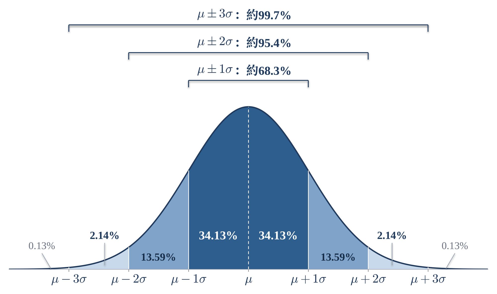
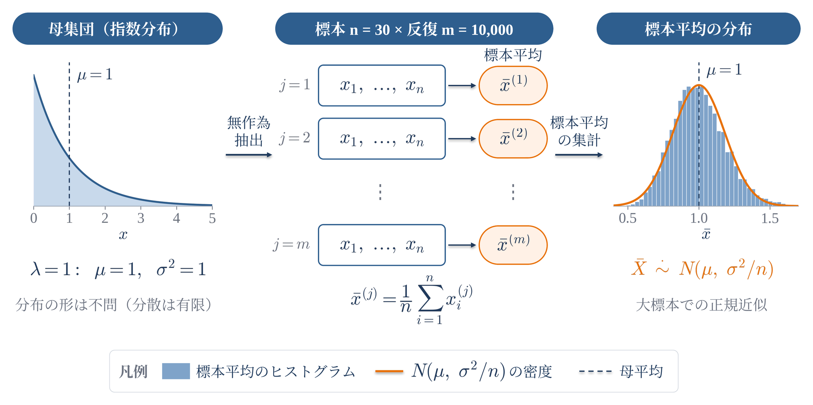
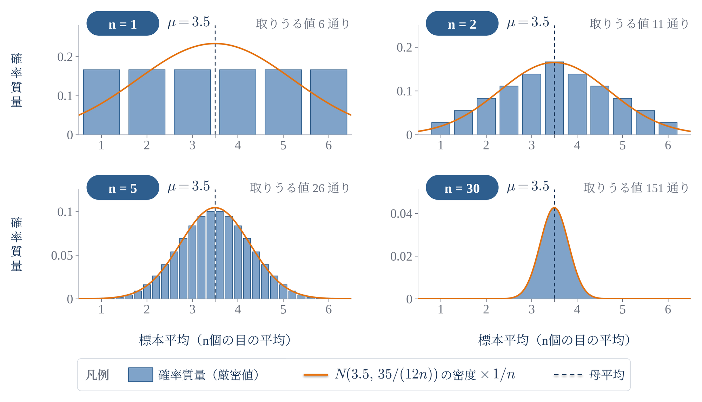

# はじめに

「とりあえず正規分布を仮定する」がなぜ許されるのか気になったので、中心極限定理とセットでまとめておきます。

# ひとことで言うと

- **正規分布**：平均のまわりに左右対称に集まる、つりがね型の分布
- **中心極限定理**：どんな分布からとったデータでも（条件つき）、**たくさん足したり平均したりすると、その分布は正規分布に近づく**という定理

# 正規分布

平均 $\mu$、分散 $\sigma^2$ の正規分布 $N(\mu, \sigma^2)$ の確率密度関数は、次の式です。

$$
f(x) = \frac{1}{\sqrt{2\pi\sigma^2}} \exp\left( -\frac{(x - \mu)^2}{2\sigma^2} \right)
$$

| 範囲 | 入る割合 |
|---|---|
| $\mu \pm 1\sigma$ | 約68.3% |
| $\mu \pm 2\sigma$ | 約95.4% |
| $\mu \pm 3\sigma$ | 約99.7% |

平均0、分散1の $N(0, 1)$ を**標準正規分布**と呼びます。

# 中心極限定理

$X_1, X_2, \ldots, X_n$ が、

- 互いに独立で、同じ分布にしたがう
- 平均 $\mu$ と分散 $\sigma^2$（$0 < \sigma^2 < \infty$）を持つ

とき、標本平均 $\bar{X}_n = \frac{1}{n}\sum_{i=1}^{n} X_i$ を標準化したものは、$n$ を大きくすると標準正規分布に近づきます。

$$
\frac{\bar{X}_n - \mu}{\sigma / \sqrt{n}} \;\xrightarrow{\;d\;}\; N(0, 1) \quad (n \to \infty)
$$

ポイントは、**もとの分布が正規分布でなくてもよい**ことです。サイコロの目（一様分布）でも、コイン投げ（ベルヌーイ分布）でも、平均をとればつりがね型になります。

左は指数分布という、つりがね型とはほど遠い分布です。ここから30個ずつ取り出して平均を計算する、を1万回くり返すと、標本平均の分布は右のようにつりがね型になります。

サイコロの目は1〜6が同じ確率で出る一様分布ですが、n個の目の平均をとると、n = 2 で山型、n = 5 でほぼつりがね型になり、n = 30 では平均3.5のまわりに細く集まります。

# 大数の法則との違い

| | 大数の法則 | 中心極限定理 |
|---|---|---|
| 分かること | 標本平均は、真の平均 $\mu$ に近づく | 標本平均のばらつきが、正規分布の形になる |
| 使いどころ | 「たくさん集めれば平均は当たる」 | 信頼区間や検定で、誤差の大きさを見積もる |

# 気をつけるところ

- 分散が有限でない分布（例：コーシー分布）では成り立たない
- 「$n \geq 30$ なら十分」とよく言われるが、これは目安。もとの分布の偏りが大きいと、もっと多く必要になる
- データ自体が正規分布になるわけではない。正規分布に近づくのは**平均（や和）の分布**

# まとめ

「平均をとれば、だいたい正規分布になる」から、統計のいろんな手法が正規分布を前提にできます。

# 参考

- 東京大学教養学部統計学教室 編『統計学入門』東京大学出版会, 1991
