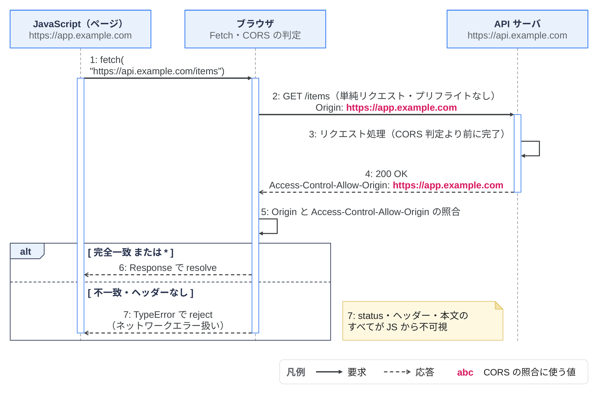
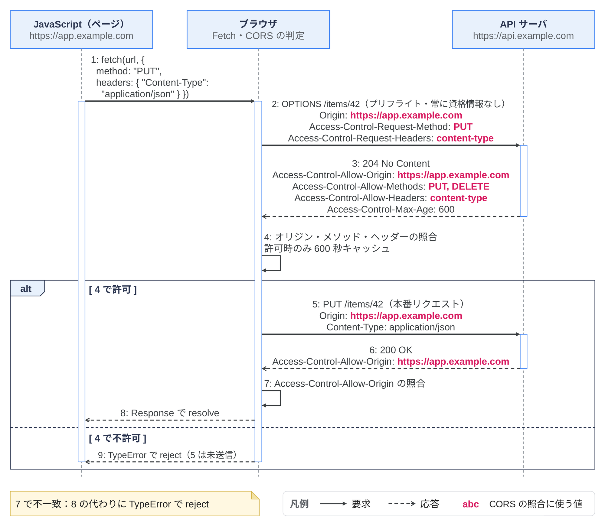
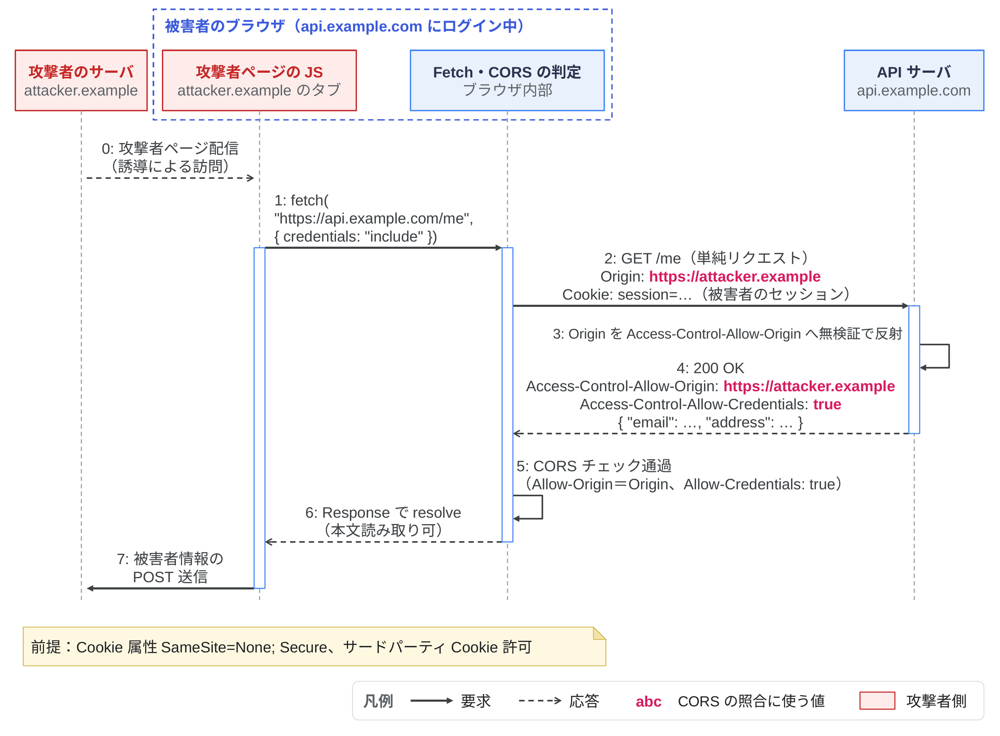

# はじめに

フロントから API を叩いたら `blocked by CORS policy` で怒られる…あれが何を守っているのかをまとめておきます。

# ひとことで言うと

**CORS（Cross-Origin Resource Sharing）は、ブラウザの同一オリジンポリシーを、サーバが許可した範囲でだけゆるめるための仕組み**です。

# 前提：同一オリジンポリシー

- オリジン ＝ **スキーム + ホスト + ポート**（例：`https://example.com:443`）
- ブラウザは、あるオリジンのページの JavaScript が、別のオリジンへ送ったリクエストの**レスポンスを読む**ことを、原則として許さない
- これがないと、悪いサイトを開いただけで、ログイン中の別サイトの情報を JavaScript で読まれてしまう

| ページ | リクエスト先 | 同一オリジンか |
|---|---|---|
| `https://example.com` | `https://example.com/api` | 同じ |
| `https://example.com` | `https://api.example.com` | 違う（ホストが違う） |
| `https://example.com` | `http://example.com` | 違う（スキームが違う） |
| `https://example.com` | `https://example.com:8443` | 違う（ポートが違う） |

# 仕組み

## 単純リクエスト

GET・HEAD・POST で、ヘッダーや Content-Type が決まったもの（`text/plain`、フォームの形式など）だけのとき。

1. ブラウザが `Origin: https://example.com` をつけてリクエストを送る
2. サーバが `Access-Control-Allow-Origin: https://example.com` を返す
3. ブラウザは、許可されていれば JavaScript にレスポンスを渡す。許可されていなければ渡さない

サーバはリクエストを処理し終えてからレスポンスを返すので、ブラウザが止めるのは「JavaScript がレスポンスを読むこと」だけです。

## プリフライトリクエスト

PUT や DELETE、`Content-Type: application/json`、独自のヘッダーなどを使うとき。

1. ブラウザが、本番の前に `OPTIONS` で「このメソッドとヘッダーで送っていい？」と聞く
2. サーバが `Access-Control-Allow-Methods` や `Access-Control-Allow-Headers` で答える
3. 許可されていれば、ブラウザが本番のリクエストを送る

プリフライトで許可されなければ、本番のリクエストはサーバに送られません。

## 主なヘッダー

| ヘッダー | 向き | 中身 |
|---|---|---|
| `Origin` | リクエスト | リクエスト元のオリジン |
| `Access-Control-Allow-Origin` | レスポンス | 読んでよいオリジン（`*` はすべて） |
| `Access-Control-Allow-Methods` | レスポンス | 使ってよいメソッド |
| `Access-Control-Allow-Headers` | レスポンス | 使ってよいヘッダー |
| `Access-Control-Allow-Credentials` | レスポンス | Cookie などをつけたリクエストの結果を読んでよいか |
| `Access-Control-Max-Age` | レスポンス | プリフライトの結果をキャッシュしてよい秒数 |

# 勘違いしやすいところ

- **CORS はブラウザが守るルール**。curl やサーバ間の通信には関係ない。CORS で API を守れるわけではない
- **単純リクエストは、サーバまで届いて処理される**。ブラウザが止めるのは「レスポンスを読むこと」だけ。なので CORS は CSRF 対策にはならない
- `Access-Control-Allow-Credentials: true` のときは、`Access-Control-Allow-Origin` に `*` を使えない

# よくある危ない設定

- リクエストの `Origin` をそのまま `Access-Control-Allow-Origin` に返し、さらに `Access-Control-Allow-Credentials: true` にする
  - どのサイトからでも、ログイン中のユーザーの情報を読めてしまう
- 許可するオリジンを、前方一致や部分一致で判定する（`example.com.attacker.example` を通してしまう）

1つ目の設定だと、攻撃者のページから被害者の Cookie つきでリクエストが飛び、レスポンスの個人情報まで攻撃者の JavaScript に読まれてしまいます。

# まとめ

CORS は「ブラウザに、別オリジンのレスポンスを読んでいいかを教える仕組み」で、守ってくれる範囲は思ったより狭いです。

# 参考

- WHATWG Fetch Standard（CORS protocol） https://fetch.spec.whatwg.org/#http-cors-protocol
- MDN Web Docs「オリジン間リソース共有（CORS）」 https://developer.mozilla.org/ja/docs/Web/HTTP/CORS
