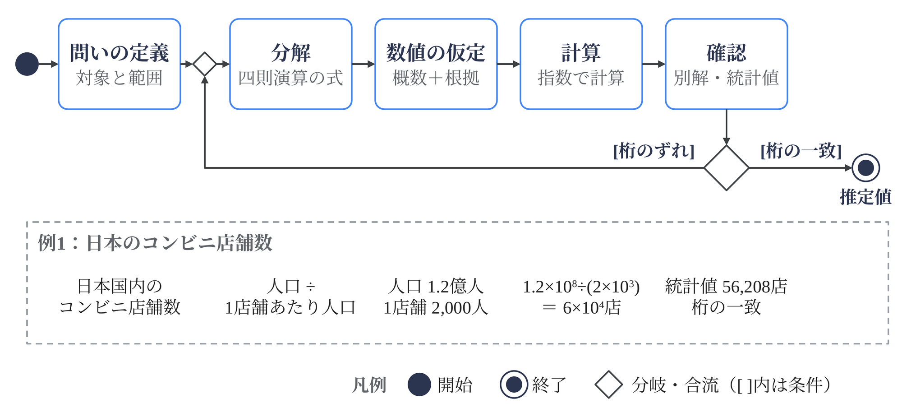

# はじめに

コンサルティングの企業をいくつか受けてきて、一次選考がケース面接のところが多かったです。
そのケース面接では、フェルミ推定で市場規模などを見積もる問題がよく出ていました。
そこで今回は、フェルミ推定を自分がどういうふうに考えて解いたのかを、この記事にまとめました。

# ひとことで言うと

**フェルミ推定は、すぐには調べられない数を、知っている数や仮定を組み合わせて、ざっくり（桁が合うくらいに）見積もる方法**です。
物理学者のエンリコ・フェルミが得意だったことから、この名前で呼ばれています。

# 手順

1. **問いの定義**：何を、どの範囲で数えるかを決める
2. **分解**：知っている数や仮定できる数を使って、掛け算・割り算・足し算などの式に分ける
3. **数値の仮定**：それぞれに、きりのいい数を仮定して置く
4. **計算**：桁を間違えないように、10の何乗かの形で計算する
5. **確認**：別の分け方で計算したり、実際の統計値と比べたりして、桁が合っているかを見る。桁がずれていたら、2の分解からやり直す

*図1：フェルミ推定の手順。桁がずれたら分解からやり直す（下段は例1の数値）*

# 例1：日本にコンビニは何店舗あるか

## 分解

コンビニの数 ＝ 日本の人口 ÷ 1店舗あたりで支えている人数

## 数値の仮定

- 日本の人口：約1.2億人
- 1店舗あたりの人数：住宅地だと、歩いて行ける範囲（人口2,000人くらい）に1店舗はある気がする → 2,000人と置く

## 計算

$$
1.2 \times 10^8 \div (2 \times 10^3) = 6 \times 10^4 \;\text{（約6万店舗）}
$$

## 確認

実際の数と比べてみます。

- 日本の人口：約1億2269万人（総務省統計局「人口推計」、2026年10月1日現在の概算値）
- コンビニの店舗数：56,208店（日本フランチャイズチェーン協会「コンビニエンスストア統計調査月報」、2026年9月度）

推定の約6万店舗に対して実際は約5.6万店舗なので、桁は合っています。

# 例2：社員1,000人の会社で、1日にたまるプロキシログの量は？

セキュリティの仕事だと、「ログを何日分とっておけるか」を考えるときに、こういう見積もりをします。

## 分解

1日のログの量 ＝ 社員数 × 1人が1日に見るページ数 × 1ページあたりのリクエスト数 × ログ1行のサイズ

## 数値の仮定

- 社員数：1,000人
- 1人が1日に見るページ数：仕事中に100ページくらい → 100ページと置く
- 1ページあたりのリクエスト数：今のWebページは、画像やJavaScriptなどで数十件のリクエストを出す → 50件と置く
- ログ1行のサイズ：日時、送信元IP、URL、ステータスコード、User-Agentなどが並ぶ → 500バイトと置く

## 計算

$$
10^3 \times 10^2 \times 50 \times 500 = 2.5 \times 10^9 \;\text{バイト（約2.5GB／日）}
$$

1年分だと、$`2.5\,\text{GB} \times 365 \approx 900\,\text{GB}`$ で、だいたい1TBです。

## 確認

この例は答え合わせに使える統計がないので、別の分け方で計算してみます。

1日のログの量 ＝ 社員数 × 1人あたりの1日のリクエスト数 × ログ1行のサイズ

- 1人あたりの1日のリクエスト数：勤務8時間、ブラウザやアプリが1分あたり20件くらいリクエストを出すと置くと、$`8 \times 60 \times 20 \approx 10^4`$ 件

$$
10^3 \times 10^4 \times 500 = 5 \times 10^9 \;\text{バイト（約5GB／日）}
$$

2.5GBと5GBで2倍ずれていますが、桁（GB／日のオーダー）は合っています。
「1日数GB、1年で1〜2TBくらいのストレージを用意すればよさそう」というところまでは言えます。

# うまくやるコツ

- 細かい数字を追わず、**桁（10の何乗か）**を合わせることを目指す
- 分解は「全体 ＝ 単位あたりの量 × 単位の数」の形にすることが多い
- 仮定は、根拠を一言そえて書いておく。あとで見直すときに、どこがずれていたか分かる
- 答え合わせができないときは、別の分け方でもう一度計算して、桁がそろうかを見る

# 何に使えるのか

- コンサルティング企業のケース面接（市場規模の推定など）や、IT企業の面接での思考力の確認
- 仕事での規模の見積もり（サーバの負荷、ログの量、ストレージの容量など）

# まとめ

フェルミ推定は「正確な答え」ではなく「桁の合った答え」を、筋道立てて出すための方法です。

# 参考

- 総務省統計局「人口推計」 https://www.stat.go.jp/data/jinsui/new.html
- 日本フランチャイズチェーン協会「コンビニエンスストア統計データ」 https://www.jfa-fc.or.jp/particle/320.html
